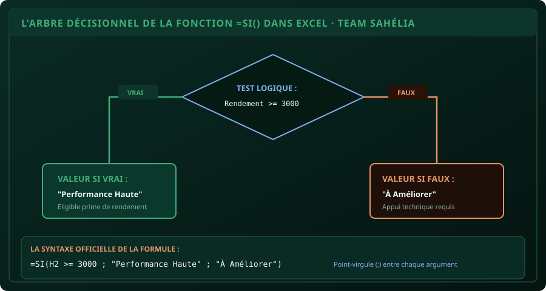

# CHAPITRE 5 : LA LOGIQUE DÉCISIONNELLE AVEC LA FONCTION SI
## Automatiser les décisions, les conditions combinées (ET / OU) et la mise en forme conditionnelle

> **Manuel :** 01 — Excel pour les Étudiants & Professionnels  
> **Auteur :** Olivier AGUIN & TEAM Sahélia  
> **Temps d’apprentissage :** 40 minutes de lecture + 30 minutes d'atelier pratique  
> **Illustration associée :** `schemas/schema_05_arbre_decisionnel_si.svg`  
> **Jeu de données :** `../datasets/dataset_agronomique_sahelia.csv`

---

## 1. Objectifs d'Impact Réel
À la fin de ce chapitre, vous saurez :
1. **Écrire un test logique rigoureux** avec la fonction `=SI()` pour classer automatiquement des données de terrain.
2. **Combiner plusieurs critères simultanés** grâce aux fonctions logiques `=ET()` et `=OU()`.
3. **Construire des barèmes à plusieurs paliers** (ex: Rendement Faible / Moyen / Élevé / Exceptionnel) avec les conditions imbriquées et `=SI.CONDITIONS()`.
4. **Appliquer une Mise en Forme Conditionnelle (MFC) sobre** pour mettre en valeur les alertes et les réussites sans saturer le document de couleurs criardes.
5. **Automatiser l'attribution d'un statut d'éligibilité** aux primes agricoles ou mentions académiques.

---

## 2. L'Anatomie de la Fonction `=SI()`

La fonction `SI` est le cerveau décisionnel du tableur. Elle évalue si une condition est vérifiée et renvoie un résultat différent selon que le test est vrai ou faux.

### La syntaxe à 3 compartiments :
```excel
=SI(Test_Logique ; Valeur_si_VRAI ; Valeur_si_FAUX)
```

1. **Test_Logique :** Une comparaison qui ne peut avoir que deux réponses possibles dans l'univers : **VRAI** ou **FAUX** (ex: `H2 >= 3000`).
2. **Valeur_si_VRAI :** Ce qu'Excel doit afficher si le test est respecté (ex: `"Objectif Atteint"` ou un calcul mathématique comme `H2 * 0,10`).
3. **Valeur_si_FAUX :** Ce qu'Excel doit afficher si le test n'est pas respecté (ex: `"Déficit"` ou le chiffre `0`).

> [!NOTE]
> **Règle impérative des guillemets :**  
> Tout texte renvoyé par la formule doit être entouré de **guillemets doubles droits** (`"Texte"`). Si vous oubliez les guillemets, Excel cherchera une fonction ou une cellule portant ce nom et renverra l'erreur `#NOM?`. En revanche, les chiffres purs s'écrivent sans guillemets (`5000` et non `"5000"`).



---

## 3. Les Fonctions Logiques Combinées : `=ET()` et `=OU()`

Dans la réalité agronomique ou économique, une décision dépend rarement d'un seul facteur.

### A. La fonction `=ET()` : Toutes les conditions doivent être vraies
*Exemple : Un producteur n'est éligible à la prime d'excellence que si sa superficie est ≥ 2 ha **ET** son rendement est ≥ 3 000 kg/ha.*
```excel
=SI(ET(F2 >= 2 ; H2 >= 3000) ; "Éligible Prime" ; "Non Éligible")
```
- Si les deux conditions sont réunies -> `"Éligible Prime"`.
- Si une seule des deux conditions échoue (ou les deux) -> `"Non Éligible"`.

### B. La fonction `=OU()` : Au moins une condition doit être vraie
*Exemple : Une exploitation est considérée comme diversifiée si elle cultive du Soja **OU** du Sorgho.*
```excel
=SI(OU(D2 = "Soja" ; D2 = "Sorgho") ; "Culture de Diversification" ; "Culture Principale")
```

---

## 4. Les Conditions Multiples à Paliers (Imbrications vs `SI.CONDITIONS`)

Comment classer les rendements d'un essai en 4 catégories distinctes ?

### Méthode 1 : L'imbrication classique de `SI` (Compatible toutes versions d'Excel)
On remplace la « Valeur si faux » par un nouveau test `SI` :
```excel
=SI(H2 >= 3500 ; "Exceptionnel" ; SI(H2 >= 2500 ; "Bon" ; SI(H2 >= 1500 ; "Moyen" ; "Faible")))
```
- Chaque parenthèse ouvrante doit avoir sa parenthèse fermante correspondante à la fin (ici 3 parenthèses fermantes `)))`).

### Méthode 2 : La fonction moderne `=SI.CONDITIONS()` (Excel 2019, 2021, Microsoft 365)
Plus lisible, elle enchaîne les couples `Test ; Résultat` sans imbrication de parenthèses :
```excel
=SI.CONDITIONS(H2 >= 3500 ; "Exceptionnel" ; H2 >= 2500 ; "Bon" ; H2 >= 1500 ; "Moyen" ; VRAI ; "Faible")
```
- L'astuce : Le dernier test `VRAI` sert de balai pour attraper tous les cas restants (le « Sinon » par défaut).

---

## 5. La Mise en Forme Conditionnelle (MFC) Sobre et Professionnelle

Une fois vos statuts calculés, vous pouvez demander à Excel de colorer automatiquement les cellules :
1. Sélectionnez votre colonne de résultats (ex: la colonne des marges nettes).
2. Rendez-vous dans **Accueil > Mise en forme conditionnelle > Règles de mise en surbrillance des cellules**.
3. Choisissez **Supérieur à...** : tapez `0`, choisissez un remplissage vert doux.
4. Créez une seconde règle **Inférieur à...** : tapez `0`, choisissez un remplissage rouge clair.

> [!CAUTION]
> ### Erreur classique : Transformer sa feuille en sapin de Noël
> Les étudiants novices appliquent souvent des dégradés rouge/jaune/vert fluo saturés sur tout le tableau. C’est illisible et immédiatement sanctionné par les jurys.  
> **Règle de sobriété :** N'appliquez la couleur que sur **une seule colonne stratégique** (la marge ou le statut final), avec des tons pastels légers.

---

## 6. Atelier Pratique : Barème d'Appui Agricole de Parakou

Ouvrez `dataset_agronomique_sahelia.csv`.  
Ajoutez les deux colonnes d'analyse décisionnelle suivantes :

### A. Colonne P : `Appréciation_Technique`
Dans la cellule P2, insérez la formule à paliers suivante :
```excel
=SI(H2 >= 3500 ; "Très Élevé" ; SI(H2 >= 2500 ; "Satisfaisant" ; SI(H2 >= 1500 ; "Passable" ; "Insuffisant")))
```
Étirez sur les 20 parcelles.

### B. Colonne Q : `Attribution_Prime_FCFA`
Le projet octroie une prime spéciale de **50 000 FCFA** uniquement si :
- La culture est du **Maïs** ou du **Soja** (`OU(D2="Maïs"; D2="Soja")`),
- **ET** que la marge nette par hectare est supérieure à **300 000 FCFA** (`O2 > 300000`).
- Sinon, la prime est de `0 FCFA`.

**La formule à taper en Q2 :**
```excel
=SI(ET(OU(D2 = "Maïs" ; D2 = "Soja") ; O2 > 300000) ; 50000 ; 0)
```
Étirez sur les 20 lignes et calculez la somme totale des primes allouées avec `=SOMME(Q2:Q21)`.

### Contrôle qualité du résultat :
- Les parcelles de Maïs performantes (`P001`, `P003`, `P010`, `P013`, `P020`) décrochent la prime de 50 000 FCFA.
- Les parcelles de Coton et Sorgho reçoivent `0 FCFA`, même si leur marge est bonne, car elles ne satisfont pas la condition de culture.
- Le montant total des primes décaissées est calculé rigoureusement sans aucune contestation possible.

---

## 7. Le Défi Communautaire TEAM Sahélia

> ### 🏆 Défi Hebdo n°05 : Le Système d'Alerte Intrants
> 
> Un technicien de vulgarisation agricole veut automatiser la surveillance des doses d'engrais :
> 1. Créez une colonne `Alerte_Fertilisation`.
> 2. Si la culture est du **Coton** et que la dose de NPK est **< 200 kg/ha**, affichez : `"Sous-dosage Critique"`.
> 3. Si la culture est du **Sorgho** et que la dose de NPK est **> 100 kg/ha**, affichez : `"Sur-fertilisation Inutile"`.
> 4. Dans tous les autres cas, affichez : `"Dose Conforme"`.
> 5. Appliquez une mise en forme conditionnelle douce (orange pour les alertes).
> 6. Postez la capture de votre formule et du tableau sur le canal officiel avec la mention :  
>    *« Défi Manuel 01 - Chapitre 5 Logique SI & MFC Réussi ! »*.

---

## 8. Fiche Mémo Récapitulative Détachable

```text
================================================================================
             FICHE MÉMO · LA LOGIQUE DÉCISIONNELLE DANS EXCEL
================================================================================
1. LA STRUCTURE DU SI :
   - =SI(Test_Logique ; Valeur_VRAI ; Valeur_FAUX)
   - Guillemets obligatoires pour le texte : "Validé".
   - Pas de guillemets pour les nombres purs : 50000.

2. COMBINAISONS LOGIQUES :
   - =ET(Cond1 ; Cond2) : Vrai UNIQUEMENT si TOUT est vrai.
   - =OU(Cond1 ; Cond2) : Vrai dès qu'AU MOINS UNE condition est vraie.
   - Combinaison : =SI(ET(A1>10 ; B1="Oui") ; "OK" ; "Non")

3. CONDITIONS MULTIPLES :
   - =SI(Test1 ; "A" ; SI(Test2 ; "B" ; "C"))
   - Ou avec SI.CONDITIONS : =SI.CONDITIONS(Test1 ; "A" ; Test2 ; "B" ; VRAI ; "C")

4. MISE EN FORME CONDITIONNELLE :
   - Toujours sobre : teintes pastels sur 1 seule colonne clé (pas d'excès de couleurs).
================================================================================
TEAM Sahélia · Apprendre aujourd’hui. Construire demain.
================================================================================
```
