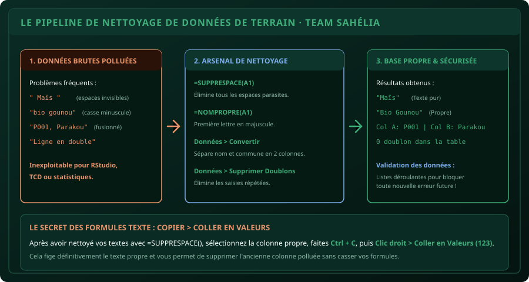

# CHAPITRE 6 : NETTOYAGE & PRÉPARATION DE BASES DE DONNÉES RÉELLES
## Rendre exploitable un fichier d'enquête pollué : espaces parasites, casse, scission et listes déroulantes

> **Manuel :** 01 — Excel pour les Étudiants & Professionnels  
> **Auteur :** Olivier AGUIN & TEAM Sahélia  
> **Temps d’apprentissage :** 45 minutes de lecture + 30 minutes d'atelier pratique  
> **Illustration associée :** `schemas/schema_06_nettoyage_donnees.svg`  
> **Jeu de données :** `../datasets/dataset_agronomique_parakou.csv`

---

## 1. Objectifs d'Impact Réel
À la fin de ce chapitre, vous saurez :
1. **Éradiquer l'ennemi invisible n°1** des formules de recherche : les espaces cachés en début ou fin de mot (`SUPPRESPACE`).
2. **Harmoniser instantanément la casse des textes** (`MAJUSCULE`, `MINUSCULE`, `NOMPROPRE`) pour un rendu professionnel irréprochable.
3. **Scinder une colonne fusionnée en plusieurs** (ex: séparer le Nom et le Prénom, ou le code parcelle et le village) sans taper une seule formule grâce à l'outil *Convertir*.
4. **Détecter et supprimer les doublons d'enquêtes** en 1 clic sans risque de supprimer des lignes valides.
5. **Verrouiller la saisie future** grâce à la *Validation des données* (listes déroulantes strictes pour les communes et cultures).

---

## 2. Le Drame de la « Donnée Sale » sur le Terrain

Dans 95 % des cas, un fichier d'enquête collecté au village ou téléchargé depuis une plateforme web contient des impuretés :
- Un enquêteur a tapé `"Maïs "` avec un espace après le mot.
- Un autre a tapé `"MAIS"` sans accent.
- Un troisième a écrit `"maïs"` en minuscules.

Pour l'œil humain, ces 3 lignes désignent la même plante. **Pour Excel, RStudio ou un Tableau Croisé Dynamique, ce sont 3 cultures totalement différentes !** Vos totaux seront faussés, vos tris incomplets et vos formules conditionnelles renverront des erreurs.

> [!IMPORTANT]
> En science des données et en gestion, **80 % du temps d'un analyste est consacré au nettoyage**. Celui qui sait nettoyer vite et bien est 5 fois plus productif que ses pairs.



---

## 3. L'Arsenal des Fonctions Texte Indispensables

### A. La fonction salvatrice : `=SUPPRESPACE(cellule)`
Elle supprime tous les espaces situés avant le premier mot, tous les espaces situés après le dernier mot, et transforme les espaces doubles au milieu d'une phrase en un seul espace normal.
- Si A1 contient `"   BIO Gounou   "` :
- `=SUPPRESPACE(A1)` renvoie proprement `"BIO Gounou"`.

### B. Harmoniser la casse des textes :
- **`=MAJUSCULE(A1)` :** Met tout en lettres capitales (idéal pour les Noms de famille ou les départements : `BORGOU`).
- **`=MINUSCULE(A1)` :** Met tout en minuscules (idéal pour les adresses e-mail).
- **`=NOMPROPRE(A1)` :** Met la première lettre de chaque mot en majuscule et le reste en minuscule (idéal pour les prénoms ou villages : `Parakou`, `Alassane`).

### C. La règle d'or : Le « Coller en Valeurs »
Lorsque vous créez une colonne nettoyée avec `=SUPPRESPACE(C2)` :
1. Sélectionnez toute votre nouvelle colonne propre.
2. Faites **`Ctrl + C`** pour copier.
3. Faites un **Clic droit > Coller en Valeurs (l'icône avec les chiffres 123)** sur elle-même.
4. **Pourquoi ?** Cela détruit la formule et ne conserve que le texte pur définitif. Vous pouvez désormais supprimer l'ancienne colonne polluée sans déclencher d'erreur `#REF!`.

---

## 4. Scinder du Texte en Plusieurs Colonnes (Outil Convertir)

Supposons que votre carnet d'enquête contient une colonne unique `Identifiant_Village` avec des données comme `P001 - Parakou` ou `P002 - N'Dali`. Vous voulez avoir le code dans la colonne A et la ville dans la colonne B.

### La méthode sans code en 4 clics :
1. Insérez une colonne vide à droite pour accueillir les nouvelles données.
2. Sélectionnez votre colonne de texte.
3. Rendez-vous dans l'onglet **Données > Convertir (Texte en colonnes)**.
4. Choisissez **Délimité** > cliquez sur Suivant.
5. Cochez le séparateur utilisé (ex: **Autre : tiret `-`** ou **Espace**). Vous voyez l'aperçu se séparer en deux colonnes nettes.
6. Cliquez sur **Terminer** : votre colonne est scindée proprement en deux !

---

## 5. Chasser les Doublons sans Pitié

Quand plusieurs enquêteurs synchronisent leurs fiches, des questionnaires peuvent être enregistrés deux fois par accident :
1. Sélectionnez tout votre tableau de données (`Ctrl + A`).
2. Allez dans **Données > Supprimer les doublons**.
3. **Le choix stratégique de la clé :**
   - Si vous cochez uniquement `ID_Parcelle` : Excel supprimera toute ligne dont le code parcelle apparaît une deuxième fois.
   - Si vous cochez toutes les colonnes : Excel ne supprimera que les lignes 100 % identiques de bout en bout.
4. Cliquez sur **OK** : Excel affiche un message clair (*« 3 valeurs en double trouvées et supprimées ; 20 valeurs uniques conservées »*).

---

## 6. Verrouiller la Saisie Future : La Validation des Données

Pour qu'un stagiaire ou un collaborateur ne puisse plus jamais faire de faute d'orthographe lors des saisies :

### A. Créer une Liste Déroulante Stricte (Dropdown List)
1. Sélectionnez la plage où vous voulez forcer le choix (ex: la colonne `Commune` de B2 à B100).
2. Rendez-vous dans **Données > Validation des données**.
3. Dans l'onglet *Options*, champ **Autoriser**, choisissez **Liste**.
4. Dans le champ **Source**, tapez directement vos options séparées par des points-virgules :  
   `Parakou; N'Dali; Tchaourou; Bembèrèkè`
5. Cliquez sur **OK**.
6. **Résultat :** Une petite flèche apparaît à côté de chaque cellule. L'utilisateur est obligé de choisir dans la liste. S'il tente de taper au clavier un nom erroné comme `Parakouuu`, Excel bloque la saisie avec un message d'erreur d'arrêt !

---

## 7. Atelier Pratique : Assainissement d'un Fichier Pollué

Créons une petite base de test volontairement sale pour pratiquer :
- En cellule A1 : `"   p021 - parakou  "`
- En cellule A2 : `"p022 - N'DALI   "`
- En cellule A3 : `"  P021 - parakou "` *(Doublon sale)*

### Mission de nettoyage :
1. Appliquez dans la colonne B la formule combinée :  
   `=NOMPROPRE(SUPPRESPACE(A1))`
2. Constatez la transformation : les espaces invisibles disparaissent, les majuscules sont impeccables.
3. Copiez la colonne B et collez-la en **Valeurs**.
4. Utilisez **Données > Convertir** avec le tiret `-` comme séparateur pour obtenir le code dans une colonne et la commune dans l'autre.
5. Utilisez **Supprimer les doublons** sur le code : la ligne 3 est éliminée automatiquement.

---

## 8. Le Défi Communautaire TEAM Sahélia

> ### 🏆 Défi Hebdo n°06 : Le Formulaire Anti-Faute de Frappe
> 
> 1. Sur une feuille Excel vierge, configurez une colonne `Sexe` avec une liste déroulante stricte (`Masculin; Féminin`).
> 2. Configurez une colonne `Rendement_kg_ha` avec une règle de validation numérique autorisant uniquement les nombres décimaux compris entre `0` et `10000`.
> 3. Personnalisez l'onglet **Alerte d'erreur** avec le message :  
>    *« Attention : Saisie rejetée par TEAM Sahélia. Vérifiez vos données de terrain ! »*.
> 4. Testez en tapant volontairement `15000` pour déclencher l'alerte.
> 5. Prenez une capture d'écran de la boîte d'alerte personnalisée en action.
> 6. Postez-la sur le canal officiel avec la mention :  
>    *« Défi Manuel 01 - Chapitre 6 Validation & Nettoyage Réussi ! »*.

---

## 9. Fiche Mémo Récapitulative Détachable

```text
================================================================================
             FICHE MÉMO · NETTOYAGE & VALIDATION DE DONNÉES
================================================================================
1. LE TRIO DES FORMULES TEXTE :
   - =SUPPRESPACE(A1) : Élimine les espaces parasites au début, fin et doubles.
   - =NOMPROPRE(A1)   : Met la 1ère lettre en majuscule (Bio Gounou).
   - =MAJUSCULE(A1)   : Met tout en capitales (PARAKOU).

2. LA RÈGLE D'OR APRÈS NETTOYAGE :
   - Toujours faire : Copier > Clic droit > Coller en Valeurs (123) pour figer
     le texte et pouvoir supprimer les colonnes de travail.

3. OUTIL DONNÉES > CONVERTIR :
   - Sépare une colonne en deux selon un délimiteur (espace, tiret, point-virgule).

4. VALIDATION DES DONNÉES :
   - Données > Validation des données > Liste : crée une liste déroulante
     qui interdit mathématiquement les fautes de frappe des enquêteurs.
================================================================================
TEAM Sahélia · Apprendre aujourd’hui. Construire demain.
================================================================================
```
