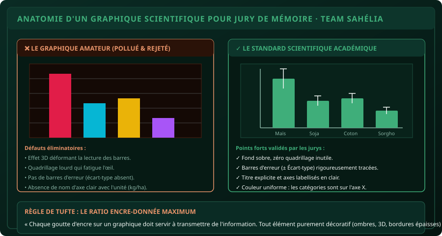

# CHAPITRE 7 : GRAPHIQUES SCIENTIFIQUES POUR SOUTENANCES & RAPPORTS
## Choisir, épurer, ajouter des barres d'erreur d'écart-type et exporter sans perte de qualité

> **Manuel :** 01 — Excel pour les Étudiants & Professionnels  
> **Auteur :** Olivier AGUIN & TEAM Sahélia  
> **Temps d’apprentissage :** 45 minutes de lecture + 30 minutes de manipulation  
> **Illustration associée :** `schemas/schema_07_graphique_scientifique.svg`  
> **Jeu de données :** `../datasets/dataset_agronomique_sahelia.csv`

---

## 1. Objectifs d'Impact Réel
À la fin de ce chapitre, vous saurez :
1. **Choisir le bon type de graphique** (Histogramme vs Courbe temporelle vs Nuage de points) selon la nature mathématique de vos variables.
2. **Éliminer la pollution visuelle (*Chartjunk*)** : bannir la 3D ringarde, les ombres portées et le quadrillage lourd.
3. **Ajouter de véritables barres d'erreur (± Écart-type)** sur vos histogrammes agronomiques pour satisfaire aux exigences des jurys universitaires.
4. **Construire un nuage de points avec courbe de tendance** (Régression linéaire) pour corréler la dose d'engrais et le rendement.
5. **Exporter votre figure vers Word ou PowerPoint en haute définition** vectorielle ou 300 DPI sans flou ni pixellisation à l'impression.

---

## 2. La Boussole Graphique : Quel Graphique pour Quelle Donnée ?

L'erreur n°1 lors d'une soutenance de mémoire est d'utiliser un graphique inadapté. Voici la règle absolue :

| Type de Donnée à Montrer | Meilleur Graphique | Graphique Interdit ❌ | Pourquoi ce choix |
| :--- | :--- | :--- | :--- |
| **Comparer des moyennes entre groupes** (ex: Rendement des 4 cultures) | **Histogramme à colonnes verticales** | Courbe continue ou Camembert | Une courbe relie artificiellement des espèces différentes qui n'ont pas de lien séquentiel. |
| **Évolution dans le temps** (ex: Pluviométrie de Mai à Octobre) | **Courbe avec marqueurs** | Camembert | L'œil doit percevoir la trajectoire temporelle de gauche à droite. |
| **Corrélation entre 2 grandeurs continues** (ex: Dose NPK vs Rendement) | **Nuage de points (Scatter Plot)** | Histogramme simple | Permet de tracer la droite de régression et d'afficher le coefficient de corrélation $R^2$. |
| **Répartition de parts d'un tout** (ex: % Hommes / Femmes) | **Anneau ou Barre 100% empilée** | Camembert 3D éclaté | Le cerveau humain compare très mal les angles en 3D. 5 tranches maximum ! |



---

## 3. Les Règles d'Épuration Visuelle (Le Standard TEAM Sahélia)

Pour transformer un graphique Excel par défaut en une figure digne d'une publication scientifique internationale :

1. **Supprimer le quadrillage d'arrière-plan :** Cliquez sur les lignes grises horizontales et appuyez sur la touche `Suppr`. Votre graphique respire immédiatement.
2. **Supprimer les effets 3D et ombres :** Ils faussent la hauteur apparente des barres et font perdre toute rigueur métrique.
3. **Supprimer la légende inutile :** Si votre axe horizontal indique déjà `Maïs`, `Soja`, `Coton`, `Sorgho`, vous n'avez pas besoin d'une légende à droite qui répète « Rendement ».
4. **Labelliser les axes clairement :**
   - Axe vertical (Y) : Titre obligatoire avec l'unité (ex : *Rendement moyen (kg/ha)*).
   - Axe horizontal (X) : *Cultures évaluées*.
5. **Harmonie des couleurs :** N'utilisez pas une couleur différente par barre si elles représentent la même grandeur ! Une seule couleur sobre (Vert émeraude `#3fae7a` ou Bleu institutionnel) suffit.

---

## 4. Ajouter les Barres d'Erreurs d'Écart-Type (La Signature du Chercheur)

Un jury d'agronomie ou d'économie rejettera un histogramme de rendements sans barres d'erreur, car une moyenne sans indication de variabilité est scientifiquement incomplète.

### La méthode rigoureuse pas à pas :
1. Calculez au préalable vos moyennes et vos écarts-types réels dans un petit tableau récapitulatif (comme nous l'avons fait au Chapitre 4).
2. Sélectionnez les barres de votre graphique.
3. Rendez-vous dans l'onglet **Création de graphique > Ajouter un élément de graphique > Barres d'erreur > Autres options de barres d'erreur**.
4. Dans le volet de droite :
   - Direction : cochez **Les deux**.
   - Style de fin : cochez **Avec empattement** (la forme en `T`).
   - Quantité d'erreur : cochez **Personnalisée** et cliquez sur **Spécifier une valeur**.
5. **Le secret :**
   - Dans le champ *Valeur d'erreur positive* : sélectionnez la plage contenant vos 4 vrais écarts-types calculés.
   - Dans le champ *Valeur d'erreur négative* : sélectionnez exactement la même plage !
6. Cliquez sur **OK**. Vos barres d'erreur s'affichent avec leur hauteur mathématique exacte.

> [!CAUTION]
> ### Le piège d'Excel : L'option « Écart-type automatique »
> Si vous cochez simplement *Barres d'erreur > Écart-type* dans Excel, le logiciel calcule un écart-type global absurde sur la hauteur de vos barres au lieu d'utiliser la variabilité réelle de vos parcelles. Utilisez **toujours** l'option *Personnalisée* liée à votre ligne d'écarts-types calculés avec `=ECARTYPE.STANDARD()`.

---

## 5. Atelier Pratique : Figure 1 Officielle du Mémoire

À partir du tableau de synthèse réalisé au Chapitre 4 (les 4 cultures, moyennes et écarts-types) :

### Consignes de l'Atelier :
1. Sélectionnez les noms des 4 cultures et leurs rendements moyens.
2. Insérez un **Histogramme groupé 2D**.
3. Supprimez le titre du graphique (le titre académique sera placé dans la légende Word : *« Figure 1 : Rendements moyens des quatre cultures... »*).
4. Supprimez le quadrillage horizontal.
5. Ajoutez le titre de l'axe vertical : `Rendement moyen (kg/ha)`.
6. Donnez une couleur vert émeraude (`#3fae7a`) aux barres.
7. Ajoutez les barres d'erreur personnalisées en pointant sur la ligne des écarts-types :
   - Maïs : `± 519,57 kg/ha`
   - Soja : `± 69,64 kg/ha`
   - Coton : `± 85,39 kg/ha`
   - Sorgho : `± 50,00 kg/ha`

---

## 6. Exporter vers Word sans Perte de Qualité

Pour insérer votre graphique dans votre mémoire Word sans le rendre flou à l'impression :

1. Cliquez sur le contour extérieur du graphique dans Excel et faites **`Ctrl + C`**.
2. Dans votre document Word, placez votre curseur à l'endroit désiré.
3. Cliquez sur la flèche sous le bouton **Coller** :
   - **Option 1 (Recommandée pour modification continue) :** *Conserver la mise en forme source et lier les données*. Si vous modifiez un chiffre dans Excel, le graphique Word s'actualise automatiquement !
   - **Option 2 (Recommandée avant envoi chez l'imprimeur) :** *Image (format vectoriel étendu SVG / EMF)*. La figure reste d'une netteté absolue même si vous zoomez à 800 %.

---

## 7. Le Défi Communautaire TEAM Sahélia

> ### 🏆 Défi Hebdo n°07 : Le Graphique Académique Parfait
> 
> 1. À partir du jeu de données, construisez un **Nuage de points (Scatter plot)** :
>    - Axe X : `Dose_NPK_kg_ha` (Abscisse).
>    - Axe Y : `Rendement_kg_ha` (Ordonnée).
> 2. Ajoutez une **Courbe de tendance linéaire**.
> 3. Cochez les options :
>    - *Afficher l'équation sur le graphique*.
>    - *Afficher le coefficient de détermination ($R^2$)*.
> 4. Supprimez le quadrillage inutile et labellisez les deux axes.
> 5. Prenez une capture d'écran montrant le graphique et l'équation de régression visible.
> 6. Postez-la sur le canal officiel avec la mention :  
>    *« Défi Manuel 01 - Chapitre 7 Graphique Scientifique Validé ! »*.

---

## 8. Fiche Mémo Récapitulative Détachable

```text
================================================================================
             FICHE MÉMO · GRAPHIQUES SCIENTIFIQUES DE MÉMOIRE
================================================================================
1. LA BOUSSOLE DU CHOIX :
   - Histogramme 2D  : Comparer des moyennes entre groupes (Maïs, Soja, Coton).
   - Courbe          : Évolution chronologique dans le temps (Pluie par mois).
   - Nuage de points : Corrélation entre 2 variables continues (NPK vs Rendement).

2. LES 4 RÈGLES DE PROPRETÉ (ÉLIMINER LE CHARTJUNK) :
   - Supprimer le quadrillage gris d'arrière-plan.
   - Bannir définitivement les effets 3D et les ombres.
   - Supprimer la légende s'il n'y a qu'une seule série de données.
   - Toujours nommer l'axe vertical avec son unité en clair : Rendement (kg/ha).

3. BARRES D'ERREUR RIGOUREUSES :
   - Toujours utiliser : Barres d'erreur > Plus d'options > Personnalisée.
   - Pointer vers la ligne des vrais écarts-types calculés avec =ECARTYPE.STANDARD().

4. EXPORT WORD SANS PIXELLISATION :
   - Copier dans Excel > Coller dans Word comme Image Vectorielle ou Objet Lié.
================================================================================
TEAM Sahélia · Apprendre aujourd’hui. Construire demain.
================================================================================
```
