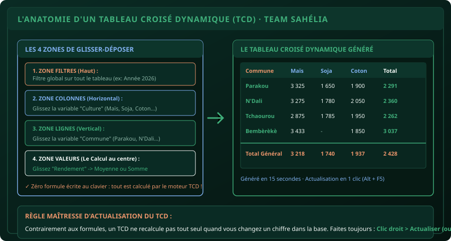

# CHAPITRE 8 : LES TABLEAUX CROISÉS DYNAMIQUES (TCD)
## L'arme absolue de synthèse, d'analyse multidimensionnelle et de création de tableaux de bord

> **Manuel :** 01 — Excel pour les Étudiants & Professionnels  
> **Auteur :** Olivier AGUIN & TEAM Sahélia  
> **Temps d’apprentissage :** 50 minutes de lecture + 35 minutes de manipulation  
> **Illustration associée :** `schemas/schema_08_anatomie_tcd.svg`  
> **Jeu de données :** `../datasets/dataset_agronomique_sahelia.csv`

---

## 1. Objectifs d'Impact Réel
À la fin de ce chapitre, vous saurez :
1. **Comprendre pourquoi le TCD remplace 5 heures de formules manuelles** en 30 secondes de glisser-déposer.
2. **Respecter les 4 prérequis stricts d'une base de données** pour qu'un TCD ne bogue jamais.
3. **Maîtriser les 4 zones fondamentales** (Lignes, Colonnes, Valeurs, Filtres).
4. **Changer le mode de calcul dans la zone Valeurs** (passer de la Somme au Nombre d'occurrences ou à la Moyenne).
5. **Afficher les résultats en pourcentages** (% du Total de la colonne, % de la ligne) pour des analyses de parts de marché.
6. **Insérer des Segments (*Slicers*) interactifs** pour piloter un mini tableau de bord visuel en direct lors d'une soutenance ou d'une réunion.

---

## 2. Pourquoi le TCD est la Compétence n°1 Demandée par les Entreprises et Projets

Supposons que votre maître de stage ou votre tuteur vous pose cette question :  
*« Quel est le rendement moyen et la superficie totale de chaque culture dans chacune des 4 communes de notre zone d'intervention ? »*

- **Sans TCD :** Vous devez écrire 16 formules combinées `=MOYENNE.SI.ENS()` et 16 formules `=SOMME.SI.ENS()`, ajuster les plages, vérifier les dollars et passer 2 heures à chasser les erreurs de frappe.
- **Avec un TCD :** Vous glissez `Commune` en Lignes, `Culture` en Colonnes, `Rendement` en Valeurs (Moyenne) et `Superficie` en Valeurs (Somme). **Temps d'exécution : 20 secondes montre en main.**



---

## 3. Les 4 Règles d'Or de la Base Source (Prérequis Non-Négociables)

Un TCD refuse catégoriquement de fonctionner ou produit des aberrations si votre base source viole l'une de ces 4 règles :

1. **Règle 1 : Une ligne d'en-tête unique et non vide :** Chaque colonne doit posséder un titre sur la ligne 1. Si une seule cellule d'en-tête est vide, Excel affiche l'erreur : *« Le nom de champ de tableau croisé dynamique n'est pas valide »*.
2. **Règle 2 : Aucune cellule fusionnée dans les données :** La fusion de cellules détruit la structure matricielle.
3. **Règle 3 : Pas de ligne de "Total" en bas de la base :** Le TCD calcule ses propres totaux généraux. Si vous incluez votre ligne de total Excel dans la sélection, tous vos chiffres seront doublés !
4. **Règle 4 : Une seule information par ligne (Format plat / Tidy Data) :** 1 ligne = 1 parcelle ou 1 enquêté.

---

## 4. Construire son Premier TCD en 4 Étapes

1. Cliquez dans n'importe quelle cellule de votre base de données propre (ex: sur la cellule `A1`).
2. Rendez-vous dans **Insertion > Tableau croisé dynamique**.
3. Excel sélectionne automatiquement toute la plage cohérente (`$A$1:$J$21`) et coche *Nouvelle feuille de calcul*. Cliquez sur **OK**.
4. Une nouvelle feuille s'ouvre avec le canevas TCD à gauche et le volet des champs à droite.

### Les 4 zones de glisser-déposer :
- **LIGNES (Axe vertical) :** Glissez le champ `Commune`. Les 4 communes s'affichent instantanément sans doublon.
- **COLONNES (Axe horizontal) :** Glissez le champ `Culture`. Les 4 cultures s'alignent en haut.
- **VALEURS (Le calcul central) :** Glissez le champ `Rendement_kg_ha`.
  - *Par défaut, Excel met « Somme de Rendement ». Faites un clic gauche sur le champ dans la zone Valeurs > **Paramètres des champs de valeurs** > Choisissez **Moyenne**.*
- **FILTRES :** Glissez par exemple le champ `Variete` si vous voulez filtrer toute la table sur une variété spécifique.

---

## 5. Passer en Pourcentages du Total (% de la Colonne / Ligne)

Pour savoir quelle commune pèse le plus dans la production de Maïs :
1. Faites un clic droit sur n'importe quel chiffre à l'intérieur du TCD.
2. Choisissez **Afficher les valeurs > % du total de la colonne**.
3. **Résultat :** Vos kg/ha se transforment en pourcentages nets. Vous voyez immédiatement que la commune de Bembèrèkè représente 35 % de la production de maïs de l'échantillon.

> [!CAUTION]
> ### Erreur classique : Oublier d'actualiser après modification des données
> Contrairement aux formules classiques qui se recalculent en temps réel, un TCD est un instantané en cache.  
> Si vous corrigez un rendement de 1 200 à 4 000 kg dans votre fichier de terrain, le TCD ne changera pas tout seul !  
> **Le réflexe obligatoire :** Faites un **Clic droit dans le TCD > Actualiser** (ou le raccourci clavier `Alt + F5`).

---

## 6. Créer un Mini-Dashboard avec les Segments (*Slicers*)

Les Segments transforment un tableau de chiffres ennuyeux en outil interactif moderne :
1. Cliquez dans votre TCD.
2. Allez dans l'onglet du ruban **Analyse du tableau croisé dynamique > Insérer un segment**.
3. Cochez **Commune** et **Culture**, puis validez.
4. Deux jolis panneaux flottants avec des boutons cliquables apparaissent.
5. Cliquez sur le bouton `Parakou` : le tableau s'ajuste instantanément pour n'afficher que les données de Parakou.
6. Maintenez `Ctrl` et cliquez sur `Parakou` et `N'Dali` : les deux communes se comparent sous vos yeux.

---

## 7. Atelier Pratique : Le Dashboard d'Exploitation Agricole

À partir de `dataset_agronomique_sahelia.csv` :

### Mission de création :
1. Créez un TCD sur une nouvelle feuille nommée `TCD_Synthese`.
2. Configurez :
   - Lignes : `Commune`
   - Colonnes : `Culture`
   - Valeurs :
     - 1er champ : `Superficie_ha` (en **Somme**)
     - 2e champ : `Rendement_kg_ha` (en **Moyenne**)
3. Formatez les nombres : Clic droit sur les chiffres > *Format de nombre* > Nombre avec séparateur de milliers et 1 décimale.
4. Insérez un **Graphique croisé dynamique** (Histogramme 2D) lié au TCD.
5. Insérez un Segment pour la variable `Commune`.
6. Cliquez alternativement sur chaque commune pour observer le tableau et le graphique s'actualiser de concert.

---

## 8. Le Défi Communautaire TEAM Sahélia

> ### 🏆 Défi Hebdo n°08 : Le Dashboard TCD Interactif
> 
> 1. À partir du jeu de données, construisez un TCD affichant en Lignes la `Commune`, et en Valeurs la **Somme de la Marge Nette (FCFA)**.
> 2. Ajoutez un deuxième calcul dans la zone Valeurs affichant le **% du Total général** de la marge générée.
> 3. Insérez un Segment sur la variable `Culture`.
> 4. Prenez une capture d'écran montrant le TCD complet et le segment actif.
> 5. Postez-la sur le canal officiel avec la mention :  
>    *« Défi Manuel 01 - Chapitre 8 TCD & Dashboard Réussi ! »*.

---

## 9. Fiche Mémo Récapitulative Détachable

```text
================================================================================
             FICHE MÉMO · TABLEAUX CROISÉS DYNAMIQUES (TCD)
================================================================================
1. LES 4 RÈGLES DE LA BASE PROPRE :
   - Chaque colonne a un titre sur la ligne 1 (aucun en-tête vide).
   - Zéro cellule fusionnée.
   - Pas de ligne de total en bas du tableau source.

2. LES 4 ZONES :
   - LIGNES    : Ce qui s'empile verticalement (Communes).
   - COLONNES  : Ce qui s'étale horizontalement (Cultures).
   - VALEURS   : Ce que l'on calcule (Somme, Moyenne, % du total).
   - FILTRES   : Filtre global sur toute la feuille.

3. CHANGEMENT DE TYPE DE CALCUL :
   - Clic droit dans le chiffre > Synthétiser les valeurs par > Moyenne.
   - Clic droit > Afficher les valeurs > % du total de la colonne.

4. LA COMMANDE VITALE :
   - Alt + F5 (ou Clic droit > Actualiser) dès que la source change !
================================================================================
TEAM Sahélia · Apprendre aujourd’hui. Construire demain.
================================================================================
```
