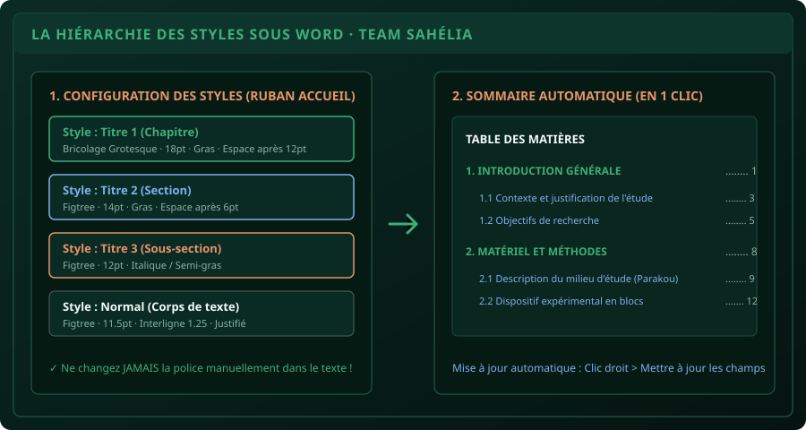

# CHAPITRE 1 : FEUILLES DE STYLES WORD & SOMMAIRE AUTOMATIQUE
## Dompter la mise en page d'un mémoire de 80 pages dès la première minute

> **Manuel :** 02 — Word & PowerPoint Pro pour Mémoires & Soutenances  
> **Auteur :** Olivier AGUIN & TEAM Sahélia  
> **Temps d’apprentissage :** 35 minutes de lecture active + 20 minutes d'atelier pratique  
> **Illustration associée :** `schemas/schema_01_hierarchie_styles_word.svg`

---

## 1. Objectifs d'Impact Réel
À la fin de ce chapitre, vous saurez :
1. **Bannir la mise en forme manuelle** qui détruit les mémoires la veille de la soutenance.
2. **Configurer les 4 styles fondamentaux** (`Titre 1`, `Titre 2`, `Titre 3`, `Normal`) conformes aux normes universitaires.
3. **Générer et actualiser la Table des Matières** en 2 clics avec les numéros de page exacts.
4. **Naviguer et réorganiser un document géant** via le Volet de Navigation sans couper-coller hasardeux.
5. **Appliquer une numérotation hiérarchique automatique** (1. / 1.1. / 1.1.1.) sans jamais taper un chiffre à la main.

---

## 2. Le Principe Absolu : Séparer le Fond de la Forme

Le piège classique de l'étudiant consiste à sélectionner un titre de chapitre, cliquer sur l'icône **Gras**, choisir la taille **16 pt** et une couleur au hasard. Si votre tuteur demande plus tard d'adopter la police *Times New Roman 14 pt* sur un document de 70 pages, vous perdez une journée entière à retoucher 150 titres à la main.

**La méthode professionnelle avec les Styles :**
Vous écrivez votre texte au kilomètre. Vous lui assignez une étiquette sémantique (*Ceci est un Titre 1*, *Ceci est un Titre 2*, *Ceci est du texte Normal*).
Pour modifier l'apparence de tout votre mémoire : vous modifiez le style une seule fois. Les 70 pages s'actualisent en un dixième de seconde.



---

## 3. Paramétrer ses 4 Styles Clés en 5 Minutes

Rendez-vous dans l'onglet **Accueil > Volet Styles**. Faites un clic droit sur chaque style puis **Modifier** :

### A. Le Style `Normal` (Corps du mémoire)
- **Police :** *Figtree* ou *Calibri* ou *Times New Roman*, taille **11,5 pt** ou **12 pt**.
- **Alignement :** **Justifié** (raccourci `Ctrl + J`).
- **Interligne :** **1,25** ou **1,5** (exigé par la plupart des universités béninoises).
- **Paragraphe :** Espace après de **6 pt** (évite d'appuyer sur Entrée pour aérer).

### B. Le Style `Titre 1` (Grands chapitres)
- **Police :** *Bricolage Grotesque* ou *Arial*, taille **16 à 18 pt**, **Gras**.
- **Couleur :** Sombre et institutionnelle (Vert profond `#0a2b24` ou Noir).
- **Paragraphe :** Espace avant **18 pt**, Espace après **12 pt**.
- **Saut de page automatique :** Cochez *Format > Paragraphe > Enchaînements > Saut de page avant*. Chaque nouveau Titre 1 commencera ainsi automatiquement en haut d'une nouvelle page !

### C. Le Style `Titre 2` (Grandes sous-parties)
- **Taille :** **13 à 14 pt**, **Gras**.
- **Espace avant :** **12 pt**, Espace après **6 pt**.

### D. Le Style `Titre 3` (Détails méthodologiques)
- **Taille :** **12 pt**, **Italique** ou **Semi-gras**.

---

## 4. Numérotation Hiérarchique Automatique (1. / 1.1 / 1.1.1)

Pour que vos titres se numérotent seuls sans erreur humaine :
1. Dans l'onglet **Accueil**, groupe *Paragraphe*, cliquez sur l'icône **Liste à plusieurs niveaux**.
2. Choisissez impérativement la bibliothèque qui lie les niveaux aux styles :  
   `1 Titre 1 / 1.1 Titre 2 / 1.1.1 Titre 3`.
3. Désormais, dès que vous appliquez le style `Titre 2`, Word ajoute automatiquement `1.1`, `1.2`, etc. Si vous insérez un chapitre au milieu, toute la numérotation avale se recalcule instantanément.

> [!CAUTION]
> ### Erreur classique à éviter : Taper les numéros à la main
> Si vous tapez `1.1 Introduction` au clavier, le jour où vous ajoutez une sous-partie avant, vous devrez renommer manuellement les 40 sections suivantes. Laissez toujours Word gérer la numérotation.

---

## 5. Le Volet de Navigation : L'Arme Secrète des Rédacteurs Rapides

Appuyez sur `Ctrl + F` (ou cochez *Affichage > Volet de navigation*) et cliquez sur l'onglet **Titres** :
- **Vue d'ensemble :** Vous visualisez l'architecture complète de votre mémoire en temps réel.
- **Téléportation :** Cliquez sur n'importe quel sous-titre pour y amener votre curseur immédiatement.
- **Réorganisation magique :** Vous voulez déplacer toute la section *« 2.2 Dispositif expérimental »* avant la section *« 2.1 Milieu d'étude »* ? Cliquez sur le titre dans le volet et glissez-le vers le haut : **tout le texte, les tableaux et les figures de la section se déplacent avec lui**, sans risque de couper un paragraphe par erreur.

---

## 6. Générer et Actualiser la Table des Matières

1. Placez votre curseur sur la page dédiée au Sommaire.
2. Allez dans **Références > Table des matières**.
3. Sélectionnez **Table automatique 1** ou **Table automatique 2**.
4. Le sommaire apparaît complet avec les points de suite et les numéros de page exacts.

> [!TIP]
> ### L'Astuce du Pro : La touche F9 pour tout mettre à jour
> Après avoir rédigé ou supprimé du texte, ne touchez jamais au sommaire à la main. Cliquez n'importe où dans la table des matières et appuyez sur la touche **F9** (ou Clic droit > *Mettre à jour les champs*). Cochez **« Mettre à jour toute la table »**. Les titres modifiés et les nouveaux numéros de page s'actualisent en 1 seconde.

---

## 7. Atelier Pratique : Le Squelette Officiel de Mémoire FA-UP

Ouvrez un document Word vierge et structurez l'ossature académique suivante en appliquant strictement les styles :

- `Titre 1` : INTRODUCTION GÉNÉRALE
  - `Titre 2` : Contexte et justification de la recherche
  - `Titre 2` : Problématique et questions d'investigation
  - `Titre 2` : Objectifs (Général et Spécifiques)
- `Titre 1` : REVUE DE LITTÉRATURE
  - `Titre 2` : Généralités sur la culture du maïs au Nord-Bénin
  - `Titre 2` : Contraintes de fertilisation et dynamique des sols
- `Titre 1` : MATÉRIEL ET MÉTHODES
  - `Titre 2` : Présentation de la zone d'étude (Commune de Parakou)
  - `Titre 2` : Dispositif expérimental en blocs de Fisher
  - `Titre 2` : Collecte et analyse statistique des données
- `Titre 1` : RÉSULTATS ET DISCUSSION
- `Titre 1` : CONCLUSION ET RECOMMANDATIONS

**Action :** Insérez une page blanche au début et générez la Table des matières automatique.

---

## 8. Le Défi Communautaire TEAM Sahélia

> ### 🏆 Défi Hebdo n°02 : Le Diagnostic de Mémoire Brut
> 
> Récupérez un ancien rapport de stage ou un devoir universitaire non mis en forme.
> 1. Créez et appliquez les styles `Titre 1`, `Titre 2` et `Normal`.
> 2. Activez la liste hiérarchique automatique `1. / 1.1 / 1.1.1`.
> 3. Insérez le sommaire automatique en première page.
> 4. Prenez une capture d'écran montrant à la fois le **Volet de navigation actif à gauche** et la **Table des matières générée à droite**.
> 5. Postez-la sur le canal TEAM Sahélia avec la mention :  
>    *« Défi Manuel 02 - Chapitre 1 Maîtrisé ! »*.

---

## 9. Fiche Mémo Récapitulative Détachable

```text
================================================================================
             FICHE MÉMO · WORD ACADÉMIQUE : STYLES & SOMMAIRE
================================================================================
1. RÈGLE N°1 :
   - Jamais de mise en forme manuelle (gras, couleur, taille) sur un titre.
   - Toujours appliquer un Style : Titre 1, Titre 2, Titre 3.

2. SAUT DE PAGE AUTOMATIQUE DU TITRE 1 :
   - Modifier Style Titre 1 > Paragraphe > Enchaînements > Cocher "Saut de page avant".
   - Chaque grand chapitre commence seul en haut d'une page propre.

3. NUMÉROTATION SANS FAUTE :
   - Accueil > Liste à plusieurs niveaux > Bibliothèque liée aux Styles (1 Titre 1).

4. NAVIGATION RAPIDE :
   - Ctrl + F > Onglet Titres : plan complet et déplacement de chapitres par glisser-déposer.

5. MISE À JOUR DU SOMMAIRE :
   - Touche F9 > "Mettre à jour toute la table".
================================================================================
TEAM Sahélia · Apprendre aujourd’hui. Construire demain.
================================================================================
```
