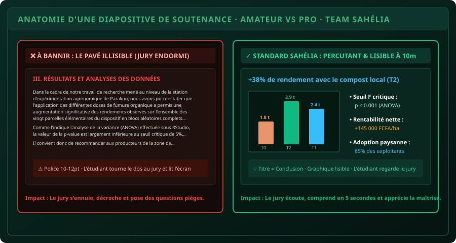

# CHAPITRE 5 : POWERPOINT POUR SOUTENANCE — LA RÈGLE DES 6x6 & LISIBILITÉ À 10 MÈTRES
## Transformer un jeu de diapositives soporifique en support d'impact captivant pour le jury

> **Manuel :** 02 — Word & PowerPoint Pro pour Mémoires & Soutenances  
> **Auteur :** Olivier AGUIN & TEAM Sahélia  
> **Temps d’apprentissage :** 35 minutes de lecture active + 20 minutes d'atelier de conception  
> **Illustration associée :** `schemas/schema_05_anatomie_diapositive_soutenance.svg`

---

## 1. Pourquoi 80% des Diapositives de Soutenance Échouent

Le jour de votre soutenance, vous n'êtes plus un étudiant qui récite un cours : vous êtes un **ingénieur, un chercheur ou un cadre qui présente les conclusions de son travail devant un collège d'experts**.

Or, la plupart des candidats commettent une erreur fatale : ils conçoivent leurs diapositives comme un pense-bête pour eux-mêmes, au lieu de les concevoir comme un **vecteur de conviction pour le jury**.

Les symptômes de la diapositive amateur sont universels :
- Des pavés entiers de texte de 8 lignes recopiés du mémoire.
- Une police de 12 ou 14 pt, impossible à déchiffrer à plus de 2 mètres.
- Des animations d'entrée tournoyantes qui fatiguent l'auditoire.
- Le candidat qui tourne le dos à son jury pour lire mot à mot ce qui est écrit sur l'écran de projection.

Le résultat est impitoyable : le jury arrête d'écouter, lit le document papier ou regarde son téléphone, et prépare des questions difficiles pour tester votre compréhension réelle.

Ce chapitre pose les règles de fer pour créer un support digne des meilleures soutenances internationales.

---

## 2. L'Anatomie Comparée : Diapositive Amateur vs Diapositive Pro



Comme l'illustre la comparaison ci-dessus, la différence entre un échec et une ovation repose sur trois principes fondamentaux :

### Principe 1 : La Règle des 6x6
- **Maximum 6 lignes (ou puces) par diapositive**.
- **Maximum 6 mots par ligne**.
- **Conséquence :** Vos diapositives ne contiennent que des **mots-clés déclencheurs**. C'est vous qui portez le discours oral, l'écran ne fait qu'ancrer l'attention visuelle.

### Principe 2 : Le Titre Conclusif (Action Title)
Ne titrez jamais une diapositive par une étiquette générique comme :  
`III. RÉSULTATS DE L'EXPÉRIMENTATION`.  
Ce titre n'apporte aucune information.

Remplacez-le par la conclusion majeure de la diapositive :  
`+38% de rendement grain avec le compost local de cotonnier (T2)`.  
Même si un membre du jury est distrait pendant 10 secondes, un seul coup d'œil à votre titre lui communique immédiatement l'essentiel de votre découverte scientifique.

### Principe 3 : La Règle du Test des 10 Mètres
Dans un amphithéâtre ou une salle de soutenance, les membres du jury sont assis à une distance de 4 à 10 mètres de l'écran ou du vidéoprojecteur.
- **Titre de diapositive :** Taille minimale de **32 à 36 pt**, Gras.
- **Texte des puces :** Taille minimale de **24 à 28 pt**.
- **Légendes et sources :** Taille minimale de **14 à 16 pt**.
- **Règle absolue :** Tout texte inférieur à 20 pt est interdit sur un écran de soutenance.

---

## 3. Le Calibrage des Contrastes & Le Piège du Vidéoprojecteur

À domicile sur votre écran d'ordinateur rétroéclairé, un texte gris clair sur fond vert pâle semble lisible.  
Dans la salle de soutenance, avec les rideaux mal fermés et une lampe de vidéoprojecteur vieillissante, votre texte gris clair devient **100% invisible**.

### Les deux palettes sûres pour une soutenance :
1. **La Palette Institutionnelle Sombre (Recommandée pour grands écrans LED) :**
   - Fond : Vert nuit très profond (`#06100c`) ou Bleu marine (`#081220`).
   - Texte principal : Blanc pur (`#ffffff`) ou Vert amande très lumineux (`#a7f3d0`).
   - Chiffres clés et accents : Orange safran (`#f59e0b`) ou Bleu ciel (`#38bdf8`).
2. **La Palette Claire Conventionnelle (Recommandée pour vidéoprojecteurs faibles) :**
   - Fond : Blanc pur ou Ivoire très doux (`#f8fafc`).
   - Texte principal : Noir profond (`#0f172a`) ou Vert forêt foncé (`#0a2b24`).
   - Accents : Vert émeraude (`#047857`) ou Bleu royal (`#1d4ed8`).

> [!CAUTION]
> Évitez absolument le rouge pur pour du texte (fatigue visuelle rapide) et le jaune pur sur fond clair (effet fantôme invisible au projecteur).

---

## 4. Le Squelette Idéal d'un Jeu de 18 Diapositives (20 Minutes)

Pour une soutenance classique de 20 minutes (Master, Ingénieur, Mémoire professionnel), prévoyez impérativement **entre 16 et 20 diapositives au total** (soit environ 1 minute par diapositive).

Voici le plan directeur type validé par TEAM Sahélia :

| Diapositive | Contenu | Temps alloué |
| :--- | :--- | :--- |
| **Slide 01** | Titre officiel, Logos partenaires, Candidat, Maître de mémoire, Date | 30 secondes |
| **Slide 02** | Plan d'intervention (4 grands axes maximum) | 30 secondes |
| **Slide 03** | Contexte du secteur agronomique / économique au Bénin | 1 minute |
| **Slide 04** | Problématique centrale & Constat de terrain alarmant | 1 minute |
| **Slide 05** | Objectif général & Questions de recherche spécifiques | 1 minute |
| **Slide 06** | Zone d'étude (Carte de situation géographique claire) | 1 minute |
| **Slide 07** | Dispositif expérimental (Schéma des blocs de Fisher ou échantillonnage) | 1 minute 30 |
| **Slide 08** | Variables collectées & Outils d'analyse statistique (R / Excel) | 1 minute |
| **Slide 09** | **Résultat 1 :** Impact sur les paramètres de croissance (Graphique clé) | 2 minutes |
| **Slide 10** | **Résultat 2 :** Rendement et composantes (Tableau synthétique épuré) | 2 minutes |
| **Slide 11** | **Résultat 3 :** Rentabilité économique et marge nette paysanne | 2 minutes |
| **Slide 12** | Discussion & Comparaison avec la littérature scientifique | 2 minutes |
| **Slide 13** | Limites méthodologiques rencontrées sur le terrain | 1 minute |
| **Slide 14** | Recommandations concrètes pour les producteurs et ONG | 1 minute 30 |
| **Slide 15** | Recommandations pour la recherche future & Politiques publiques | 1 minute |
| **Slide 16** | Conclusion générale & Synthèse de la valeur ajoutée | 1 minute |
| **Slide 17** | Diapositive de remerciements & « Place aux échanges avec le Jury » | 30 secondes |
| **Slides 18-22** | **Slides d'annexes cachées** (Réservées aux questions pointues du jury) | Hors chrono |

---

## 5. L'Astuce Maîtresse : Les Diapositives « Parapluie » en Annexe

Après votre diapositive finale de remerciements, préparez **3 à 5 diapositives supplémentaires non présentées**, contenant :
- Le tableau complet de l'ANOVA avec tous les degrés de liberté et carrés moyens.
- La carte détaillée des points GPS des 20 parcelles.
- La formule exacte de calcul de la marge brute économique.

Lors de la séance de questions, si un professeur vous demande :  
*« Quelle était la valeur exacte du coefficient de corrélation de Pearson entre la hauteur des plants et la dose d'azote ? »*

Vous ne balbutiez pas : vous passez avec le sourire à la **Slide 19**, affichez le tableau précis et répondez avec une assurance déconcertante. C'est le coup de maître qui transforme une mention Bien en mention **Très Honorable avec Félicitations du Jury**.

---

## 6. Défi Pratique du Chapitre

> ### ⚡ Défi d'Application : La Métamorphose d'une Diapositive Pavé
> 
> 1. Prenez un paragraphe dense de votre mémoire (au moins 8 lignes d'explications).
> 2. Créez une première diapositive en collant le paragraphe tel quel (version amateur).
> 3. Créez une seconde diapositive en appliquant les 3 principes du pro :
>    - Titre conclusif affirmé.
>    - 3 puces de 5 mots maximum.
>    - Un pictogramme, schéma ou graphique illustratif.
>    - Police de 28 pt minimum.
> 4. Éloignez-vous à 5 mètres de votre écran pour comparer l'impact instantané des deux versions.

---

## 7. Fiche Mémo Récapitulative

```text
================================================================================
          FICHE MÉMO · POWERPOINT DE SOUTENANCE : STANDARD SAHÉLIA
================================================================================
1. RÈGLE DES 6x6 :
   - Jamais plus de 6 puces par slide, jamais plus de 6 mots par puce.

2. TAILLES DE POLICE LISIBLES À 10 MÈTRES :
   - Titre   : 32 à 36 pt, Gras.
   - Puces   : 24 à 28 pt.
   - Jamais rien en dessous de 20 pt.

3. TITRE CONCLUSIF OBLIGATOIRE :
   - Remplacer "Résultats 2" par l'enseignement clé (+38% de rendement...).

4. RYTHME PARFAIT :
   - 1 slide par minute -> 16 à 18 slides pour 20 minutes de présentation.

5. DIAPOSITIVES PARAPLUIE (ANNEXES) :
   - Garder 3 à 5 slides techniques après la conclusion pour les questions du jury.
================================================================================
```
