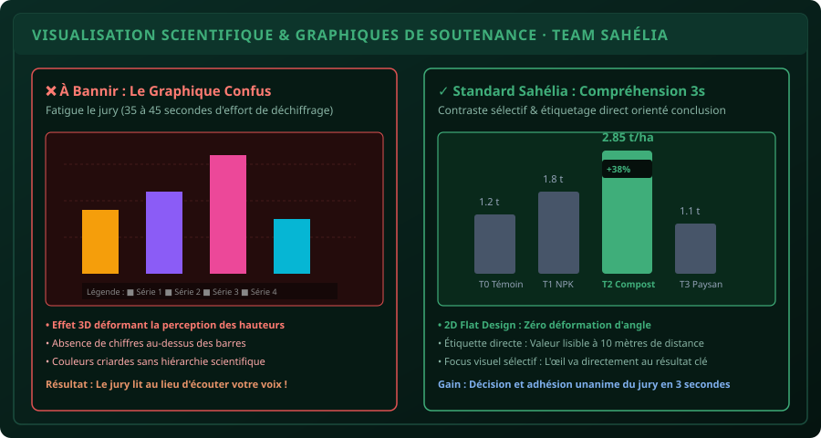

# CHAPITRE 6 : REMPLACER LE TEXTE PAR DES SCHÉMAS & GRAPHIQUES DE SOUTENANCE
## La puissance de la visualisation de données pour emporter l'adhésion unanime du jury

> **Manuel :** 02 — Word & PowerPoint Pro pour Mémoires & Soutenances  
> **Auteurs :** Sègla Bio KPEROU, Olivier AREMOU & TEAM Sahélia  
> **Temps d’apprentissage :** 35 minutes de lecture active + 25 minutes d'atelier pratique  
> **Illustration associée :** `schemas/schema_05b_graphiques_soutenance.svg`

---

## 1. La Loi de Traitement Visuel du Cerveau Humain

Les neurosciences appliquées à la communication scientifique révèlent un constat sans appel :
- Le cerveau humain traite une image ou un graphique **60 000 fois plus vite qu'un texte écrit**.
- Devant un paragraphe de 5 lignes, le cerveau d'un examinateur doit lire, déchiffrer, mémoriser et reconstruire le sens de la phrase : cela prend **35 à 45 secondes d'effort cognitif lourd**.
- Devant un graphique épuré avec une barre verte dominante et le chiffre `+38%`, l'information est comprise et validée en **moins de 3 secondes**.

Chaque fois que vous remplacez un bloc de texte par un schéma logique ou un graphique bien conçu, vous libérez l'attention du jury pour qu'il se concentre sur **votre voix, votre posture et votre analyse critique**.



---

## 2. Quel Graphique Choisir selon le Message Scientifique ?

L'une des erreurs les plus fréquentes en soutenance consiste à choisir le mauvais type de graphique (par exemple un camembert avec 12 tranches microscopiques ou un graphique 3D illisible).

Voici la matrice de décision officielle TEAM Sahélia :

| Objectif de Démonstration | Type de Graphique Recommandé | À Bannir Absolument |
| :--- | :--- | :--- |
| **Comparer des traitements** (ex: Doses d'engrais T0, T1, T2) | **Histogramme en barres verticales** avec barres d'erreur (écart-type) | Graphique en courbes reliant des points sans lien temporel |
| **Montrer une évolution temporelle** (ex: Pluviométrie mensuelle, croissance) | **Courbe continue (Line Chart)** avec repères nets | Histogramme 3D ou camembert |
| **Présenter une répartition** (ex: Typologie des exploitations agricoles) | **Diagramme en barres horizontales** ordonnées ou anneau (max 4-5 parts) | Camembert avec plus de 5 parts ou tranches éclatées |
| **Expliquer un dispositif de terrain** (ex: Blocs de Fisher à Parakou) | **Schéma spatial vectoriel (Vue en plan des parcelles)** | Description textuelle de 15 lignes |
| **Illustrer une démarche** (ex: Protocole d'enquête et étapes d'analyse) | **Diagramme de flux (Flowchart)** avec flèches logiques | Liste à puces de 10 étapes monotones |

---

## 3. Les 4 Règles de Nettoyage Graphique pour Vidéoprojecteur

Un graphique exporté directement d'Excel ou de RStudio est rarement optimisé pour une salle de conférence. Il faut lui appliquer un nettoyage chirurgical en 4 étapes :

### Règle 1 : Supprimer impérativement les effets 3D et les ombres
Les graphiques 3D déforment la perspective : une barre placée à l'arrière paraît plus petite qu'une barre à l'avant, même si la valeur est supérieure. Les ombres et biseaux créent un flou visuel sur grand écran. Restez en **2D plat (Flat Design)** strict.

### Règle 2 : Éliminer la légende inutile si vous pouvez étiqueter directement
Au lieu d'avoir un carré de couleur perdu dans un coin que le jury doit aller chercher des yeux : placez le nom du traitement directement sous ou sur la barre (`T0 : Témoin`, `T1 : NPK`, `T2 : Compost`).

### Règle 3 : Afficher l'étiquette de donnée sur la barre gagnante
Ne forcez pas le jury à plisser les yeux pour faire correspondre le haut d'une barre avec l'axe vertical des ordonnées à gauche. Inscrivez la valeur exacte au-dessus de la barre : `2,85 t/ha`.

### Règle 4 : La technique du contraste sélectif (Le Focus Visuel)
Si vous présentez 4 traitements (T0, T1, T2, T3) et que votre apport majeur est le traitement **T2** :
- Colorez T0, T1 et T3 dans un **gris ardoise neutre et discret** (`#64748b`).
- Colorez le traitement gagnant T2 dans votre **couleur de marque éclatante (Vert émeraude `#10b981`)**.
- L'œil du jury est immédiatement guidé vers votre résultat phare sans aucune hésitation.

---

## 4. Remplacer un Protocole Complexe par un Schéma en 3 Blocs

Lorsque vous présentez votre méthodologie de terrain, ne récitez pas :  
*« Nous avons d'abord sélectionné 20 producteurs, puis nous avons installé les capteurs, ensuite nous avons fait des prélèvements chaque semaine... »*

**Construisez un diagramme de flux en 3 boîtes connectées :**

```text
[ 1. ÉCHANTILLONNAGE ]       [ 2. SUIVI TERRAIN ]          [ 3. ANALYSES & STATS ]
20 Parcelles paysannes  -->  Relevés GPS + Sondages   -->  ANOVA à 2 facteurs sous R
Zone cotonnière Parakou      Humidité & Biomasse (J30-J90)  Seuil de significativité 5%
```

En prononçant vos explications pendant que ce schéma est affiché, vous donnez une impression immédiate de maîtrise architecturale et de rigueur scientifique.

---

## 5. Défi Pratique du Chapitre

> ### ⚡ Défi d'Application : Le Relooking Graphique de Soutenance
> 
> 1. Prenez un graphique Excel brut issu de vos recherches ou d'un devoir.
> 2. Supprimez le quadrillage arrière trop lourd.
> 3. Supprimez la légende flottante et placez les étiquettes directement.
> 4. Appliquez la technique du contraste sélectif (mettez en valeur la donnée essentielle avec une couleur forte et passez le reste en gris neutre).
> 5. Intégrez ce graphique sur une diapositive PowerPoint avec un **titre conclusif affirmé**.

---

## 6. Fiche Mémo Récapitulative

```text
================================================================================
          FICHE MÉMO · VISUALISATION DE SOUTENANCE : STANDARD SAHÉLIA
================================================================================
1. LE CERVEAU COMPREND L'IMAGE EN 3 SECONDES :
   - Remplacer systématiquement les pavés d'explications par un graphique ou schéma.

2. MATRICE DE CHOIX :
   - Comparaison de traitements -> Histogramme barres verticales 2D.
   - Évolution dans le temps    -> Courbe continue.
   - Protocole / Méthode        -> Diagramme de flux en 3 ou 4 boîtes.

3. NETTOYAGE OBLIGATOIRE :
   - Zéro effet 3D, zéro ombre parasite, zéro quadrillage dense.
   - Inscrire la valeur clé directement au-dessus de la barre.

4. CONTRASTE SÉLECTIF :
   - Mettre en valeur le traitement phare en couleur vive (vert/bleu).
   - Passer les témoins et données secondaires en gris discret.
================================================================================
TEAM Sahélia · Apprendre. Créer. Innover.
================================================================================
```
