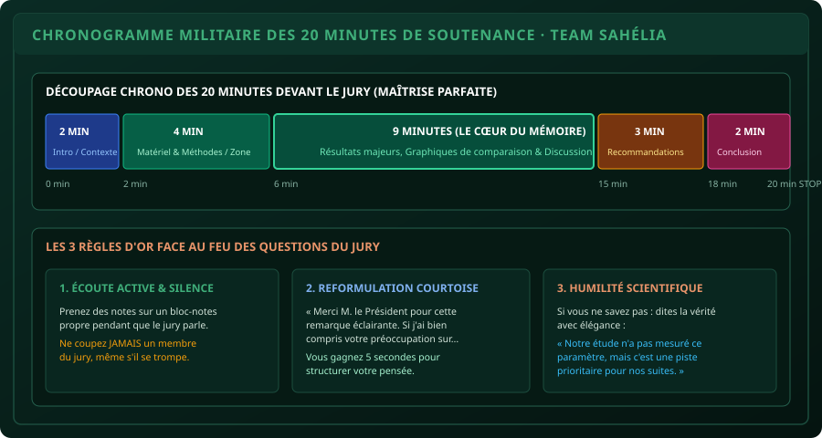

# CHAPITRE 7 : MAÎTRISE DU CHRONOMÈTRE, POSTURE ORALE & FEU DES QUESTIONS
## L'art de dompter son stress, captiver l'auditoire et répondre au jury avec autorité et humilité

> **Manuel :** 02 — Word & PowerPoint Pro pour Mémoires & Soutenances  
> **Auteur :** Olivier AGUIN & TEAM Sahélia  
> **Temps d’apprentissage :** 40 minutes de lecture active + répétitions orales chronométrées  
> **Illustration associée :** `schemas/schema_06_chrono_soutenance_jury.svg`

---

## 1. La Réalité Psychologique de la Salle de Soutenance

Le jour de votre soutenance, le jury a déjà parcouru votre mémoire écrit. Ce qu'il vient évaluer pendant ces 45 à 60 minutes d'examen oral, ce n'est pas votre capacité à lire des diapositives : c'est votre **maturité intellectuelle, votre sang-froid face à la critique et votre stature de futur professionnel**.

Deux dangers majeurs guettent chaque candidat :
1. **Le débordement chronométrique :** L'étudiant s'attarde 8 minutes sur l'historique de la commune de Parakou. Au bout de 18 minutes, il n'a toujours pas abordé ses propres résultats. Le Président du jury l'interrompt sèchement : *« Monsieur, il vous reste 2 minutes pour conclure »*. L'étudiant panique, saute 10 diapositives et gâche 6 mois d'efforts de recherche.
2. **La crispation défensive face aux questions :** Dès qu'un examinateur pointe une faiblesse méthodologique, le candidat s'énerve, coupe la parole au jury ou cherche des excuses en accusant son tuteur ou le manque de moyens. Le jury sanctionne immédiatement le manque d'éthique scientifique.

Ce chapitre vous transmet les techniques précises pour piloter votre temps à la seconde près et transformer l'épreuve des questions en démonstration d'excellence.

---

## 2. Le Chronogramme Militaire des 20 Minutes



Comme le démontre notre matrice opérationnelle, les 20 minutes réglementaires doivent être réparties avec une précision chirurgicale :

### Phase 1 : L'Accroche & La Problématique (00:00 à 02:00 — 2 minutes)
- **Objectif :** Capter immédiatement l'attention du jury.
- Salutations protocolaires brèves (30 secondes max) : *« Monsieur le Président du jury, chers membres du jury, honorables invités... »*.
- Présentation du **problème de terrain concret** qui justifie l'étude (ex: la baisse drastique de fertilité des sols au Nord-Bénin).
- Énoncé clair de l'**objectif principal**.

### Phase 2 : Le Dispositif Méthodologique (02:00 à 06:00 — 4 minutes)
- **Objectif :** Prouver la validité scientifique de votre protocole.
- Présentation synthétique de la zone d'étude et du climat.
- Explication du dispositif expérimental (schéma des blocs de Fisher, traitements T0, T1, T2).
- Paramètres mesurés et outils d'analyse statistique retenus (RStudio, ANOVA).

### Phase 3 : Le Cœur du Mémoire — Résultats & Discussion (06:00 à 15:00 — 9 minutes)
- **C'est ici que se joue votre note.** Vous devez y consacrer près de la moitié de votre temps total !
- Présentez vos résultats en **3 blocs thématiques majeurs**, chacun illustré par un graphique percutant.
- **Règle fondamentale :** N'énoncez jamais un résultat sans le commenter immédiatement à la lumière de la littérature :  
  *« Nous obtenons un rendement de 2,9 t/ha avec le compost T2. Ce résultat confirme les observations de Bio et al. (2024) dans la même zone agro-écologique, et s'explique par l'amélioration de la capacité d'échange cationique du sol. »*

### Phase 4 : Recommandations Pratiques de Terrain (15:00 à 18:00 — 3 minutes)
- Ce que votre travail apporte concrètement aux producteurs agricoles, aux ONG de développement et aux décideurs politiques.
- Chiffrez les gains économiques (marge nette paysanne en FCFA).

### Phase 5 : Conclusion & Perspectives (18:00 à 20:00 — 2 minutes)
- Synthèse des 2 acquis majeurs de votre recherche.
- Mention des pistes de recherche futures qui restent à explorer.
- Phrase de clôture sobre et professionnelle : *« Monsieur le Président, honorables membres du jury, je vous remercie pour votre bienveillante attention et me tiens prêt à répondre à vos questions. »*.

---

## 3. Posture Physique & Communication Non-Verbale

Pendant votre exposé, votre corps communique avant même que vous n'ayez prononcé un mot :

1. **Le Regard Circulaire (L'Erreur du Tuteur) :**
   Beaucoup d'étudiants ne regardent que leur maître de mémoire, cherchant un signe d'approbation rassurant. C'est une faute grave. Vous devez distribuer votre regard équitablement : 30% au Président du jury, 30% aux rapporteurs et examinateurs, 20% à votre tuteur, et 20% à l'auditoire général.
2. **La Position d'Ancrage :**
   Tenez-vous debout, les deux pieds bien ancrés au sol à largeur d'épaules. Évitez de vous balancer d'une jambe sur l'autre (effet pendule) ou de vous appuyer mollement sur le pupitre.
3. **Le Pointeur Laser / Télécommande :**
   Utilisez une télécommande de présentation avec pointeur laser pour changer vos diapositives discrètement sans rester scotché derrière le clavier de votre ordinateur. Si vos mains tremblent à cause du stress, tenez la télécommande à deux mains ou posez délicatement une main sur le pupitre.
4. **La Voix et les Silences :**
   Parlez avec un volume suffisant pour être entendu au dernier rang sans crier. Remplacez les tics de langage (« euh... », « en fait... », « voilà quoi... ») par **des silences maîtrisés de 2 secondes** pendant que vous changez de diapositive. Le silence donne une impression de réflexion profonde et d'autorité.

---

## 4. Les 3 Règles d'Or Face au Feu des Questions

Après votre exposé, le Président donne la parole aux examinateurs. C'est le moment le plus intimidant, mais c'est aussi là que vous gagnez l'admiration du jury si vous appliquez les 3 règles d'or :

### Règle 1 : L'Écoute Active avec Bloc-Notes
Pendant qu'un examinateur prend la parole (parfois pendant 5 minutes d'affilée), **notez scrupuleusement ses remarques sur un bloc-notes propre**, stylo en main.
- **Effet psychologique :** L'examinateur voit que vous respectez sa parole et que vous traitez ses remarques avec sérieux.
- **Règle absolue :** Ne coupez JAMAIS la parole à un membre du jury, même s'il commet une erreur manifeste sur un chiffre. Attendez qu'il ait complètement terminé son intervention.

### Règle 2 : La Reformulation Courtoise
Ne commencez jamais votre réponse de manière abrupte. Prenez une inspiration et formulez une transition élégante :  
*« Merci M. le Rapporteur pour cette question particulièrement stimulante. Si j'ai bien saisi votre préoccupation concernant la méthode d'échantillonnage des parcelles... »*
- Vous valorisez l'examinateur.
- Vous gagnez 5 précieuses secondes pour structurer votre réponse mentale en 2 points clés.

### Règle 3 : L'Humilité Scientifique Face aux Lacunes
Aucun mémoire de fin d'études n'est parfait. Si un membre du jury pointe une faiblesse réelle (ex: un échantillon trop restreint ou une analyse foliaire manquante), ne mentez jamais et n'inventez rien.

Adoptez la réponse des grands scientifiques :  
*« C'est une remarque tout à fait juste et pertinente, Monsieur le Professeur. En raison des contraintes calendaires de la saison des pluies, nous n'avons pas pu étendre les mesures au-delà de 20 parcelles. C'est précisément l'une des limites majeures de notre étude que nous avons consignée en page 64, et ce sera l'axe prioritaire de nos travaux complémentaires. »*

Face à une telle réponse, l'examinateur est désarmé et apprécie votre intégrité intellectuelle.

---

## 5. Défi Pratique du Chapitre

> ### ⚡ Défi d'Application : La Répétition Chronométrée à Blanc
> 
> 1. Mettez un compte à rebours de 20 minutes sur votre smartphone.
> 2. Présentez votre diaporama complet à voix haute devant un miroir ou devant un camarade.
> 3. Notez le temps exact atteint à la diapositive des Résultats (doit se situer impérativement entre la 6e et la 15e minute).
> 4. Si vous terminez en moins de 17 minutes : vous devez approfondir l'explication de vos résultats.
> 5. Si vous dépassez 20 minutes : vous devez couper des diapositives d'introduction sans hésiter.

---

## 6. Fiche Mémo Récapitulative

```text
================================================================================
          FICHE MÉMO · CHRONO & SOUTENANCE : STANDARD SAHÉLIA
================================================================================
1. DÉCOUPAGE STRICT DES 20 MINUTES :
   - 0 à 2 min   : Contexte & Problématique.
   - 2 à 6 min   : Méthodologie & Dispositif expérimental.
   - 6 à 15 min  : RÉSULTATS MAJEURS & DISCUSSION (Le cœur du mémoire).
   - 15 à 18 min : Recommandations pratiques & Rentabilité économique.
   - 18 à 20 min : Conclusion & Perspectives d'avenir.

2. POSTURE ET REGARD :
   - Regarder tout le jury (Président, rapporteurs, tuteur, public).
   - Bannir les tics de langage ("euh", "en fait") au profit de pauses silencieuses.

3. FACE AUX QUESTIONS :
   - Noter les questions sur papier sans jamais couper la parole.
   - Remercier et reformuler avec courtoisie.
   - Admettre les limites méthodologiques avec humilité et élégance scientifique.
================================================================================
```
