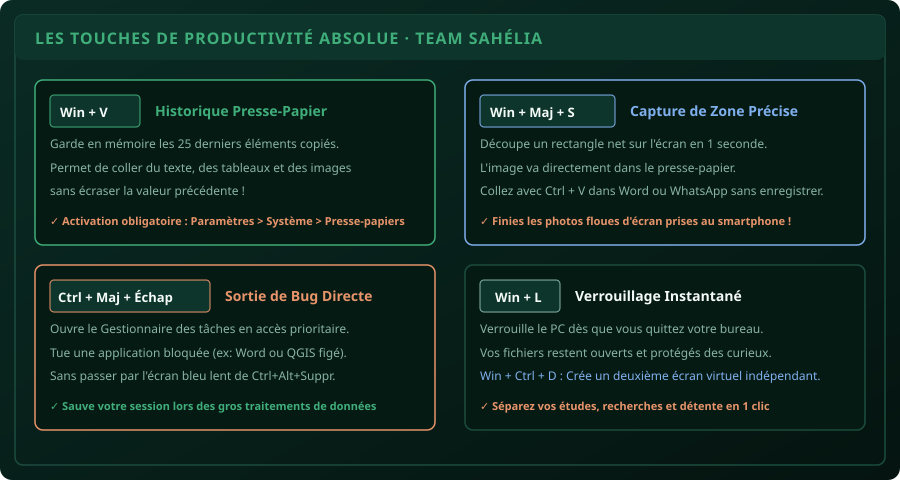

# CHAPITRE 1 : LES 15 TOUCHES SYSTÈMES QUI DÉCUPLENT VOTRE VITESSE
## En finir avec la lenteur de la souris et piloter Windows & Mac comme un ingénieur

> **Manuel :** 03 — 50 Astuces & Raccourcis Informatiques du Débutant au Pro  
> **Auteurs :** Sègla Bio KPEROU, Olivier AREMOU & TEAM Sahélia  
> **Temps d’apprentissage :** 25 minutes  
> **Illustration associée :** `schemas/schema_01_raccourcis_productivite.svg`

---

## 1. Objectifs d'Impact Réel
À la fin de ce chapitre, vous saurez :
1. **Économiser 30 minutes de manipulation par jour** en éliminant 80 % des mouvements de souris inutiles.
2. **Copier 10 textes et images différents** sans écraser le précédent grâce à l'historique de presse-papier (`Win + V`).
3. **Récupérer la main en 3 secondes** lorsqu'une application freeze (Word, Excel, QGIS) via `Ctrl + Maj + Échap`.
4. **Capturer des zones nettes d'écran** (`Win + Maj + S`) pour vos mémoires sans jamais prendre de photos floues avec votre smartphone.
5. **Diviser votre écran en 2 ou 4 fenêtres parfaites** (`Win + Flèches`) pour saisir des données tout en lisant un PDF.

---

## 2. Le Super-Presse-Papier (`Win + V`) : La Fin du Drame du Copier-Coller

Sur un ordinateur configuré par défaut, faire `Ctrl + C` sur une phrase efface immédiatement la précédente. Si vous avez copié un lien important, puis un numéro de téléphone, votre lien est perdu.

**La Révolution `Win + V` :**
1. Appuyez sur la touche **Windows + V**.
2. Cliquez sur **Activer** la première fois.
3. Désormais, Windows garde en mémoire vos **25 derniers éléments copiés** (textes, tableaux Excel entiers, captures d'images, liens web).
4. Lorsque vous rédigez un mémoire : copiez 5 paragraphes de sources différentes d'affilée avec `Ctrl + C`. Allez dans Word, faites `Win + V` : une boîte flottante s'ouvre, vous choisissez dans quel ordre coller vos éléments d'un simple clic !



---

## 3. Les 15 Raccourcis Indispensables du Quotidien

| Raccourci | Action Réelle | Gain de temps concret |
| :--- | :--- | :--- |
| `Win + V` | Historique de presse-papier (25 éléments) | Ne plus jamais perdre un texte copié |
| `Win + Maj + S` | Capture de zone nette | Intégrer un schéma dans son rapport sans fichier temporaire |
| `Ctrl + Maj + Échap` | Gestionnaire des tâches direct | Fermer un logiciel planté sans redémarrer le PC |
| `Win + Flèche Gauche / Droite` | Ancre la fenêtre sur la moitié exacte de l'écran | Comparer 2 fichiers côte à côte |
| `Win + D` | Affiche instantanément le Bureau | Accéder à un fichier sans fermer ses 10 fenêtres |
| `Ctrl + Z` | Annuler la bêtise | Récupérer un dossier ou un texte effacé par erreur |
| `Ctrl + Y` ou `F4` | Rétablir / Répéter la dernière action | Appliquer une action en chaîne |
| `Alt + Tab` | Basculer entre fenêtres actives | Passer de Word à Excel sans lâcher le clavier |
| `Win + L` | Verrouiller sa session | Sécurité en amphi ou au bureau en 1 fraction de seconde |
| `Ctrl + Maj + N` | Nouveau dossier dans l'Explorateur | Classer ses documents de cours en 1 seconde |
| `F2` | Renommer le fichier sélectionné | Finis les clics droits interminables |
| `Ctrl + Maj + T` (Navigateur) | Rouvrir l'onglet fermé par erreur | Retrouver un article de recherche fermé trop vite |
| `Win + E` | Ouvrir l'Explorateur de fichiers | Accéder à son disque sans chercher l'icône |
| `Win + Point (.)` | Clavier d'emojis et symboles (², ³, ±, α, β) | Insérer des symboles scientifiques dans Word |
| `Ctrl + P` | Lancer l'impression / Export PDF direct | Convertir une page web en PDF propre |

---

## 4. Découper son Écran pour Travailler à Deux Mains (`Win + Flèches`)

Ne perdez plus votre temps à redimensionner laborieusement les fenêtres avec les coins de la souris :
1. Cliquez sur votre fenêtre de données Excel.
2. Pressez **Win + Flèche Gauche** : la fenêtre se cale sur 50 % de l'écran à gauche.
3. Cliquez sur votre document Word et faites **Win + Flèche Droite** : Word se cale sur 50 % à droite.
4. Vous avez un poste de travail bi-écran virtuel parfait pour transcrire des données sans jamais jongler entre les fenêtres.

> [!CAUTION]
> ### Erreur classique : Éteindre le PC de force avec le bouton d'alimentation
> Quand Word ou Excel ne répond plus, beaucoup appuient 10 secondes sur le bouton d'alimentation de l'ordinateur. C'est la pire chose à faire : cela corrompt le système de fichiers du disque dur et détruit les sauvegardes automatiques.  
> **Le réflexe sain :** Pressez `Ctrl + Maj + Échap`. Sélectionnez l'application qui porte la mention *« Ne répond pas »*, et cliquez sur **Fin de tâche**. Seul le programme bloqué est fermé, Windows reste stable.

---

## 5. Atelier Pratique : Le Circuit de Vitesse en 4 Minutes

1. Activez `Win + V` sur votre ordinateur.
2. Ouvrez votre navigateur sur un article en ligne : copiez le titre (`Ctrl + C`), puis le nom de l'auteur (`Ctrl + C`), puis l'URL (`Ctrl + C`).
3. Ouvrez le Bloc-notes (`Win + R`, tapez `notepad`, `Entrée`).
4. Faites `Win + V` et collez successivement les 3 éléments dans l'ordre que vous voulez.
5. Faites `Win + Maj + S`, sélectionnez un encadré sur votre écran.
6. Revenez dans votre document et faites `Ctrl + V` : l'image se colle instantanément.
7. Divisez votre écran : Bloc-notes à gauche (`Win + Gauche`), navigateur à droite (`Win + Droite`).

---

## 6. Le Défi Communautaire TEAM Sahélia

> ### 🏆 Défi Hebdo n°03 : La Minute du Numéricien Sans Souris
> 
> 1. Débranchez ou n'utilisez pas votre souris / pavé tactile pendant 3 minutes.
> 2. Ouvrez l'Explorateur (`Win + E`), naviguez au clavier (`Flèches`, `Entrée`), créez un nouveau dossier (`Ctrl + Maj + N`) nommé `TEAM_SAHELIA_DEFIS` (`F2`).
> 3. Ouvrez Word au clavier (`Win`, tapez `word`, `Entrée`).
> 4. Faites une capture d'écran nette de votre bureau (`Win + Maj + S`) et collez-la dans votre document.
> 5. Postez la capture sur la communauté avec la mention :  
>    *« Défi Manuel 03 - Chapitre 1 Validé Sans Souris ! »*.

---

## 7. Fiche Mémo Récapitulative Détachable

```text
================================================================================
             FICHE MÉMO · LES 5 TOUCHES DE SURVIE INFORMATIQUE
================================================================================
1. Win + V :
   - Historique des 25 derniers copier-coller (textes, tableaux, images).

2. Win + Maj + S :
   - Capture de zone d'écran chirurgicale (finies les photos de téléphone floues).

3. Ctrl + Maj + Échap :
   - Gestionnaire des tâches instantané (tue les programmes bloqués sans éteindre le PC).

4. Win + Flèches (Gauche / Droite) :
   - Écran scindé en 2 fenêtres égales en 1 fraction de seconde.

5. Ctrl + Maj + T :
   - Rouvre immédiatement l'onglet internet fermé par inadvertance.
================================================================================
TEAM Sahélia · Apprendre. Créer. Innover.
================================================================================
```
