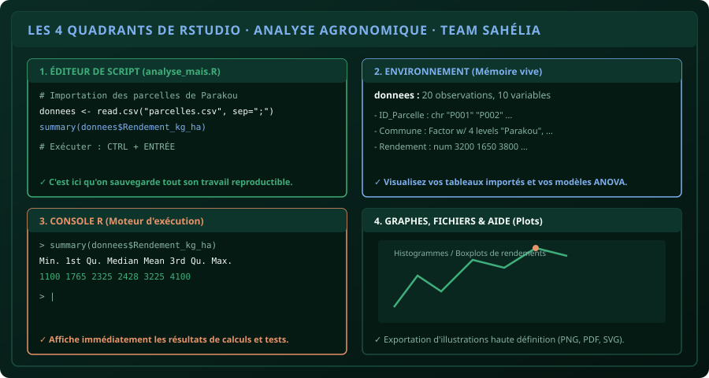

# CHAPITRE 1 : PRISE EN MAIN DE RSTUDIO & IMPORTATION SANS ERREUR
## Dompter l'environnement statistique sans paniquer face aux lignes de commande

> **Manuel :** 04 — R & RStudio pour l'Agronomie : Analyse statistique des essais et enquêtes  
> **Auteurs :** Sègla Bio KPEROU, Olivier AREMOU & TEAM Sahélia  
> **Temps d’apprentissage :** 35 minutes de lecture active + 25 minutes de manipulation  
> **Illustration associée :** `schemas/schema_01_quadrants_rstudio.svg`  
> **Jeu de données :** `../../01-excel-etudiants-professionnels/datasets/dataset_agronomique_parakou.csv`

---

## 1. Objectifs d'Impact Réel
À la fin de ce chapitre, vous saurez :
1. **Comprendre la différence fondamentale** entre R (le moteur mathématique) et RStudio (le tableau de bord visuel).
2. **Naviguer avec aisance** entre les 4 quadrants de l'interface RStudio.
3. **Importer un fichier d'essai agronomique CSV / Excel** sans bogue d'encodage ni de délimiteur.
4. **Inspecter la structure de vos données** avec les 4 commandes clés (`head()`, `str()`, `dim()`, `summary()`).
5. **Sauvegarder un script d'analyse reproductible (`.R`)** pour pouvoir refaire tous vos calculs en 1 clic le jour de la soutenance.

---

## 2. R vs RStudio : L'Analogie du Moteur et de la Voiture

- **R** est le moteur brut sous le capot. C'est un langage de programmation statistique puissant mais austère : si vous lancez R seul, vous n'avez qu'une fenêtre noire vide.
- **RStudio** est la carrosserie moderne, le volant en cuir et le tableau de bord avec compte-tours. Il organise vos fenêtres, affiche vos graphiques et gère vos fichiers.

Pour travailler, on installe d'abord R, puis on installe RStudio. **On n'ouvre jamais R directement : on lance toujours RStudio.**



---

## 3. L'Anatomie des 4 Quadrants de RStudio

| Quadrant | Rôle Pratique | Ce qu'on y fait |
| :--- | :--- | :--- |
| **Haut-Gauche (Éditeur de Script)** | Le laboratoire | On écrit son code dans un fichier texte `.R`. Rien ne s'efface quand on ferme. |
| **Bas-Gauche (Console R)** | Le moteur d'exécution | Reçoit les ordres, exécute les calculs et affiche les résultats bruts. |
| **Haut-Droite (Environnement)** | La mémoire vive | Affiche la liste des tables de données importées, variables et modèles créés. |
| **Bas-Droite (Plots / Files / Help)** | La vitrine graphique | Visualise les graphiques (boxplots, courbes), gère les fichiers et affiche la documentation. |

---

## 4. Les Raccourcis Vitaux de RStudio

- **`Ctrl + Entrée` :** Exécute la ligne ou le bloc de code sélectionné dans le Script vers la Console. Vous ne touchez jamais à la souris pour lancer un calcul !
- **`Ctrl + L` :** Nettoie l'écran de la Console quand elle est trop chargée de texte.
- **`Alt + -` :** Insère automatiquement l'opérateur d'assignation `<-` (très utilisé en R : `x <- 10`).

> [!CAUTION]
> ### Erreur classique : Écrire tout son code dans la Console
> Si vous tapez vos commandes directement dans la console en bas à gauche, dès que vous fermez RStudio, tout votre travail disparaît ! Travaillez **toujours** dans un fichier de Script en haut à gauche (`Fichier > Nouveau fichier > R Script`), et enregistrez-le sous le nom `analyse_parakou.R`.

---

## 5. Importer des Données Agronomiques sans Erreur

Pour importer le fichier d'essais `dataset_agronomique_parakou.csv` situé dans le dossier de travail :

```r
# 1. Définir le dossier de travail (où se trouve le fichier)
# Session > Set Working Directory > To Source File Location

# 2. Importer le tableau avec read.csv
essai <- read.csv("dataset_agronomique_parakou.csv", sep = ",", dec = ".", stringsAsFactors = TRUE)

# 3. Vérifier les dimensions (Lignes x Colonnes)
dim(essai)
# Résultat : [1] 20 10 -> 20 parcelles suivies, 10 variables mesurées
```

### Le diagnostic en 3 commandes magiques :
1. **`head(essai, n = 5)` :** Affiche les 5 premières lignes du tableau.
2. **`str(essai)` :** Révèle la structure technique. Vérifiez immédiatement :
   - Les rendements et doses d'engrais doivent être marqués **`num`** (nombres décimaux) ou **`int`** (entiers).
   - Les communes et cultures doivent être des **`Factor`** (facteurs / catégories).
3. **`summary(essai$Rendement_kg_ha)` :** Calcule instantanément le Minimum, le 1er Quartile, la Médiane, la Moyenne et le Maximum des rendements !

---

## 6. Atelier Pratique : Première Exploration de l'Essai de Parakou

Ouvrez un nouveau script R dans RStudio et tapez ce bloc de code :

```r
# ==============================================================================
# MANUEL 04 - ATELIER 1 : PREMIER BILAN STATISTIQUE AGRONOMIQUE
# ==============================================================================

# Chargement des données
donnees <- read.csv("dataset_agronomique_parakou.csv", sep = ",")

# Afficher les noms des colonnes
names(donnees)

# Calculer la moyenne globale des rendements
moy_rendement <- mean(donnees$Rendement_kg_ha)
print(paste("Rendement moyen :", round(moy_rendement, 2), "kg/ha"))

# Calculer l'écart-type
ecart_type <- sd(donnees$Rendement_kg_ha)
print(paste("Écart-type :", round(ecart_type, 2), "kg/ha"))

# Premier graphique exploratoire rapide (Boxplot)
boxplot(Rendement_kg_ha ~ Culture, data = donnees,
        col = c("#3fae7a", "#7fb0ee", "#e8946a", "#f3b977"),
        main = "Distribution des Rendements par Culture à Parakou",
        xlab = "Culture", ylab = "Rendement (kg/ha)")
```

Exécutez ligne par ligne avec **`Ctrl + Entrée`**. Le graphique apparaît instantanément dans le quadrant inférieur droit !

---

## 7. Le Défi Communautaire TEAM Sahélia

> ### 🏆 Défi Hebdo n°04 : Le Bilan Statistique RStudio
> 
> 1. À partir du jeu de données, calculez en R le rendement moyen spécifiquement pour la culture du **Maïs** :  
>    `mean(donnees$Rendement_kg_ha[donnees$Culture == "Maïs"])`.
> 2. Générez le boxplot comparatif des rendements par **Commune** (`Parakou`, `N'Dali`, `Tchaourou`, `Bembèrèkè`).
> 3. Exportez le graphique en PNG haute résolution via le bouton *Export > Save as Image*.
> 4. Postez votre graphique avec la ligne de code correspondante sur le canal TEAM Sahélia avec la mention :  
>    *« Défi Manuel 04 - Chapitre 1 RStudio Validé ! »*.

---

## 8. Fiche Mémo Récapitulative Détachable

```text
================================================================================
             FICHE MÉMO · R & RSTUDIO : LES FONDATIONS
================================================================================
1. L'OUVERTURE :
   - On lance RStudio, jamais R seul.
   - On travaille dans un Script (.R) en haut à gauche, jamais dans la Console.

2. RACCOURCIS MAÎTRES :
   - Ctrl + Entrée : Exécute la ligne de code en cours.
   - Alt + -       : Écrit l'opérateur d'assignation ( <- ).
   - Ctrl + L      : Efface l'écran de la console.

3. LES 4 COMMANDES D'INSPECTION :
   - dim(tab)     : Nombre de lignes et de colonnes.
   - head(tab)    : Affiche les 6 premières lignes.
   - str(tab)     : Type de chaque colonne (num, chr, Factor).
   - summary(tab) : Résumé statistique complet (Min, Médiane, Moyenne, Max).

4. LE GRAPHIQUE EN 1 LIGNE :
   - boxplot(Variable_Y ~ Groupe_X, data = mon_tableau)
================================================================================
TEAM Sahélia · Apprendre. Créer. Innover.
================================================================================
```
