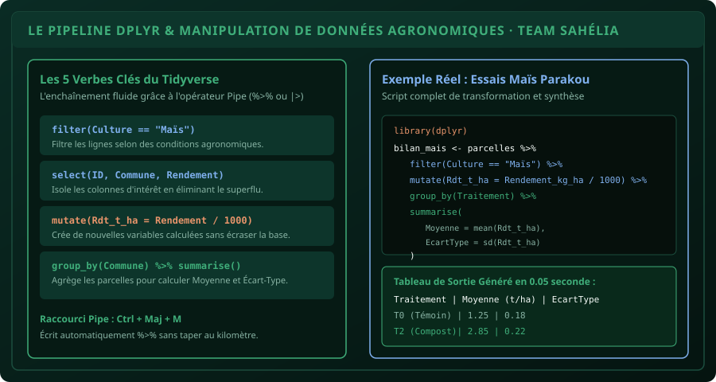

# CHAPITRE 2 : MANIPULATION DE DONNÉES AGRONOMIQUES AVEC TIDYVERSE & DPLYR
## Du fichier d'enquête complexe au tableau d'analyse épuré en quelques lignes de code fluide

> **Manuel :** 04 — R & RStudio pour l'Agronomie : Analyse statistique des essais et enquêtes  
> **Auteurs :** Sègla Bio KPEROU, Olivier AREMOU & TEAM Sahélia  
> **Temps d’apprentissage :** 40 minutes de lecture active + 30 minutes d'atelier pratique  
> **Illustration associée :** `schemas/schema_02_pipeline_dplyr.svg`  
> **Jeu de données :** `../../01-excel-etudiants-professionnels/datasets/dataset_agronomique_sahelia.csv`

---

## 1. Objectifs d'Impact Réel
À la fin de ce chapitre, vous saurez :
1. **Comprendre et utiliser l'opérateur Pipe (`%>%` ou `|>`)** pour enchaîner vos opérations d'analyse sans créer 15 tables intermédiaires temporaires.
2. **Filtrer des parcelles spécifiques** avec `filter()` (ex: parcelles de maïs ayant reçu plus de 50 kg/ha d'Urée).
3. **Isoler les variables stratégiques** avec `select()` en éliminant les colonnes superflues issues de la collecte.
4. **Calculer de nouvelles variables agronomiques** avec `mutate()` (conversion des rendements de kg/ha en tonnes/ha, calcul des marges brutes).
5. **Calculer des moyennes, écarts-types et coefficients de variation par traitement** en 2 lignes de code avec `group_by() %>% summarise()`.

---

## 2. Pourquoi Dplyr Enterre le R de Base

Dans les anciens manuels de statistiques, pour calculer la moyenne de rendement des parcelles de Maïs à Parakou ayant reçu l'engrais T2, les étudiants devaient écrire du code lourd et difficile à relire :

```r
# L'ANCIENNE MÉTHODE (R de base, source d'erreurs fréquentes) :
sous_table <- donnees[donnees$Culture == "Maïs" & donnees$Commune == "Parakou", ]
moyenne <- mean(sous_table$Rendement_kg_ha, na.rm = TRUE)
```

Avec **dplyr** (le cœur du Tidyverse), le code se lit comme une phrase en français grâce à l'opérateur Pipe (`%>%`) :

```r
# LA MÉTHODE MODERNE DPLYR (Élégante, rapide et infaillible) :
bilan <- donnees %>%
  filter(Culture == "Maïs", Commune == "Parakou") %>%
  summarise(Moyenne = mean(Rendement_kg_ha))
```



---

## 3. Les 5 Verbes Fondamentaux de la Manipulation de Données

Le package `dplyr` repose sur une grammaire universelle de 5 verbes d'action :

### 1. `filter()` : Filtrer les lignes selon des conditions
Permet de ne conserver que les observations qui respectent des critères scientifiques précis :
```r
# Filtrer les parcelles de Maïs avec un rendement supérieur à 2 tonnes (2000 kg/ha)
parcelles_haut_rdt <- donnees %>%
  filter(Culture == "Maïs" & Rendement_kg_ha > 2000)

# Filtrer sur plusieurs communes cibles du Nord-Bénin
zone_nord <- donnees %>%
  filter(Commune %in% c("Parakou", "Bembèrèkè", "N'Dali"))
```

### 2. `select()` : Sélectionner les colonnes utiles
Après une enquête KoboToolbox de 60 questions, vous ne voulez analyser que le rendement et les intrants :
```r
# Conserver uniquement les colonnes indispensables
donnees_analyse <- donnees %>%
  select(ID_Parcelle, Commune, Culture, Traitement, Rendement_kg_ha)

# Exclure une colonne encombrante (ex: Note_Enqueteur)
table_propre <- donnees %>%
  select(-Note_Enqueteur)
```

### 3. `mutate()` : Créer ou transformer des variables
`mutate()` ajoute une nouvelle colonne calculée tout en préservant le reste du tableau :
```r
# Convertir le rendement en tonnes par hectare et calculer l'écart à la moyenne
donnees <- donnees %>%
  mutate(
    Rendement_t_ha = Rendement_kg_ha / 1000,
    Efficience_Azote = Rendement_kg_ha / Dose_Uree_kg_ha
  )
```

### 4. `arrange()` : Trier les données
```r
# Trier par ordre décroissant de rendement (du meilleur au plus faible)
classement_parcelles <- donnees %>%
  arrange(desc(Rendement_kg_ha))
```

### 5. `group_by()` + `summarise()` : Le duo d'or des synthèses agronomiques
C'est l'équivalent ultra-puissant des tableaux croisés dynamiques d'Excel :
```r
# Calcul du bilan agronomique complet par Traitement
tableau_recap <- donnees %>%
  group_by(Traitement) %>%
  summarise(
    Nombre_Repetitions = n(),
    Rendement_Moyen = mean(Rendement_kg_ha, na.rm = TRUE),
    Ecart_Type = sd(Rendement_kg_ha, na.rm = TRUE),
    CV_Pourcent = (Ecart_Type / Rendement_Moyen) * 100
  )
```

> [!TIP]
> **Le raccourci clavier indispensable du Pipe :**  
> Ne tapez pas `% > %` à la main ! Pressez simultanément :  
> **`Ctrl + Maj + M`** dans RStudio. L'opérateur `%>%` (ou `|>`) s'insère automatiquement avec les espaces autour.

---

## 4. Atelier Pratique : Audit de l'Essai de Parakou

Ouvrez RStudio et exécutez le script complet ci-dessous :

```r
# ==============================================================================
# MANUEL 04 - ATELIER 2 : PIPELINE DE TRANSFORMATION AGRONOMIQUE
# ==============================================================================

library(dplyr)

# 1. Chargement des parcelles
df <- read.csv("dataset_agronomique_sahelia.csv", stringsAsFactors = TRUE)

# 2. Pipeline complet : Filtrage, calcul et synthèse en 1 seul bloc
synthese_parakou <- df %>%
  filter(Culture == "Maïs") %>%
  mutate(Rdt_t_ha = Rendement_kg_ha / 1000) %>%
  group_by(Commune, Traitement) %>%
  summarise(
    N = n(),
    Moyenne_t_ha = round(mean(Rdt_t_ha), 2),
    Ecart_Type = round(sd(Rdt_t_ha), 2)
  ) %>%
  arrange(desc(Moyenne_t_ha))

# 3. Affichage du résultat net
print(synthese_parakou)
```

---

## 5. Fiche Mémo Récapitulative Détachable

```text
================================================================================
             FICHE MÉMO · DPLYR & LE PIPELINE TIDYVERSE
================================================================================
1. L'OPÉRATEUR PIPE (Ctrl + Maj + M) :
   - donnees %>% action1() %>% action2()
   - Lit de haut en bas comme une phrase logique.

2. LES 5 VERBES MAÎTRES :
   - filter()   : Conserve les lignes respectant une condition (==, >, %in%).
   - select()   : Garde ou retire (-) des colonnes.
   - mutate()   : Calcule une nouvelle variable (ex: Rdt_t_ha = Rdt_kg / 1000).
   - arrange()  : Trie les lignes (croissant ou desc() décroissant).
   - group_by() + summarise() : Calcule des statistiques par groupe (mean, sd).

3. FORMULE DU COEFFICIENT DE VARIATION AGRONOMIQUE :
   - CV = (sd(x) / mean(x)) * 100
================================================================================
TEAM Sahélia · Apprendre. Créer. Innover.
================================================================================
```
