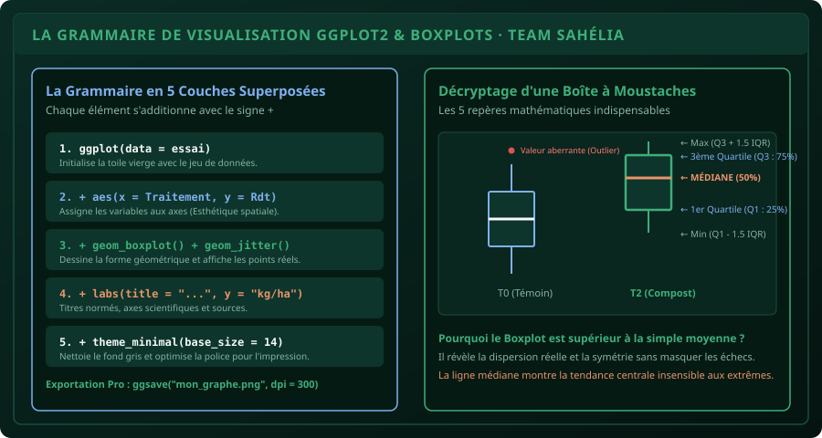

# CHAPITRE 3 : STATISTIQUES DESCRIPTIVES & VISUALISATION AVEC GGPLOT2
## La grammaire des graphiques pour concevoir des figures de publication scientifique

> **Manuel :** 04 — R & RStudio pour l'Agronomie : Analyse statistique des essais et enquêtes  
> **Auteurs :** Sègla Bio KPEROU, Olivier AREMOU & TEAM Sahélia  
> **Temps d’apprentissage :** 45 minutes de lecture active + 30 minutes de codage  
> **Illustration associée :** `schemas/schema_03_anatomie_ggplot2.svg`  
> **Jeu de données :** `../../01-excel-etudiants-professionnels/datasets/dataset_agronomique_parakou.csv`

---

## 1. Objectifs d'Impact Réel
À la fin de ce chapitre, vous saurez :
1. **Maîtriser les 5 couches fondamentales** de `ggplot2` (Données, Esthétique `aes`, Géométrie `geom`, Titres `labs`, Thème `theme`).
2. **Construire et décrypter une boîte à moustaches (Boxplot)** scientifique (Médiane, Quartiles Q1/Q3, Écart interquartile IQR, Valeurs aberrantes).
3. **Superposer les points de parcelles réels (`geom_jitter()`)** sur les boîtes pour offrir une transparence méthodologique totale au jury.
4. **Générer des graphiques à facettes (`facet_wrap()`)** pour comparer 4 communes d'un coup sans écrire 4 scripts différents.
5. **Exporter des images en haute résolution (300 DPI)** avec `ggsave()` prêtes pour l'impression d'un mémoire ou la publication d'un article.

---

## 2. La Philosophie de ggplot2 : Une Pyramide de Couches

Contrairement aux fonctions graphiques classiques de base de R (`plot()`, `hist()`) qui dessinent tout d'un bloc rigide, **ggplot2** repose sur la *Grammaire des Graphiques* inventée par Leland Wilkinson et popularisée par Hadley Wickham.

Un graphique se construit comme un mille-feuille :
$$\text{Graphique} = \text{Données} + \text{Esthétiques (Axes/Couleurs)} + \text{Formes Géométriques} + \text{Habillage}$$

Chaque couche s'ajoute simplement avec l'opérateur **`+`** :

```r
library(ggplot2)

ggplot(data = donnees, aes(x = Traitement, y = Rendement_kg_ha, fill = Traitement)) +
  geom_boxplot(alpha = 0.8, outlier.color = "red") +
  geom_jitter(width = 0.15, alpha = 0.5) +
  labs(
    title = "Comparaison des Rendements de Maïs par Traitement",
    subtitle = "Essai agronomique en blocs complets randomisés · Parakou 2026",
    x = "Mode de Fertilisation",
    y = "Rendement grain (kg/ha)",
    caption = "Source : Données de terrain Faculté d'Agronomie (FA-UP)"
  ) +
  theme_minimal(base_size = 13)
```



---

## 3. L'Anatomie Mathématique d'un Boxplot

Dans un jury de soutenance d'agronomie, présenter une simple moyenne avec une barre verticale est considéré comme un travail amateur. Pourquoi ?  
Parce que deux parcelles peuvent avoir la même moyenne de $2\,000\text{ kg/ha}$, alors que la première a des rendements réguliers ($1\,900$ et $2\,100$) et la seconde a subi un échec total sur un bloc ($500$ et $3\,500$).

Le **Boxplot (Boîte à moustaches)** révèle la réalité du vivant :
1. **La barre centrale épaisse :** La **Médiane** (50 % des parcelles produisent plus, 50 % produisent moins). Elle est insensible aux valeurs extrêmes accidentelles.
2. **Le bas de la boîte :** Le **1er Quartile ($Q_1$)** (25 % des données sont en dessous).
3. **Le haut de la boîte :** Le **3ème Quartile ($Q_3$)** (75 % des données sont en dessous).
4. **La hauteur de la boîte :** L'**Écart Interquartile ($IQR = Q_3 - Q_1$)**, qui mesure la dispersion centrale des 50 % d'essais du milieu.
5. **Les moustaches :** Elles s'étendent jusqu'à la valeur la plus éloignée ne dépassant pas $1{,}5 \times IQR$.
6. **Les points isolés au-delà :** Les **outliers** (valeurs aberrantes), causés par une attaque parasitaire localisée ou une erreur de pesée, immédiatement identifiables.

---

## 4. La Puissance des Facettes (`facet_wrap`)

Vous voulez comparer les rendements de maïs entre les différentes communes du Borgou sans copier-coller votre code ?  
Ajoutez simplement une ligne :

```r
ggplot(donnees, aes(x = Traitement, y = Rendement_kg_ha, fill = Traitement)) +
  geom_boxplot() +
  facet_wrap(~ Commune) +
  theme_bw()
```

RStudio génère instantanément une grille de 4 sous-graphiques indépendants (`Parakou`, `N'Dali`, `Bembèrèkè`, `Tchaourou`), avec des échelles harmonisées !

---

## 5. Exporter en Qualité Imprimerie avec `ggsave`

Ne faites jamais de capture d'écran avec l'outil de rognage sur vos graphiques RStudio : l'image serait pixélisée et floue dans votre mémoire Word imprimé.

Utilisez la fonction vectorielle `ggsave()` :

```r
# Sauvegarder le dernier graphique tracé en haute définition
ggsave(
  filename = "figure_01_rendements_mais_parakou.png",
  width = 8,        # Largeur en pouces
  height = 5,       # Hauteur en pouces
  dpi = 300         # 300 points par pouce : standard d'édition scientifique
)
```

---

## 6. Fiche Mémo Récapitulative Détachable

```text
================================================================================
             FICHE MÉMO · LA SYNTAXE MAÎTRESSE DE GGPLOT2
================================================================================
1. LA FORMULE CANONIQUE :
   ggplot(data = tab, aes(x = Variable_X, y = Variable_Y, fill = Facteur)) +
     geom_boxplot() +
     geom_jitter(width = 0.1) +
     labs(title = "Titre Scientifique", x = "Axe X", y = "Axe Y") +
     theme_minimal()

2. LES GÉOMÉTRIES CLÉS :
   - geom_boxplot() : Distribution, médiane et quartiles.
   - geom_point()   : Nuage de points (corrélations).
   - geom_histogram(): Fréquences et forme de la distribution.
   - geom_col()     : Diagramme en barres de moyennes.

3. EXPORT HAUTE RÉSOLUTION :
   - ggsave("mon_graphe.png", width = 8, height = 5, dpi = 300)
================================================================================
TEAM Sahélia · Apprendre. Créer. Innover.
================================================================================
```
