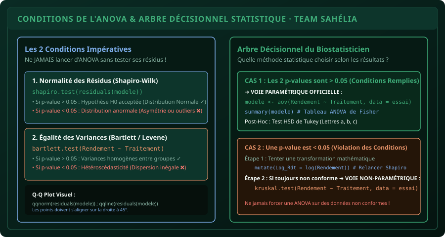

# CHAPITRE 4 : CONDITIONS PRÉALABLES DE L'ANOVA (NORMALITÉ & HOMOSCÉDASTICITÉ)
## Les contrôles stricts de Shapiro-Wilk et Bartlett pour éviter le rejet immédiat de son mémoire par le jury

> **Manuel :** 04 — R & RStudio pour l'Agronomie : Analyse statistique des essais et enquêtes  
> **Auteurs :** Sègla Bio KPEROU, Olivier AREMOU & TEAM Sahélia  
> **Temps d’apprentissage :** 40 minutes de lecture active + 30 minutes de travaux dirigés  
> **Illustration associée :** `schemas/schema_04_arbre_decision_tests_statistiques.svg`  
> **Jeu de données :** `../../01-excel-etudiants-professionnels/datasets/dataset_agronomique_sahelia.csv`

---

## 1. Objectifs d'Impact Réel
À la fin de ce chapitre, vous saurez :
1. **Comprendre pourquoi 50 % des analyses de mémoires d'ingénieurs sont statistiquement invalides** pour n'avoir pas testé les résidus.
2. **Tester la normalité des résidus** avec le test de **Shapiro-Wilk** (`shapiro.test()`) et l'inspection visuelle du **Q-Q Plot**.
3. **Tester l'égalité des variances (Homoscédasticité)** entre les traitements avec le test de **Bartlett** (`bartlett.test()`).
4. **Interpréter sans faille la valeur $p$ ($p$-value)** face au seuil académique $\alpha = 0{,}05$.
5. **Appliquer une transformation de variable** ($\log(x)$, $\sqrt{x}$) ou basculer vers le test non-paramétrique de **Kruskal-Wallis** en cas de non-conformité.

---

## 2. Le Piège de l'ANOVA Automatique : La Faute Lourde en Soutenance

Dans de nombreuses facultés d'agronomie, des étudiants ouvrent RStudio et tapent directement :
```r
summary(aov(Rendement ~ Traitement, data = mes_donnees))
```
Devant un jury de biométriciens avertis, la première question tombe immédiatement :  
*« Candidat, avez-vous vérifié que les résidus de votre modèle suivent une loi normale et que vos variances sont homogènes ? »*  
Si la réponse est non, **l'ensemble des conclusions du mémoire s'effondre**, car le test $F$ de Fisher repose mathématiquement sur ces deux piliers indispensables.



---

## 3. Condition 1 : La Normalité des Résidus (Shapiro-Wilk)

Attention : ce ne sont **pas** vos données brutes qui doivent être normales, ce sont **les résidus du modèle linéaire** (les écarts entre chaque valeur observée et la moyenne de son traitement) !

### La Démarche en 3 Lignes R :
```r
# 1. Ajuster le modèle linéaire
modele <- aov(Rendement_kg_ha ~ Traitement, data = donnees)

# 2. Extraire les résidus du modèle
residus <- residuals(modele)

# 3. Lancer le test officiel de Shapiro-Wilk
shapiro.test(residus)
```

### Comment lire le résultat dans la Console ?
```text
	Shapiro-Wilk normality test

data:  residus
W = 0.9682, p-value = 0.7241
```

* **Hypothèse nulle ($H_0$) :** Les résidus suivent une loi normale.
* **Hypothèse alternative ($H_1$) :** Les résidus ne suivent pas une loi normale.
* **La Règle d'or :** Si **$p\text{-value} > 0{,}05$** (ici $0{,}7241 > 0{,}05$), on ne peut pas rejeter $H_0$. **La condition de normalité est pleinement validée ! ✓**
* Si $p\text{-value} < 0{,}05$, la normalité est violée ❌.

---

## 4. Condition 2 : L'Égalité des Variances (Homoscédasticité)

L'ANOVA compare des moyennes, mais suppose que la variabilité interne au sein de chaque traitement est similaire. Si le traitement T0 a une variance de 10 et le traitement T2 une variance de 50 000, le test est faussé.

### Le Test de Bartlett en 1 Ligne :
```r
bartlett.test(Rendement_kg_ha ~ Traitement, data = donnees)
```

### Interprétation de la $p$-value :
```text
	Bartlett test of homogeneity of variances

data:  Rendement_kg_ha by Traitement
Bartlett's K-squared = 1.8412, df = 3, p-value = 0.606
```
* Ici, $p\text{-value} = 0{,}606 > 0{,}05$.
* Les variances sont statistiquement homogènes. **La condition d'homoscédasticité est validée ! ✓**

---

## 5. Que Faire Si Vos Données Échouent ? (Le Plan B)

Si votre $p$-value est inférieure à $0{,}05$, vous avez deux solutions professionnelles :

### Solution 1 : La Transformation Mathématique
Souvent, dans les comptages d'insectes ou les mesures de pourcentages, la distribution est étirée vers la droite. Appliquez une transformation :
```r
# Transformation logarithmique ou racine carrée
donnees$Log_Rendement <- log(donnees$Rendement_kg_ha)
modele_log <- aov(Log_Rendement ~ Traitement, data = donnees)
shapiro.test(residuals(modele_log))
```
Si la $p$-value repasse au-dessus de $0{,}05$, vous pouvez réaliser votre ANOVA sur les variables transformées !

### Solution 2 : Le Test Non-Paramétrique de Kruskal-Wallis
Si les données restent non-normales, vous abandonnez l'ANOVA paramétrique et utilisez l'équivalent sur les rangs (test de Kruskal-Wallis) :
```r
kruskal.test(Rendement_kg_ha ~ Traitement, data = donnees)
```
Le jury appréciera immensément cette rigueur : vous avez prouvé que vous maîtrisez la théorie biométrique et que vous ne forcez pas les données dans un modèle inadapté.

---

## 6. Fiche Mémo Récapitulative Détachable

```text
================================================================================
             FICHE MÉMO · VÉRIFICATION DES HYPOTHÈSES DE L'ANOVA
================================================================================
1. LE PROTOCOLE EN 2 TESTS :
   - Étape 1 : mod <- aov(Y ~ Traitement, data = tab)
   - Étape 2 : shapiro.test(residuals(mod))     -> Exige p > 0.05 (Normalité)
   - Étape 3 : bartlett.test(Y ~ Traitement)     -> Exige p > 0.05 (Homoscédasticité)

2. LA RÈGLE UNIVERSELLE DU SEUIL ALPHA = 0.05 :
   - p-value > 0.05 : Tout va bien, continuer vers l'ANOVA de Fisher.
   - p-value < 0.05 : Alerte ! Transformer les données ou passer à Kruskal-Wallis.

3. LE GRAPHIQUE DE CONTRÔLE :
   - qqnorm(residuals(mod)) ; qqline(residuals(mod), col = "red")
================================================================================
TEAM Sahélia · Apprendre. Créer. Innover.
================================================================================
```
