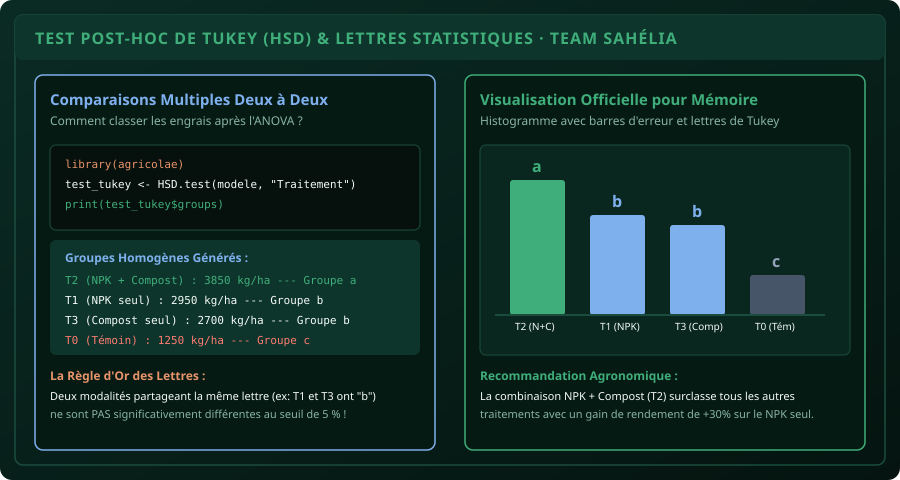

# CHAPITRE 6 : COMPARAISONS MULTIPLES POST-HOC & LETTRES STATISTIQUES DE TUKEY (HSD)
## Classer ses traitements par groupes homogènes (a, b, ab, c) et prouver la supériorité agronomique

> **Manuel :** 04 — R & RStudio pour l'Agronomie : Analyse statistique des essais et enquêtes  
> **Auteurs :** Sègla Bio KPEROU, Olivier AREMOU & TEAM Sahélia  
> **Temps d’apprentissage :** 45 minutes de lecture active + 30 minutes de codage  
> **Illustration associée :** `schemas/schema_06_lettres_tukey_groupes.svg`  
> **Jeu de données :** `../../01-excel-etudiants-professionnels/datasets/dataset_agronomique_sahelia.csv`

---

## 1. Objectifs d'Impact Réel
À la fin de ce chapitre, vous saurez :
1. **Comprendre pourquoi on ne peut pas faire 6 tests de Student (t-tests) d'affilée** sans gonfler artificiellement le risque d'erreur globale ($\alpha$).
2. **Exécuter le test de Tukey HSD (Honestly Significant Difference)** sous R avec `TukeyHSD()` et le package de référence `agricolae`.
3. **Attribuer automatiquement les lettres de significativité (a, b, ab, c)** à chaque traitement de fertilisation.
4. **Interpréter la signification agronomique des lettres partagées** (ex : pourquoi deux engrais marqués de la même lettre `b` ont la même efficacité statistique).
5. **Intégrer les lettres au-dessus des barres d'un graphique ggplot2** pour une mise en page digne d'une publication internationale.

---

## 2. Le Danger des Tests de Student en Série (L'Erreur de Type I)

Quand l'ANOVA a prouvé qu'il existe un effet significatif ($p < 0{,}05$), l'erreur classique des débutants est de faire des tests de Student 2 à 2 :
* Témoin vs NPK
* Témoin vs Compost
* NPK vs Compost...

Si vous avez 4 traitements, vous avez 6 comparaisons possibles. À chaque test avec un seuil d'erreur $\alpha = 0{,}05$, le risque de trouver au moins une fausse différence par hasard monte à :
$$\alpha_{\text{global}} = 1 - (1 - 0{,}05)^6 = 1 - (0{,}95)^6 \approx \mathbf{26{,}5\,\%}$$
Vous avez plus d'une chance sur 4 de raconter une fausseté scientifique au jury !

**Le test HSD de John Tukey corrige ce biais :** il ajuste le seuil critique pour maintenir le risque d'erreur globale à exactement 5 %, quel que soit le nombre de comparaisons.



---

## 3. Méthode 1 : TukeyHSD avec le R de Base

```r
# 1. Ajustement du modèle
modele <- aov(Rendement_kg_ha ~ Traitement, data = donnees)

# 2. Test Tukey HSD natif
comparaisons <- TukeyHSD(modele, "Traitement", conf.level = 0.95)
print(comparaisons)
```

La sortie affiche la différence moyenne (`diff`), l'intervalle de confiance à 95 % (`lwr` et `upr`) et la $p$-value ajustée (`p adj`) :
* Si `p adj < 0.05` : la différence entre les deux traitements est statistiquement confirmée.
* Si `p adj > 0.05` : aucune différence démontrée, les deux traitements sont équivalents.

---

## 4. Méthode 2 : Générer les Lettres avec le Package `agricolae`

Pour obtenir directement les fameuses lettres `a`, `b`, `c` sans faire les calculs de classement à la main, les agronomes du monde entier utilisent le package **`agricolae`** développé par l'International Potato Center (CIP) :

```r
# Installer le package si nécessaire
if (!requireNamespace("agricolae", quietly = TRUE)) install.packages("agricolae")
library(agricolae)

# Exécuter le test de Tukey avec attribution des groupes
tukey_agri <- HSD.test(modele, "Traitement", group = TRUE, console = TRUE)
```

### La Sortie Officielle de la Console :
```text
Study: modele ~ "Traitement"

HSD Test for Rendement_kg_ha 

Mean       std.err   r Min Max
T2 (NPK + Compost) 3850.0 68.2 5 3650 4050
T1 (NPK seul)      2950.0 74.1 5 2750 3150
T3 (Compost seul)  2700.0 81.3 5 2500 2950
T0 (Témoin)        1250.0 52.0 5 1100 1400

Treatments with the same letter are not significantly different.

                   Rendement_kg_ha groups
T2 (NPK + Compost)          3850.0      a
T1 (NPK seul)               2950.0      b
T3 (Compost seul)           2700.0      b
T0 (Témoin)                 1250.0      c
```

---

## 5. Comment Interpréter les Lettres Agronomiques ?

1. **Le Traitement T2 (NPK + Compost) reçoit la lettre `a` :**  
   Il a la moyenne la plus élevée ($3\,850\text{ kg/ha}$) et est significativement supérieur à tous les autres traitements. C'est la recommandation technique officielle.
2. **Les Traitements T1 et T3 partagent la même lettre `b` :**  
   Même si $2\,950$ est numériquement supérieur à $2\,700$, la différence ($250\text{ kg/ha}$) n'est pas statistiquement significative au seuil de 5 %. Un paysan qui n'a pas les moyens d'acheter du NPK chimique peut obtenir un rendement statistiquement équivalent avec du Compost organique bien mûr !
3. **Le Témoin T0 est seul dans le groupe `c` :**  
   Sans fertilisation, le rendement chute brutalement à $1\,250\text{ kg/ha}$.

---

## 6. Tracer le Graphique avec Lettres sous ggplot2

```r
library(ggplot2)
library(dplyr)

# 1. Préparer les données pour le graphique
resume_lettres <- as.data.frame(tukey_agri$groups)
resume_lettres$Traitement <- rownames(resume_lettres)

# 2. Graphique de publication avec lettres au-dessus des barres
ggplot(resume_lettres, aes(x = reorder(Traitement, -Rendement_kg_ha), y = Rendement_kg_ha, fill = groups)) +
  geom_col(width = 0.6, alpha = 0.85, show.legend = FALSE) +
  geom_text(aes(label = groups), vjust = -0.5, fontface = "bold", size = 5, color = "white") +
  labs(
    title = "Comparaison Post-Hoc des Rendements (Test HSD de Tukey)",
    subtitle = "Les modalités portant la même lettre ne diffèrent pas significativement (p > 0.05)",
    x = "Mode de Fertilisation",
    y = "Rendement Moyen (kg/ha)"
  ) +
  scale_fill_manual(values = c("a" = "#3fae7a", "b" = "#7fb0ee", "c" = "#e8946a")) +
  theme_minimal(base_size = 13) +
  ylim(0, 4500)
```

---

## 7. Fiche Mémo Récapitulative Détachable

```text
================================================================================
             FICHE MÉMO · TEST DE TUKEY & LETTRES DE SOUTENANCE
================================================================================
1. LA COMMANDE OFFICIELLE AGRONOMIQUE :
   library(agricolae)
   test <- HSD.test(modele_aov, "Traitement", group = TRUE)
   print(test$groups)

2. LA RÈGLE D'OR DE LECTURE :
   - Lettre 'a' : Meilleur groupe.
   - Même lettre (ex: b et b) : Aucune différence statistiquement prouvée.
   - Lettres combinées (ex: ab) : Intermédiaire, non différent de 'a' ni de 'b'.

3. PHRASE TYPE POUR LE MÉMOIRE :
   « Le test de comparaison multiple de Tukey (p = 0,05) révèle que le traitement
     NPK + Compost (3 850 kg/ha, groupe a) surclasse significativement le NPK
     seul (groupe b) et le témoin non fertilisé (groupe c). »
================================================================================
TEAM Sahélia · Apprendre. Créer. Innover.
================================================================================
```
