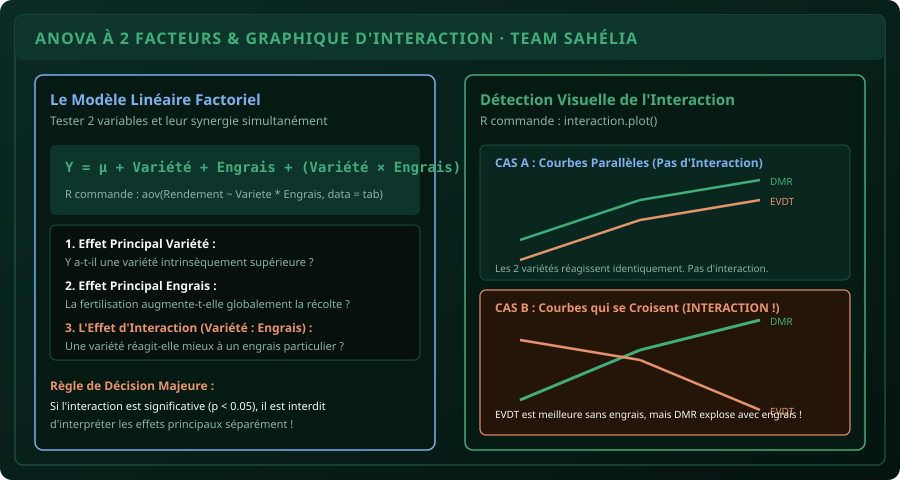

# CHAPITRE 7 : ANOVA À 2 FACTEURS & ANALYSE DES INTERACTIONS
## Traiter les dispositifs factoriels de terrain et comprendre la synergie entre intrants et variétés

> **Manuel :** 04 — R & RStudio pour l'Agronomie : Analyse statistique des essais et enquêtes  
> **Auteurs :** Sègla Bio KPEROU, Olivier AREMOU & TEAM Sahélia  
> **Temps d’apprentissage :** 45 minutes de lecture active + 35 minutes de codage  
> **Illustration associée :** `schemas/schema_07_graphique_interaction_factorielle.svg`  
> **Jeu de données :** `../../01-excel-etudiants-professionnels/datasets/dataset_agronomique_parakou.csv`

---

## 1. Objectifs d'Impact Réel
À la fin de ce chapitre, vous saurez :
1. **Comprendre la structure d'un essai factoriel** (ex : 2 Variétés $\times$ 4 Doses d'engrais = 8 combinaisons de traitements).
2. **Écrire le modèle linéaire à deux facteurs avec interaction** sous R (`aov(Y ~ FacteurA * FacteurB)`).
3. **Distinguer l'effet principal d'un facteur de son effet d'interaction**.
4. **Tracer et analyser un graphique d'interaction (`interaction.plot()`)** pour savoir si les courbes sont parallèles ou croisées.
5. **Prendre la bonne décision agronomique :** Pourquoi il est scientifiquement interdit de recommander une variété "en général" lorsque l'interaction est significative.

---

## 2. Le Modèle Mathématique de l'ANOVA à Deux Facteurs

Dans la réalité agricole au Bénin, une variété ne pousse jamais dans le vide : son potentiel dépend de la dose d'azote apportée, de l'espacement de semis ou du régime hydrique.  
L'ANOVA à deux facteurs avec interaction permet d'étudier simultanément :
* L'effet propre du premier facteur (ex : **Variété**).
* L'effet propre du deuxième facteur (ex : **Fertilisation**).
* **L'effet combiné non-additif : l'Interaction**.

L'équation s'écrit :
$$Y_{ijk} = \mu + \alpha_i + \beta_j + (\alpha\beta)_{ij} + \varepsilon_{ijk}$$

Où :
* $\alpha_i$ est l'effet de la modalité $i$ du facteur A (Variété).
* $\beta_j$ est l'effet de la modalité $j$ du facteur B (Fertilisation).
* $(\alpha\beta)_{ij}$ est **l'effet d'interaction** entre la variété $i$ et la fertilisation $j$.
* $\varepsilon_{ijk}$ est l'erreur aléatoire de la répétition $k$.



---

## 3. L'Écriture du Modèle sous R : Le Secret de l'Astérisque (`*`)

Dans R, la syntaxe de la formule est extrêmement expressive :

```r
# Modèle complet avec Effets Principaux + Interaction :
modele_factoriel <- aov(Rendement_kg_ha ~ Variete * Traitement, data = donnees)
summary(modele_factoriel)
```

> [!NOTE]
> **Différence entre `*` et `+` :**  
> * `Variete + Traitement` : Modèle additif simple (on force l'hypothèse qu'il n'y a AUCUNE interaction).  
> * `Variete * Traitement` : Équivaut à `Variete + Traitement + Variete:Traitement`. C'est le modèle complet obligatoire en agronomie de recherche !

---

## 4. Lecture du Tableau ANOVA Factoriel

```text
                   Df   Sum Sq  Mean Sq F value   Pr(>F)    
Variete             1  1420500 1420500   24.81 0.00032 ***
Traitement          3  6854200 2284733   39.91 1.82e-06 ***
Variete:Traitement  3   985000  328333    5.73 0.01120 *  
Residuals          12   687000   57250                      
```

### La Règle d'Or de Lecture : De Bas en Haut !
On regarde **toujours en premier la ligne d'interaction (`Variete:Traitement`)** :
1. **Ici, la $p$-value de l'interaction est $0{,}0112 < 0{,}05$ (`*`) :**  
   L'interaction est **statistiquement significative**.
2. **Conséquence scientifique capitale :**  
   Vous ne pouvez **PAS** dire simplement *« La variété DMR-ESR-W est meilleure que la variété EVDT »*. Pourquoi ? Parce que la supériorité de DMR dépend de la fertilisation !

---

## 5. Le Graphique d'Interaction (`interaction.plot`)

Pour expliquer visuellement cette interaction au jury, tracez le graphique de croisement des moyennes :

```r
interaction.plot(
  x.factor = donnees$Traitement,
  trace.factor = donnees$Variete,
  response = donnees$Rendement_kg_ha,
  fun = mean,
  type = "b",          # Lignes et points
  pch = c(16, 17),
  col = c("#3fae7a", "#e8946a"),
  lwd = 2,
  main = "Effet d'Interaction Variété × Fertilisation",
  xlab = "Mode de Fertilisation",
  ylab = "Rendement Moyen (kg/ha)",
  trace.label = "Variété"
)
```

### Diagnostic Visuel :
* **Si les deux courbes sont parallèles :** L'interaction est nulle ($p > 0{,}05$). L'engrais augmente les rendements de la même manière chez toutes les variétés.
* **Si les courbes se croisent ou s'écartent fortement :** Interaction forte ($p < 0{,}05$). Par exemple, la variété locale tolère mieux les sols pauvres (Témoin T0), mais la variété améliorée hybride explose de rendement dès qu'on apporte du NPK + Compost (T2).

---

## 6. Fiche Mémo Récapitulative Détachable

```text
================================================================================
             FICHE MÉMO · L'ANOVA À 2 FACTEURS & INTERACTIONS
================================================================================
1. LA COMMANDE CANONIQUE :
   modele <- aov(Rendement ~ FacteurA * FacteurB, data = tab)
   summary(modele)

2. L'ORDRE D'ANALYSE IMPÉRATIF :
   - Étape 1 : Regarder la ligne d'interaction FacteurA:FacteurB.
   - Si p < 0.05 : L'interaction est active. Ne pas interpréter les facteurs isolés.
   - Si p > 0.05 : Pas d'interaction. Les deux facteurs agissent indépendamment.

3. LE GRAPHIQUE D'INTERACTION :
   - interaction.plot(FacteurA, FacteurB, Variable_Y, fun = mean)
   - Lignes parallèles = Indépendance. Lignes sécantes = Synergie ou conflit.
================================================================================
TEAM Sahélia · Apprendre. Créer. Innover.
================================================================================
```
