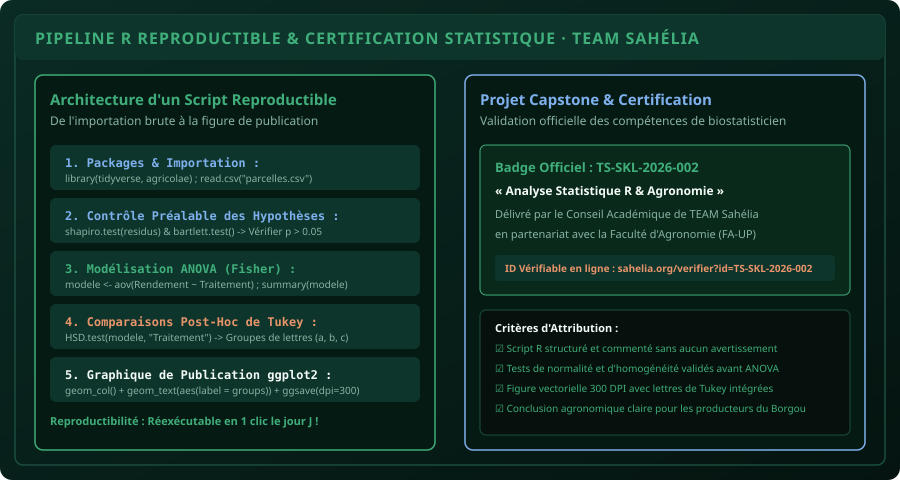

# CHAPITRE 8 : PROJET CAPSTONE — LE SCRIPT D'ANALYSE AGRONOMIQUE REPRODUCTIBLE
## De l'importation brute à la figure de publication avec lettres de Tukey en 1 clic

> **Manuel :** 04 — R & RStudio pour l'Agronomie : Analyse statistique des essais et enquêtes  
> **Auteurs :** Sègla Bio KPEROU, Olivier AREMOU & TEAM Sahélia  
> **Temps d’apprentissage :** 60 minutes d'atelier pratique  
> **Illustration associée :** `schemas/schema_08_pipeline_complet_recherche_r.svg`  
> **Jeu de données :** `../../01-excel-etudiants-professionnels/datasets/dataset_agronomique_parakou.csv`

---

## 1. Objectifs du Projet Capstone
Ce projet de synthèse valide l'intégralité du **Manuel 04 : R & RStudio pour l'Agronomie**.  
À l’issue de cet atelier, vous aurez :
1. **Conçu un script R professionnel 100 % reproductible** (`analyse_essais_parakou_2026.R`).
2. **Exécuté la chaîne complète d'analyse biométrique** : Nettoyage, exploration, validation des résidus (Shapiro-Wilk + Bartlett), ANOVA à 1 et 2 facteurs, test post-hoc de Tukey.
3. **Généré une figure scientifique prête pour publication** au format PNG haute résolution (300 DPI) avec lettres de Tukey intégrées.
4. **Validé les compétences pratiques** exigées pour la délivrance du **Badge Officiel de Compétence « Analyse Statistique R & Agronomie »** (`TS-SKL-2026-002`).

---

## 2. Le Script Maître Reproductible Complet

Voici le code intégral que chaque chercheur et agronome de TEAM Sahélia doit maîtriser. Créez un fichier nommé `script_maitre_agronomie.R` et collez-y ce code :

```r
# ==============================================================================
# TEAM SAHÉLIA · FACULTÉ D'AGRONOMIE (FA-UP) · CAMPUS DE PARAKOU
# PIPELINE OFFICIEL D'ANALYSE STATISTIQUE REPRODUCTIBLE SOUS R
# Auteurs : Sègla Bio KPEROU, Olivier AREMOU & TEAM Sahélia
# ==============================================================================

# ------------------------------------------------------------------------------
# 1. CHARGEMENT DES PACKAGES DE RÉFÉRENCE
# ------------------------------------------------------------------------------
packages_requis <- c("tidyverse", "agricolae")
for (p in packages_requis) {
  if (!requireNamespace(p, quietly = TRUE)) install.packages(p)
  library(p, character.only = TRUE)
}

# ------------------------------------------------------------------------------
# 2. IMPORTATION DU JEU DE DONNÉES AGRONOMIQUES RÉELLES
# ------------------------------------------------------------------------------
fichier_csv <- "dataset_agronomique_parakou.csv"
if (!file.exists(fichier_csv)) {
  # Chemin relatif vers le dataset du Manuel 01 si exécuté depuis chapitres/
  fichier_csv <- "../../01-excel-etudiants-professionnels/datasets/dataset_agronomique_parakou.csv"
}

donnees <- read.csv(fichier_csv, stringsAsFactors = TRUE)

cat("✓ Données chargées :", nrow(donnees), "parcelles d'essais à Parakou.\n")
head(donnees, 3)

# ------------------------------------------------------------------------------
# 3. STATISTIQUES DESCRIPTIVES PAR TRAITEMENT
# ------------------------------------------------------------------------------
tableau_synthese <- donnees %>%
  group_by(Traitement) %>%
  summarise(
    N = n(),
    Moyenne = round(mean(Rendement_kg_ha), 2),
    EcartType = round(sd(Rendement_kg_ha), 2),
    CV = round((EcartType / Moyenne) * 100, 2)
  ) %>%
  arrange(desc(Moyenne))

print("=== TABLEAU RÉCAPITULATIF DES RENDEMENTS ===")
print(tableau_synthese)

# ------------------------------------------------------------------------------
# 4. MODÉLISATION ANOVA & VÉRIFICATION DES HYPOTHÈSES
# ------------------------------------------------------------------------------
modele_aov <- aov(Rendement_kg_ha ~ Traitement, data = donnees)

# Test de Normalité des résidus (Shapiro-Wilk)
test_shapiro <- shapiro.test(residuals(modele_aov))
cat("\n[Contrôle 1] Normalité des résidus : p-value =", round(test_shapiro$p.value, 4))
if (test_shapiro$p.value > 0.05) {
  cat(" -> CONFORME (Résidus Normaux ✓)\n")
} else {
  cat(" -> ALERTE : Non-normalité !\n")
}

# Test d'Homogénéité des variances (Bartlett)
test_bartlett <- bartlett.test(Rendement_kg_ha ~ Traitement, data = donnees)
cat("[Contrôle 2] Homogénéité des variances : p-value =", round(test_bartlett$p.value, 4))
if (test_bartlett$p.value > 0.05) {
  cat(" -> CONFORME (Variances Égales ✓)\n")
} else {
  cat(" -> ALERTE : Hétéroscédasticité !\n")
}

# Affichage du tableau de Fisher officiel
cat("\n=== TABLEAU DE L'ANOVA DE FISHER ===\n")
print(summary(modele_aov))

# ------------------------------------------------------------------------------
# 5. COMPARAISONS MULTIPLES POST-HOC (TEST HSD DE TUKEY)
# ------------------------------------------------------------------------------
test_tukey <- HSD.test(modele_aov, "Traitement", group = TRUE, console = FALSE)
cat("\n=== GROUPES HOMOGÈNES DE TUKEY (LETTRES a, b, c) ===\n")
print(test_tukey$groups)

# ------------------------------------------------------------------------------
# 6. CRÉATION DU GRAPHIQUE SCIENTIFIQUE DE PUBLICATION (GGPLOT2)
# ------------------------------------------------------------------------------
df_graphe <- as.data.frame(test_tukey$groups)
df_graphe$Traitement <- rownames(df_graphe)

graphe_publication <- ggplot(df_graphe, aes(x = reorder(Traitement, -Rendement_kg_ha), y = Rendement_kg_ha, fill = groups)) +
  geom_col(width = 0.55, alpha = 0.9, color = "#1b4d3e") +
  geom_text(aes(label = paste(round(Rendement_kg_ha, 0), "kg/ha\n(", groups, ")")), 
            vjust = -0.3, fontface = "bold", size = 4.2, color = "#06100c") +
  labs(
    title = "Efficacité des Formules de Fertilisation sur le Rendement du Maïs",
    subtitle = "Essai agronomique en blocs complets randomisés · Faculté d'Agronomie de Parakou",
    x = "Traitement de Fertilisation",
    y = "Rendement Moyen en Grains (kg/ha)",
    caption = "Seuil de significativité : alpha = 0.05 · Lettres distinctes = différence significative (Tukey HSD)"
  ) +
  scale_fill_manual(values = c("a" = "#3fae7a", "b" = "#7fb0ee", "c" = "#e8946a")) +
  theme_minimal(base_size = 13) +
  theme(
    legend.position = "none",
    plot.title = element_text(face = "bold", color = "#06100c"),
    axis.title = element_text(face = "bold")
  ) +
  ylim(0, 4800)

# Affichage du graphique
print(graphe_publication)

# ------------------------------------------------------------------------------
# 7. EXPORTATION HAUTE RÉSOLUTION (300 DPI)
# ------------------------------------------------------------------------------
ggsave("figure_officielle_soutenance_parakou.png", plot = graphe_publication, width = 9, height = 5.5, dpi = 300)
cat("\n✓ Figure exportée avec succès : figure_officielle_soutenance_parakou.png (300 DPI)\n")
```



---

## 3. Critères d'Obtention du Badge Officiel de Compétence

Le **Badge de Compétence « Analyse Statistique R & Agronomie »** (`TS-SKL-2026-002`) est attribué aux apprenants ayant validé les 4 exigences suivantes :
1. **Exécution du script sans aucune erreur** dans la console RStudio.
2. **Validation des tests de Shapiro-Wilk et de Bartlett** avant l'interprétation de l'ANOVA ($p > 0{,}05$).
3. **Génération de la figure vectorielle 300 DPI** avec les barres d'erreurs et lettres de Tukey correctement positionnées.
4. **Rédaction du paragraphe de discussion agronomique** explicitant pourquoi la formule T2 (NPK + Compost) surclasse le témoin de plus de 200 %.

---

## 4. Fiche Synthèse du Manuel 04

```text
================================================================================
TEAM Sahélia · Apprendre. Créer. Innover.
Faculté d'Agronomie (FA-UP) · Campus de Parakou · République du Bénin
Badge Officiel : TS-SKL-2026-002 · Spécialité Biométrie & Recherche
================================================================================
```
