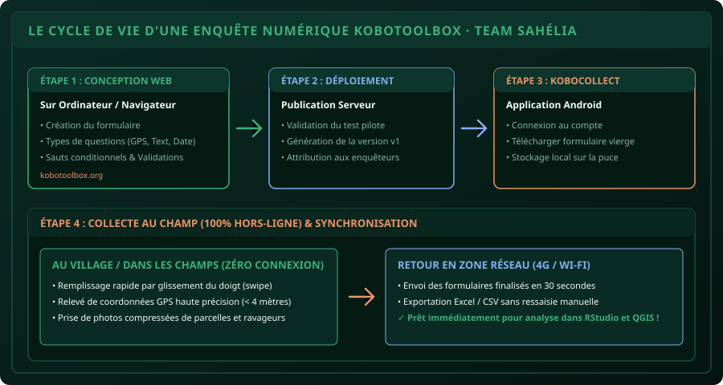

# CHAPITRE 1 : CONCEPTION D'UN FORMULAIRE D'ENQUÊTE & TYPES DE VARIABLES
## Construire son questionnaire numérique d'agronomie sans papier ni erreur de saisie

> **Manuel :** 05 — KoboToolbox & Collecte Numérique de Terrain sur Smartphone  
> **Auteurs :** Sègla Bio KPEROU, Olivier AREMOU & TEAM Sahélia  
> **Temps d’apprentissage :** 30 minutes de lecture + 20 minutes de conception web  
> **Illustration associée :** `schemas/schema_01_cycle_kobotoolbox.svg`

---

## 1. Objectifs d'Impact Réel
À la fin de ce chapitre, vous saurez :
1. **Créer un projet d'enquête complet** sur le serveur officiel KoboToolbox sans écrire une seule ligne de code.
2. **Assigner le type technique rigoureux** à chaque question (Texte, Nombre, Choix unique, Choix multiple, GPS, Photo, Date).
3. **Nommer proprement vos identifiants de variables (Data Column Names)** pour que le fichier exporté soit directement lisible dans R, SPSS et Excel.
4. **Tester votre questionnaire en direct** sur l'émulateur web avant de le déployer sur les téléphones de terrain.

---

## 2. Le Cycle Vertueux de la Collecte Numérique

L'enquête numérique ne consiste pas simplement à remplacer une feuille par un écran. Elle supprime l'étape la plus risquée et la plus longue de toute recherche : **la ressaisie manuelle sur ordinateur**.



---

## 3. Les Types de Variables Indispensables en Agronomie

Lors de la création de chaque question, KoboToolbox vous demande de choisir son type. Voici la règle de sélection :

| Type Kobo | Usage Terrain | Exemple de Question | Ce que l'enquêteur voit |
| :--- | :--- | :--- | :--- |
| **Text** | Saisie libre de mots | *Nom et Prénoms du producteur* | Clavier alphabétique |
| **Number (Integer)** | Chiffres ronds sans virgule | *Âge du chef d'exploitation* | Clavier purement numérique (0-9) |
| **Decimal** | Nombres avec décimales | *Superficie mesurée (ha)* | Clavier numérique avec point/virgule |
| **Select One** | Choix exclusif (1 seule réponse) | *Sexe du répondant (M / F)* | Boutons radio ronds |
| **Select Many** | Choix multiples (plusieurs réponses) | *Cultures pratiquées (Maïs, Soja...)* | Cases à cocher carrées |
| **Point (Geopoint)** | Coordonnées GPS du champ | *Localisation de la parcelle* | Bouton « Enregistrer le point GPS » |
| **Photo** | Preuve visuelle horodatée | *Photo du symptôme foliaire* | Déclenchement de l'appareil photo |
| **Date** | Date de calendrier | *Date du semis* | Sélecteur de date (Jour/Mois/Année) |

> [!CAUTION]
> ### Erreur classique : Utiliser le type « Text » pour un chiffre
> Si vous créez la question *« Rendement obtenu »* avec le type **Text**, un enquêteur tapera `3000`, un autre tapera `environ 3 tonnes`, et un troisième tapera `3,000 kg`. Votre tableau Excel sera inexploitable pour les calculs statistiques ! Choisissez toujours **Number (Integer)** ou **Decimal** pour toute grandeur mesurable.

---

## 4. Nommer Proprement les Noms de Colonnes (Data Column Names)

Par défaut, KoboToolbox nomme les colonnes avec tout le texte de votre question (ex: `Quelle_est_la_quantite_totale_de_mais_recoltee_en_sacs`). C'est illisible dans RStudio ou Excel.

**La bonne pratique des pros :**
Dans les paramètres de la question > **Data Column Name**, définissez un code court standardisé :
- Au lieu de *« Nom et prénoms de l'exploitant »* -> nommez `nom_producteur`.
- Au lieu de *« Quelle est la superficie de la parcelle en hectares ? »* -> nommez `sup_ha`.
- Au lieu de *« Rendement estimé de maïs en kg/ha »* -> nommez `rdt_kg_ha`.
- **Règles :** Tout en minuscules, aucun espace (utiliser le tiret du bas `_`), aucun accent.

---

## 5. Atelier Pratique : Créer l'Enquête Agricole de Parakou

1. Connectez-vous sur [kobotoolbox.org](https://kobotoolbox.org).
2. Cliquez sur **New > Build from scratch** :
   - Titre : `Enquete_Parcelles_Parakou_2026`.
3. Ajoutez successivement les 6 questions suivantes :
   - `Q1` : *Nom de l'enquêteur* (Type: **Text**, Nom variable: `enqueteur`)
   - `Q2` : *Commune d'enquête* (Type: **Select One**, Choix: `Parakou`, `N'Dali`, `Tchaourou`, `Bembèrèkè`, Nom variable: `commune`)
   - `Q3` : *Culture principale* (Type: **Select One**, Choix: `Maïs`, `Soja`, `Coton`, `Sorgho`, Nom variable: `culture`)
   - `Q4` : *Superficie emblavée (ha)* (Type: **Decimal**, Nom variable: `sup_ha`)
   - `Q5` : *Coordonnées GPS de la parcelle* (Type: **Point**, Nom variable: `gps_parcelle`)
   - `Q6` : *Photo de l'état végétatif* (Type: **Photo**, Nom variable: `photo_culture`)
4. Cliquez sur **Save** (Enregistrer) puis sur l'icône de l'œil **Preview** (Aperçu) pour tester le formulaire comme sur un smartphone.

---

## 6. Le Défi Communautaire TEAM Sahélia

> ### 🏆 Défi Hebdo n°05 : Le Formulaire Kobo Certifié
> 
> 1. Créez et déployez votre propre formulaire d'enquête sur votre compte KoboToolbox.
> 2. Remplissez 1 soumission test directement depuis l'aperçu web.
> 3. Allez dans l'onglet **Data > Table** pour voir votre première ligne enregistrée.
> 4. Prenez une capture d'écran de la table de données avec vos colonnes courtes bien nommées (`sup_ha`, `commune`, etc.).
> 5. Postez-la sur le canal de la communauté avec la mention :  
>    *« Défi Manuel 05 - Chapitre 1 KoboToolbox Validé ! »*.

---

## 7. Fiche Mémo Récapitulative Détachable

```text
================================================================================
             FICHE MÉMO · KOBOTOOLBOX : TYPES & VARIABLES
================================================================================
1. LE BON COMPTE :
   - Créez votre compte sur le Global KoboToolbox Server (kc.kobotoolbox.org).

2. LES 5 TYPES MAJEURS :
   - Integer / Decimal : Pour tous les chiffres et mesures (interdit d'utiliser Text).
   - Select One        : Pour les choix stricts (Sexe, Commune, Variété).
   - Select Many       : Pour les réponses combinées (Engrais utilisés).
   - Point (Geopoint)  : Pour la localisation satellite précise.
   - Photo             : Pour les preuves de terrain compressées.

3. RÈGLE DES NOMS DE VARIABLES (Data Column Name) :
   - Court, explicite, sans espace ni accent (ex: rdt_mais_ha).
================================================================================
TEAM Sahélia · Apprendre. Créer. Innover.
================================================================================
```
