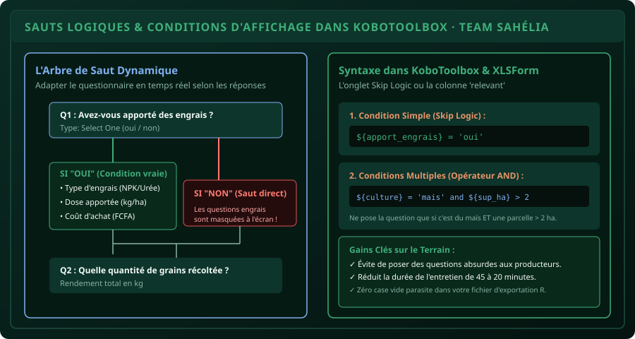

# CHAPITRE 2 : SAUTS LOGIQUES & CONDITIONS D'AFFICHAGE (SKIP LOGIC)
## Créer des questionnaires intelligents qui s'adaptent dynamiquement aux réponses du producteur

> **Manuel :** 05 — KoboToolbox & Collecte Numérique de Terrain sur Smartphone  
> **Auteurs :** Sègla Bio KPEROU, Olivier AREMOU & TEAM Sahélia  
> **Temps d’apprentissage :** 35 minutes de lecture active + 25 minutes de conception  
> **Illustration associée :** `schemas/schema_02_skip_logic_arborescence.svg`

---

## 1. Objectifs d'Impact Réel
À la fin de ce chapitre, vous saurez :
1. **Éliminer les questions inutiles et absurdes sur le terrain** en masquant les sections non pertinentes pour le répondant.
2. **Configurer des conditions de saut simples** dans l'éditeur KoboToolbox (Skip Logic).
3. **Maîtriser la syntaxe formelle de conditionnement** (`${variable} = 'valeur'`).
4. **Combiner plusieurs critères logiques** avec les opérateurs `and` (ET) et `or` (OU).
5. **Diviser par 2 le temps de passage d'un questionnaire d'enquête** (passer de 45 minutes à 20 minutes par exploitation).

---

## 2. Le Drame du Questionnaire Linéaire Papier

Sur un questionnaire papier classique, l'enquêteur doit lire des consignes complexes :  
*« Si le producteur a répondu NON à la question 14, sautez directement à la question 28 page 5 »*.  
Dans la fatigue du terrain sous le soleil de Parakou, **l'enquêteur oublie la consigne** : il pose des questions sans objet (*« Quelle dose d'engrais chimique avez-vous mise ? »* à un producteur 100 % biologique), ce qui agace le paysan et génère des données incohérentes dans votre base finale.

### La Solution Numérique : Le Formulaire Vivant
Dans KoboToolbox, **une question conditionnelle n'apparaît à l'écran que si la condition est remplie**. Si le producteur répond "Non", la question sur les engrais reste invisible et le formulaire affiche directement la suite.



---

## 3. Configuration dans l'Éditeur Web Kobo

Pour ajouter un saut logique sur une question (ex : *« Type d'engrais utilisé »*) :
1. Cliquez sur l'icône **Engrenage (Settings)** de la question cible.
2. Dans le panneau latéral, ouvrez la section **Skip Logic (Logique de saut)**.
3. Cliquez sur **+ Add a condition (+ Ajouter une condition)**.
4. Sélectionnez la question déclencheur : *« Avez-vous apporté des engrais ? »*.
5. Choisissez l'opérateur : **= (est égal à)**.
6. Choisissez la valeur déclenchante : **Oui**.
7. Enregistrez : désormais, la question ne s'affichera que si l'enquêteur a coché "Oui" à la question précédente.

---

## 4. La Syntaxe des Conditions Complexes (`and` / `or`)

Pour les enquêtes de recherche avancées, vous devez parfois croiser plusieurs critères :

### Cas 1 : La Condition Double avec `and` (ET)
*On ne veut poser la question sur le pulvérisateur motorisé que si l'exploitant cultive du Coton ET que sa superficie dépasse 3 hectares :*
```text
${culture} = 'coton' and ${sup_ha} > 3
```

### Cas 2 : La Condition Alternative avec `or` (OU)
*On affiche la question sur l'irrigation si le producteur cultive de la Tomate OU du Piment :*
```text
${culture} = 'tomate' or ${culture} = 'piment'
```

### Cas 3 : Les Questions à Choix Multiples (`selected()`)
Quand la question déclencheur est de type **Select Many** (cases à cocher multiples), la syntaxe change obligatoirement :
```text
selected(${intrants_utilises}, 'npk')
```
*Cette fonction vérifie si l'option 'npk' fait partie des cases cochées, même si l'agriculteur a aussi coché Urée et Fumier.*

---

## 5. Atelier Pratique : Module Intrants & Équipement

Dans votre formulaire de Parakou :
1. Créez la question `Q_Mecanisation` : *« Utilisez-vous un tracteur ? »* (Select One: `oui` / `non`).
2. Créez la question `Q_Cout_Tracteur` : *« Quel est le coût de location du tracteur par hectare (FCFA) ? »* (Type: **Number**).
3. Appliquez le saut logique sur `Q_Cout_Tracteur` : `${Q_Mecanisation} = 'oui'`.
4. Testez dans l'aperçu : la question du coût doit disparaître quand vous cochez "Non" et réapparaître instantanément quand vous cochez "Oui".

---

## 6. Fiche Mémo Récapitulative Détachable

```text
================================================================================
             FICHE MÉMO · SKIP LOGIC DANS KOBOTOOLBOX
================================================================================
1. RÈGLE D'OR :
   - Le Skip Logic se paramètre TOUJOURS sur la question à masquer/afficher,
     et JAMAIS sur la question déclencheur !

2. LES 3 SYNTAXES FONDAMENTALES :
   - Égalité simple : ${reponse} = 'oui'
   - Différence     : ${statut} != 'celibataire'
   - Choix multiple : selected(${materiel}, 'charrette')

3. COMBINAISONS LOGIQUES :
   - and : Les 2 conditions doivent être vraies simultanément.
   - or  : Au moins 1 des 2 conditions doit être vraie.
================================================================================
TEAM Sahélia · Apprendre. Créer. Innover.
================================================================================
```
