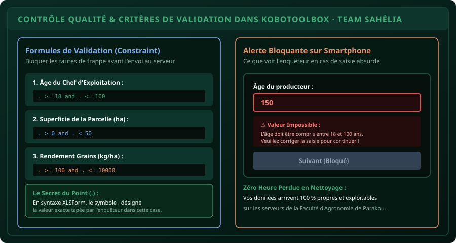

# CHAPITRE 3 : CRITÈRES DE VALIDATION & CONTRÔLE QUALITÉ À LA SAISIE
## Bloquer les données absurdes directement sur le smartphone et garantir une base 100 % saine

> **Manuel :** 05 — KoboToolbox & Collecte Numérique de Terrain sur Smartphone  
> **Auteurs :** Sègla Bio KPEROU, Olivier AREMOU & TEAM Sahélia  
> **Temps d’apprentissage :** 35 minutes de lecture active + 25 minutes d'atelier pratique  
> **Illustration associée :** `schemas/schema_03_criteres_validation_erreurs.svg`

---

## 1. Objectifs d'Impact Réel
À la fin de ce chapitre, vous saurez :
1. **Éviter les erreurs de frappe de terrain** (un enquêteur qui tape `150` ans pour l'âge ou `5000` ha pour une parcelle paysanne).
2. **Définir des plages de valeurs autorisées (Constraint)** avec le symbole point (`.`).
3. **Rédiger des messages d'erreur pédagogiques et bloquants (Constraint Message)** en français ou en langues nationales.
4. **Vérifier la cohérence chronologique des dates** (la date de récolte doit obligatoirement être postérieure à la date de semis).
5. **Contrôler la somme des pourcentages** (la répartition des cultures doit faire exactement 100 %).

---

## 2. Le Principe du Contrôle à la Source (Garbage In, Garbage Out)

Dans les anciens projets de développement rural, les enquêteurs remplissaient des fiches papier. Deux mois plus tard, lors de la saisie sur ordinateur, le statisticien découvrait des aberrations :
* Un producteur âgé de 8 ans.
* Un champ de maïs récolté le 12 mai alors que le semis avait eu lieu le 20 juillet.
* Une dose d'engrais de 25 000 kg par hectare.

**Le principe de KoboToolbox est le verrouillage à la source :** le smartphone refuse d'enregistrer la question tant que la valeur saisie ne respecte pas les lois de l'agronomie et de la logique.



---

## 3. Les Formules de Contraintes Indispensables (Constraint)

Dans les paramètres de la question > **Validation Criteria (Critères de validation)**, vous saisissez une formule mathématique. Le point **`.`** représente la valeur saisie par l'enquêteur.

### 1. Limiter un Nombre à une Plage Réaliste
* **Âge du chef de ménage :** `. >= 18 and . <= 100`  
  *Empêche les enfants de moins de 18 ans et les âges fantaisistes.*
* **Superficie de la parcelle (ha) :** `. > 0 and . <= 50`  
  *Interdit les superficies nulles ou négatives.*
* **Rendement maïs (kg/ha) :** `. >= 100 and . <= 12000`  
  *Au-delà de 12 tonnes/ha au Nord-Bénin, c'est une faute de frappe.*

### 2. Cohérence Chronologique entre Deux Dates
Si vous avez une question `date_semis` et une question `date_recolte` :  
Sur la question `date_recolte`, appliquez la contrainte :
```text
. >= ${date_semis}
```
*Le smartphone bloque si l'enquêteur entre une date de récolte antérieure au semis.*

### 3. La Règle des 100 % (Somme de Pourcentages)
Si vous demandez la part de la récolte vendue (`%`) et la part autoconsommée (`%`) :  
Sur la deuxième question, contraignez la somme :
```text
(. + ${part_vendue}) = 100
```

---

## 4. Rédiger un Message d'Erreur Personnalisé (Constraint Message)

Si vous ne configurez pas de message d'erreur, Kobo affichera un message froid : *« Réponse non valide »*. L'enquêteur sera bloqué sans comprendre pourquoi.

Dans le champ **Error Message**, écrivez une consigne claire et bienveillante :
* *« Valeur impossible : L'âge du producteur doit être compris entre 18 et 100 ans. Veuillez vérifier avec la personne interrogée. »*
* *« Incohérence chronologique : La date de récolte ne peut pas être avant la date de semis (${date_semis}). »*

---

## 5. Atelier Pratique : Blindage du Formulaire de Parakou

Ajoutez les 3 verrous de sécurité suivants sur votre questionnaire :
1. Sur `sup_ha` : Contrainte `. > 0 and . < 100` avec message *« La superficie doit être comprise entre 0,1 et 100 hectares. »*.
2. Sur `rdt_kg_ha` : Contrainte `. >= 0 and . <= 15000` avec message *« Rendement hors normes. Vérifiez le poids en sacs. »*.
3. Testez dans l'aperçu en tapant volontairement `-5` puis `25000` : vérifiez que le bouton "Suivant" refuse de valider tant que le chiffre est faux.

---

## 6. Fiche Mémo Récapitulative Détachable

```text
================================================================================
             FICHE MÉMO · CRITÈRES DE VALIDATION DANS KOBOTOOLBOX
================================================================================
1. LE SYMBOLE MAÎTRE :
   - Le point (.) désigne la valeur que l'enquêteur vient de taper.

2. SYNTAXES TYPES :
   - Intervalle numérique : . >= 18 and . <= 99
   - Valeur strictement positive : . > 0
   - Dépendance d'une date : . >= ${date_semis}
   - Longueur de texte fixe (ex: Téléphone 8 chiffres) : string-length(.) = 8

3. RÈGLE D'OR :
   - Chaque contrainte doit TOUJOURS être accompagnée de son Constraint Message
     explicatif pour guider l'agent de terrain.
================================================================================
TEAM Sahélia · Apprendre. Créer. Innover.
================================================================================
```
