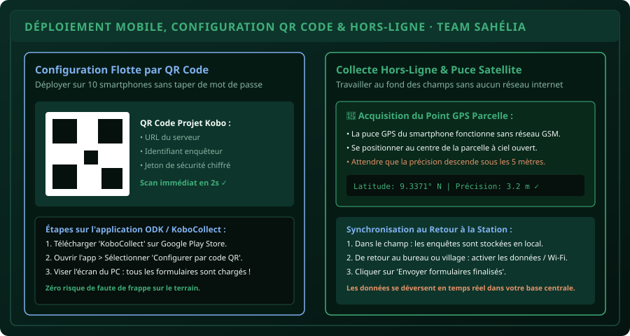

# CHAPITRE 5 : DÉPLOIEMENT MOBILE, CONFIGURATION PAR QR CODE & COLLECTE HORS-LIGNE
## Piloter une équipe d'enquêteurs de terrain sans réseau internet et géolocaliser les parcelles par satellite

> **Manuel :** 05 — KoboToolbox & Collecte Numérique de Terrain sur Smartphone  
> **Auteurs :** Sègla Bio KPEROU, Olivier AREMOU & TEAM Sahélia  
> **Temps d’apprentissage :** 40 minutes de lecture active + 30 minutes de configuration smartphone  
> **Illustration associée :** `schemas/schema_05_deploiement_mobile_odk_qrcode.svg`

---

## 1. Objectifs d'Impact Réel
À la fin de ce chapitre, vous saurez :
1. **Configurer une flotte de 10 smartphones d'enquêteurs en 1 minute** grâce au QR Code de déploiement automatique.
2. **Collecter des données 100 % hors-ligne** dans les villages et parcelles du Borgou totalement isolés de tout réseau téléphonique.
3. **Obtenir des coordonnées GPS satellites ultra-précises** (seuil de tolérance inférieur à 5 mètres).
4. **Appliquer les protocoles d'économie de batterie** pour tenir une journée complète de 10 heures d'enquêtes sous forte chaleur.
5. **Synchroniser les formulaires finalisés en un clic** dès le retour à la station de recherche ou au Wi-Fi.

---

## 2. Le Déploiement par QR Code : La Fin des Fautes de Frappe

Dans le passé, pour configurer l'application sur le téléphone de chaque étudiant enquêteur, il fallait taper manuellement :
* L'URL du serveur : `https://kc.kobotoolbox.org/votre_identifiant`
* Le nom d'utilisateur
* Le mot de passe confidentiel...

Une seule lettre inversée et l'application ne téléchargeait pas le questionnaire.

### La Méthode TEAM Sahélia en 3 Secondes :
1. Sur votre ordinateur (KoboToolbox Web) : Ouvrez votre projet déployé.
2. Cliquez sur l'onglet **Settings > Form** ou le bouton **Collect data**.
3. Sélectionnez **Android application** : Kobo génère un **QR Code de configuration sécurisé**.
4. Sur le smartphone : Ouvrez l'application **KoboCollect**.
5. Cliquez sur **Configurer par code QR (Scan QR code)** et visez l'écran de votre ordinateur.
6. En 2 secondes, l'URL, les accès et les questionnaires sont installés automatiquement !



---

## 3. La Vérité sur le GPS Hors-Ligne : Comment Ça Marche ?

Beaucoup d'étudiants pensent à tort que le GPS nécessite une connexion internet mobile (forfait data 4G). **C'est faux !**

* **Le GPS est une puce électronique matérielle** intégrée à votre smartphone qui capte directement les ondes radio émises par les constellations de satellites américains (GPS), européens (Galileo) et russes (GLONASS) en orbite autour de la Terre.
* Vous pouvez activer le **Mode Avion** sur votre téléphone : le GPS continuera de fonctionner parfaitement !

> [!CAUTION]
> **Le Protocole d'Acquisition GPS de Terrain :**  
> 1. Ne prenez JAMAIS le point GPS à l'intérieur d'une maison ou sous un grand manguier touffu : les feuilles et la tôle bloquent les signaux satellites.  
> 2. Marchez jusqu'au centre de la parcelle agricole à ciel ouvert.  
> 3. Cliquez sur **Enregistrer le point GPS** et attendez 15 à 30 secondes que la puce se synchronise avec au moins 6 satellites.  
> 4. Ne validez le point que lorsque la précision affichée est **inférieure à 5 mètres** (idéalement 2 ou 3 mètres).

---

## 4. Protocole d'Énergie pour les Journées Terrain au Bénin

Sur le terrain dans les communes de Parakou, N'Dali ou Bembèrèkè, la température élevée et l'utilisation prolongée de l'écran vident les batteries rapidement :
1. **Activer le Mode Avion :** Couper la recherche constante d'antennes relais 4G dans les zones à faible réseau économise 50 % de batterie.
2. **Réduire la luminosité à 40 %** dès que vous êtes sous un arbre ou à l'ombre.
3. **Ne jamais laisser l'écran allumé entre deux concessions paysannes :** Verrouillez le smartphone avec le bouton latéral.
4. **Emporter une batterie externe (Power Bank) de 10 000 mAh** certifiée dans la sacoche d'enquête.

---

## 5. Synchronisation au Retour à la Base

À la fin de la journée :
1. L'enquêteur vérifie que toutes ses fiches sont dans l'onglet **Prêts pour l'envoi (Ready for send)**.
2. Connectez le smartphone au Wi-Fi de la faculté ou activez vos données mobiles.
3. Cliquez sur **Envoyer formulaires finalisés (Send Finalized Form)**.
4. Une barre de chargement verte confirme la transmission. Les formulaires sont archivés dans le téléphone et apparaissent instantanément sur le tableau de bord du superviseur.

---

## 6. Fiche Mémo Récapitulative Détachable

```text
================================================================================
             FICHE MÉMO · DÉPLOIEMENT & COLLECTE TERRAIN KOBOTOOLBOX
================================================================================
1. DÉPLOIEMENT RAPIDE :
   - Générer le QR Code sur Kobo Web -> Scanner avec l'appli KoboCollect.

2. PROTOCOLE GPS :
   - Ciel ouvert, au centre du champ, attendre précision < 5 m.
   - Fonctionne 100 % hors-ligne en mode avion.

3. RÈGLE D'OR DE SÉCURITÉ :
   - Ne jamais désinstaller l'application KoboCollect tant que les formulaires
     n'ont pas été synchronisés avec le serveur !
================================================================================
TEAM Sahélia · Apprendre. Créer. Innover.
================================================================================
```
