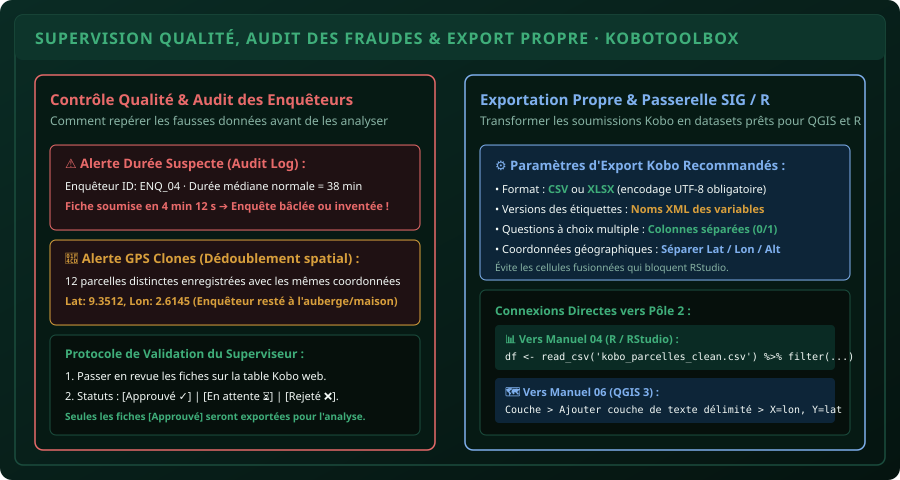

# CHAPITRE 6 : EXPORTATION, CONTRÔLE QUALITÉ & PASSERELLE R / QGIS
## Superviser les enquêteurs, traquer les fraudes et préparer les données pour l'analyse

> **Manuel :** 05 — KoboToolbox & Collecte Numérique de Terrain sur Smartphone  
> **Auteur :** Sègla Bio KPEROU, Olivier AREMOU & TEAM Sahélia  
> **Temps d’apprentissage :** 35 minutes de lecture + 30 minutes de manipulation pratique  
> **Illustration associée :** `schemas/schema_06_audit_export_supervision.svg`

---

## 1. Objectifs d'Impact Réel
À la fin de ce chapitre, vous saurez :
1. **Superviser en direct** le flux de soumissions des enquêteurs sur le serveur KoboToolbox.
2. **Détecter les fraudes et erreurs courantes** : durées d'interview anormalement courtes, coordonnées GPS identiques ("clones"), et incohérences logiques.
3. **Maîtriser le système de validation** (`Approved`, `On Hold`, `Rejected`) pour nettoyer les données avant l'export.
4. **Configurer un export propre** : séparer les coordonnées GPS en colonnes distinctes (`_latitude`, `_longitude`), choisir les identifiants XML des variables et encoder en UTF-8.
5. **Établir la passerelle directe** avec **RStudio** (Manuel 04) et **QGIS** (Manuel 06) pour boucler le Pôle 2.

---

## 2. Le Rôle Crucial de la Supervision en Temps Réel

Une collecte numérique sur smartphone ne supprime pas le risque d'erreur humaine ; en revanche, elle vous donne le pouvoir de **constater les anomalies dès le premier jour de collecte**, alors que les enquêteurs sont encore sur le terrain !



### Les 3 Signaux d'Alerte Indispensables à Surveiller :

1. **L'alerte de Durée d'Interview (Audit Log) :**
   - Grâce aux variables automatiques `start` et `end` configurées dans l'XLSForm, vous connaissez la durée exacte passée sur chaque questionnaire.
   - *Exemple concret :* Une enquête agronomique détaillée sur les pratiques culturales prend en moyenne **35 à 45 minutes** auprès d'un paysan. Si un enquêteur envoie des fiches enregistrées en **4 minutes et 12 secondes**, il ne fait aucun doute qu'il remplit le questionnaire sous un manguier sans poser les questions au producteur.

2. **L'alerte des Coordonnées GPS Clones :**
   - En ouvrant l'onglet **Données > Carte** sur KoboToolbox, visualisez la dispersion des points.
   - Si vous observez un amas de 15 parcelles distinctes superposées exactement au même endroit (souvent au niveau d'une auberge, d'une buvette ou du domicile de l'enquêteur à Parakou), l'enquêteur n'a pas arpenté les parcelles.

3. **L'analyse des distributions marginales quotidiennes :**
   - Vérifiez la fréquence des réponses aux questions ouvertes ou semi-ouvertes. Un enquêteur qui répond systématiquement "Non" ou "0" à tous les filtres pour raccourcir l'arborescence du questionnaire doit être rappelé à l'ordre immédiatement.

---

## 3. Le Protocole de Validation KoboToolbox

Dans l'onglet **Données > Tableau**, activez la colonne de statut de validation :
- **En attente (Pending) :** Statut par défaut de toute nouvelle fiche transmise.
- **Approuvé (Approved) :** La fiche a été auditée par le superviseur ou l'ingénieur agronome ; les valeurs sont cohérentes et les métadonnées valides.
- **Rejeté (Rejected) :** Fiche frauduleuse, test ou doublon. Elle reste historisée dans la base mais ne sera pas incluse dans les extractions d'analyses statistiques.

> [!TIP]
> En cas de doute sur une valeur aberrante (ex: un rendement renseigné à 120 tonnes de maïs par hectare au lieu de 2,5 tonnes), le superviseur peut cliquer sur **Modifier la soumission** directement sur l'interface Kobo, corriger la faute de frappe après contact téléphonique avec l'enquêteur, et enregistrer la note explicative d'audit.

---

## 4. Configurer une Exportation Propre pour R & QGIS

C'est ici que 80 % des débutants perdent des heures de travail. Si vous faites un export Excel par défaut sans paramétrage, vous obtenez des intitulés de colonnes de trois lignes avec accents, des cellules fusionnées et des coordonnées GPS concaténées dans une seule cellule sous la forme `"9.3512 2.6145 320.4 4.5"`.

### La Recette TEAM Sahélia pour un Export Parfait :

1. Rendez-vous dans **Données > Téléchargements**.
2. **Type d'export :** Choisissez `CSV` (ou `XLSX`).
3. **Version de la valeur et de l'en-tête :** Cochez **Noms XML des variables** (ex: `sup_parcelle`, `qte_semis`) au lieu des libellés longs.
4. **Questions à sélection multiple :** Cochez **Colonnes séparées (0/1 ou VRAI/FAUX)**. Cela permet d'obtenir une colonne binaire par modalité (`engrais/uree`, `engrais/npk`, `engrais/aucun`), directement exploitable en régression statistique.
5. **Coordonnées géographiques :** Cochez **Diviser les questions de géopoint en colonnes distinctes**. Kobo créera automatiquement 4 colonnes numériques propres :
   - `_geopoint_latitude`
   - `_geopoint_longitude`
   - `_geopoint_altitude`
   - `_geopoint_precision`
6. Cliquez sur **Enregistrer les paramètres d'exportation** puis sur **Exporter**.

---

## 5. Passerelles Directes vers R et QGIS

### Connexion avec RStudio (Manuel 04) :
Votre fichier `kobo_enquete_parcelles.csv` s'importe en 1 seule ligne de code propre et sans avertissement de typage :

```r
library(tidyverse)

# Importation directe avec noms XML propres
data_kobo <- read_csv("kobo_enquete_parcelles.csv")

# Aperçu et contrôle qualité
glimpse(data_kobo)

# Filtrage des soumissions validées par la supervision
data_validees <- data_kobo %>%
  filter(`_validation_status` == "validation_status_approved") %>%
  mutate(rendement_kg_ha = (poids_recolte_kg / sup_parcelle_ha))

# Synthèse des rendements par commune
synthese <- data_validees %>%
  group_by(commune) %>%
  summarise(
    n_producteurs = n(),
    rendement_moyen = mean(rendement_kg_ha, na.rm = TRUE),
    ecart_type = sd(rendement_kg_ha, na.rm = TRUE)
  )

print(synthese)
```

### Connexion avec QGIS 3 (Manuel 06) :
1. Dans QGIS, allez dans **Couche > Ajouter une couche > Ajouter une couche de texte délimité...**
2. Sélectionnez votre fichier `kobo_enquete_parcelles.csv`.
3. Format de fichier : `CSV (virgule comme séparateur)`.
4. Définition de la géométrie :
   - Cochez **Coordonnées de point**.
   - Champ X : `_geopoint_longitude` (Attention : X = Longitude !).
   - Champ Y : `_geopoint_latitude` (Attention : Y = Latitude !).
5. SCR de la géométrie : Sélectionnez **EPSG:4326 - WGS 84** (car les satellites GPS écrivent en WGS 84).
6. Cliquez sur **Ajouter** : tous les champs enquêtés apparaissent instantanément sur votre carte satellite !

---

## 6. Projet Capstone Pôle 2 & Défi Communautaire

> ### 🏆 Défi Capstone n°05 : Le Dossier Complet de Collecte Professionnelle
> 
> Vous êtes mandaté par un projet de développement agricole dans le bassin cotonnier du Nord-Bénin (Banikoara - N'Dali - Kandi).
> 
> 1. **Concevez le classeur XLSForm complet** comprenant :
>    - Les 3 onglets réglementaires (`survey`, `choices`, `settings`).
>    - Les métadonnées d'audit (`start`, `end`, `deviceid`).
>    - 1 variable géopoint avec précision seuil `<= 5 m`.
>    - 2 sauts logiques conditionnels (`relevant`).
>    - 2 critères de validation avec messages d'alerte (`constraint` et `constraint_message`).
> 2. **Déployez le formulaire** sur KoboToolbox et générez le QR Code d'enrôlement.
> 3. **Simulez 5 soumissions réelles** sur smartphone via KoboCollect.
> 4. **Exportez le jeu de données en CSV nettoyé** avec éclatement des coordonnées GPS.
> 5. Partagez votre capture du tableau de bord Kobo validé sur la communauté TEAM Sahélia avec le tag :  
>    *« Capstone Manuel 05 Validé - Spécialiste Collecte Mobile Sahélia »*.

---

## 7. Fiche Mémo Récapitulative Détachable

```text
================================================================================
           FICHE MÉMO · CONTRÔLE QUALITÉ, EXPORT & PASSERELLES SIG
================================================================================
1. LES 3 POINTS DE CONTRÔLE QUOTIDIENS DU SUPERVISEUR :
   - Durée de l'enquête : start vs end (traquer les interviews < 10 min).
   - Localisation GPS   : vérifier l'absence d'amas de coordonnées identiques.
   - Complétude         : auditer les modalités "Autre (à préciser)" et filtres.

2. PARAMÈTRES D'EXPORTATION KOBOTOOLBOX OBLIGATOIRES :
   - Type : CSV ou XLSX en encodage UTF-8.
   - En-têtes : "Noms XML des variables" (JAMAIS les libellés longs avec accents).
   - GPS : "Diviser les questions de géopoint en colonnes distinctes".
   - Choix multiples : "Colonnes séparées (0/1)".

3. CHARGEMENT EN 1 CLIC DANS QGIS 3 :
   - Menu Couche > Ajouter couche de texte délimité...
   - X = _geopoint_longitude  (Axe Est-Ouest)
   - Y = _geopoint_latitude   (Axe Nord-Sud)
   - SCR initial = EPSG:4326 (WGS 84)

4. CHARGEMENT EN 1 LIGNE DANS RSTUDIO :
   - df <- readr::read_csv("export_kobo_clean.csv")
================================================================================
TEAM Sahélia · Apprendre. Créer. Innover.
================================================================================
```
