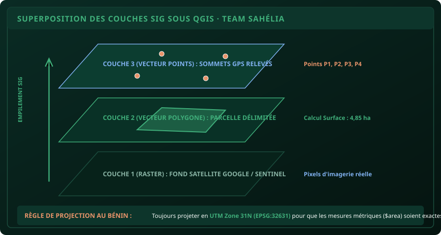

# CHAPITRE 1 : LES FONDATIONS DU SIG & COORDONNÉES AU BÉNIN
## Comprendre l'empilement des couches et maîtriser la projection UTM 31N

> **Manuel :** 06 — Cartographie Agricole & SIG : Maîtriser QGIS, ArcGIS & Google Earth sur le Terrain  
> **Auteur :** Sègla Bio KPEROU, Olivier AREMOU & TEAM Sahélia  
> **Temps d’apprentissage :** 35 minutes de lecture + 25 minutes sur QGIS 3  
> **Illustration associée :** `schemas/schema_01_superposition_couches_sig.svg`

---

## 1. Objectifs d'Impact Réel
À la fin de ce chapitre, vous saurez :
1. **Comprendre la structure d'un SIG** (la différence entre couches Vectorielles et Rasters).
2. **Déchiffrer les coordonnées géographiques** au Bénin (Longitude X ~ 2°E, Latitude Y ~ 9°N).
3. **Éviter le piège de la projection mondiale** : Pourquoi calculer une surface en degrés décimaux (`EPSG:4326`) produit un résultat absurde.
4. **Configurer votre projet QGIS en UTM Zone 31N (`EPSG:32631`)** pour obtenir des mesures métriques exactes en hectares.
5. **Activer le fond de carte satellite Google / OpenStreetMap** en arrière-plan en 1 clic.

---

## 2. Qu'est-ce qu'un Système d'Information Géographique (SIG) ?

Un SIG n'est pas un logiciel de dessin comme Photoshop ou Paint. C'est une base de données géographique où chaque point, chaque ligne et chaque polygone est **ancré à un endroit précis de la planète Terre** grâce à des coordonnées géodésiques.

### Les 2 familles de données dans QGIS :
1. **Les Données Vectorielles (Formes géométriques discrètes) :**
   - **Points :** Les bornes d'une parcelle, la position d'un puits, un foyer de ravageurs.
   - **Lignes :** Une piste agricole, un cours d'eau, une clôture.
   - **Polygones :** Le contour fermé d'un champ de maïs, une forêt sacrée, les limites de la commune de N'Dali.
2. **Les Données Rasters (Images matricielles en grille de pixels) :**
   - Les photos aériennes de drones, les images satellites Sentinel-2 ou Landsat, les modèles numériques de terrain (altimétrie).



---

## 3. Coordonnées & Projections : Le Cas de la République du Bénin

La Terre est une sphère bosselée en 3D. Pour l'afficher sur un écran plat en 2D, on utilise un **Système de Coordonnées de Référence (SCR)**.

### Les 2 SCR indispensables à connaître :
1. **WGS 84 (EPSG:4326) — Système Mondial Non-Projeté (Degrés décimaux) :**
   - C'est le système utilisé par les puces GPS des smartphones et KoboCollect.
   - Coordonnées sous la forme : `Longitude = 2.61452°` (Axe X), `Latitude = 9.35120°` (Axe Y).
   - **Inconvénient fatal :** Les unités sont des degrés d'angle, pas des mètres ! Vous ne pouvez pas mesurer de surface en hectares dans ce système.
2. **WGS 84 / UTM Zone 31N (EPSG:32631) — Système Métrique Projeté (Mètres) :**
   - Le Bénin est situé majoritairement dans le **fuseau UTM 31 Nord** (bande comprise entre 0° et 6° de longitude Est).
   - Les coordonnées sont exprimées en **mètres réels** : `X = 457 600 m`, `Y = 1 033 800 m`.
   - **Avantage absolu :** C'est le système obligatoire pour calculer la superficie d'une parcelle d'essai en mètres carrés ou en hectares.

> [!CAUTION]
> ### Erreur classique : La surface en « degrés carrés »
> Si vous créez une parcelle dans QGIS avec le SCR `EPSG:4326` et que vous demandez à la calculatrice de champ de calculer `$area`, QGIS va vous retourner par exemple `0.000412`. L'étudiant novice recopie ce chiffre dans son mémoire ! Ce sont des degrés carrés, pas des hectares.  
> **La solution :** Reprojetez toujours votre couche en **EPSG:32631 (UTM Zone 31N)** avant tout calcul de superficie.

---

## 4. Afficher Google Satellite dans QGIS en 10 Secondes

Dans les anciennes versions, il fallait chercher des fichiers d'extension complexes. Avec QGIS 3, c'est direct :
1. Dans le panneau de gauche **Explorateur** (*Browser*), faites un clic droit sur **Tuiles XYZ** (*XYZ Tiles*) > **Nouvelle connexion**.
2. Renseignez :
   - **Nom :** `Google Satellite`
   - **URL :** `https://mt1.google.com/vt/lyrs=s&x={x}&y={y}&z={z}`
3. Cliquez sur **OK**.
4. Double-cliquez sur `Google Satellite` : la terre vue du ciel s'affiche instantanément dans votre fenêtre de travail !

---

## 5. Atelier Pratique : Démarrer son Projet Cartographique

1. Lancez QGIS 3.
2. Regardez en bas à droite de la fenêtre : cliquez sur le code SCR (souvent affiché `EPSG:4326`).
3. Dans la boîte de recherche, tapez `32631`.
4. Sélectionnez **WGS 84 / UTM zone 31N** dans la liste et cliquez sur **OK**. Le projet est maintenant calé sur le système métrique du Bénin.
5. Glissez la couche `Google Satellite` depuis l'explorateur vers la zone de carte.
6. Zoomez avec la molette de la souris sur la ville de Parakou : vous observez le campus de l'Université de Parakou et les blocs de cultures avec une précision photographique.

---

## 6. Le Défi Communautaire TEAM Sahélia

> ### 🏆 Défi Hebdo n°06 : Le Calage Territorial QGIS
> 
> 1. Ouvrez QGIS 3 et configurez le projet en `EPSG:32631`.
> 2. Ajoutez le fond de carte satellite Google.
> 3. Zoomez sur une zone agricole ou un site d'expérimentation que vous connaissez au Bénin (ex: la Faculté d'Agronomie de Parakou ou une ferme paysanne).
> 4. Prenez une capture d'écran nette où l'on voit le fond satellite et le code `EPSG:32631` visible en bas à droite de l'écran.
> 5. Postez-la sur le canal de la communauté avec la mention :  
>    *« Défi Manuel 06 - Chapitre 1 SIG Validé ! »*.

---

## 7. Fiche Mémo Récapitulative Détachable

```text
================================================================================
             FICHE MÉMO · SIG & GÉOMATIQUE AGRICOLE : LES BASES
================================================================================
1. VECTEURS VS RASTERS :
   - Vecteurs : Points (sommets), Lignes (pistes), Polygones (parcelles).
   - Rasters  : Images satellites Google, Sentinel-2, photos de drones (pixels).

2. LES DEUX CODES SCR VITAUX AU BÉNIN :
   - EPSG:4326  : WGS 84 (Degrés décimaux du GPS smartphone).
   - EPSG:32631 : WGS 84 / UTM Zone 31N (Mètres, obligatoire pour calculer les ha).

3. FORMULE DU CALCUL DE SURFACE EN HECTARES :
   - Dans la calculatrice de champ QGIS (couche en EPSG:32631) :
     $area / 10000

4. COORDONNÉES AU BÉNIN (NE PAS INVERSER !) :
   - Longitude (X) : ~ 0.7° à 3.8° Est (Parakou ~ 2.6°).
   - Latitude (Y)  : ~ 6.2° à 12.4° Nord (Parakou ~ 9.3°).
================================================================================
TEAM Sahélia · Apprendre. Créer. Innover.
================================================================================
```
