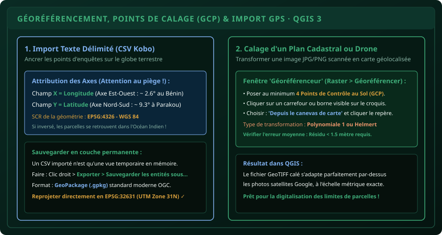

# CHAPITRE 2 : IMPORTATION GPS & GÉORÉFÉRENCEMENT DE PLANS TERRAIN
## Convertir les relevés Kobo en vecteurs et caler des croquis scannés au millimètre

> **Manuel :** 06 — Cartographie Agricole & SIG : QGIS, ArcGIS & Google Earth  
> **Auteur :** Sègla Bio KPEROU, Olivier AREMOU & TEAM Sahélia  
> **Temps d’apprentissage :** 40 minutes de lecture + 30 minutes d'atelier QGIS 3  
> **Illustration associée :** `schemas/schema_02_georeferencement_points_calage.svg`

---

## 1. Objectifs d'Impact Réel
À la fin de ce chapitre, vous saurez :
1. **Importer sans erreur** des coordonnées GPS issues de KoboToolbox, d'un smartphone ou d'un récepteur Garmin.
2. **Éviter le piège de l'inversion d'axes** (Longitude X vs Latitude Y).
3. **Pérenniser vos données** en les convertissant du format texte éphémère vers le standard moderne **GeoPackage (`.gpkg`)** en projection UTM 31N.
4. **Géoréférencer un plan parcellaire scanné**, un croquis d'expérimentation agronomique ou une photo aérienne non géoréférencée avec l'outil officiel *Géoréférenceur* de QGIS.
5. **Maîtriser les Points de Contrôle au Sol (GCP)** et évaluer la précision par le calcul de l'erreur résiduelle RMS.

---

## 2. Importer des Relevés GPS de Terrain (KoboToolbox & CSV)

Lorsque vous revenez du terrain avec un fichier CSV d'enquêtes agricoles (tel qu'exporté au Chapitre 6 du Manuel 05), ce fichier n'est pas encore une couche cartographique spatiale : c'est un simple tableau de texte.



### Procédure rigoureuse d'importation dans QGIS 3 :

1. Cliquez sur le menu **Couche > Ajouter une couche > Ajouter une couche de texte délimité...** (ou raccourci `Ctrl + Maj + T`).
2. Cliquez sur **Parcourir** (`...`) et sélectionnez votre fichier `parcelles_kobo_nord_benin.csv`.
3. Dans la section **Format de fichier**, cochez **CSV (virgule comme séparateur)** ou vérifiez que les colonnes s'alignent parfaitement dans le tableau de prévisualisation en bas.
4. Dans la section **Définition de la géométrie** :
   - Cochez **Coordonnées de point**.
   - **Champ X (Axe Est-Ouest) :** Sélectionnez `_geopoint_longitude` (au Bénin, cette valeur tourne autour de `2.6°` Est).
   - **Champ Y (Axe Nord-Sud) :** Sélectionnez `_geopoint_latitude` (au Bénin, cette valeur tourne entre `6.3°` au Sud et `12.3°` au Nord).
   - **SCR de la géométrie :** Indiquez **EPSG:4326 - WGS 84**. C'est le système universel dans lequel écrivent les puces GPS.

> [!WARNING]
> ### Ne laissez jamais votre couche en mémoire CSV !
> Une couche de texte délimité dans QGIS est en lecture seule et dépend de l'emplacement exact du fichier sur votre disque. Si vous déplacez le dossier, votre projet QGIS affichera des couches manquantes.  
> **Le bon réflexe :** Faites un clic droit sur la couche > **Exporter > Sauvegarder les entités sous...**  
> - Format : **GeoPackage** (ou ESRI Shapefile).
> - Nom du fichier : `enquete_parcelles_2026.gpkg`.
> - SCR : **EPSG:32631 - WGS 84 / UTM zone 31N**. QGIS reprojette alors directement vos coordonnées en mètres réels !

---

## 3. Qu'est-ce que le Géoréférencement ?

Sur le terrain agronomique, vous rencontrerez fréquemment des documents précieux dépourvus de coordonnées géographiques intégrées :
- Un vieux plan cadastral foncier d'un domaine agricole sur papier sulfurisé.
- Le croquis d'un dispositif en blocs complets randomisés (Fisher) dessiné à la main par le chef de station.
- Une image aérienne capturée par un petit drone civil sans métadonnées EXIF GPS.

Le **géoréférencement** consiste à associer des pixels d'une image matricielle classique (JPG, PNG, PDF) à des coordonnées géodésiques réelles à la surface de la Terre en posant des **Points de Calage au Sol** (*Ground Control Points - GCP*).

---

## 4. Atelier Pratique : Caler un Plan de Station d'Essai

### Étape 1 : Ouvrir le Géoréférenceur
Dans la barre d'outils de QGIS 3, ouvrez le menu **Raster > Géoréférencer...**. Une fenêtre secondaire dédiée s'ouvre.

### Étape 2 : Charger l'image brute
Cliquez sur le premier bouton **Ouvrir un raster** et sélectionnez votre image `plan_station_recherche_ina.jpg`.

### Étape 3 : Poser les Points de Contrôle au Sol (GCP)
Il faut au minimum **4 points bien répartis aux 4 coins du document** (évitez d'aligner tous les points sur la même ligne) :
1. Cliquez sur l'outil **Ajouter un point** (`Ctrl + A`).
2. Zoomez sur un repère remarquable et invariable dans le temps :
   - Le carrefour de deux pistes principales.
   - Le coin d'un bâtiment en dur de la station.
   - Une borne en béton ou un puits maçonné.
3. Cliquez précisément sur ce repère dans l'image.
4. Une boîte de dialogue s'ouvre : cliquez sur le bouton **Depuis le canevas de carte**.
5. La fenêtre se réduit momentanément : sur votre carte principale QGIS (où le fond Google Satellite est affiché), cliquez exactement sur le même bâtiment ou carrefour. Les coordonnées X et Y réelles sont automatiquement injectées !
6. Répétez l'opération pour 3 autres repères espacés.

### Étape 4 : Paramètres de transformation
Cliquez sur la roue dentée jaune **Paramètres de transformation** :
- **Type de transformation :** Choisissez **Polynomiale 1** (si le plan papier est régulier et non déformé) ou **Helmert** (pour une rotation-translation sans distorsion).
- **Méthode de rééchantillonnage :** **Plus proche voisin** ou **Bilinéaire**.
- **SCR cible :** `EPSG:32631 - WGS 84 / UTM zone 31N`.
- **Raster de sortie :** `plan_station_ina_georeference.tif` (QGIS va générer un GeoTIFF enrichi d'un en-tête spatial).
- Cochez la case **Charger dans QGIS lorsque terminé**.

### Étape 5 : Lancer le calcul
Cliquez sur le bouton vert **Commencer le géoréférencement** (`F5`). En quelques secondes, l'image apparaît dans votre projet QGIS, superposée au mètre près au-dessus de la vue satellite Google !

---

## 5. Le Défi Hebdo TEAM Sahélia

> ### 🏆 Défi Hebdo n°06-B : Le Calage au Sol Parfait
> 
> 1. Exportez vos données GPS d'enquêtes ou téléchargez un extrait de points GPS réels.
> 2. Importez-les dans QGIS 3 avec le SCR `EPSG:4326`, puis convertissez la couche en `GeoPackage` avec le SCR projeté `EPSG:32631`.
> 3. Activez le panneau des propriétés de la couche > **Symbologie** : attribuez aux points un cercle vert émeraude (`#10b981`) de taille 3.5 mm avec contour blanc net.
> 4. Prenez une capture d'écran de votre zone de travail montrant les points superposés aux champs réels sur Google Satellite.
> 5. Partagez votre capture sur le canal TEAM Sahélia avec la mention :  
>    *« Défi Géoréférencement & Points GPS Validé ! »*.

---

## 6. Fiche Mémo Récapitulative Détachable

```text
================================================================================
             FICHE MÉMO · IMPORT GPS & GÉORÉFÉRENCEMENT QGIS 3
================================================================================
1. TABLEAU DES AXES GPS (MÉMORISER À VIE) :
   - Axe X = LONGITUDE = Coordonnée Est-Ouest (Bénin ~ 2.6° Est).
   - Axe Y = LATITUDE  = Coordonnée Nord-Sud  (Bénin ~ 6.3° à 12.3° Nord).

2. LES 3 FORMATS DE SORTIE RECOMMANDÉS :
   - GeoPackage (.gpkg) : Le standard mondial moderne OGC (monofichier rapide).
   - Shapefile (.shp)   : Format historique (attention aux 4 fichiers indissociables .shp, .shx, .dbf, .prj).
   - GeoTIFF (.tif)     : Format image raster contenant les balises de géoréférencement.

3. CONSEILS POUR UN GÉORÉFÉRENCEMENT PRÉCIS :
   - Toujours choisir 4 à 6 points répartis sur toute la périphérie de l'image.
   - Ne jamais concentrer tous les points au centre du plan.
   - Vérifier la colonne "Résidu (pixels)" dans la table des GCP :
     Tout point avec un résidu > 2.0 doit être supprimé ou repositionné.
================================================================================
TEAM Sahélia · Apprendre. Créer. Innover.
================================================================================
```
