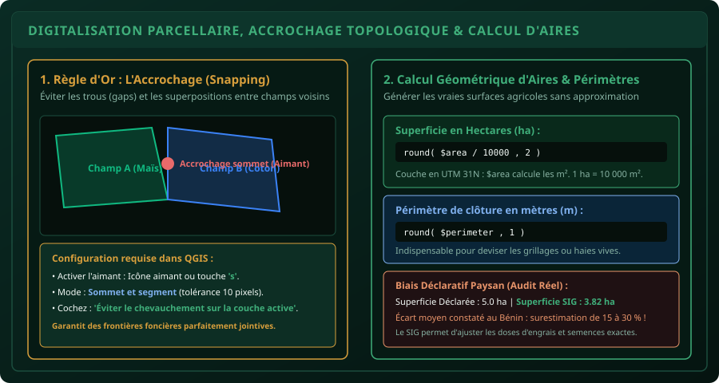

# CHAPITRE 3 : DIGITALISATION PARCELLAIRE & CALCUL D'AIRES EN HECTARES
## Dessiner les parcelles agricoles, maîtriser l'accrochage topologique et corriger les biais déclaratifs

> **Manuel :** 06 — Cartographie Agricole & SIG : QGIS, ArcGIS & Google Earth  
> **Auteur :** Sègla Bio KPEROU, Olivier AREMOU & TEAM Sahélia  
> **Temps d’apprentissage :** 45 minutes de lecture + 35 minutes de digitalisation sur QGIS 3  
> **Illustration associée :** `schemas/schema_03_topologie_et_calcul_surface.svg`

---

## 1. Objectifs d'Impact Réel
À la fin de ce chapitre, vous saurez :
1. **Créer une couche vectorielle de polygones** au format GeoPackage projetée en UTM Zone 31N.
2. **Digitaliser des parcelles agricoles** à partir d'un fond d'imagerie satellite haute résolution (Google Satellite / Bing).
3. **Activer et configurer les options d'accrochage topologique (*Snapping*)** pour garantir des limites de champs jointives sans trous ni superpositions.
4. **Calculer automatiquement la surface exacte en hectares** et le périmètre en mètres grâce à la Calculatrice de Champ de QGIS.
5. **Comprendre et quantifier le biais déclaratif paysan** : pourquoi mesurer les parcelles au SIG est le préalable obligatoire à tout conseil en fertilisation et prévision de récolte.

---

## 2. Créer une Nouvelle Couche de Polygones dans QGIS 3

Avant de tracer la moindre parcelle, il faut initialiser un fichier récepteur propre :
1. Ouvrez le menu **Couche > Créer une couche > Nouvelle couche GeoPackage...** (ou `Ctrl + Maj + N`).
2. Renseignez les paramètres suivants :
   - **Base de données :** Choisissez l'emplacement et nommez le fichier `parcellaire_agricole_2026.gpkg`.
   - **Nom de la table :** `parcelles_essais`.
   - **Type de géométrie :** **Polygone** (ou Multi-polygone).
   - **SCR :** **EPSG:32631 - WGS 84 / UTM zone 31N** (*Crucial pour que les calculs de surface soient en mètres carrés et non en degrés !*).
3. Dans la section **Nouveau champ**, ajoutez les attributs nécessaires pour caractériser chaque champ :
   - `id_parcelle` (Texte, longueur 20)
   - `nom_producteur` (Texte, longueur 60)
   - `culture_principale` (Texte, longueur 40)
   - `variete` (Texte, longueur 40)
   - `sup_declaree_ha` (Nombre décimal, précision 2)
   - `date_semis` (Date)
4. Cliquez sur **OK** : la couche vide s'ajoute dans le panneau des couches à gauche.

---

## 3. La Digitalisation & L'Accrochage Topologique (*Snapping*)

Digitaliser consiste à tracer les contours d'une parcelle en posant des sommets consécutifs à l'aide de la souris.



### La Règle d'Or de l'Agronome Géomaticien : L'Aimant
Si vous tracez deux champs voisins "à vue d'œil", vous allez inévitablement créer :
- Soit un **vide (*gap*)** entre les deux parcelles : une bande de terre de 50 cm de large qui n'appartient à personne.
- Soit un **chevauchement (*overlap*)** : une surface comptée en double dans les deux exploitations.

### Configuration du Snapping dans QGIS :
1. Cliquez sur l'icône d'aimant rouge dans la barre d'outils (ou appuyez sur la touche `s`).
2. Déroulez le menu à côté de l'aimant :
   - Mode : **Toutes les couches** ou **Couche active**.
   - Type : **Sommet et segment**.
   - Tolérance : `10` ou `12` **pixels**.
3. Cliquez sur l'icône **Ouvrir les options d'accrochage** et activez :
   - **Activer l'édition topologique** (quand vous déplacez un sommet mitoyen, les deux parcelles bougent ensemble).
   - **Éviter le chevauchement sur la couche active**.

---

## 4. Atelier Pratique : Tracer une Parcelle et Calculer sa Surface

### Étape 1 : Passer en mode édition
Sélectionnez la couche `parcelles_essais` dans le panneau des couches et cliquez sur l'icône du crayon jaune **Basculer en mode édition** (raccourci `Ctrl + E`).

### Étape 2 : Ajouter un polygone
1. Cliquez sur l'outil **Ajouter une entité polygonale** (`Ctrl + .`).
2. Faites un clic gauche sur le premier coin de la parcelle visible sur le fond satellite Google.
3. Suivez la bordure du champ en faisant un clic gauche à chaque virage ou arbre d'angle.
4. Une fois le polygone refermé, faites un **clic droit** : une fenêtre s'ouvre pour renseigner les informations (ID, Producteur, Culture, etc.).
5. Renseignez par exemple : `id_parcelle = 'P-01'`, `nom_producteur = 'Bio TCHABI'`, `culture_principale = 'Maïs'`. Cliquez sur **OK**.

### Étape 3 : Calculer la surface exacte en hectares
Ouvrez la table d'attributs (`F6`) puis ouvrez la **Calculatrice de champ** (`Ctrl + I`) :
1. Cochez **Créer un nouveau champ**.
2. Nom du champ de sortie : `sup_sig_ha`.
3. Type du champ de sortie : **Nombre décimal (réel)**, longueur 10, précision 2.
4. Dans la zone d'expression centrale, tapez la formule universelle :
   ```sql
   round( $area / 10000 , 2 )
   ```
   - `$area` renvoie la surface exacte du polygone en mètres carrés (car notre couche est en projection UTM 31N métrique).
   - `/ 10000` convertit les mètres carrés en hectares ($1\text{ ha} = 10\,000\text{ m}^2$).
   - `round( ... , 2)` arrondit à deux décimales (ex: 2.45 ha).
5. Cliquez sur **OK** : la colonne est immédiatement calculée pour l'ensemble des parcelles du projet !

### Étape 4 : Calculer le périmètre en mètres
Dans la calculatrice de champ, créez le champ `perimetre_m` :
```sql
round( $perimeter , 1 )
```
Cette valeur donne la longueur exacte de grillage ou de haie vive nécessaire pour clôturer la parcelle contre la divagation des animaux.

---

## 5. L'Audit du Biais Déclaratif Paysan

En milieu rural ouest-africain, les producteurs estiment traditionnellement leurs surfaces en cordes, en "quarts d'hectare" ou en journées de labour. L'expérience montre que :
- Les petites parcelles (< 1 ha) sont généralement **surestimées** par les paysans de 20 à 40 %.
- Les grandes parcelles (> 5 ha) sont fréquemment **sous-estimées**.

Pour calculer l'erreur d'estimation dans QGIS :
```sql
round( ((sup_declaree_ha - sup_sig_ha) / sup_sig_ha) * 100 , 1 )
```
Ce taux d'erreur démontre scientifiquement l'utilité du géomaticien agronome : si un paysan fertilise une parcelle qu'il croit faire 5 ha alors qu'elle n'en fait que 3,8 ha, il surdose l'urée de 30 %, brûle son budget et pollue la nappe phréatique !

---

## 6. Le Défi Hebdo TEAM Sahélia

> ### 🏆 Défi Hebdo n°06-C : Le Parcellaire Modélisé
> 
> 1. Créez une couche GeoPackage `parcelles_challenge.gpkg` en projection `EPSG:32631`.
> 2. Activez l'accrochage topologique et digitalisez **au moins 3 parcelles contiguës** sur une zone agricole réelle du Bénin.
> 3. Ouvrez la calculatrice de champ et générez les colonnes `sup_ha` et `perim_m`.
> 4. Affichez les étiquettes (*Labels*) au centre de chaque champ avec la formule suivante :  
>    `nom_producteur || '\n' || culture_principale || ' (' || sup_ha || ' ha)'`.
> 5. Prenez une capture de la carte avec les étiquettes et postez-la avec la mention :  
>    *« Défi Digitalisation Parcellaire Sahélia Validé ! »*.

---

## 7. Fiche Mémo Récapitulative Détachable

```text
================================================================================
             FICHE MÉMO · DIGITALISATION & CALCUL D'AIRES QGIS 3
================================================================================
1. RACCOURCIS CLAVIER DE DIGITALISATION :
   - Ctrl + E : Basculer le mode édition (activer / désactiver le crayon).
   - Ctrl + . : Ajouter une entité polygone.
   - Touche S : Activer / désactiver l'aimant d'accrochage (Snapping).
   - Clic droit : Valider et fermer le tracé du polygone.

2. FORMULES CLÉS DE LA CALCULATRICE DE CHAMP (Couche en UTM 31N) :
   - Surface en hectares : round( $area / 10000 , 2 )
   - Périmètre en mètres : round( $perimeter , 1 )
   - Coordonnée X centre : round( x(centroid($geometry)) , 2 )
   - Coordonnée Y centre : round( y(centroid($geometry)) , 2 )

3. CONSEIL DE SAUVEGARDE :
   - Cliquez régulièrement sur l'icône de disquette "Enregistrer les modifications"
     pendant la numérisation. Ne quittez jamais QGIS avec le crayon jaune allumé !
================================================================================
TEAM Sahélia · Apprendre. Créer. Innover.
================================================================================
```
