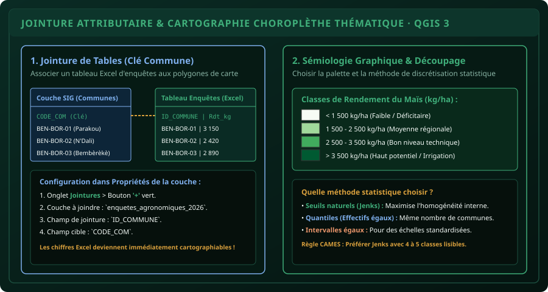

# CHAPITRE 4 : JOINTURES DE DONNÉES & CARTOGRAPHIE THÉMATIQUE
## Fusionner les tableurs d'enquêtes aux couches géographiques et appliquer la sémiologie graphique

> **Manuel :** 06 — Cartographie Agricole & SIG : QGIS, ArcGIS & Google Earth  
> **Auteur :** Sègla Bio KPEROU, Olivier AREMOU & TEAM Sahélia  
> **Temps d’apprentissage :** 45 minutes de lecture + 35 minutes de mise en pratique  
> **Illustration associée :** `schemas/schema_04_jointure_attributaire_carte_choroplethe.svg`

---

## 1. Objectifs d'Impact Réel
À la fin de ce chapitre, vous saurez :
1. **Réaliser une jointure attributaire 1:1** sans risque d'erreur entre un fichier Excel/CSV externe et une couche vectorielle spatiale.
2. **Identifier et corriger les pièges de typage** (codes avec zéros initiaux comme `01` vs `1`).
3. **Appliquer les règles de la sémiologie graphique** (Jacques Bertin) : distinguer les variables qualitatives (couleurs distinctes) des variables quantitatives ordonnées (dégradés continus).
4. **Créer une carte choroplèthe** de rendements agricoles ou de pression parasitaire.
5. **Choisir intelligemment le mode de discrétisation statistique** : Seuils Naturels de Jenks, Quantiles, Intervalles égaux ou Écarts-types.

---

## 2. Le Principe de la Jointure Attributaire

Dans 90 % des études agronomiques ou mémoires de master, les données géographiques (le contour des communes ou des départements) sont fournies par une source cartographique officielle (INSAE/IGN Bénin), tandis que vos données d'études (rendements de maïs, taux d'adoption de semences certifiées, niveaux d'infestation par la légionnaire d'automne) se trouvent dans votre classeur Excel ou votre export Kobo.

La **jointure attributaire** consiste à fusionner temporairement ou définitivement le tableau de données avec la table d'attributs de la couche géographique en s'appuyant sur un identifiant commun appelé **champ de jointure** ou **clé**.



---

## 3. Atelier Pratique : Réaliser la Jointure dans QGIS 3

### Étape 1 : Préparation rigoureuse de la clé
Pour que la jointure réussisse, le contenu de la colonne clé doit être strictement identique :
- Attention aux espaces invisibles en fin de mot (`"Parakou "` ne joindra pas avec `"Parakou"`).
- Attention aux accents et majuscules.
- **La méthode professionnelle :** Utilisez des codes numériques ou alphanumériques normalisés (ex: `BEN_BOR_01`, `COM_04`).

### Étape 2 : Charger les deux couches dans QGIS
1. Chargez le vecteur des communes du Bénin : `communes_benin_utm31n.gpkg`.
2. Chargez votre tableau de données : **Couche > Ajouter une couche > Ajouter une couche de texte délimité...**
   - Sélectionnez `synthese_rendements_2026.csv`.
   - Dans **Définition de la géométrie**, cochez **Pas de géométrie (table attributaire seulement)**.

### Étape 3 : Configurer la jointure
1. Faites un clic droit sur la couche spatiale `communes_benin_utm31n` > **Propriétés...**
2. Dans le menu de gauche, cliquez sur l'onglet **Jointures** (icône de chaîne).
3. Cliquez sur le bouton vert **Ajouter une nouvelle jointure** (`+`).
4. Renseignez la boîte de dialogue :
   - **Joindre la couche :** `synthese_rendements_2026`.
   - **Champ de jointure :** `id_commune` (la clé dans le tableau Excel).
   - **Champ cible :** `code_com` (la clé dans la couche spatiale).
   - Cochez **Champs joints** pour sélectionner uniquement les colonnes utiles (ex: `rdt_moyen_kg`, `n_enquetes`).
   - Cochez **Préfixe personnalisé** et effacez le texte par défaut ou mettez un préfixe court comme `e_` pour éviter des noms de colonnes trop longs.
5. Cliquez sur **OK** puis sur **Appliquer**.

Ouvrez la table d'attributs des communes (`F6`) : vos colonnes d'enquêtes agricoles sont désormais visibles à droite de chaque commune !

---

## 4. Sémiologie Graphique & Cartes Choroplèthes

Une carte mal colorée transmet un message faux. Selon les lois de la sémiologie graphique :
- **Pour une variable quantitative continue** (ex: Rendement en kg/ha, Pluviométrie en mm) :  
  On utilise **une seule teinte déclinée en dégradé de valeur** (du vert très clair pour les rendements faibles au vert très sombre pour les rendements élevés). L'œil humain perçoit immédiatement que plus la couleur est foncée, plus la quantité est grande.
- **Pour une variable qualitative nominale** (ex: Type de culture : Maïs, Igname, Coton, Riz) :  
  On utilise **des teintes contrastées sans hiérarchie** (Jaune pour le maïs, Marron pour l'igname, Blanc/Bleu pour le coton, Vert pour le riz).

### Configurer la Symbologie Graduée dans QGIS :
1. Clic droit sur la couche `communes_benin_utm31n` > **Propriétés > Symbologie**.
2. En haut, changez **Symbole unique** par **Gradué**.
3. **Valeur :** Sélectionnez le champ joint `e_rdt_moyen_kg`.
4. **Palette de couleur :** Choisissez le dégradé de vert `Greens` (ou `YlGn`).
5. **Mode de discrétisation :**
   - **Seuils naturels (Jenks) :** Recommandé par excellence en géographie agronomique. L'algorithme cherche les ruptures statistiques naturelles dans la distribution pour regrouper les communes similaires.
   - **Classes :** Choisissez `4` ou `5` classes (au-delà de 6 classes, l'œil ne distingue plus les nuances).
6. Cliquez sur **Classer** puis sur **OK**.

---

## 5. Le Défi Hebdo TEAM Sahélia

> ### 🏆 Défi Hebdo n°06-D : La Carte Thématique des Rendements
> 
> 1. Téléchargez ou créez un fichier CSV contenant les noms de 5 communes du Nord ou Sud Bénin et des valeurs de rendement fictives ou réelles.
> 2. Joignez ce fichier à une couche vectorielle de communes ou de cantons.
> 3. Appliquez une symbologie graduée en 4 classes selon la méthode des **Seuils Naturels de Jenks**.
> 4. Activez les étiquettes pour afficher le nom de la commune et sa valeur arrondie entre parenthèses.
> 5. Postez la capture de votre carte thématique sur le forum avec la mention :  
>    *« Défi Cartographie Thématique Sahélia Validé ! »*.

---

## 6. Fiche Mémo Récapitulative Détachable

```text
================================================================================
             FICHE MÉMO · JOINTURE & CARTOGRAPHIE THÉMATIQUE
================================================================================
1. CHECK-LIST AVANT DE LANCER UNE JOINTURE :
   - Vérifier que la colonne clé a le même format (Texte avec Texte, Entier avec Entier).
   - Supprimer les espaces au début ou à la fin des identifiants (TRIM).
   - Utiliser des codes normalisés (ex: BEN_01) plutôt que des noms avec accents.

2. LES MODES DE DISCRÉTISATION STATISTIQUE :
   - Jenks (Seuils naturels) : Référence scientifique CAMES. Minimise la variance intra-classe.
   - Quantiles (Effectifs égaux) : Chaque classe contient exactement le même nombre d'entités.
   - Intervalles égaux : Découpe l'amplitude (Max - Min) en tranches d'égale largeur.

3. RÈGLES D'OR DE SÉMIOLOGIE GRAPHIQUE :
   - Quantité / Ordre ➔ Dégradé d'une même couleur (clair = peu, sombre = beaucoup).
   - Catégorie / Espèce ➔ Couleurs franches différenciées.
   - Limiter à 4 ou 5 classes pour préserver la lisibilité lors des soutenances.
================================================================================
TEAM Sahélia · Apprendre. Créer. Innover.
================================================================================
```
