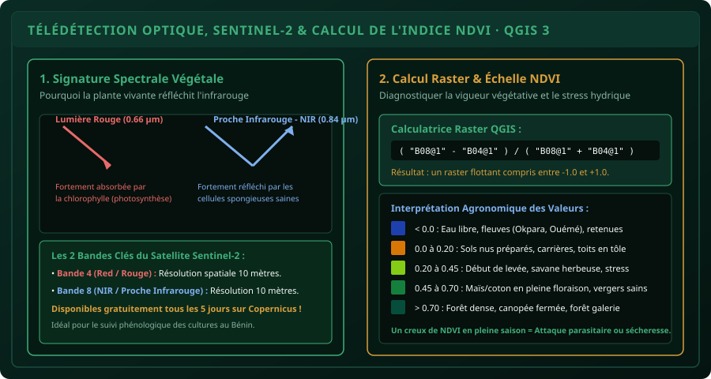

# CHAPITRE 5 : TÉLÉDÉTECTION OPTIQUE & CALCUL DE L'INDICE NDVI
## Exploiter les données satellitaires Sentinel-2 pour évaluer la vigueur des cultures et le stress hydrique

> **Manuel :** 06 — Cartographie Agricole & SIG : QGIS, ArcGIS & Google Earth  
> **Auteur :** Sègla Bio KPEROU, Olivier AREMOU & TEAM Sahélia  
> **Temps d’apprentissage :** 50 minutes de lecture + 40 minutes de calcul raster sur QGIS 3  
> **Illustration associée :** `schemas/schema_05_calcul_ndvi_spectre_vegetation.svg`

---

## 1. Objectifs d'Impact Réel
À la fin de ce chapitre, vous saurez :
1. **Comprendre les fondements biophysiques** de la signature spectrale de la végétation (réflexion du proche infrarouge et absorption du rouge).
2. **Identifier et manipuler les bandes spectrales** du satellite européen **Sentinel-2** (programme Copernicus de l'ESA).
3. **Calculer l'indice de végétation normalisé (NDVI)** à l'aide de la Calculatrice Raster de QGIS.
4. **Appliquer une palette pseudo-couleurs adaptée** pour interpréter visuellement l'état sanitaire des parcelles.
5. **Diagnostiquer les anomalies agronomiques** : détection précoce du stress hydrique, retards de développement végétatif et dégâts causés par les ravageurs.

---

## 2. Pourquoi la Télédétection Révolutionne l'Agronomie

Parcourir à pied des dizaines d'hectares de cultures sous un soleil de plomb est harassant et ne permet d'observer qu'une infime fraction des champs. La télédétection par satellite permet d'observer l'ensemble des parcelles d'une commune ou d'un département **tous les 5 jours**, avec une résolution spatiale de **10 mètres par pixel**, et ce de manière totalement gratuite grâce au programme Copernicus de l'Union Européenne.



### La Signature Spectrale d'une Plante Saine :
1. **Dans le domaine du Visible (particulièrement le Rouge - Bande 4, $\approx 0.66\,\mu\text{m}$) :**  
   Les pigments chlorophylliens des feuilles saines absorbent massivement la lumière pour réaliser la photosynthèse. Une plante en pleine santé réfléchit très peu de lumière rouge.
2. **Dans le Proche Infrarouge (NIR - Bande 8, $\approx 0.84\,\mu\text{m}$) :**  
   La lumière n'est pas absorbée par les pigments. Elle pénètre dans la feuille et est puissamment diffractée et réfléchie par la structure cellulaire spongieuse du mésophylle. Plus la plante est turgescente et dense, plus elle renvoie d'infrarouge.

---

## 3. La Formule Mathématique Universelle du NDVI

L'Indice de Végétation par Différence Normalisée (*Normalized Difference Vegetation Index - NDVI*) a été formalisé par Rouse et al. (1974) :

$$\text{NDVI} = \frac{\text{NIR} - \text{Red}}{\text{NIR} + \text{Red}}$$

Pour les données satellitaires **Sentinel-2**, la formule devient directement :

$$\text{NDVI} = \frac{\text{B08} - \text{B04}}{\text{B08} + \text{B04}}$$

### Caractéristiques de la valeur NDVI :
- Elle est toujours comprise mathématiquement entre **$-1.0$ et $+1.0$**.
- C'est un ratio adimensionnel, ce qui compense automatiquement les variations d'illumination solaire, les ombres légères et l'angle de prise de vue.

---

## 4. Atelier Pratique : Calculer le NDVI dans QGIS 3

### Étape 1 : Charger les bandes Sentinel-2
1. Téléchargez la scène Sentinel-2 de votre zone d'étude (ex: tuile couvrant Parakou ou le bassin de l'Alibori) depuis le portail *Copernicus Browser* ou le plugin QGIS *Semi-Automatic Classification Plugin (SCP)*.
2. Glissez dans QGIS les deux bandes 10 mètres :
   - `T31PCL_B04.jp2` (Bande Rouge)
   - `T31PCL_B08.jp2` (Bande Proche Infrarouge)

### Étape 2 : Ouvrir la Calculatrice Raster
1. Dans la barre de menu, cliquez sur **Raster > Calculatrice Raster...**
2. Dans la zone **Bandes raster**, double-cliquez sur les bandes pour composer la formule :
   ```sql
   ( "T31PCL_B08@1" - "T31PCL_B04@1" ) / ( "T31PCL_B08@1" + "T31PCL_B04@1" )
   ```
3. **Couche de sortie :** Cliquez sur `...` et nommez votre fichier `ndvi_parakou_2026.tif` (Format GeoTIFF).
4. **Format de sortie :** GeoTIFF.
5. Cliquez sur **OK** : QGIS calcule l'indice pixel par pixel sur l'ensemble de la scène en quelques secondes.

### Étape 3 : Appliquer une Symbologie Pseudo-Couleurs Parlante
Par défaut, le raster s'affiche en niveaux de gris ternes. Pour lui donner une dimension visuelle professionnelle :
1. Clic droit sur la couche `ndvi_parakou_2026` > **Propriétés > Symbologie**.
2. **Type de rendu :** Changez *Gris bande unique* en **Pseudo-couleur à bande unique**.
3. **Palette de couleur :** Choisissez la palette `RdYlGn` (Rouge-Jaune-Vert) ou `Spectral` inversée.
4. Dans les paramètres de coupure :
   - Minimum : `0.0`
   - Maximum : `0.85`
5. Cliquez sur **Classer** puis sur **OK**.

Vos parcelles de maïs vigoureux éclatent en vert émeraude intense, tandis que les pistes en terre battue et les sols nus apparaissent en ocre/rouge !

---

## 5. Diagnostic Agronomique en Milieu Tropical

| Intervalle NDVI | Type de Couvert Végétal | Diagnostic Agronomique |
| :--- | :--- | :--- |
| **$< 0.0$** | Eau libre, fleuves, barrages | Milieu aquatique pur, nuages denses. |
| **$0.00$ à $0.18$** | Sols nus préparés, pistes, toits | Sol avant semis ou après récolte totale. |
| **$0.18$ à $0.35$** | Levée des cultures, savane arbustive sèche | Biomasse faible, sol dominant le pixel. |
| **$0.35$ à $0.55$** | Cultures en plein tallage / montaison | Développement végétatif normal sous pluie régulière. |
| **$0.55$ à $0.80$** | Pleine floraison / couverture maximale | Biomasse optimale, aucune carence foliaire. |
| **$> 0.80$** | Forêt dense galerie, bas-fonds irrigués | Canopée fermée pluristrate. |

> [!TIP]
> ### Détection d'un Stress Hydrique en Cours de Campagne :
> Comparez le NDVI de la même parcelle à 15 jours d'intervalle. Si le NDVI chute brutalement de `0.65` à `0.42` alors que la culture n'est pas encore en phase de sénescence naturelle, cela traduit soit une poche de sécheresse locale, soit une invasion massive de chenilles défoliatrices (*Spodoptera frugiperda*).

---

## 6. Le Défi Hebdo TEAM Sahélia

> ### 🏆 Défi Hebdo n°06-E : Le Diagnostic Satellite Sentinel-2
> 
> 1. Procurez-vous un extrait de bandes 4 et 8 Sentinel-2 (ou utilisez un fichier d'exercice fourni).
> 2. Calculez le raster NDVI avec la calculatrice raster.
> 3. Superposez vos polygones de parcelles (digitalisés au Chapitre 3) sur le raster NDVI.
> 4. Utilisez l'outil **Statistiques de zone** (*Zonal Statistics*) pour calculer le `NDVI_moyen` à l'intérieur de chaque champ.
> 5. Identifiez la parcelle la plus vigoureuse et celle qui présente le plus faible indice.
> 6. Partagez votre capture d'écran sur la communauté avec la mention :  
>    *« Défi Télédétection NDVI Sentinel-2 Validé ! »*.

---

## 7. Fiche Mémo Récapitulative Détachable

```text
================================================================================
             FICHE MÉMO · TÉLÉDÉTECTION OPTIQUE & NDVI QGIS 3
================================================================================
1. BANDES SENTINEL-2 À RETENIR PAR CŒUR :
   - Bande 2 (Bleu)             : 0.49 µm (Résolution 10 m)
   - Bande 3 (Vert)             : 0.56 µm (Résolution 10 m)
   - Bande 4 (Rouge / Red)      : 0.66 µm (Résolution 10 m) ➔ Photosynthèse
   - Bande 8 (Proche Infrarouge): 0.84 µm (Résolution 10 m) ➔ Mésophylle cellulaire

2. FORMULE CALCULATRICE RASTER :
   ( "B08@1" - "B04@1" ) / ( "B08@1" + "B04@1" )

3. OUTIL STATISTIQUES DE ZONE (Zonal Statistics) :
   - Boîte à outils de traitements > Analyse raster > Statistiques de zone.
   - Calcule automatiquement le NDVI moyen, min, max et écart-type par parcelle.
   - Permet de classer objectivement les parcelles selon leur vigueur foliaire.
================================================================================
TEAM Sahélia · Apprendre. Créer. Innover.
================================================================================
```
