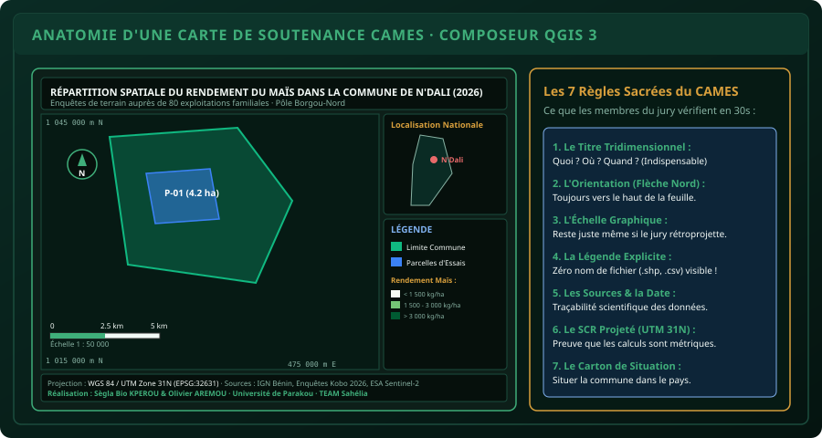

# CHAPITRE 6 : MISE EN PAGE & CARTE DE SOUTENANCE AUX NORMES CAMES
## Créer une carte scientifique irréprochable avec le composeur d'impression QGIS et valider le Pôle 2

> **Manuel :** 06 — Cartographie Agricole & SIG : QGIS, ArcGIS & Google Earth  
> **Auteur :** Sègla Bio KPEROU, Olivier AREMOU & TEAM Sahélia  
> **Temps d’apprentissage :** 50 minutes de lecture + 45 minutes de composition graphique  
> **Illustration associée :** `schemas/schema_06_anatomie_composeur_impression_cames.svg`

---

## 1. Objectifs d'Impact Réel
À la fin de ce chapitre, vous saurez :
1. **Maîtriser le Composeur d'Impression (*Print Layout*)** de QGIS 3 pour concevoir des mises en page professionnelles en haute définition.
2. **Appliquer sans omission les 7 règles d'or de la cartographie académique** exigées par les jurys du CAMES et les revues scientifiques internationales.
3. **Créer un carton de localisation national (Bénin)** avec rectangle d'emprise dynamique (*Overview Map*).
4. **Nettoyer et hiérarchiser une légende cartographique** (supprimer les intitulés de fichiers bruts, reformuler les unités agronomiques).
5. **Exporter votre livrable en PDF vectoriel 300 DPI** prêt à être inséré dans votre manuscrit de thèse ou mémoire.
6. **Réaliser le grand Projet Capstone du Pôle 2** reliant la collecte mobile KoboToolbox (Manuel 05), l'analyse statistique sous R (Manuel 04) et la cartographie sous QGIS (Manuel 06).

---

## 2. Les 7 Règles Sacrées d'une Carte CAMES

Lors d'une soutenance de mémoire de Licence, Master ou Thèse d'agronomie, les examinateurs et professeurs du CAMES mettent moins de 30 secondes pour évaluer le sérieux méthodologique d'un candidat. Une carte sans échelle graphique ou sans mention du système de projection décrédibilise immédiatement le travail de recherche.



### La Grille d'Évaluation Officielle :

1. **Le Titre Tridimensionnel (Complet & Spécifique) :**  
   Il doit répondre obligatoirement aux 3 questions fondamentales : **Quoi ? Où ? Quand ?**  
   - *Mauvais titre :* "Carte des rendements"  
   - *Titre CAMES irréprochable :* *"Répartition spatiale des rendements en grains de maïs (*Zea mays* L.) dans la commune de N'Dali au cours de la campagne agricole 2025-2026"*.
2. **L'Orientation Géographique (Flèche Nord) :**  
   Une flèche sobre, pointant vers le haut de la feuille, placée de préférence dans un angle dégagé de la carte.
3. **L'Échelle Graphique (Double ou Triple segments) :**  
   L'échelle numérique (ex: `1 : 50 000`) est utile mais devient fausse si le document est projeté sur écran géant ou imprimé à un format réduit. L'échelle graphique à barres, quant à elle, s'agrandit et se rétrécit avec le document et reste **mathématiquement exacte en toute circonstance**.
4. **La Légende Explicite & Nettoyée :**  
   Aucun nom de variable informatique ou extension de fichier (ex: `parcelles_final_v2.shp`, `rdt_kg_ha`) ne doit subsister. Chaque élément doit être explicité en français avec son unité de mesure (ex: *Rendement moyen (kg/ha)*).
5. **Le Système de Coordonnées de Référence (SCR) :**  
   Préciser impérativement le Datum et la projection utilisée :  
   `Projection : WGS 84 / UTM Zone 31N (EPSG:32631)`. C'est la garantie légale que les superficies et distances affichées ont été calculées en mètres réels.
6. **Le Cartouche des Sources et de l'Auteur :**  
   Indiquer la provenance des données brutes (*Enquêtes de terrain TEAM Sahélia 2026, IGN Bénin, ESA Copernicus Sentinel-2*) ainsi que le nom du réalisateur et son institution (*Faculté d'Agronomie, TEAM Sahélia*).
7. **Le Carton de Situation Régionale ou Nationale :**  
   Un petit encadré situant la zone d'étude au sein du territoire national du Bénin ou de l'Afrique de l'Ouest.

---

## 3. Atelier Pas-à-Pas dans le Composeur QGIS 3

### Étape 1 : Créer la mise en page
1. Dans QGIS, ouvrez le menu **Projet > Nouvelle mise en page...** (raccourci `Ctrl + P`).
2. Donnez un nom : `Carte_Soutenance_Rendements_Ndali`.
3. Une nouvelle fenêtre s'ouvre. Faites un clic droit sur la feuille blanche > **Propriétés de la page...**
4. Choisissez le format : **A4**, Orientation : **Paysage** (ou Portrait selon la forme de votre commune).

### Étape 2 : Ajouter la carte principale
1. Cliquez sur l'outil **Ajouter une carte** dans la barre d'outils de gauche.
2. Dessinez un grand rectangle occupant environ 75 % de la largeur de la page.
3. Dans le panneau de droite **Propriétés de l'objet** :
   - Ajustez l'**Échelle** (ex: tapez `50000` pour une échelle ronde au 1:50 000).
   - Déroulez la section **Grilles** > Cliquez sur `+` > **Modifier la grille...** :
     - Type de grille : **Croix** ou **Amorces (cadre)**.
     - SCR : `EPSG:32631 (WGS 84 / UTM Zone 31N)`.
     - Intervalle X et Y : `5000` mètres (une ligne tous les 5 km).
     - Cochez **Dessiner les coordonnées** : format décimal, affichage extérieur au cadre en orientation verticale pour les bordures droite et gauche.

### Étape 3 : Ajouter la Flèche Nord et l'Échelle
1. Cliquez sur **Ajouter une flèche Nord**, tracez un rectangle en haut à gauche de la carte. Choisissez un symbole SVG sobre.
2. Cliquez sur **Ajouter une barre d'échelle**, tracez-la en bas à gauche de la carte :
   - Style : **Boîte double** ou **Ligne avec graduations**.
   - Unités : **Kilomètres**.
   - Segments : 2 à gauche, 2 ou 3 à droite.

### Étape 4 : Insérer le Carton de Localisation National
1. Toujours dans le composeur, cliquez à nouveau sur **Ajouter une carte** et tracez un petit rectangle (environ 6 × 8 cm) en haut à droite.
2. Dans le panneau des couches de la fenêtre principale de QGIS, cochez uniquement la couche des frontières du Bénin et décochez le parcellaire détaillé.
3. Revenez dans le composeur, sélectionnez le petit cadre de carte > dans **Propriétés de l'objet**, déroulez **Aperçus (*Overviews*)** > Cliquez sur `+`.
4. **Cadre de la carte :** Sélectionnez votre carte principale (`Carte 1`).
5. Style de remplissage : Rouge semi-transparent (`#e86a6a` à 40 % d'opacité) avec bordure rouge foncée.
6. **Magie :** Un rectangle rouge apparaît automatiquement sur la silhouette du Bénin, indiquant exactement l'emprise géographique de votre zone d'étude !

### Étape 5 : Nettoyer la Légende
1. Cliquez sur **Ajouter une légende** et placez-la sous le carton de localisation.
2. Dans les propriétés de la légende :
   - **Titre :** Tapez `LÉGENDE`.
   - Décochez la case **Mise à jour automatique** (sinon vous ne pourrez pas éditer les textes).
   - Sélectionnez les couches inutiles (fonds satellite Google, couches de travail) et supprimez-les avec le bouton rouge `-`.
   - Double-cliquez sur chaque ligne restante pour lui donner un libellé clair et soigné en français.

### Étape 6 : Insérer le Cartouche des Métadonnées
Cliquez sur **Ajouter une étiquette de texte** et insérez le bloc de métadonnées en bas de la page :
```text
Système de coordonnées : WGS 84 / UTM Zone 31N (EPSG:32631)
Sources : Données d'enquêtes terrain KoboToolbox 2026, IGN Bénin, ESA Sentinel-2
Auteur : Sègla Bio KPEROU & Olivier AREMOU · TEAM Sahélia · Communauté Panafricaine
Date de réalisation : Octobre 2026
```

---

## 4. Exporter en Haute Définition (Vectoriel 300 DPI)

Pour que votre carte reste parfaitement nette lors de l'impression sur papier couché ou lors du zoom dans le visualiseur PDF du jury :
1. Dans le composeur, allez dans **Mise en page > Exporter au format PDF...**
2. Choisissez l'emplacement : `Rapport_Pôle2_Carte_Finale_Ndali.pdf`.
3. Dans la boîte de dialogue d'options :
   - Cochez **Exporter les métadonnées RDF**.
   - Cochez **Générer un PDF géospatial** (permet d'afficher les coordonnées directement dans Adobe Acrobat Reader !).
   - Résolution d'exportation : **300 ppp (DPI)** minimum.
4. Cliquez sur **Enregistrer**.

---

## 5. Le Grand Projet Capstone du Pôle 2 : L'Atlas de Terrain

> ### 🏆 Défi Capstone Final du Pôle 2 : Le Dossier Agronomique Intégré
> 
> Vous devez mobiliser l'ensemble des compétences acquises à travers les Manuels 04, 05 et 06 :
> 
> 1. **Collecte Mobile (Manuel 05 - KoboToolbox) :**
>    - Déployez un formulaire XLSForm contenant géolocalisation GPS, nom du paysan, culture et dose de fertilisation.
>    - Simulez la collecte et exportez le fichier CSV propre avec coordonnées éclatées.
> 2. **Analyses Statistiques Reproductibles (Manuel 04 - R & RStudio) :**
>    - Importez le CSV dans RStudio.
>    - Testez la normalité (Shapiro-Wilk) et l'homoscédasticité (Bartlett).
>    - Réalisez une ANOVA à 1 facteur sur le rendement selon la fertilisation.
>    - Générez le graphique de synthèse `ggplot2` avec barres d'erreurs et lettres de Tukey HSD.
> 3. **Cartographie de Soutenance (Manuel 06 - QGIS 3) :**
>    - Importez les données dans QGIS et projetez-les en UTM 31N (`EPSG:32631`).
>    - Digitalisez les parcelles et calculez les superficies en hectares (`$area / 10000`).
>    - Joignez les données de rendement et appliquez une discrétisation de Jenks en 4 classes.
>    - Composez la carte finale de soutenance conforme aux 7 règles du CAMES et exportez-la en PDF 300 DPI.
> 
> **Félicitations :** La réalisation de ce projet valide officiellement votre **Pôle 2 : Agronomie Numérique & Données de Terrain** au sein de TEAM Sahélia !

---

## 6. Fiche Mémo Récapitulative Détachable

```text
================================================================================
             FICHE MÉMO · COMPOSEUR QGIS & NORMES DU CAMES
================================================================================
1. LA CHECK-LIST DES 7 ÉLÉMENTS INDISPENSABLES :
   [ ] Titre explicite (Quoi, Où, Quand ?)
   [ ] Flèche Nord sobre orientée vers le haut
   [ ] Échelle graphique double segment (en km)
   [ ] Légende soignée sans jargon informatique
   [ ] Mention du SCR projeté : WGS 84 / UTM Zone 31N (EPSG:32631)
   [ ] Cartouche des sources, date et auteur
   [ ] Carton de situation avec rectangle d'emprise rouge (Overview)

2. PARAMÈTRES D'EXPORTATION REQUIS :
   - Format d'exportation : PDF vectoriel ou image PNG/TIFF.
   - Résolution minimale : 300 DPI (ppp) pour impression papier A4/A3.
   - Ne jamais faire une simple capture d'écran Windows (résolution 72 DPI floue) !

3. RACCOURCIS COMPOSEUR :
   - Ctrl + P : Créer ou ouvrir une mise en page.
   - Molette de la souris : Zoomer sur la page.
   - Touche C : Déplacer le contenu à l'intérieur de la carte sans bouger le cadre.
================================================================================
TEAM Sahélia · Apprendre. Créer. Innover.
================================================================================
```
