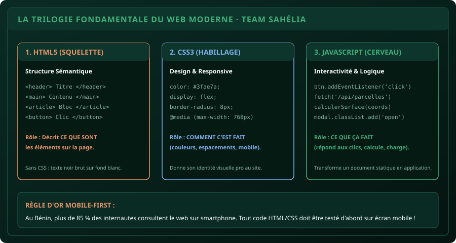

# CHAPITRE 1 : ANATOMIE D'UNE PAGE WEB & LE SQUELETTE HTML5 RESPONSIVE
## Comprendre le web moderne et créer son premier document sans framework lourd

> **Manuel :** 07 — Développement Web Moderne (HTML5, CSS3, JavaScript & Fondations Back-End)  
> **Auteur :** Sègla Bio KPEROU, Olivier AREMOU & TEAM Sahélia  
> **Temps d’apprentissage :** 30 minutes de lecture + 25 minutes de code  
> **Illustration associée :** `schemas/schema_01_trilogie_web.svg`

---

## 1. Objectifs d'Impact Réel
À la fin de ce chapitre, vous saurez :
1. **Comprendre la mécanique Client / Serveur** (ce qui se passe quand vous tapez une URL dans Chrome ou Safari).
2. **Maîtriser les rôles respectifs** de la sainte trinité du web : **HTML5**, **CSS3** et **JavaScript**.
3. **Écrire un document HTML5 sémantique irréprochable** (`<header>`, `<main>`, `<section>`, `<article>`, `<footer>`).
4. **Verrouiller l'affichage sur smartphone** grâce à la balise `<meta name="viewport">`.
5. **Construire et afficher dans votre navigateur** votre première page de profil professionnel d'agronome/numéricien.

---

## 2. La Trinité du Web : Squelette, Habit et Cerveau

Une page web n'est pas un bloc unique magique. C'est la collaboration synchronisée de 3 technologies distinctes :

| Technologie | Métaphore | Ce qu'elle produit | Fichier associé |
| :--- | :--- | :--- | :--- |
| **HTML5** | Le squelette osseux | La structure, les titres, paragraphes, images et formulaires | `index.html` |
| **CSS3** | Les vêtements et le style | Les couleurs, polices, marges, grilles et adaptation mobile | `style.css` |
| **JavaScript** | Le système nerveux | Les animations, calculs de conversion, ouverture de modales | `app.js` |



---

## 3. Le Squelette Minimal d'une Page HTML5 Valide

Créez un fichier nommé `index.html` dans un éditeur (comme VS Code ou Notepad++). Voici le code de départ absolu :

```html
<!DOCTYPE html>
<html lang="fr">
<head>
  <meta charset="UTF-8">
  <meta name="viewport" content="width=device-width, initial-scale=1.0">
  <title>Mon Profil Professionnel · TEAM Sahélia</title>
  <link rel="stylesheet" href="style.css">
</head>
<body>

  <header>
    <h1>Sègla Bio KPEROU & Olivier AREMOU</h1>
    <p>Agronome-Numéricien & Développeur Web · Parakou, Bénin</p>
  </header>

  <main>
    <section>
      <h2>À propos</h2>
      <p>Passionné par les technologies numériques utiles au développement rural.</p>
    </section>
  </main>

  <footer>
    <p>&copy; 2026 TEAM Sahélia · Apprendre aujourd'hui. Construire demain.</p>
  </footer>

</body>
</html>
```

### Décryptage des balises obligatoires :
- `<!DOCTYPE html>` : Dit au navigateur d'utiliser la norme HTML5 moderne.
- `<meta charset="UTF-8">` : Gère les accents français (é, è, à) sans afficher des symboles bizarres (`é`).
- `<meta name="viewport" content="width=device-width, initial-scale=1.0">` : **La balise la plus importante pour l'Afrique !** Elle force le navigateur du smartphone à afficher la page à la taille réelle de l'écran au lieu de dézoomer à 10 % comme sur un grand ordinateur.

---

## 4. La Sémantique Moderne vs Les « Divs Sauvegardes »

Les débutants ont tendance à tout envelopper dans des balises neutres `<div>`. C'est une mauvaise pratique pour le référencement Google et l'accessibilité des personnes malvoyantes.

**La règle d'or sémantique :**
- `<header>` : L'en-tête du site ou d'une section.
- `<nav>` : La barre de liens de navigation.
- `<main>` : Le cœur du contenu unique de la page.
- `<section>` : Un regroupement thématique (ex: Nos Services, Notre Équipe).
- `<article>` : Un bloc autonome (ex: une fiche de cours, une annonce de cohorte).
- `<footer>` : Le pied de page avec mentions légales et contacts.

---

## 5. Atelier Pratique : Créer sa Carte de Visite Web Pro

Ouvrez un dossier sur votre bureau nommé `mon-site`, créez-y le fichier `index.html` avec ce contenu enrichi :

```html
<!DOCTYPE html>
<html lang="fr">
<head>
  <meta charset="UTF-8">
  <meta name="viewport" content="width=device-width, initial-scale=1.0">
  <title>Carte Numérique · TEAM Sahélia</title>
</head>
<body style="font-family: sans-serif; background: #06100c; color: #f4faf7; padding: 2rem; max-width: 500px; margin: 0 auto;">

  <div style="background: #0a2b24; border: 1px solid #3fae7a; border-radius: 12px; padding: 1.5rem; text-align: center;">
    <h1 style="color: #3fae7a; margin-bottom: 0.5rem;">Olivier AGUIN</h1>
    <p style="color: #88b3a4; font-size: 0.9rem;">Agronome Numéricien · Université de Parakou</p>
    
    <hr style="border: 0; border-top: 1px solid #1b4d3e; margin: 1.5rem 0;">

    <h3 style="color: #e8946a; font-size: 1rem; text-align: left;">Mes Compétences :</h3>
    <ul style="text-align: left; line-height: 1.8; color: #f4faf7;">
      <li>🌾 Cartographie de Parcelles sous QGIS 3</li>
      <li>📊 Analyse Statistique de Données sous RStudio</li>
      <li>📱 Enquêtes Mobiles Hors-Ligne avec KoboToolbox</li>
    </ul>

    <a href="https://wa.me/22900000000" style="display: block; background: #3fae7a; color: #06100c; text-decoration: none; font-weight: bold; padding: 0.8rem; border-radius: 6px; margin-top: 1.5rem;">
      Me Contacter sur WhatsApp
    </a>
  </div>

</body>
</html>
```

Double-cliquez sur `index.html` : votre page s'ouvre dans Chrome ou Firefox. Vous venez de créer votre première application web responsive !

---

## 6. Le Défi Communautaire TEAM Sahélia

> ### 🏆 Défi Hebdo n°07 : Votre Première Page Web
> 
> 1. Créez votre propre page de profil `index.html` avec votre vrai nom, votre filière d'études et vos 3 objectifs d'apprentissage.
> 2. Ouvrez le fichier dans votre navigateur web sur votre ordinateur.
> 3. Ouvrez les outils de développement (`F12`), cliquez sur l'icône smartphone en haut à gauche pour simuler l'affichage sur écran de téléphone.
> 4. Prenez une capture d'écran montrant le rendu mobile parfait.
> 5. Postez-la sur le canal avec la mention :  
>    *« Défi Manuel 07 - Chapitre 1 Web Validé ! »*.

---

## 7. Fiche Mémo Récapitulative Détachable

```text
================================================================================
             FICHE MÉMO · HTML5 : LA STRUCTURE DU WEB
================================================================================
1. LA TRILOGIE DU WEB :
   - HTML : Qu'est-ce que c'est (Structure sémantique).
   - CSS  : Comment c'est habillé (Style, couleurs, mobile).
   - JS   : Que fait la page (Logique et interactivité).

2. LES BALISES VITALES DU HEAD :
   - <meta charset="UTF-8"> : Évite les bogues d'accents.
   - <meta name="viewport" content="width=device-width, initial-scale=1.0"> :
     Obligatoire pour que la page s'adapte aux smartphones.

3. HIÉRARCHIE DES TITRES :
   - Un seul <h1> par page (le grand titre).
   - Des <h2> pour les grandes sections, puis <h3> pour les sous-parties.
================================================================================
TEAM Sahélia · Apprendre. Créer. Innover.
================================================================================
```
