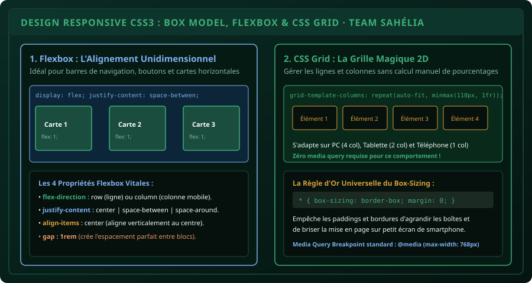

# CHAPITRE 2 : CSS3 MODERNE, FLEXBOX & DESIGN RESPONSIVE
## Maîtriser le modèle de boîte, aligner avec Flexbox et créer des grilles adaptatives pour smartphone

> **Manuel :** 07 — Développement Web Moderne (HTML5, CSS3, JavaScript & Fondations Back-End)  
> **Auteur :** Sègla Bio KPEROU, Olivier AREMOU & TEAM Sahélia  
> **Temps d’apprentissage :** 40 minutes de lecture + 35 minutes de code pratique  
> **Illustration associée :** `schemas/schema_02_flexbox_et_grid_css.svg`

---

## 1. Objectifs d'Impact Réel
À la fin de ce chapitre, vous saurez :
1. **Comprendre et dompter le Modèle de Boîte (*Box Model*)** : `margin`, `border`, `padding` et `content`.
2. **Appliquer systématiquement la règle d'or** `box-sizing: border-box` pour éviter les débordements d'écran horizontaux (*scroll horizontal indésirable*).
3. **Maîtriser Flexbox sur le bout des doigts** pour centrer n'importe quel élément en 3 lignes et créer des barres de navigation et des cartes flexibles.
4. **Exploiter la formule magique CSS Grid** `repeat(auto-fit, minmax(280px, 1fr))` pour obtenir une grille auto-responsive sans calcul manuel.
5. **Utiliser les Media Queries (`@media`)** pour transformer une mise en page de bureau en une application mobile fluide.

---

## 2. Le Modèle de Boîte (*Box Model*) & La Règle d'Or

En CSS, chaque balise HTML est considérée par le navigateur comme une boîte rectangulaire constituée de 4 couches concentriques :
1. **Content (Contenu) :** Le texte ou l'image elle-même.
2. **Padding (Marge intérieure) :** L'espace d'aération entre le texte et la bordure.
3. **Border (Bordure) :** La ligne de contour visible.
4. **Margin (Marge extérieure) :** L'espace vide repoussant les boîtes voisines.



### Le Piège Historique du CSS :
Par défaut en CSS (`box-sizing: content-box`), si vous donnez à une boîte une largeur de `100%` et que vous ajoutez un `padding: 20px`, le navigateur calcule la largeur totale comme :  
`100% + 20px (gauche) + 20px (droite) = 100% + 40px` !  
La boîte déborde alors de l'écran du smartphone et crée un ascenseur horizontal affreux.

### Le Correctif Universel TEAM Sahélia (À placer au tout début de chaque fichier CSS) :
```css
*, *::before, *::after {
  box-sizing: border-box;
  margin: 0;
  padding: 0;
}
```
Avec `border-box`, les paddings et les bordures sont intégrés **à l'intérieur** de la largeur définie, garantissant que `width: 100%` ne dépassera jamais l'écran.

---

## 3. Flexbox : L'Alignement Unidimensionnel Parfait

Fini l'époque des bricolages avec `float` ou des tableaux invisibles. Flexbox gère l'alignement le long d'un axe (en ligne ou en colonne).

### Comment Centrer Parfaitement un Bloc (Le Saint Graal du Web) :
```css
.conteneur-parent {
  display: flex;
  justify-content: center; /* Centre sur l'axe horizontal */
  align-items: center;     /* Centre sur l'axe vertical */
  min-height: 100vh;
}
```

### Les Propriétés Maîtresses du Conteneur Flex :
- **`flex-direction: row | column`** : Aligne les enfants horizontalement (par défaut sur PC) ou verticalement en colonne (idéal sur smartphone).
- **`justify-content: space-between`** : Écarte les éléments aux deux extrémités (parfait pour placer le logo à gauche et le menu de navigation à droite dans un `<header>`).
- **`gap: 1.5rem`** : Crée un espacement net et constant entre les éléments enfants sans devoir calculer des marges individuelles.

---

## 4. CSS Grid : La Grille Magique Auto-Responsive

Flexbox est idéal pour une ligne ou une colonne. Pour organiser une galerie de parcelles agricoles, un catalogue de produits ou un tableau de bord en deux dimensions (lignes ET colonnes), **CSS Grid** est roi.

### La Ligne de Code la Plus Puissante du CSS Moderne :
```css
.grille-cartes {
  display: grid;
  grid-template-columns: repeat(auto-fit, minmax(280px, 1fr));
  gap: 1.5rem;
}
```
**Comment fonctionne cette magie ?**
- `minmax(280px, 1fr)` : Chaque carte fait au minimum $280\text{ pixels}$ de large et au maximum une fraction égale de l'espace disponible (`1fr`).
- `auto-fit` : Le navigateur compte automatiquement combien de boîtes de 280 px tiennent sur l'écran :
  - Sur grand écran PC ($1920\text{ px}$) : Il affiche **4 ou 5 colonnes** côte à côte.
  - Sur tablette ($768\text{ px}$) : Il passe automatiquement à **2 colonnes**.
  - Sur smartphone ($375\text{ px}$) : Il empile les cartes sur **1 seule colonne** pleine largeur.  
  *Et tout cela sans écrire une seule ligne de Media Query !*

---

## 5. Les Media Queries pour le Raffinement Mobile

Pour ajuster la taille des polices de caractères, cacher un menu ou changer une couleur sur smartphone :

```css
/* Styles généraux pour PC / Ordinateur portable */
body {
  font-family: 'Figtree', sans-serif;
  font-size: 16px;
  background-color: #06100c;
  color: #f4faf7;
}

.navigation-principale {
  display: flex;
  justify-content: space-between;
  padding: 1rem 2rem;
}

/* Bascule spécifique pour les écrans de smartphones (<= 768px) */
@media (max-width: 768px) {
  .navigation-principale {
    flex-direction: column; /* Le menu passe en vertical */
    text-align: center;
    gap: 1rem;
  }

  h1 {
    font-size: 1.5rem; /* Réduction du titre pour éviter qu'il ne coupe */
  }
}
```

---

## 6. Le Défi Hebdo TEAM Sahélia

> ### 🏆 Défi Hebdo n°07-B : La Carte de Visite Métier Responsive
> 
> 1. Créez un fichier `profil.html` et un fichier `style.css`.
> 2. Construisez un composant de carte de profil comprenant :
>    - Une photo de profil centrée en cercle (`border-radius: 50%`).
>    - Votre nom en vert émeraude (`#10b981`) et votre titre professionnel.
>    - Une grille de 3 badges de compétences (ex: *QGIS*, *RStudio*, *KoboToolbox*) alignés avec Flexbox.
>    - Un bouton de contact pleine largeur avec effet de survol (`:hover`).
> 3. Vérifiez sur smartphone que la carte ne dépasse pas des bordures de l'écran.
> 4. Postez votre capture d'écran sur la communauté avec la mention :  
>    *« Défi CSS3 & Flexbox Validé ! »*.

---

## 7. Fiche Mémo Récapitulative Détachable

```text
================================================================================
             FICHE MÉMO · CSS3 MODERNE, FLEXBOX & GRID
================================================================================
1. RESET OBLIGATOIRE EN HAUT DU CSS :
   *, *::before, *::after { box-sizing: border-box; margin: 0; padding: 0; }

2. LES 3 COMMANDES FLEXBOX ESSENTIELLES :
   - display: flex;
   - justify-content: center | space-between | flex-start; (Axe principal)
   - align-items: center; (Axe transversal)
   - gap: 1rem; (Espace entre les enfants)

3. LA FORMULE DU GRID AUTO-ADAPTATIF :
   grid-template-columns: repeat(auto-fit, minmax(280px, 1fr));

4. SYNTAXE MEDIA QUERY SMARTPHONE :
   @media (max-width: 768px) { ... }
================================================================================
TEAM Sahélia · Apprendre. Créer. Innover.
================================================================================
```
