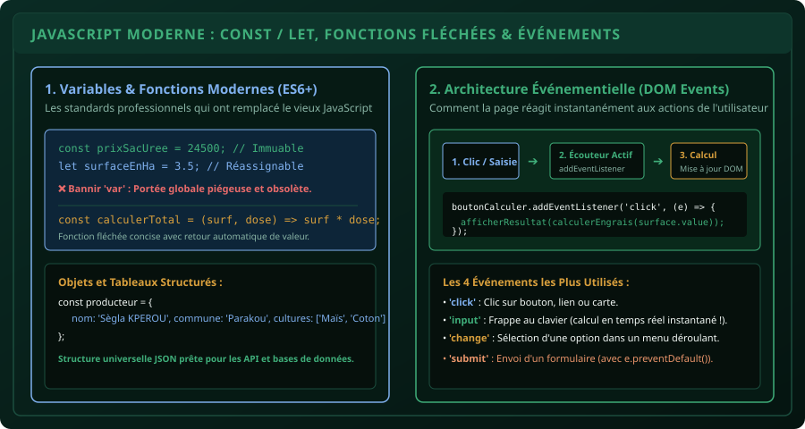

# CHAPITRE 3 : JAVASCRIPT MODERNE, LOGIQUE & MOTEUR ÉVÉNEMENTIEL
## Donner vie à la page web avec ES6+, les fonctions fléchées et les écouteurs d'événements

> **Manuel :** 07 — Développement Web Moderne (HTML5, CSS3, JavaScript & Fondations Back-End)  
> **Auteur :** Sègla Bio KPEROU, Olivier AREMOU & TEAM Sahélia  
> **Temps d’apprentissage :** 45 minutes de lecture + 40 minutes de code interactif  
> **Illustration associée :** `schemas/schema_03_moteur_evenementiel_javascript.svg`

---

## 1. Objectifs d'Impact Réel
À la fin de ce chapitre, vous saurez :
1. **Comprendre le rôle de JavaScript** en tant que moteur d'interactivité et de calcul du navigateur web.
2. **Utiliser rigoureusement les déclarations modernes `const` et `let`** en éliminant définitivement le mot-clé obsolète `var`.
3. **Manipuler les types de données fondamentaux** : Nombres, Chaînes (*Template Literals* avec backticks), Booléens, Tableaux et Objets JSON.
4. **Écrire des fonctions fléchées concises et modulaires** (`=>`).
5. **Attacher des écouteurs d'événements (`addEventListener`)** pour réagir aux clics et aux saisies de l'utilisateur sans recharger la page.

---

## 2. Le Cerveau de la Page Web

Si le HTML5 est le squelette et le CSS3 l'habit, **JavaScript est le système nerveux**.  
JavaScript est le seul langage de programmation au monde exécuté nativement par tous les navigateurs (Chrome, Safari, Firefox, Edge, navigateurs mobiles Android).



---

## 3. Déclarer des Données Propres : `const` vs `let`

Dans les anciens tutoriels web d'avant 2015, vous verrez souvent le mot-clé `var`.  
**Pourquoi ne devez-vous JAMAIS utiliser `var` en 2026 ?**  
`var` possède une portée fonctionnelle (*function scope*) défaillante qui autorise la redéclaration silencieuse d'une variable et cause des bogues invisibles catastrophiques en mémoire.

### La Règle d'Or Moderne :
1. **`const` par défaut (dans 90 % des cas) :**  
   Utilisez `const` dès que la variable ne doit pas être réassignée (ex: une référence vers un bouton, un taux de conversion fixe, le prix d'un intrant).
   ```javascript
   const PRIX_SAC_UREE_FCFA = 24500;
   const TAUX_PERTE_RECOLTE = 0.05;
   ```
2. **`let` uniquement si la valeur doit changer :**  
   Utilisez `let` pour un compteur de boucle, un total cumulatif ou un état qui évolue au fil des actions de l'utilisateur.
   ```javascript
   let surfaceTotaleDeclaree = 0;
   surfaceTotaleDeclaree += 3.5; // Valide avec let
   ```

---

## 4. Les Gabarits de Chaînes (*Template Literals*)

Finie l'époque fastidieuse des concaténations de texte avec des signes plus (`"Bonjour " + nom + " vous avez " + score + " points."`).  
Le JavaScript moderne utilise les **backticks (accent grave \`)** pour injecter directement des variables avec `${...}` :

```javascript
const producteur = "Sègla Bio KPEROU";
const commune = "Parakou";
const surface = 4.2;

// Injection limpide et élégante :
const message = `Le producteur ${producteur} possède une parcelle de ${surface} ha située à ${commune}.`;
console.log(message);
```

---

## 5. Les Fonctions Fléchées (*Arrow Functions*)

Une fonction est un bloc d'instructions réutilisable qui prend des entrées (*paramètres*) et produit un résultat (*retour*).

### Syntaxe Traditionnelle vs Syntaxe Fléchée ES6 :
```javascript
// Ancienne syntaxe verbeuse :
function calculerEngraisAncien(surfaceHa, doseParHa) {
  return surfaceHa * doseParHa;
}

// Syntaxe moderne fléchée concise :
const calculerEngrais = (surfaceHa, doseParHa) => surfaceHa * doseParHa;

const quantiteTotaleKg = calculerEngrais(5.0, 150); // Retourne 750 kg
```

---

## 6. L'Architecture Événementielle : Faire Réagir la Page

Le navigateur fonctionne selon une boucle événementielle (*Event Loop*) : il attend passivement que l'humain fasse une action pour exécuter un bout de code en réponse.

### La Méthode Universelle `addEventListener` :
```javascript
// 1. Sélectionner l'élément HTML interactif
const boutonCalculer = document.querySelector("#btn-calculer");
const champSuperficie = document.querySelector("#input-surface");
const zoneAffichage = document.querySelector("#resultat");

// 2. Écouter le clic de l'utilisateur
boutonCalculer.addEventListener("click", () => {
  const surface = parseFloat(champSuperficie.value);

  if (isNaN(surface) || surface <= 0) {
    zoneAffichage.textContent = "Veuillez entrer une superficie valide supérieure à 0.";
    zoneAffichage.style.color = "#e86a6a";
    return;
  }

  const nombreSacsUree = Math.ceil((surface * 100) / 50); // 100 kg/ha en sacs de 50 kg
  const coutTotalFcfa = nombreSacsUree * 24500;

  zoneAffichage.textContent = `Besoin : ${nombreSacsUree} sacs d'urée (Coût estimé : ${coutTotalFcfa.toLocaleString()} FCFA).`;
  zoneAffichage.style.color = "#3fae7a";
});
```

---

## 7. Le Défi Hebdo TEAM Sahélia

> ### 🏆 Défi Hebdo n°07-C : Le Convertisseur Interactif d'Unités Agricoles
> 
> 1. Créez une page web contenant un champ de saisie (`<input type="number">`) et deux boutons :
>    - Bouton 1 : **Convertir en Hectares** (si l'utilisateur entre une surface en mètres carrés, $m^2 / 10\,000$).
>    - Bouton 2 : **Convertir en Cordes traditionnelles** (1 corde béninoise $\approx 400\text{ m}^2$ ou selon votre région).
> 2. Utilisez `addEventListener` pour intercepter les clics et afficher le résultat dynamique sous le champ en vert.
> 3. Postez votre capture d'écran sur le canal avec la mention :  
>    *« Défi JavaScript & Événements Validé ! »*.

---

## 8. Fiche Mémo Récapitulative Détachable

```text
================================================================================
             FICHE MÉMO · JAVASCRIPT MODERNE & ÉVÉNEMENTS
================================================================================
1. DÉCLARATION DES VARIABLES :
   - const : Valeur qui ne change jamais (à utiliser par défaut partout).
   - let   : Valeur qui sera réassignée au cours de l'exécution.
   - var   : STRICTEMENT INTERDIT en JavaScript moderne.

2. SYNTAXE FONCTION FLÉCHÉE :
   const nomFonction = (param1, param2) => param1 + param2;

3. GABARIT DE TEXTE DYNAMIQUE :
   `Résultat : ${variable} unités` (toujours entre backticks ` `).

4. ATTACHER UN ÉVÉNEMENT :
   element.addEventListener('click', (event) => { ... });
   element.addEventListener('input', (event) => { ... }); // En direct à chaque touche !
================================================================================
TEAM Sahélia · Apprendre. Créer. Innover.
================================================================================
```
