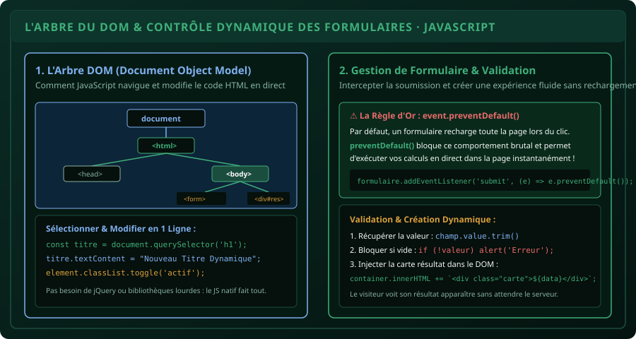

# CHAPITRE 4 : MANIPULATION DU DOM & FORMULAIRES INTERACTIFS
## Naviguer dans l'arbre HTML, capturer les saisies utilisateur et injecter du contenu dynamique

> **Manuel :** 07 — Développement Web Moderne (HTML5, CSS3, JavaScript & Fondations Back-End)  
> **Auteur :** Sègla Bio KPEROU, Olivier AREMOU & TEAM Sahélia  
> **Temps d’apprentissage :** 45 minutes de lecture + 40 minutes d'atelier pratique  
> **Illustration associée :** `schemas/schema_04_arbre_dom_et_interactions.svg`

---

## 1. Objectifs d'Impact Réel
À la fin de ce chapitre, vous saurez :
1. **Comprendre l'architecture du DOM (*Document Object Model*)** : comment le navigateur transforme un fichier HTML en une arborescence d'objets vivants.
2. **Cibler n'importe quel élément avec précision** grâce à `document.querySelector()` et `document.querySelectorAll()`.
3. **Modifier dynamiquement le contenu textuel et le style** sans recharger la page (`.textContent`, `.classList.add()`, `.classList.toggle()`).
4. **Intercepter la soumission d'un formulaire** en neutralisant le rechargement par défaut avec `event.preventDefault()`.
5. **Valider les données saisies et injecter des composants visuels** (cartes de résultats, tableaux de synthèse) directement dans le flux HTML.

---

## 2. Qu'est-ce que le DOM (Document Object Model) ?

Lorsque votre navigateur lit un fichier `index.html`, il ne conserve pas le texte brut. Il construit en mémoire vive une structure arborescente où chaque balise devient un **nœud objet** accessible et modifiable par JavaScript.



### Les Sélecteurs Modernes Universels :
Oubliez les anciennes méthodes lourdes comme `document.getElementById` ou `getElementsByClassName`. Aujourd'hui, on utilise la syntaxe standard des sélecteurs CSS :

```javascript
// Sélectionner UN SEUL élément (le premier qui correspond) :
const boutonSoumettre = document.querySelector("#btn-calculer"); // Par ID
const premierParagraphe = document.querySelector("p");          // Par balise
const carteActive = document.querySelector(".carte.active");     // Par classe

// Sélectionner TOUS les éléments correspondants (retourne une NodeList) :
const tousLesChamps = document.querySelectorAll("input");
tousLesChamps.forEach((champ) => {
  console.log(champ.value);
});
```

---

## 3. Modifier le Contenu et les Classes CSS

### `.textContent` vs `.innerHTML` (Règle de Sécurité Vitale) :
- **`.textContent` (Recommandé par excellence) :**  
  Modifie uniquement le texte brut. Si un utilisateur malveillant saisit `<script>volerMotsDePasse()</script>`, le navigateur l'affiche comme du simple texte inoffensif.
- **`.innerHTML` (À utiliser avec prudence) :**  
  Interprète le texte comme de véritables balises HTML. À n'utiliser que pour injecter vos propres gabarits sécurisés (jamais pour afficher directement une saisie utilisateur non nettoyée, afin d'éviter les failles XSS).

### Piloter les Classes CSS avec `.classList` :
Ne modifiez pas les styles en dur dans le code (`element.style.display = 'none'`). La méthode professionnelle consiste à basculer une classe CSS préexistante :

```javascript
const modale = document.querySelector("#modale-confirmation");

// Afficher ou masquer en basculant la classe CSS .visible :
modale.classList.toggle("visible");

// Ou explicitement :
modale.classList.add("actif");
modale.classList.remove("inactif");
```

---

## 4. Atelier Pratique : Le Formulaire d'Enquête Agronomique Réactif

Construisons un formulaire complet qui calcule la dose d'engrais et génère une carte de synthèse sans quitter la page :

### Le Code HTML (`index.html`) :
```html
<form id="form-parcelle">
  <label for="nom-paysan">Nom du Producteur :</label>
  <input type="text" id="nom-paysan" required placeholder="Ex: Bio TCHABI">

  <label for="surface-ha">Superficie (en hectares) :</label>
  <input type="number" id="surface-ha" step="0.1" min="0.1" required placeholder="Ex: 3.5">

  <label for="type-culture">Culture Principale :</label>
  <select id="type-culture">
    <option value="mais">Maïs (Dose : 150 kg NPK + 100 kg Urée)</option>
    <option value="coton">Coton (Dose : 200 kg NPK + 50 kg Urée)</option>
    <option value="soja">Soja (Dose : 100 kg TSP phosphate)</option>
  </select>

  <button type="submit" id="btn-valider">Générer la Préconisation</button>
</form>

<div id="zone-resultats" class="grille-resultats"></div>
```

### Le Script JavaScript (`app.js`) :
```javascript
const formulaire = document.querySelector("#form-parcelle");
const conteneurResultats = document.querySelector("#zone-resultats");

formulaire.addEventListener("submit", (evenement) => {
  // 1. Bloquer le rechargement brutal de la page par défaut
  evenement.preventDefault();

  // 2. Extraire et valider les valeurs
  const nom = document.querySelector("#nom-paysan").value.trim();
  const surface = parseFloat(document.querySelector("#surface-ha").value);
  const culture = document.querySelector("#type-culture").value;

  if (!nom || isNaN(surface) || surface <= 0) {
    alert("Veuillez renseigner des données valides.");
    return;
  }

  // 3. Logique agronomique
  let besoinNpkKg = 0;
  let besoinUreeKg = 0;

  if (culture === "mais") {
    besoinNpkKg = surface * 150;
    besoinUreeKg = surface * 100;
  } else if (culture === "coton") {
    besoinNpkKg = surface * 200;
    besoinUreeKg = surface * 50;
  } else {
    besoinNpkKg = surface * 100;
    besoinUreeKg = 0;
  }

  const sacsNpk = Math.ceil(besoinNpkKg / 50);
  const sacsUree = Math.ceil(besoinUreeKg / 50);

  // 4. Injection dynamique d'une carte de préconisation dans le DOM
  const carteHtml = `
    <article class="carte-preconisation">
      <h3>Fiche de Fertilisation : ${nom}</h3>
      <p><strong>Superficie :</strong> ${surface} ha · <strong>Culture :</strong> ${culture.toUpperCase()}</p>
      <ul>
        <li>NPK 15-15-15 : <strong>${besoinNpkKg} kg</strong> (soit ${sacsNpk} sacs de 50 kg)</li>
        <li>Urée 46% : <strong>${besoinUreeKg} kg</strong> (soit ${sacsUree} sacs de 50 kg)</li>
      </ul>
      <p class="date-emission">Émis le ${new Date().toLocaleDateString('fr-FR')} · TEAM Sahélia</p>
    </article>
  `;

  conteneurResultats.innerHTML = carteHtml;

  // 5. Réinitialiser le formulaire pour la saisie suivante
  formulaire.reset();
});
```

---

## 5. Le Défi Hebdo TEAM Sahélia

> ### 🏆 Défi Hebdo n°07-D : Le Générateur Dynamique de Fiches
> 
> 1. Intégrez le formulaire ci-dessus dans une page HTML stylisée avec les couleurs de la charte TEAM Sahélia.
> 2. Modifiez le script pour que les nouvelles fiches s'ajoutent les unes sous les autres (`+=`) sans écraser la précédente, créant ainsi une liste cumulative d'exploitations.
> 3. Ajoutez un bouton rouge **Supprimer** sur chaque carte créée dynamiquement.
> 4. Postez la capture de votre interface avec au moins 3 fiches générées sur le canal avec la mention :  
>    *« Défi Manipulation DOM & Formulaire Validé ! »*.

---

## 6. Fiche Mémo Récapitulative Détachable

```text
================================================================================
             FICHE MÉMO · MANIPULATION DU DOM & FORMULAIRES
================================================================================
1. CIBLAGE DES ÉLÉMENTS :
   - document.querySelector('.classe / #id / balise') : Retourne 1 élément.
   - document.querySelectorAll('.classe')             : Retourne une liste d'éléments.

2. GESTION DES FORMULAIRES SANS RELOAD :
   formulaire.addEventListener('submit', (e) => {
     e.preventDefault(); // OBLIGATOIRE : stoppe le rechargement de page
     const valeur = input.value.trim();
   });

3. GESTION DES CLASSES CSS :
   element.classList.add('nom-classe');
   element.classList.remove('nom-classe');
   element.classList.toggle('nom-classe'); // Ajoute si absent, enlève si présent

4. SÉCURITÉ INJECTION DE CONTENU :
   - Préférer element.textContent pour du texte brut ou des valeurs utilisateurs.
   - Réserver element.innerHTML aux gabarits HTML strictement contrôlés.
================================================================================
TEAM Sahélia · Apprendre. Créer. Innover.
================================================================================
```
