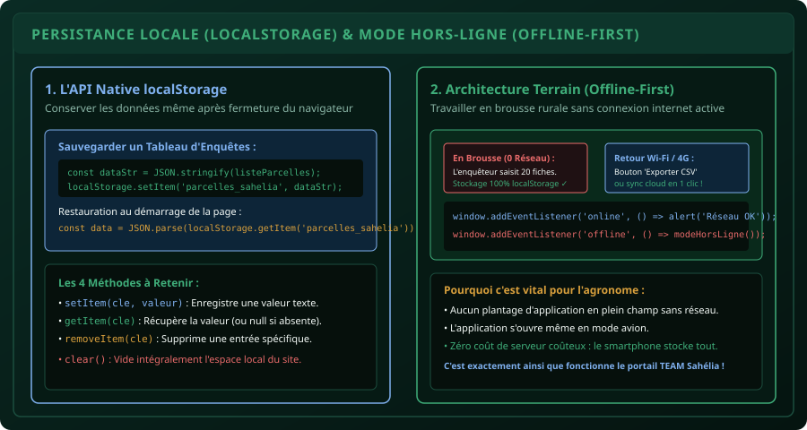

# CHAPITRE 5 : LOCALSTORAGE & APPLICATIONS WEB HORS-LIGNE
## Bâtir des outils de terrain robustes qui fonctionnent en brousse sans aucune connexion internet

> **Manuel :** 07 — Développement Web Moderne (HTML5, CSS3, JavaScript & Fondations Back-End)  
> **Auteur :** Sègla Bio KPEROU, Olivier AREMOU & TEAM Sahélia  
> **Temps d’apprentissage :** 45 minutes de lecture + 35 minutes de code pratique  
> **Illustration associée :** `schemas/schema_05_cycle_localstorage_offline.svg`

---

## 1. Objectifs d'Impact Réel
À la fin de ce chapitre, vous saurez :
1. **Comprendre l'API native `localStorage`** du navigateur et ses limites de stockage (5 à 10 Mo par domaine, persistance permanente).
2. **Sérialiser et désérialiser des structures de données complexes** avec `JSON.stringify()` et `JSON.parse()`.
3. **Construire une architecture "Offline-First"** (priorité au hors-ligne) indispensable pour les outils de terrain déployés en milieu rural africain.
4. **Détecter l'état de la connexion internet en direct** grâce à `navigator.onLine` et aux événements `online` / `offline`.
5. **Permettre l'exportation des données locales en fichier CSV téléchargeable** en pur JavaScript sans aucun serveur distant.

---

## 2. La Réalité du Terrain Ouest-Africain : Pas de 4G au Fond du Champ !

Beaucoup d'ingénieurs conçoivent des applications web dépendantes à 100 % d'une base de données cloud (Firebase, Supabase, MySQL). Lorsqu'un enquêteur ou un technicien agricole se rend dans un village reculé du Borgou ou de l'Atacora, la page web affiche la redoutée *"Connexion interrompue"* et l'outil devient inutilisable.

L'approche professionnelle de **TEAM Sahélia** est l'architecture **Offline-First** :  
L'application doit fonctionner **parfaitement en mode avion**, stocker les saisies localement sur l'appareil, et ne synchroniser avec le réseau que lorsqu'une connexion stable réapparaît.



---

## 3. L'API Native `localStorage`

Le `localStorage` est une mini base de données intégrée à chaque navigateur moderne.  
Elle fonctionne sous forme de paires **Clé / Valeur**.

### Les 4 Méthodes Fondamentales :
```javascript
// 1. Sauvegarder une information (clé, valeur) :
localStorage.setItem("nom_utilisateur", "Bio KPEROU");

// 2. Lire une information :
const utilisateur = localStorage.getItem("nom_utilisateur"); // Retourne "Bio KPEROU"

// 3. Supprimer une clé spécifique :
localStorage.removeItem("nom_utilisateur");

// 4. Vider tout le stockage local du site :
localStorage.clear();
```

---

## 4. Sauvegarder des Objets et Tableaux Complexes : Le Rôle de JSON

Le `localStorage` ne sait stocker que des **chaînes de caractères textuelles**. Si vous tentez d'enregistrer un tableau ou un objet en direct, le navigateur enregistrera la mention inutile `"[object Object]"`.

### La Mécanique de Sérialisation JSON :
- **Pour enregistrer (`JSON.stringify`) :** Convertit l'objet JavaScript en chaîne de texte formatée.
- **Pour relire (`JSON.parse`) :** Reconstitue l'objet ou le tableau d'origine en mémoire.

```javascript
// Notre base d'enquêtes agricoles
const parcellesCollectees = [
  { id: "P-01", producteur: "Bio TCHABI", surface: 2.5, culture: "Maïs" },
  { id: "P-02", producteur: "Mariam DIALLO", surface: 4.1, culture: "Coton" }
];

// SAUVEGARDE LOCALE :
localStorage.setItem("sahelia_parcelles", JSON.stringify(parcellesCollectees));

// RESTAURATION AU DÉMARRAGE DE L'APPLICATION :
const donneesSauvegardees = localStorage.getItem("sahelia_parcelles");
const listeFinale = donneesSauvegardees ? JSON.parse(donneesSauvegardees) : [];

console.log(`Nombre d'exploitations en mémoire locale : ${listeFinale.length}`);
```

---

## 5. Détecter l'État Réseau en Temps Réel

Le navigateur dispose d'une API native pour surveiller l'état de la connexion internet :

```javascript
const indicateurReseau = document.querySelector("#statut-reseau");

function actualiserStatutReseau() {
  if (navigator.onLine) {
    indicateurReseau.textContent = "● Connecté (En ligne)";
    indicateurReseau.style.color = "#3fae7a";
  } else {
    indicateurReseau.textContent = "● Mode Brousse (Hors-ligne) - Données sécurisées localement";
    indicateurReseau.style.color = "#d89f3c";
  }
}

// Écouter les changements en direct :
window.addEventListener("online", actualiserStatutReseau);
window.addEventListener("offline", actualiserStatutReseau);
actualiserStatutReseau();
```

---

## 6. Exporter les Données Locales en CSV (Sans Serveur !)

Une fois la collecte terminée en brousse, l'enquêteur doit pouvoir extraire son travail sans attendre :

```javascript
function telechargerCsvLocal(donnees, nomFichier = "enquetes_sahelia.csv") {
  if (donnees.length === 0) {
    alert("Aucune donnée à exporter.");
    return;
  }

  // 1. Extraire les en-têtes
  const colonnes = Object.keys(donnees[0]);
  let contenuCsv = colonnes.join(",") + "\n";

  // 2. Extraire chaque ligne
  donnees.forEach((ligne) => {
    const valeurs = colonnes.map((col) => `"${ligne[col]}"`);
    contenuCsv += valeurs.join(",") + "\n";
  });

  // 3. Créer un lien virtuel de téléchargement Blob
  const blob = new Blob([contenuCsv], { type: "text/csv;charset=utf-8;" });
  const url = URL.createObjectURL(blob);
  const lien = document.createElement("a");
  lien.setAttribute("href", url);
  lien.setAttribute("download", nomFichier);
  document.body.appendChild(lien);
  lien.click();
  document.body.removeChild(lien);
}
```

---

## 7. Le Défi Hebdo TEAM Sahélia

> ### 🏆 Défi Hebdo n°07-E : Le Carnet de Terrain Persistant
> 
> 1. Créez une application web de carnet de terrain agricole avec :
>    - Un formulaire de saisie : Nom de la parcelle, Superficie, Culture.
>    - Une liste d'affichage sous forme de tableau ou de cartes.
>    - Un bouton **Exporter en CSV**.
> 2. Enregistrez chaque nouvelle entrée dans le `localStorage`.
> 3. Fermez complètement votre navigateur, coupez votre Wi-Fi (passez en mode avion), puis rouvrez le fichier : toutes vos données doivent réapparaître instantanément !
> 4. Postez votre capture d'écran du carnet fonctionnant hors-ligne sur la communauté avec la mention :  
>    *« Défi Application Hors-Ligne & LocalStorage Validé ! »*.

---

## 8. Fiche Mémo Récapitulative Détachable

```text
================================================================================
             FICHE MÉMO · LOCALSTORAGE & MODE HORS-LIGNE
================================================================================
1. DUO SÉRIALISATION OBLIGATOIRE :
   - Sauvegarde : localStorage.setItem('cle', JSON.stringify(monObjet));
   - Lecture    : const obj = JSON.parse(localStorage.getItem('cle')) || [];

2. LIMITATIONS DU LOCALSTORAGE :
   - Capacité : Environ 5 Mo par domaine (largement suffisant pour des milliers de lignes texte).
   - Sécurité : Accessible par tout script de la même origine (ne jamais y stocker de mots de passe en clair).

3. DÉTECTION CONNEXION INTERNET :
   - navigator.onLine (Retourne true ou false).
   - window.addEventListener('online', callback);
   - window.addEventListener('offline', callback);
================================================================================
TEAM Sahélia · Apprendre. Créer. Innover.
================================================================================
```
