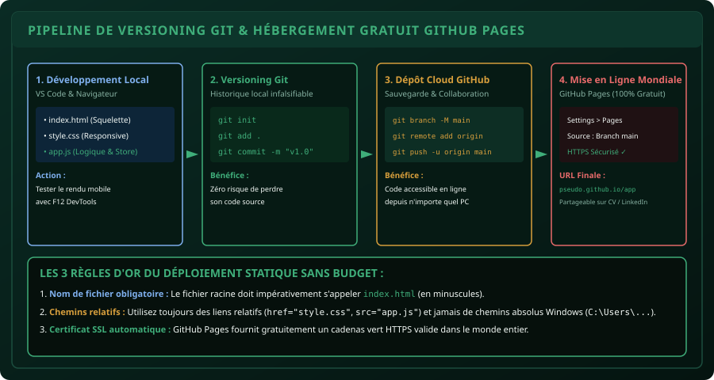

# CHAPITRE 6 : PROJET CAPSTONE · L'APPLICATION WEB MÉTIER DÉPLOYÉE
## De la conception locale jusqu'à la mise en ligne mondiale gratuite avec Git et GitHub Pages

> **Manuel :** 07 — Développement Web Moderne (HTML5, CSS3, JavaScript & Fondations Back-End)  
> **Auteur :** Sègla Bio KPEROU, Olivier AREMOU & TEAM Sahélia  
> **Temps d’apprentissage :** 50 minutes de lecture + 60 minutes d'atelier de déploiement réel  
> **Illustration associée :** `schemas/schema_06_pipeline_git_et_deploiement_web.svg`

---

## 1. Objectifs d'Impact Réel
À la fin de ce chapitre, vous saurez :
1. **Intégrer les 3 technologies fondamentales (HTML5, CSS3, JavaScript)** au sein d'une véritable application web métier complète et responsive.
2. **Initialiser et maîtriser un dépôt Git local** (`git init`, `git add`, `git commit`, `git status`).
3. **Connecter votre machine à un dépôt distant GitHub** (`git remote`, `git push`).
4. **Déployer gratuitement votre application sur le web mondial** via **GitHub Pages** avec nom de domaine public et cadenas sécurisé HTTPS.
5. **Ajouter un lien d'application interactive fonctionnelle** sur votre CV et votre profil LinkedIn pour prouver concrètement vos compétences aux recruteurs et bailleurs de fonds.

---

## 2. Le Pipeline du Développeur Web Moderne

Créer une application sur son propre ordinateur est une première étape ; mais un outil numérique n'a d'impact que s'il est **accessible en 1 clic par n'importe quel agronome, paysan ou superviseur depuis son smartphone**.



---

## 3. Le Projet Capstone : "Sahelia-AgriCalc"

Nous allons assembler une application web professionnelle : un **Calculateur de Rentabilité & de Semences Agricoles** intégrant :
- Un formulaire avec validation stricte.
- Le calcul en direct du rendement théorique et de la marge brute en FCFA.
- Le stockage automatique des parcelles dans le `localStorage`.
- L'exportation immédiate en fichier CSV.

### Structure Propre du Projet :
```text
mon-projet-agricalc/
├── index.html        # Squelette sémantique et conteneurs
├── style.css         # Thème sombre émeraude, Flexbox, Grid
├── app.js            # Logique, calculs agronomiques, localStorage
└── README.md         # Présentation professionnelle du projet
```

---

## 4. Les 4 Commandes Git Fondamentales

Ouvrez le terminal dans le dossier de votre projet (dans VS Code : `Ctrl + ù` ou `Terminal > Nouveau terminal`) :

### Étape 1 : Initialiser le dépôt local
```bash
git init
```
Git crée un dossier caché `.git` qui va désormais enregistrer chaque version de votre travail.

### Étape 2 : Enregistrer vos fichiers
```bash
git add .
git commit -m "feat: version 1.0 initiale de l'application AgriCalc"
```

### Étape 3 : Créer la branche principale standard
```bash
git branch -M main
```

---

## 5. Déployer Mondialement sur GitHub Pages (0 FCFA)

GitHub n'est pas seulement un site de stockage de code : il offre un hébergement web gratuit à vie pour les applications web statiques (HTML, CSS, JS).

### La Procédure en 5 Clics :
1. Rendez-vous sur [github.com](https://github.com) et connectez-vous à votre compte.
2. Cliquez sur le bouton vert **New repository** (Nouveau dépôt).
3. Nommez votre dépôt (ex: `agricalc-sahelia`), laissez-le en **Public**, et ne cochez aucune option d'initialisation (pas de README automatique). Cliquez sur **Create repository**.
4. GitHub vous affiche 3 lignes de commande pour relier votre dossier local :
   ```bash
   git remote add origin https://github.com/VOTRE_PSEUDO/agricalc-sahelia.git
   git push -u origin main
   ```
5. Une fois les fichiers envoyés :
   - Cliquez sur l'onglet **Settings** du dépôt GitHub.
   - Dans le menu de gauche, cliquez sur **Pages**.
   - Sous **Build and deployment > Branch**, sélectionnez la branche **`main`** et le dossier **`/(root)`**.
   - Cliquez sur **Save**.

En moins de 60 secondes, GitHub génère votre lien mondial officiel :  
👉 `https://VOTRE_PSEUDO.github.io/agricalc-sahelia/`

Ouvrez ce lien depuis votre smartphone : votre application est en ligne, rapide, sécurisée en HTTPS et utilisable par n'importe qui sur Terre !

---

## 6. Le Défi Capstone Final du Manuel 07

> ### 🏆 Défi Capstone : Votre Première Application Web Publique
> 
> 1. Développez l'application métier de votre choix (Calculateur d'engrais, Suivi des récoltes, ou Annuaire de coopérative).
> 2. Assurez-vous que l'application respecte les 4 piliers :
>    - Modèle de boîte maîtrisé (aucun scroll horizontal sur smartphone).
>    - Validation des entrées (impossible de soumettre des valeurs négatives).
>    - Persistance locale dans le `localStorage`.
>    - Bouton d'export CSV fonctionnel.
> 3. Déployez l'application sur **GitHub Pages**.
> 4. Partagez votre lien public GitHub Pages et une capture d'écran sur la communauté avec la mention :  
>    *« Projet Capstone Manuel 07 Déployé avec Succès ! »*.

---

## 7. Fiche Mémo Récapitulative Détachable

```text
================================================================================
             FICHE MÉMO · WORKFLOW GIT & DÉPLOIEMENT GITHUB PAGES
================================================================================
1. LES 4 COMMANDES GIT DE ROUTINE :
   - git status              : Voir les fichiers modifiés.
   - git add .               : Préparer tous les fichiers modifiés.
   - git commit -m "Message" : Enregistrer un point de sauvegarde daté.
   - git push                : Envoyer les modifications sur le serveur GitHub.

2. RÈGLE D'OR DE DÉPLOIEMENT :
   - Le fichier d'entrée DOIT obligatoirement s'appeler index.html en minuscules.
   - Ne jamais utiliser de chemins absolus (C:\...) dans les balises <link> ou <script>.
   - Utiliser des chemins relatifs : href="style.css", src="app.js".

3. IMPACT PROFESSIONNEL :
   - Un lien GitHub Pages sur un CV prouve immédiatement que vous savez concevoir,
     versionner et mettre en production un outil informatique fonctionnel.
================================================================================
TEAM Sahélia · Apprendre. Créer. Innover.
================================================================================
```
