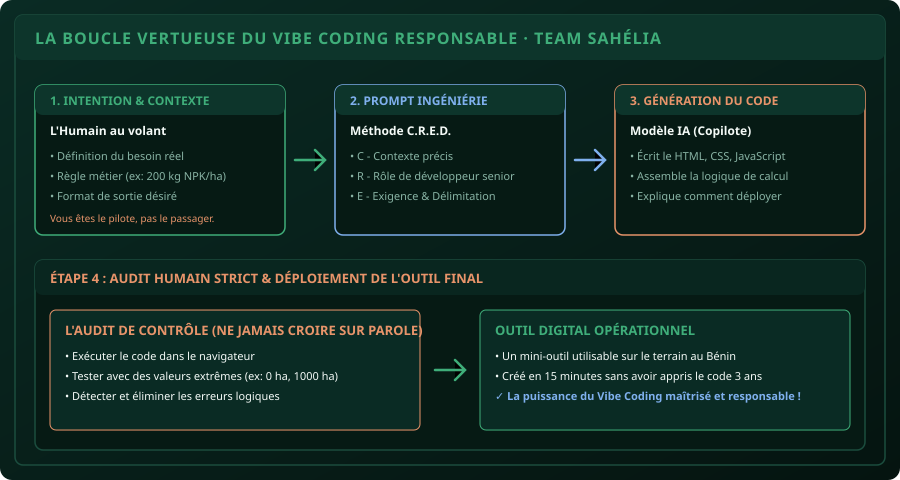

# CHAPITRE 1 : QU'EST-CE QUE LE VIBE CODING & LES LLM SOUS LE CAPOT
## Passer de l'apprentissage laborieux de la syntaxe au pilotage stratégique de l'IA

> **Manuel :** 08 — Vibe Coding & IA Responsable : Bâtir ses propres outils en pilotant l'Intelligence Artificielle  
> **Auteur :** Sègla Bio KPEROU, Olivier AREMOU & TEAM Sahélia  
> **Temps d’apprentissage :** 30 minutes de lecture + 20 minutes d'atelier  
> **Illustration associée :** `schemas/schema_01_cycle_vibe_coding.svg`

---

## 1. Objectifs d'Impact Réel
À la fin de ce chapitre, vous saurez :
1. **Comprendre ce que fait réellement un Grand Modèle de Langage (LLM)** (la prédiction probabiliste de tokens) sans croyance magique.
2. **Définir le concept de Vibe Coding** : Pourquoi décrire clairement son intention en français structuré suffit aujourd'hui pour concevoir des logiciels utiles.
3. **Appliquer la méthode C.R.E.D.** pour concevoir des prompts d'ingénierie qui ne plantent jamais.
4. **Identifier immédiatement une hallucination d'IA** avant qu'elle ne contamine votre travail académique ou professionnel.
5. **Générer et tester votre premier mini-calculateur agronomique** en 10 minutes chrono.

---

## 2. Démystifier l'IA : La Machine à Prédire des Mots

Un LLM (comme Claude, ChatGPT ou Gemini) ne « pense » pas au sens biologique. Il ne ressent rien et ne possède pas de conscience.

C’est un modèle statistique gigantesque entraîné sur des centaines de milliards de pages de textes et de code informatique. Son fonctionnement fondamental est simple :  
*« Étant donné les mots précédents, quel est le mot (ou le morceau de code) le plus statistiquement probable qui doit suivre ? »*

### La conséquence directe :
- Si votre demande est floue, le modèle va combler le vide en inventant des détails plausibles mais faux (**l'hallucination**).
- Si votre demande est ultra-précise, encadrée et contextualisée, le modèle produit un code propre, optimisé et fonctionnel du premier coup.



---

## 3. Qu'est-ce que le « Vibe Coding » ?

Traditionnellement, pour fabriquer un outil numérique, il fallait apprendre pendant des années la syntaxe d'un langage (les accolades `{`, les points-virgules `;`, la gestion de la mémoire). Beaucoup d'étudiants agronomes ou gestionnaires abandonnaient avant d'avoir produit le moindre outil utile.

**Le Vibe Coding inverse totalement le paradigme :**
1. **Vous apportez l'expertise métier et l'idée :** Vous savez exactement quel est le besoin agricole ou organisationnel (ex : *« Un paysan a 2,5 ha, il me faut 200 kg d'engrais NPK par ha, un sac pèse 50 kg et coûte 24 500 FCFA : combien de sacs et quel budget total ? »*).
2. **L'IA génère le code technique :** Elle écrit le HTML, le CSS et le JavaScript.
3. **Vous pilotez et auditez :** Vous exécutez le programme, testez les calculs, vérifiez qu'il n'y a pas d'erreur et ajustez par le dialogue.

---

## 4. La Méthode de Prompt C.R.E.D.

Pour ordonner à une IA de coder un outil sans divaguer, utilisez la structure **C.R.E.D.** :

- **C - Contexte :** Qui êtes-vous et quelle est la situation (*« Je suis étudiant en agronomie à Parakou au Bénin... »*).
- **R - Rôle :** Quelle posture l'IA doit-elle adopter (*« Agis comme un développeur web frontend senior expert en ergonomie mobile... »*).
- **E - Exigence :** Que doit faire l'outil très exactement (*« Crée un calculateur en un seul fichier HTML interactif qui prend en entrée la superficie en ha et calcule le nombre de sacs de 50 kg nécessaires et le coût total en FCFA... »*).
- **D - Délimitation :** Ce que l'IA ne doit PAS faire (*« Utilise du pur HTML/JS sans aucune bibliothèque externe, interface sombre sobre inspirée des couleurs vert forêt et or, responsive pour smartphone Android... »*).

---

## 5. Atelier Pratique : Le Calculateur d'Urée & NPK en 5 Minutes

Copiez le prompt suivant et donnez-le à votre assistant IA :

```text
Agis comme un ingénieur développeur web senior.
Je veux créer un mini-calculateur d'engrais pour les producteurs de maïs du Nord-Bénin.
Livrable attendu : Un SEUL fichier index.html autonome contenant le code HTML, CSS et JavaScript.

Fonctionnalités :
1. Un champ de saisie pour la superficie de la parcelle (en hectares).
2. Un sélecteur du type d'engrais :
   - NPK 15-15-15 (Recommandation : 200 kg/ha | Prix du sac de 50 kg : 24 000 FCFA).
   - Urée 46% (Recommandation : 100 kg/ha | Prix du sac de 50 kg : 25 000 FCFA).
3. Un bouton "Calculer les Besoins".
4. Affichage dynamique du résultat :
   - Quantité totale d'engrais en kg.
   - Nombre exact de sacs de 50 kg à acheter (arrondi au sac supérieur).
   - Coût total estimé en FCFA.

Design :
- Couleurs sobres : fond sombre (#06100c), accents émeraude (#3fae7a).
- Parfaitement lisible et responsive sur smartphone Android.
- Zéro dépendance externe (fonctionne hors connexion une fois téléchargé).
```

**Action :** Sauvegardez le code généré dans un fichier `calculateur.html` sur votre bureau et double-cliquez dessus. Vous venez de vibe-coder votre premier outil de terrain !

---

## 6. Le Défi Communautaire TEAM Sahélia

> ### 🏆 Défi Hebdo n°08 : Votre Premier Outil Vibe-Codé
> 
> 1. Utilisez la méthode C.R.E.D. pour vibe-coder un outil interactif utile à vos études (ex: calculateur d'indice de masse corporelle, convertisseur de devises FCFA/Euro, ou estimateur de rendement de soja).
> 2. Testez l'outil sur votre ordinateur et entrez une valeur test.
> 3. Prenez une capture d'écran du résultat affiché avec le prompt que vous avez utilisé à côté.
> 4. Postez-la sur le canal avec la mention :  
>    *« Défi Manuel 08 - Chapitre 1 Vibe Coding Réussi ! »*.

---

## 7. Fiche Mémo Récapitulative Détachable

```text
================================================================================
             FICHE MÉMO · VIBE CODING & IA : LES PRINCIPES CLÉS
================================================================================
1. L'IA EST UN COPILOTE :
   - Elle prédit des tokens probables, elle ne possède pas la vérité absolue.
   - Vous êtes le pilote : vous validez chaque résultat avec votre bon sens métier.

2. LA RÈGLE C.R.E.D. :
   - Contexte    : La situation réelle (terrain, université, pays).
   - Rôle        : L'identité de l'expert IA (développeur senior, statisticien).
   - Exigence    : Les fonctionnalités strictes attendues.
   - Délimitation: Ce qui est interdit (pas de framework lourd, pas de fausses données).

3. RÈGLE D'OR DE DÉPLOIEMENT :
   - Exiger toujours "un seul fichier HTML autonome" pour que l'outil fonctionne
     immédiatement hors connexion sur n'importe quel smartphone.
================================================================================
TEAM Sahélia · Apprendre. Créer. Innover.
================================================================================
```
