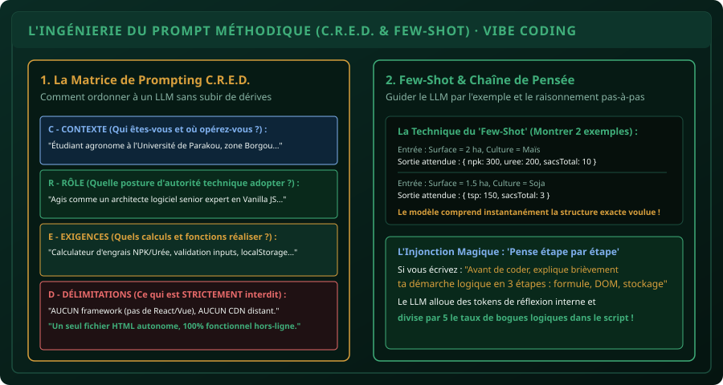

# CHAPITRE 2 : L'INGÉNIERIE DU PROMPT MÉTHODIQUE & LE STANDARD C.R.E.D.
## Cadrer l'intelligence artificielle pour générer du code métier robuste, sans hallucination

> **Manuel :** 08 — Vibe Coding & IA Responsable : Bâtir ses propres outils en pilotant l'Intelligence Artificielle  
> **Auteur :** Sègla Bio KPEROU, Olivier AREMOU & TEAM Sahélia  
> **Temps d’apprentissage :** 40 minutes de lecture + 30 minutes de rédaction de prompts  
> **Illustration associée :** `schemas/schema_02_anatomie_prompt_cred_systeme.svg`

---

## 1. Objectifs d'Impact Réel
À la fin de ce chapitre, vous saurez :
1. **Comprendre pourquoi 90 % des déceptions face à l'IA proviennent d'un prompt bâclé**.
2. **Appliquer la matrice exclusive C.R.E.D. de TEAM Sahélia** (Contexte, Rôle, Exigences, Délimitations).
3. **Exploiter la technique du *Few-Shot Prompting*** pour imposer un format de sortie mathématique ou visuel strict.
4. **Activer la *Chain-of-Thought* (Pensée étape par étape)** pour forcer le LLM à vérifier sa logique avant d'émettre le code.
5. **Formuler des prompts de refactorisation et d'optimisation** lorsqu'un bogue survient au premier jet.

---

## 2. Le Vibe Coding n'est pas de la Magie Noire

Beaucoup d'utilisateurs abordent l'IA générative (Claude, ChatGPT, Gemini, DeepSeek) comme un oracle omniscient. Ils tapent des requêtes vagues comme :  
*« Fais-moi une application web pour gérer mes parcelles agricoles »*.  
Le modèle génère alors un code générique avec des frameworks complexes (React, Tailwind, Node.js) qui refuse de s'ouvrir sur un smartphone et utilise des unités agronomiques inadaptées au contexte ouest-africain.

Le **Vibe Coding professionnel** ne consiste pas à être passif : il consiste à **traduire une vision métier claire dans un cadre d'ingénierie formel**.



---

## 3. La Matrice C.R.E.D. en Détail

Pour obtenir un résultat parfait dès la première réponse de l'IA, votre invite de commande (*prompt*) doit contenir les 4 blocs obligatoires :

### 1. C - Le Contexte (L'ancrage territorial et professionnel) :
Donnez à l'IA la réalité du terrain :
- *Exemple :* « Je suis ingénieur agronome au Nord-Bénin. Mes techniciens de terrain doivent estimer les doses d'engrais et les coûts d'intrants pour des producteurs de maïs et de coton dans la commune de N'Dali, souvent dans des zones à faible couverture réseau mobile. »

### 2. R - Le Rôle (La posture d'autorité technique) :
Assignez à l'IA une identité professionnelle précise :
- *Exemple :* « Agis comme un développeur web frontend senior et architecte logiciel expert en ergonomie mobile et applications légères sans dépendances. »

### 3. E - Les Exigences (La liste fonctionnelle explicite) :
Détaillez les fonctionnalités attendues avec les formules mathématiques exactes :
- *Exemple :*  
  « L'application doit contenir :  
  - Un formulaire avec nom du paysan, superficie en ha, et choix de culture (Maïs : 150 kg NPK + 100 kg Urée / ha ; Coton : 200 kg NPK + 50 kg Urée / ha).  
  - Un calcul automatique du nombre de sacs de 50 kg requis (arrondi supérieur avec `Math.ceil`).  
  - Le calcul du budget total basé sur les prix : NPK = 22 500 FCFA/sac, Urée = 24 500 FCFA/sac.  
  - La sauvegarde automatique dans `localStorage` pour ne rien perdre hors-ligne.  
  - Un bouton pour exporter l'historique en fichier CSV. »

### 4. D - Les Délimitations (Les garde-fous stricts) :
C'est la partie la plus importante ! Précisez ce que l'IA **ne doit JAMAIS faire** :
- *Exemple :*  
  « **INTERDICTIONS FORMELLES :**  
  - N'utilise aucun framework externe (pas de React, pas de Vue, pas de jQuery).  
  - Aucun CDN externe (pas de Tailwind ou Bootstrap via lien web : l'outil doit fonctionner 100 % hors-ligne en mode avion).  
  - Fournis le code complet dans **un seul fichier `index.html` autonome** contenant le CSS dans une balise `<style>` et le JS dans une balise `<script>`.  
  - Pas de texte tronqué ou de commentaires `// à compléter par l'utilisateur` : écris le code intégral de A à Z. »

---

## 4. La Puissance du Few-Shot Prompting

Les LLMs sont des imitateurs probabilistes de motifs (*pattern matchers*). Si vous leur décrivez une structure sous forme abstraite, ils peuvent dériver. Si vous leur montrez **2 exemples concrets de couples Entrée $\rightarrow$ Sortie**, ils reproduisent le format à 100 %.

### Exemple d'Injection Few-Shot dans votre Prompt :
```text
Voici le format exact des données JSON que tu dois manipuler :

Exemple 1 :
Entrée : { producteur: "Bio TCHABI", surface: 2, culture: "mais" }
Sortie calculée : { sacsNpk: 6, sacsUree: 4, coutTotalFcfa: 233000 }

Exemple 2 :
Entrée : { producteur: "Mariam DIALLO", surface: 1.5, culture: "coton" }
Sortie calculée : { sacsNpk: 6, sacsUree: 2, coutTotalFcfa: 184000 }

Applique rigoureusement cette logique pour toutes les entrées.
```

---

## 5. La Chaîne de Pensée (*Chain-of-Thought*)

Pour les calculs agronomiques ou les architectures de code complexes, ajoutez toujours cette phrase à la fin de votre prompt :

> *« Avant d'écrire le code, décompose ton raisonnement en 3 étapes : 1) Les formules mathématiques agronomiques retenues, 2) La structure du DOM HTML, 3) Le flux des événements JavaScript et du localStorage. »*

Cette consigne force le modèle à "réfléchir tout haut". Les probabilités d'erreurs de syntaxe ou d'oublis de balises fermantes chutent de plus de 80 %.

---

## 6. Le Défi Hebdo TEAM Sahélia

> ### 🏆 Défi Hebdo n°08-B : Le Prompt C.R.E.D. Parfait
> 
> 1. Choisissez un besoin agronomique ou de gestion réel que vous rencontrez dans vos études ou votre travail (ex: estimation de la récolte de soja, suivi du stock d'aliments pour volailles, calcul d'amortissement d'un motoculteur).
> 2. Rédigez un prompt complet en appliquant strictement les 4 piliers **C.R.E.D.** et la technique du **Few-Shot**.
> 3. Soumettez votre prompt à l'assistant IA de votre choix.
> 4. Testez le fichier HTML généré dans votre navigateur.
> 5. Partagez votre prompt et le rendu de votre outil sur le canal avec la mention :  
>    *« Défi Ingénierie du Prompt C.R.E.D. Validé ! »*.

---

## 7. Fiche Mémo Récapitulative Détachable

```text
================================================================================
             FICHE MÉMO · LA FORMULE DE PROMPT C.R.E.D.
================================================================================
1. C - CONTEXTE     : Territoire, public cible, contraintes d'infrastructure.
2. R - RÔLE         : Développeur web senior, expert agronome rigoureux.
3. E - EXIGENCES    : Formules mathématiques, fonctionnalités, boutons, stockage.
4. D - DÉLIMITATIONS: 0 framework, 0 CDN, 1 seul fichier autonome, 100% hors-ligne.

5. FEW-SHOT PROMPTING :
   Toujours donner 2 exemples concrets Entrée -> Sortie attendue.

6. INJONCTION CHAIN-OF-THOUGHT :
   "Pense étape par étape et explique ta logique avant d'écrire le code."
================================================================================
TEAM Sahélia · Apprendre. Créer. Innover.
================================================================================
```
