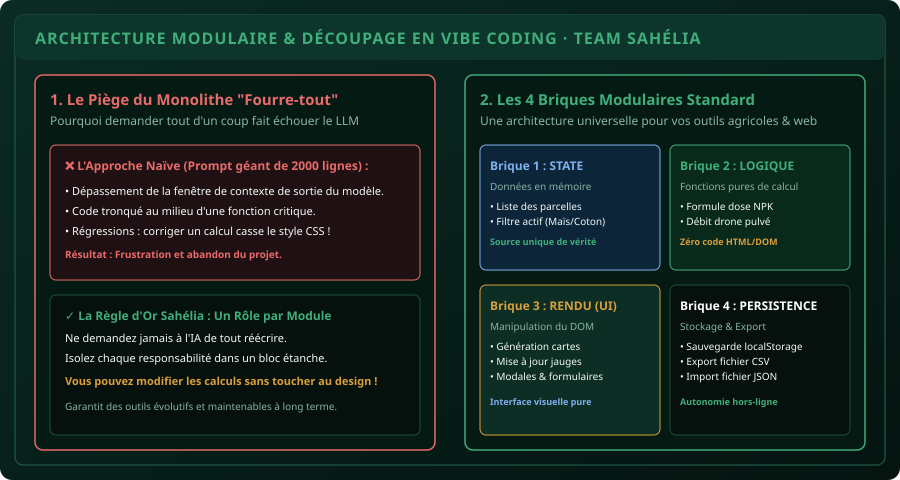

# CHAPITRE 3 : ARCHITECTURE MODULAIRE & DÉCOUPAGE EN VIBE CODING
## Structurer son projet en composants étanches pour piloter l'IA sans régressions ni amnésie

> **Manuel :** 08 — Vibe Coding & IA Responsable : Bâtir ses propres outils en pilotant l'Intelligence Artificielle  
> **Auteur :** Sègla Bio KPEROU, Olivier AREMOU & TEAM Sahélia  
> **Temps d’apprentissage :** 45 minutes de lecture + 35 minutes d'atelier d'architecture  
> **Illustration associée :** `schemas/schema_03_architecture_modulaire_composants.svg`

---

## 1. Objectifs d'Impact Réel
À la fin de ce chapitre, vous saurez :
1. **Comprendre les limites physiques des LLMs** : la taille de la fenêtre de contexte et le phénomène d'oubli ou de troncature de code.
2. **Éviter le piège du fichier monolithique de 2 000 lignes** impossible à corriger sans casser des fonctionnalités annexes.
3. **Découper une application métier en 4 briques étanches** : L'État (*State*), La Logique pure (*Logic*), Le Rendu visuel (*UI*) et La Persistance (*Storage*).
4. **Piloter l'IA module par module** : demander l'amélioration d'un calcul sans risquer de corrompre le style CSS ou la base de données.
5. **Maintenir un code lisible, propre et documenté** facilement transférable à un collègue ou client.

---

## 2. Le Piège de l'Amnésie du Contexte

Lorsque vous demandez à une IA de modifier une petite fonction dans un fichier de 1 500 lignes, deux catastrophes surviennent fréquemment :
1. **La troncature silencieuse :** L'IA écrit la correction demandée mais coupe la fin du fichier avec un commentaire paresseux du type `// ... reste du code inchangé ...`, détruisant la moitié de votre application !
2. **L'effet domino (Régression) :** En modifiant le code d'un bouton, le modèle change accidentellement le nom d'une variable globale utilisée par un autre module, créant un bogue fatal qui paralyse l'application.



---

## 3. Les 4 Briques Universelles d'une Application Web Métier

Pour que le dialogue avec l'IA reste sous contrôle absolu, nous divisons systématiquement notre code en **4 responsabilités distinctes** :

```text
mon-application/
├── css/
│   └── style.css       # Uniquement les styles visuels
└── js/
    ├── state.js        # Brique 1 : Données en mémoire (L'État)
    ├── calculs.js      # Brique 2 : Fonctions mathématiques pures (La Logique)
    ├── ui.js           # Brique 3 : Création d'éléments HTML & DOM (L'Affichage)
    └── storage.js      # Brique 4 : localStorage et export CSV (La Persistance)
```

---

## 4. Exemple Concret des 4 Briques

### Brique 1 : L'État (`state.js`)
Ce fichier ne contient aucun calcul complexe et aucune balise HTML : il contient uniquement la structure de vos données.
```javascript
// La source unique de vérité de l'application
const SaheliaState = {
  parcelles: [],
  filtreActif: "tous",
  uniteMesure: "hectare",

  ajouterParcelle(parcelle) {
    this.parcelles.push(parcelle);
  },

  supprimerParcelle(id) {
    this.parcelles = this.parcelles.filter(p => p.id !== id);
  }
};
```

### Brique 2 : La Logique Métier Pure (`calculs.js`)
Ce sont des **fonctions pures** : elles prennent des nombres en entrée et retournent un résultat. Elles ne touchent jamais au DOM (`document.querySelector` est banni ici).
```javascript
const SaheliaCalculs = {
  // Calcul de dose NPK maïs
  calculerDoseNpkMais(surfaceHa) {
    return surfaceHa * 150; // 150 kg/ha
  },

  // Calcul du nombre de sacs de 50 kg requis
  convertirEnSacs(poidsTotalKg, poidsSacKg = 50) {
    return Math.ceil(poidsTotalKg / poidsSacKg);
  },

  // Calcul du budget total en FCFA
  calculerCoutEngrais(nbSacs, prixUnitaireFcfa = 22500) {
    return nbSacs * prixUnitaireFcfa;
  }
};
```

### Brique 3 : Le Rendu Visuel (`ui.js`)
Ce module ne fait aucun calcul mathématique : il reçoit les chiffres calculés et les met en page sous forme de cartes HTML élégantes.
```javascript
const SaheliaUI = {
  genererCarteParcelle(parcelle) {
    return `
      <article class="carte-parcelle" data-id="${parcelle.id}">
        <h4>${parcelle.nom}</h4>
        <p>Surface : ${parcelle.surface} ha · Culture : ${parcelle.culture}</p>
        <span class="badge-sacs">${parcelle.sacsRequis} sacs requis</span>
      </article>
    `;
  },

  afficherListe(conteneur, liste) {
    conteneur.innerHTML = liste.map(p => this.genererCarteParcelle(p)).join("");
  }
};
```

### Brique 4 : La Persistance (`storage.js`)
Gère uniquement les entrées/sorties avec le disque dur ou le `localStorage`.
```javascript
const SaheliaStorage = {
  sauvegarder(donnees) {
    localStorage.setItem("sahelia_parcelles", JSON.stringify(donnees));
  },

  charger() {
    const raw = localStorage.getItem("sahelia_parcelles");
    return raw ? JSON.parse(raw) : [];
  }
};
```

---

## 5. Comment Piloter l'IA avec cette Architecture

Grâce à ce découpage, vos prompts de mise à jour deviennent d'une précision chirurgicale :

> **Exemple de prompt modulaire :**  
> *« Voici mon fichier `calculs.js`. Je souhaite ajouter une nouvelle formule pour la culture de l'igname (besoin : 120 kg de sulfate de potasse par ha). Modifie UNIQUEMENT ce fichier sans toucher à l'interface `ui.js` ni au stockage. »*

L'IA ne lit que 30 lignes de code et ne réécrit que 30 lignes de code. **Le risque de bogue collatéral est mathématiquement nul.**

---

## 6. Le Défi Hebdo TEAM Sahélia

> ### 🏆 Défi Hebdo n°08-C : La Refactorisation Modulaire
> 
> 1. Prenez une application d'une seule page que vous avez déjà créée ou générée.
> 2. Découpez son code JavaScript en isolant :
>    - Les fonctions de calcul pur d'un côté.
>    - Les fonctions de manipulation du DOM de l'autre.
> 3. Demandez à votre assistant IA d'ajouter une nouvelle fonctionnalité de calcul en lui fournissant **uniquement le module de calcul**.
> 4. Vérifiez que l'application continue de fonctionner sans régression.
> 5. Postez la capture de votre structure de fichiers sur le canal avec la mention :  
>    *« Défi Architecture Modulaire Validé ! »*.

---

## 7. Fiche Mémo Récapitulative Détachable

```text
================================================================================
             FICHE MÉMO · ARCHITECTURE MODULAIRE EN VIBE CODING
================================================================================
1. LES 4 RESPONSABILITÉS FONDAMENTALES :
   - STATE   : Les données vivantes en mémoire.
   - LOGIQUE : Les calculs et algorithmes purs (sans document.querySelector).
   - UI      : L'affichage visuel et la création des éléments HTML.
   - STORAGE : La persistance locale (localStorage, exports CSV/JSON).

2. RÈGLE D'OR FACE AU LLM :
   - Ne jamais lui donner 1000 lignes à modifier d'un coup.
   - Donner uniquement le module concerné par la modification.
   - Exiger en sortie uniquement le module ciblé.
================================================================================
TEAM Sahélia · Apprendre. Créer. Innover.
================================================================================
```
