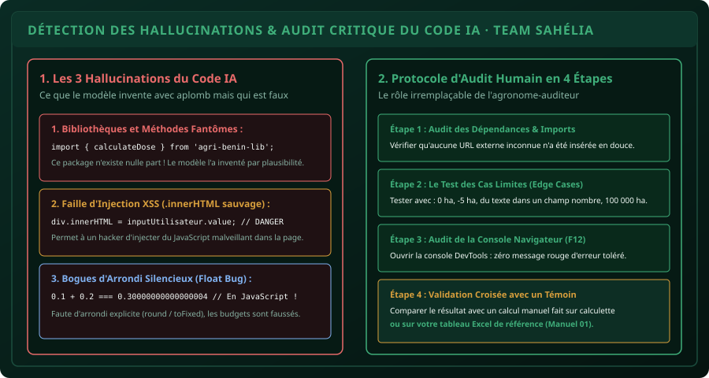

# CHAPITRE 4 : AUDIT DU CODE & DÉTECTION DES HALLUCINATIONS
## Déjouer les pièges de l'IA, sécuriser ses applications et valider les calculs critiques

> **Manuel :** 08 — Vibe Coding & IA Responsable : Bâtir ses propres outils en pilotant l'Intelligence Artificielle  
> **Auteur :** Sègla Bio KPEROU, Olivier AREMOU & TEAM Sahélia  
> **Temps d’apprentissage :** 45 minutes de lecture + 35 minutes d'atelier d'audit de sécurité  
> **Illustration associée :** `schemas/schema_04_matrice_audit_hallucinations_code.svg`

---

## 1. Objectifs d'Impact Réel
À la fin de ce chapitre, vous saurez :
1. **Comprendre l'origine technique des hallucinations dans le code** (la plausibilité statistique sans conscience sémantique).
2. **Détecter les 3 hallucinations classiques des LLMs** : packages fantômes, erreurs d'arrondis à virgule flottante (*Float Bug*), et failles de sécurité par injection XSS.
3. **Mettre en œuvre la méthodologie d'audit humain en 4 étapes** avant toute utilisation sur le terrain ou en soutenance.
4. **Appliquer les tests aux limites (*Edge Cases*)** pour garantir qu'un utilisateur maladroit ne fasse pas planter l'outil.
5. **Utiliser la console des outils de développement du navigateur (`F12`)** pour traquer les erreurs silencieuses et les fuites de mémoire.

---

## 2. L'IA a Toujours Raison en Apparence !

Le plus grand danger avec les modèles d'intelligence artificielle modernes réside dans leur **aplomb** : même lorsqu'ils écrivent une fonction mathématiquement fausse ou inventent un module inexistant, ils le font avec un ton convaincant et une syntaxe élégante.

Un ingénieur ou un chercheur qui copie-colle aveuglément le code d'une IA sans l'auditer commet une **faute méthodologique grave**. En Vibe Coding, votre rôle n'est pas de taper le code à la main, mais d'être **le garant infaillible de la vérité scientifique et de la robustesse opérationnelle**.



---

## 3. Les 3 Hallucinations Fréquentes dans le Code

### 1. Les Bibliothèques & Fonctions Fantômes (*Ghost Packages*) :
Le modèle "invente" une fonction qui semble exister parce que son nom est très logique :
```javascript
// Hallucination fréquente générée par un LLM :
import { calculateGSD } from 'benin-drone-tools';
```
Quand vous exécutez le code, le navigateur plante immédiatement : `Uncaught TypeError: Failed to resolve module`.  
*Le réflexe d'audit :* Exiger toujours du pur JavaScript natif (*Vanilla JS*) sans dépendance externe obscure.

### 2. Le Bogue des Décimales Flottantes (Le Piège Financier) :
En informatique, les ordinateurs calculent en binaire (base 2). Certaines fractions décimales ne peuvent pas être représentées exactement :
```javascript
console.log(0.1 + 0.2); // Affiche 0.30000000000000004 !
```
Si vous écrivez une condition naïve :
```javascript
if (coutTotal === 0.3) { ... } // Ce test sera TOUJOURS faux !
```
*Le réflexe d'audit :* Toujours arrondir les calculs monétaires et métriques avec `Math.round()` ou `Number(valeur.toFixed(2))`.

### 3. Les Failles d'Injection XSS (*Cross-Site Scripting*) :
Si l'IA utilise `.innerHTML` pour afficher le nom du producteur saisi dans un formulaire :
```javascript
// Dangereux :
carte.innerHTML = `<h3>Producteur : ${nomSaisi}</h3>`;
```
Un utilisateur malicieux qui écrit dans le champ nom : `` peut exécuter du code arbitraire sur le téléphone ou le PC de l'enquêteur.  
*Le réflexe d'audit :* Utiliser `.textContent` pour injecter du texte, ou nettoyer les entrées (*sanitization*).

---

## 4. La Matrice d'Audit en 4 Étapes TEAM Sahélia

Avant de valider une application générée par IA :

### Étape 1 : Le Contrôle des Dépendances
Inspectez les balises `<head>` et `<script>` : y a-t-il des liens vers des serveurs externes inconnus ? Si oui, supprimez-les ou remplacez-les par du code local.

### Étape 2 : Le Test des Cas Limites (*Edge Cases*)
Remplissez votre formulaire avec des données aberrantes :
- Que se passe-t-il si vous tapez une superficie de `0` ha ? (L'outil doit afficher un message d'alerte propre, pas `Infinity` ou `NaN`).
- Que se passe-t-il si vous entrez `-15` ha ? (Doit être rejeté).
- Que se passe-t-il si vous laissez le champ vide et cliquez sur calculer ?

### Étape 3 : L'Inspection de la Console DevTools (`F12`)
Appuyez sur la touche `F12` de votre clavier (ou clic droit > *Inspecter*), puis cliquez sur l'onglet **Console** :
- **Si la console est vierge ou affiche des messages verts d'information :** Tout est parfait.
- **Si vous voyez des messages rouges (`Error`, `Uncaught TypeError`) :** Copiez l'erreur textuelle exacte et donnez-la à l'IA pour correction immédiate.

### Étape 4 : La Validation Croisée avec un Témoin
Prenez un cas simple et calculez-le à la main ou dans votre classeur Excel du Manuel 01 :
- *Exemple :* 4 ha de maïs $\rightarrow$ $4 \times 150 = 600\text{ kg de NPK}$, soit exactement 12 sacs de 50 kg.  
L'application web affiche-t-elle bien 12 sacs ? Si elle affiche 13 sacs ou 11 sacs, l'algorithme d'arrondi de l'IA est vicié.

---

## 5. Le Défi Hebdo TEAM Sahélia

> ### 🏆 Défi Hebdo n°08-D : L'Audit d'une Application IA "Piégée"
> 
> 1. Demandez à votre assistant IA :  
>    *« Génère un calculateur de semences de maïs en HTML/JS. Insère délibérément un petit bogue de calcul ou une faille de validation sans me dire où. »*
> 2. Enfilez votre casquette d'auditeur : ouvrez la console `F12`, appliquez les tests aux limites et comparez les résultats avec vos connaissances agronomiques.
> 3. Localisez le bogue dans le code JavaScript et corrigez-le vous-même ou via un prompt de correction ciblé.
> 4. Postez votre rapport d'audit (bogue trouvé + correctif appliqué) sur le forum avec la mention :  
>    *« Défi Audit & Chasse aux Hallucinations Validé ! »*.

---

## 6. Fiche Mémo Récapitulative Détachable

```text
================================================================================
             FICHE MÉMO · AUDIT DE CODE ET DÉTECTION D'HALLUCINATIONS
================================================================================
1. LES 3 SYMBOLES ROUGES À CHERCHER DANS LE CODE IA :
   - NaN (Not a Number)       : Une conversion de texte en nombre a échoué.
   - undefined                : Une variable ou propriété inexistante est appelée.
   - .innerHTML = saisie      : Faille de sécurité XSS potentielle.

2. PROTOCOLE D'AUDIT EN 30 SECONDES :
   [ ] Ouvrir DevTools (F12) > Onglet Console (Zéro erreur rouge tolérée).
   [ ] Tester une valeur nulle (0) et une valeur négative (-5).
   [ ] Valider le calcul sur un cas témoin simple connu d'avance.

3. RÈGLE D'OR DE RESPONSABILITÉ :
   - L'IA n'est jamais responsable du code qu'elle écrit.
   - L'ingénieur qui valide et déploie l'outil porte 100% de la responsabilité !
================================================================================
TEAM Sahélia · Apprendre. Créer. Innover.
================================================================================
```
