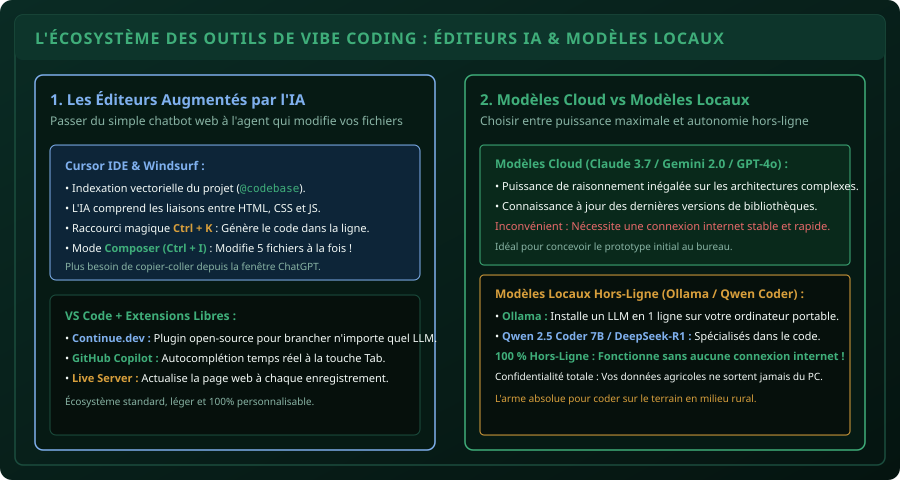

# CHAPITRE 5 : ENVIRONNEMENTS ASSISTÉS, CURSOR & MODÈLES LOCAUX
## Quitter le copier-coller du navigateur pour intégrer l'IA directement dans son éditeur de code

> **Manuel :** 08 — Vibe Coding & IA Responsable : Bâtir ses propres outils en pilotant l'Intelligence Artificielle  
> **Auteur :** Sègla Bio KPEROU, Olivier AREMOU & TEAM Sahélia  
> **Temps d’apprentissage :** 45 minutes de lecture + 35 minutes de configuration logicielle  
> **Illustration associée :** `schemas/schema_05_ecosysteme_outils_vibe_coding.svg`

---

## 1. Objectifs d'Impact Réel
À la fin de ce chapitre, vous saurez :
1. **Comprendre l'évolution des flux de travail en Vibe Coding** : du va-et-vient fastidieux navigateur/éditeur jusqu'à l'édition in-situ dans le code source.
2. **Prendre en main les éditeurs natifs IA** comme **Cursor IDE** ou **Windsurf** et maîtriser les commandes d'indexation du projet (`@codebase`, `@file`).
3. **Configurer VS Code avec des extensions libres** (Continue.dev, GitHub Copilot).
4. **Comprendre la différence stratégique entre modèles Cloud et modèles Locaux** : performance maximale vs souveraineté des données et gratuité totale hors connexion.
5. **Installer et faire tourner un LLM local sur son propre ordinateur** grâce à **Ollama** (ex: `Qwen 2.5 Coder 7B` ou `DeepSeek-R1`) pour coder en brousse sans internet.

---

## 2. La Fin du Copier-Coller Bête et Méchant

Au début de l'ère de l'IA (2023), le développeur novice procédait ainsi :
1. Il ouvrait le site web de ChatGPT ou Claude dans son navigateur.
2. Il tapait son prompt, attendait la réponse.
3. Il copiait le code, basculait sur son éditeur, collait le bloc, enregistrait.
4. S'il y avait une erreur, il recopiait l'erreur dans le navigateur, attendait, recopiait le correctif...

Ce flux est lent, source d'inversions de fichiers et limite la vision de l'IA à un seul extrait isolé.  
Les **environnements assistés modernes (IDE IA)** changent la donne : l'IA est **directement intégrée dans votre éditeur**, lit l'ensemble de votre dossier de projet, propose les modifications sous forme de *diff* visuel (vert/rouge) et applique les changements en 1 clic !



---

## 3. Cursor IDE : La Référence Mondiale du Vibe Coding

Cursor est un éditeur bâti sur les fondations de VS Code (toutes vos extensions et raccourcis habituels fonctionnent à l'identique), mais enrichi d'un moteur d'IA contextuelle :

### Les 3 Raccourcis Magiques de Cursor :
1. **`Ctrl + K` (Édition en ligne) :**  
   Sélectionnez 5 lignes de code dans votre fichier HTML ou JS, appuyez sur `Ctrl + K` et écrivez votre consigne en français :  
   *« Ajoute un bouton de réinitialisation qui vide le formulaire et le localStorage »*.  
   L'IA modifie directement les lignes sélectionnées sous vos yeux. Vous n'avez plus qu'à appuyer sur **Accepter (`Ctrl + Entrée`)**.
2. **`Ctrl + L` (Le Chat Contextuel) :**  
   Ouvre un panneau latéral de discussion où vous pouvez mentionner des fichiers précis avec le symbole `@` :  
   *« Regarde `@calculs.js` et dis-moi si la formule de l'engrais maïs prend bien en compte l'arrondi supérieur »*.
3. **`Ctrl + I` (Le Mode Composer) :**  
   C'est la fonctionnalité la plus puissante : l'IA peut créer, éditer et synchroniser **plusieurs fichiers simultanément** (ex: créer un nouveau bouton dans `index.html`, lui donner son style dans `style.css` et ajouter son écouteur dans `app.js` en une seule invite !).

---

## 4. Modèles Cloud vs Modèles Locaux Gratuits

| Critère | Modèles Cloud (Claude 3.7 / GPT-4o / Gemini 2.0) | Modèles Locaux (Ollama / Qwen 2.5 Coder / DeepSeek) |
| :--- | :--- | :--- |
| **Connexion internet** | **Obligatoire en permanence** (débit fluide requis) | **100 % Autonome Hors-Ligne (0 connexion requise)** |
| **Confidentialité** | Les données transitent par les serveurs américains | **Souveraineté totale : les données restent sur le disque dur** |
| **Coût d'usage** | Abonnements mensuels (20 $/mois) ou paiement à l'API | **Totalement Gratuit et Open-Source à vie** |
| **Puissance** | Inégalée sur les très gros projets complexes | Remarquable sur les fonctions HTML/CSS/JS et scripts Python |
| **Matériel requis** | N'importe quel PC ou smartphone d'entrée de gamme | PC avec au moins 8 à 16 Go de RAM (CPU récent ou GPU) |

---

## 5. L'Atelier Pratique : Installer Ollama sur son PC en 5 Minutes

Pour les agronomes et chercheurs appelés à intervenir en zone rurale sans 4G, avoir un copilote IA local sur son ordinateur portable est un atout stratégique inestimable :

### Étape 1 : Télécharger Ollama
Rendez-vous sur [ollama.com](https://ollama.com) et téléchargez l'installateur Windows officiel. Installez-le en quelques clics.

### Étape 2 : Télécharger un modèle spécialisé dans le code
Ouvrez le terminal PowerShell et lancez le modèle de référence mondiale pour le code léger :
```powershell
ollama run qwen2.5-coder:7b
```
*(Le modèle d'environ 4.5 Go se télécharge une fois pour toutes sur votre machine).*

### Étape 3 : Discuter et générer du code 100 % hors-ligne
Dès que le téléchargement est fini, vous pouvez couper votre Wi-Fi et dialoguer en direct avec le modèle dans le terminal ou le brancher dans VS Code via l'extension libre **Continue.dev** !

---

## 6. Le Défi Hebdo TEAM Sahélia

> ### 🏆 Défi Hebdo n°08-E : L'Expérience de l'Éditeur Augmenté
> 
> 1. Téléchargez et installez **Cursor IDE** (ou configurez l'extension **Continue.dev** dans VS Code avec un modèle de votre choix).
> 2. Ouvrez votre projet web du Manuel 07 dans l'éditeur.
> 3. Utilisez le raccourci en ligne (`Ctrl + K` ou équivalent) pour demander à l'IA d'ajouter un sélecteur de thème sombre/clair (*Dark Mode toggle*) dans votre page.
> 4. Acceptez la modification générée directement dans le fichier sans aucun copier-coller.
> 5. Postez votre capture d'écran montrant le diff visuel dans l'éditeur avec la mention :  
>    *« Défi Environnement de Vibe Coding Validé ! »*.

---

## 7. Fiche Mémo Récapitulative Détachable

```text
================================================================================
             FICHE MÉMO · OUTILS DE VIBE CODING & MODÈLES LOCAUX
================================================================================
1. LES 3 COMMANDES ESSENTIELLES DE CURSOR :
   - Ctrl + K : Modifier du code sélectionné directement dans le fichier.
   - Ctrl + L : Chat latéral avec référence aux fichiers (@codebase, @file).
   - Ctrl + I : Mode Composer (édition multi-fichiers simultanée).

2. LES OUTILS OPEN-SOURCE INDÉPENDANTS :
   - Ollama       : Gestionnaire de modèles locaux (ollama run nom_modele).
   - Continue.dev : Extension VS Code universelle pour connecter n'importe quel LLM.

3. LES MEILLEURS MODÈLES LOCAUX POUR LE CODE :
   - Qwen 2.5 Coder (7B ou 14B) : Le champion du code open-source.
   - DeepSeek-R1 (Distill 7B/8B) : Raisonnement logique et détection d'erreurs.
================================================================================
TEAM Sahélia · Apprendre. Créer. Innover.
================================================================================
```
