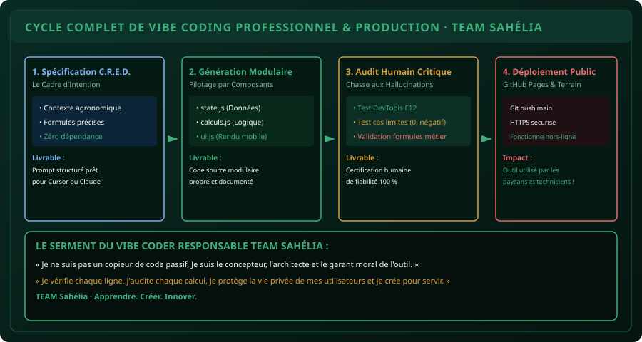

# CHAPITRE 6 : PROJET CAPSTONE · CONCEVOIR UNE APPLICATION MÉTIER PAR VIBE CODING
## Du besoin agronomique réel à la mise en ligne d'un logiciel autonome par le dialogue avec l'IA

> **Manuel :** 08 — Vibe Coding & IA Responsable : Bâtir ses propres outils en pilotant l'Intelligence Artificielle  
> **Auteur :** Sègla Bio KPEROU, Olivier AREMOU & TEAM Sahélia  
> **Temps d’apprentissage :** 50 minutes de lecture + 60 minutes de création guidée  
> **Illustration associée :** `schemas/schema_06_cycle_complet_vibe_coding_production.svg`

---

## 1. Objectifs d'Impact Réel
À la fin de ce chapitre, vous saurez :
1. **Conduire de A à Z un projet logiciel complet** en utilisant exclusivement le Vibe Coding méthodique.
2. **Rédiger le cahier des charges C.R.E.D. parfait** pour un besoin agricole, commercial ou académique spécifique.
3. **Mener le dialogue itératif avec l'IA** sans régression de code, en pilotant la création fichier par fichier.
4. **Appliquer la grille d'audit de sécurité et de conformité** avant la publication officielle.
5. **Déployer l'application sur le web mondial** et valider officiellement votre **Pôle 3 : Code, IA & Vibe Coding** au sein de TEAM Sahélia.

---

## 2. Le Paradigme Réalisé : Vous êtes l'Architecte

Vous avez désormais toutes les armes en main :
- Vous comprenez la structure HTML5, le style CSS3 et la réactivité JavaScript (Manuel 07).
- Vous comprenez comment les LLMs prédisent le code et comment les canaliser avec la méthode C.R.E.D. (Manuel 08, Ch. 1 & 2).
- Vous savez imposer une architecture modulaire étanche (Ch. 3).
- Vous savez débusquer les hallucinations et auditer les résultats mathématiques (Ch. 4).
- Vous savez intégrer l'IA dans votre éditeur Cursor ou utiliser un modèle local hors-ligne (Ch. 5).

Il ne vous reste plus qu'à franchir le pas ultime : **donner vie à votre propre logiciel utile**.



---

## 3. Le Grand Projet Capstone du Pôle 3 : "Sahélia-AgriPilot"

Vous allez concevoir un outil web complet baptisé **`Sahelia-AgriPilot`** :  
Une application de tableau de bord pour exploitants et coopératives agricoles du Bénin, combinant :

1. **Module 1 : Le Simulateur de Doses & Intrants (NPK, Urée, Biopesticides) :**
   - Calcul des besoins exacts selon la culture (Maïs, Coton, Soja, Maraîchage).
   - Calcul des sacs de 50 kg et du devis d'achat en FCFA.
2. **Module 2 : Le Calculateur de Rentabilité & Marge Brute :**
   - Estimation du rendement espéré en tonnes.
   - Saisie du prix de vente au kilogramme sur les marchés locaux (ex: Parakou, Malanville, Glazoué).
   - Calcul automatique de la marge nette prévisionnelle :  
     $\text{Marge} = (\text{Production en kg} \times \text{Prix/kg}) - \text{Coût des intrants}$.
3. **Module 3 : La Persistance & L'Exportation Terrain :**
   - Sauvegarde automatique dans `localStorage`.
   - Bouton de bascule Hors-Ligne / En Ligne.
   - Bouton d'exportation de l'ensemble des fiches en fichier CSV propre pour Excel ou RStudio.

---

## 4. Le Prompt C.R.E.D. Intégral à Soumettre à l'IA

Copiez le prompt d'ingénierie suivant et adaptez-le dans Cursor ou dans votre modèle LLM :

```text
### CONTEXTE :
Je suis ingénieur agronome membre de la communauté TEAM Sahélia au Bénin.
Je dois concevoir une application web mobile de gestion d'exploitations agricoles pour nos techniciens sur le terrain.

### RÔLE :
Agis comme un architecte logiciel frontend senior, expert en JavaScript moderne ES6+, CSS Grid/Flexbox et applications autonomes offline-first.

### EXIGENCES FONCTIONNELLES :
L'application doit être livrée en 3 fichiers propres et modulaires :
1. index.html : Structure sémantique épurée, responsive avec meta viewport.
2. style.css : Design moderne sombre (fond #06100c, accents vert émeraude #10b981 et bleu #3b82f6), typographie Figtree, zéro scroll horizontal sur smartphone.
3. app.js :
   - Formulaire d'ajout d'exploitation : Nom du producteur, Commune (Borgou/Alibori), Superficie (ha), Culture (Maïs, Coton, Soja).
   - Calcul des sacs d'engrais et de la marge brute prévisionnelle en FCFA.
   - Affichage dynamique sous forme de cartes d'exploitations avec badge de rentabilité.
   - Sauvegarde dans localStorage avec gestion des suppressions.
   - Bouton d'export en fichier CSV complet.
   - Indicateur de statut réseau (Online / Offline).

### DÉLIMITATIONS STRICTES :
- Strictement ZÉRO framework externe (pas de React, pas de Tailwind CDN).
- Tout le CSS et le JavaScript doivent fonctionner 100% hors-ligne en mode avion.
- Valide chaque entrée (interdiction des nombres négatifs).
- N'abrège aucun fichier : génère le code intégral de A à Z.
```

---

## 5. La Grille d'Évaluation de Certification TEAM Sahélia

Avant de soumettre votre projet Capstone au comité d'évaluation de TEAM Sahélia, cochez la grille de conformité :

```text
[ ] 1. ERGONOMIE MOBILE : L'outil s'affiche sans débordement sur écran de smartphone (375 px).
[ ] 2. VALIDATION ENTRÉES : Les superficies négatives ou nulles sont bloquées avec message d'alerte.
[ ] 3. CALCULS AGRONOMIQUES : Les doses de sacs sont arrondies au supérieur (Math.ceil).
[ ] 4. PERSISTANCE : En rechargeant la page ou en coupant la connexion, les données restent intactes.
[ ] 5. EXPORT CSV : Le fichier CSV généré s'ouvre proprement dans Excel sans caractères corrompus.
[ ] 6. CODE PROPRE : La console F12 n'affiche aucune erreur rouge d'exécution.
[ ] 7. DÉPLOIEMENT : L'application est en ligne sur GitHub Pages avec URL publique fonctionnelle.
```

---

## 6. Fiche Mémo Récapitulative Détachable

```text
================================================================================
             FICHE MÉMO · CERTIFICATION VIBE CODING PROFESSIONNEL
================================================================================
1. LA FORMULE GAGNANTE DU VIBE CODING :
   Expertise Métier Humaine + Prompt C.R.E.D. Structuré + Audit DevTools Critique
   = Logiciel Utile, Fiable et Déployé en un Temps Record.

2. IMPACT CONSTATÉ SUR LA CARRIÈRE :
   - Capacité à prototyper en 1 après-midi ce qui prenait autrefois 3 mois.
   - Autonomie totale : vous n'attendez plus qu'une équipe informatique développe vos outils.
   - Valorisation immédiate auprès des ONG, institutions de recherche et bailleurs.

3. LE SERMENT DE L'INNOVATEUR SAHÉLIA :
   Créer des outils numériques robustes, sobres et au service du bien commun.
================================================================================
TEAM Sahélia · Apprendre. Créer. Innover.
================================================================================
```
