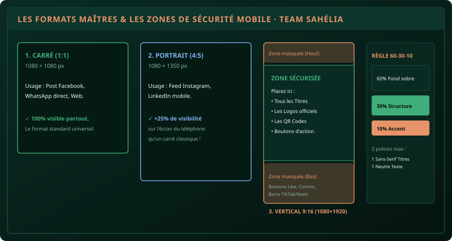

# CHAPITRE 1 : LES 4 RÈGLES DU DESIGN EFFICACE & LES FORMATS RÉSEAUX
## En finir avec l'amateurisme visuel et concevoir des affiches qui convertissent

> **Manuel :** 09 — Création Graphique & Vidéo Mobile pour les Réseaux Sociaux  
> **Auteur :** Sègla Bio KPEROU, Olivier AREMOU & TEAM Sahélia  
> **Temps d’apprentissage :** 25 minutes de lecture + 20 minutes d'atelier  
> **Illustration associée :** `schemas/schema_01_formats_et_safe_zones.svg`

---

## 1. Objectifs d'Impact Réel
À la fin de ce chapitre, vous saurez :
1. **Choisir instantanément le format de pixel exact** selon la plateforme (1:1 pour WhatsApp/Facebook, 4:5 pour LinkedIn, 9:16 pour TikTok/Statut).
2. **Respecter les zones de sécurité (Safe Zones)** pour éviter que les boutons d'applications ne masquent vos titres ou contacts.
3. **Appliquer la règle des couleurs 60-30-10** pour une affiche équilibrée, sobre et haut de gamme.
4. **Hiérarchiser l'information en 3 niveaux** pour capter l'attention en moins d'une seconde.
5. **Exporter un visuel en haute définition sans flou** ni fond blanc disgracieux.

---

## 2. Le Mythe du Don Artistique

Le graphisme professionnel n'est pas une question d'inspiration magique. C'est l'application rigoureuse de **lois cognitives et géométriques** : le contraste de luminosité, l'alignement des éléments et la lisibilité typographique.

Si votre affiche d'invitation à une formation ou de soutenance de mémoire semble « amateur », c'est généralement pour 3 raisons simples :
- Trop de couleurs criardes mélangées sans harmonie.
- Plus de 3 polices de caractères fantaisistes qui s'affrontent.
- Une absence totale de marges (le texte touche le bord du cadre).



---

## 3. Les 3 Formats Maîtres & Les Safe Zones Mobile

| Format | Dimensions Exactes | Réseaux Visés | Avantage Stratégique |
| :--- | :--- | :--- | :--- |
| **Carré (1:1)** | **1080 × 1080 px** | Feed Facebook, Groupes WhatsApp, Web | S'affiche parfaitement sans rognage sur tout écran |
| **Portrait (4:5)** | **1080 × 1350 px** | Feed Instagram, Publications LinkedIn | Occupe 25 % d'espace vertical en plus sur le fil d'actualité |
| **Vertical (9:16)** | **1080 × 1920 px** | TikTok, Instagram Reels, Statuts WhatsApp | Occupe 100 % de l'écran du smartphone en plein écran |

> [!CAUTION]
> ### Erreur classique : Mettre son numéro WhatsApp tout en bas d'un statut
> Sur TikTok, Reels et les statuts WhatsApp, les 350 derniers pixels du bas sont recouverts par la zone de texte, les boutons de partage et les commentaires. Si vous y placez votre contact ou votre logo, personne ne pourra le lire ! Gardez tous vos éléments vitaux dans la **Zone Sécurisée Centrale** (entre Y = 250 px et Y = 1550 px).

---

## 4. La Règle des Couleurs 60 - 30 - 10

Pour garantir l'élégance visuelle :
- **60 % (Couleur dominante de fond) :** Un fond très sobre (Vert profond `#0a2b24` ou Blanc cassé).
- **30 % (Couleur secondaire de structure) :** Les cartes, encadrés et sous-titres (Émeraude `#3fae7a` ou Gris ardoise).
- **10 % (Couleur d'accentuation vive) :** L'or (`#e8946a`) ou l'azur (`#7fb0ee`), réservé exclusivement à l'élément le plus important (la date, le mot-clé de l'événement ou le bouton d'inscription).

---

## 5. Atelier Pratique : Créer son Affiche d'Événement sur Smartphone

Ouvrez Canva (sur smartphone ou ordinateur) ou un outil graphique libre :
1. Choisissez le format **Publication Instagram (Carré 1080 × 1080)**.
2. Définissez le fond avec une couleur sombre sobre (`#0a2b24`).
3. Appliquez la hiérarchie en 3 blocs :
   - **Niveau 1 (Accroche - Corps 48 à 60 pt) :** *« FORMATION PRATIQUE QGIS & PARCELLES »* (Police *Bricolage Grotesque* ou *Montserrat*, couleur blanche).
   - **Niveau 2 (Contexte - Corps 24 à 28 pt) :** *« Samedi 15 Novembre 2026 · Campus Parakou »* (Couleur émeraude `#3fae7a`).
   - **Niveau 3 (Action - Corps 18 pt) :** *« Inscription sur WhatsApp : +229 XX XX XX XX »* (Bouton or `#e8946a`).
4. Laissez au moins 60 pixels de marge tout autour sans aucun texte.
5. Exportez en **PNG Haute Définition**.

---

## 6. Le Défi Communautaire TEAM Sahélia

> ### 🏆 Défi Hebdo n°09 : L'Affiche aux Normes Sahélia
> 
> 1. Concevez votre première affiche d'annonce au format carré (1080×1080) ou vertical (1080×1920) en appliquant la règle 60-30-10 et les marges de sécurité.
> 2. Vérifiez qu'il n'y a que 2 polices de caractères maximum.
> 3. Postez votre affiche sur le canal officiel avec la mention :  
>    *« Défi Manuel 09 - Chapitre 1 Graphisme Validé ! »*.

---

## 7. Fiche Mémo Récapitulative Détachable

```text
================================================================================
             FICHE MÉMO · GRAPHISME & FORMATS RÉSEAUX
================================================================================
1. LES 3 DIMENSIONS OFFICIELLES :
   - Carré 1:1       : 1080 × 1080 px (Facebook, WhatsApp).
   - Portrait 4:5    : 1080 × 1350 px (Instagram feed, LinkedIn).
   - Vertical 9:16   : 1080 × 1920 px (TikTok, Reels, Statuts).

2. RÈGLE 60-30-10 :
   - 60% Fond sobre | 30% Structure | 10% Accent vif (Bouton/Date).

3. TYPOGRAPHIE PROFESSIONNELLE :
   - 2 polices maximum : 1 Sans-serif solide (Titre), 1 Neutre aérée (Corps).

4. MARGES DE SÉCURITÉ :
   - Toujours laisser 60 à 80 px de vide aux bords.
   - En 9:16 : ne rien mettre dans les 350 px du bas (zone recouverte).
================================================================================
TEAM Sahélia · Apprendre. Créer. Innover.
================================================================================
```
