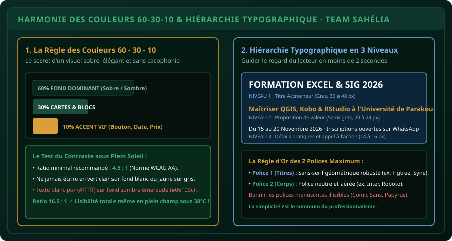

# CHAPITRE 2 : CHARTE GRAPHIQUE, COULEURS & TYPOGRAPHIE D'IMPACT
## Construire une identité visuelle sobre, maîtriser la règle 60-30-10 et éliminer la cacophonie visuelle

> **Manuel :** 09 — Création Graphique & Vidéo Mobile pour les Réseaux Sociaux  
> **Auteur :** Sègla Bio KPEROU, Olivier AREMOU & TEAM Sahélia  
> **Temps d’apprentissage :** 35 minutes de lecture + 30 minutes de création sur Canva / Photopea  
> **Illustration associée :** `schemas/schema_02_harmonie_couleurs_et_typographie.svg`

---

## 1. Objectifs d'Impact Réel
À la fin de ce chapitre, vous saurez :
1. **Comprendre les fondements psychologiques et optiques d'une charte graphique** (cohérence de marque, mémorisation instantanée).
2. **Appliquer rigoureusement la règle d'harmonie des couleurs 60 - 30 - 10**.
3. **Assurer un contraste de luminosité suffisant (normes WCAG AA)** pour que vos affiches soient lisibles en plein soleil sur l'écran d'un smartphone.
4. **Structurer la hiérarchie typographique en 3 niveaux stricts** (Titre accrocheur $\rightarrow$ Proposition de valeur $\rightarrow$ Détails pratiques & Appel à l'action).
5. **Associer deux polices de caractères complémentaires** sans jamais tomber dans la surcharge visuelle.

---

## 2. Pourquoi la Plupart des Affiches Africaines Échouent

Observez les affiches d'événements, d'ateliers ou de soutenances partagées sur les statuts WhatsApp au Bénin :
- Fond rouge vif avec texte jaune et bleu fluo.
- 5 polices de caractères différentes qui s'affrontent (de l'écriture gothique à l'italique fantaisiste).
- Des photos détourées à la hache avec des franges blanches pixélisées.
- Du texte plaqué au bord de l'image sans aucune marge d'aération.

Le cerveau humain rejette inconsciemment ces visuels en moins d'une demi-seconde car ils exigent un effort cognitif trop lourd. Une communication professionnelle réussie n'a pas besoin d'être complexe : elle a besoin d'être **claire, ordonnée et reposante pour l'œil**.



---

## 3. La Règle des Couleurs 60 - 30 - 10 en Pratique

Cette règle universelle, issue de l'architecture d'intérieur et du design d'interface, garantit un équilibre parfait :

1. **60 % : La Couleur Dominante (Le Fond) :**  
   Elle donne l'ambiance générale. Elle doit être sobre, calme et peu saturée :
   - Soit un fond sombre élégant (ex: le vert forêt profond `#06100c` de TEAM Sahélia).
   - Soit un fond clair lumineux (ex: blanc cassé `#f8fafc` ou écru lin).
2. **30 % : La Couleur Secondaire (La Structure & Les Cartes) :**  
   Elle sert à délimiter les blocs, les encadrés et les tableaux (ex: vert émeraude sombre `#1b4d3e` ou gris ardoise).
3. **10 % : La Couleur d'Accent (Le Point Focal Vif) :**  
   Elle attire immédiatement l'œil vers l'information capitale : la date limite, le prix en FCFA ou le bouton d'action WhatsApp (ex: l'or ambré `#d89f3c` ou le vert émeraude vibrant `#10b981`).

> [!CAUTION]
> Si votre couleur d'accent dépasse 15 % de la surface de l'affiche, elle perd son pouvoir d'attraction et redevient du bruit visuel !

---

## 4. La Hiérarchie Typographique en 3 Niveaux

Sur les réseaux sociaux, un lecteur ne "lit" pas une affiche de haut en bas : il la "scanne" visuellement en triangle :

1. **Niveau 1 : Le Titre Principal (Taille 36 à 48 px en gras) :**  
   Doit répondre en 4 mots maximum au sujet central de l'affiche (ex: *FORMATION EXCEL PRO*, *SOUTENANCE DE MASTER*, *CAMPAGNE BIO-COTON*).
2. **Niveau 2 : Le Sous-Titre ou Proposition de Valeur (Taille 20 à 24 px en semi-gras) :**  
   Explique le bénéfice concret pour celui qui regarde (ex: *Maîtriser les TCD et tableaux de bord agronomiques à Parakou*).
3. **Niveau 3 : Les Métadonnées Pratiques & Call-to-Action (Taille 12 à 16 px régulier) :**  
   Date, Lieu, Tarif, Contact WhatsApp et mention de l'institution organisatrice.

### La Règle des Deux Polices Max :
- **Police Titre :** Une police sans empattement (*Sans-Serif*) géométrique et percutante (ex: *Figtree*, *Montserrat*, *Syne*, *Bebas Neue*).
- **Police Corps de texte :** Une police neutre, très lisible même en petite taille sur écran mobile (ex: *Inter*, *Roboto*, *Open Sans*).
- *Interdiction formelle d'utiliser Comic Sans, Papyrus ou des polices cursives manuscrites pour du texte informatif.*

---

## 5. Atelier Pratique : Créer son Gabarit de Marque sur Canva

1. Ouvrez [canva.com](https://canva.com) (ou l'application mobile Canva sur Android).
2. Créez un design au format carré **1080 × 1080 px**.
3. Définissez le fond avec votre couleur dominante (60 %).
4. Activez les repères : **Fichier > Paramètres d'affichage > Afficher les marges** (laissez au moins $60\text{ pixels}$ de vide tout autour).
5. Insérez un bloc rectangulaire semi-transparent pour recevoir le texte (30 %).
6. Utilisez l'outil **Effets > Supprimer l'arrière-plan** sur votre photo de profil ou photo d'épi de maïs pour un détourage net sans franges blanches.
7. Placez le logo officiel TEAM Sahélia dans l'angle supérieur gauche ou supérieur droit.
8. Exportez le fichier au format **PNG haute qualité** (et non en JPEG compressé qui crée du flou autour des textes).

---

## 6. Le Défi Hebdo TEAM Sahélia

> ### 🏆 Défi Hebdo n°09-B : L'Affiche aux Normes Typographiques
> 
> 1. Créez une affiche officielle pour un événement académique, associatif ou commercial réel.
> 2. Appliquez strictement :
>    - La règle 60-30-10.
>    - Maximum 2 polices de caractères.
>    - Les 3 niveaux de hiérarchie visuelle.
>    - Une marge d'aération minimale de 60 px sur les 4 bordures.
> 3. Vérifiez le rendu sur l'écran de votre smartphone en plein jour.
> 4. Postez votre affiche sur le canal officiel avec la mention :  
>    *« Défi Charte Graphique & Typographie Validé ! »*.

---

## 7. Fiche Mémo Récapitulative Détachable

```text
================================================================================
             FICHE MÉMO · CHARTE GRAPHIQUE & TYPOGRAPHIE D'IMPACT
================================================================================
1. LA FORMULE 60-30-10 :
   - 60% : Fond dominant calme (Sombre émeraude ou Blanc cassé).
   - 30% : Conteneurs, cartes et structure secondaire.
   - 10% : Accent vif (Or, Vert fluo, Corail) réservé au bouton ou à la date.

2. COMBINAISON TYPOGRAPHIQUE TYPE :
   - Titre percutant : Montserrat Bold ou Figtree Bold.
   - Corps aéré      : Inter Regular ou Roboto.
   - Nombre de polices maximum : 2.

3. CONTRÔLE QUALITÉ AVANT EXPORTATION :
   [ ] Aucune lettre ne touche la bordure (marge > 60 px respectée).
   [ ] Le contraste texte/fond est supérieur à 4.5:1.
   [ ] Format d'export : PNG pour le graphisme (zéro compression dégradante).
================================================================================
TEAM Sahélia · Apprendre. Créer. Innover.
================================================================================
```
