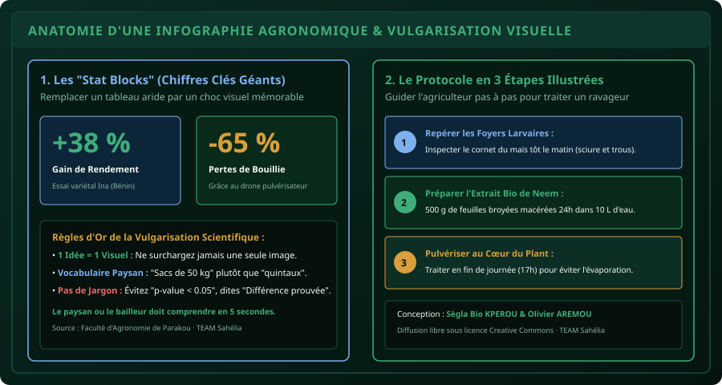

# CHAPITRE 3 : INFOGRAPHIES AGRONOMIQUES & VULGARISATION SCIENTIFIQUE
## Traduire les données d'essais agronomiques et rapports de recherche en fiches visuelles mémorables

> **Manuel :** 09 — Création Graphique & Vidéo Mobile pour les Réseaux Sociaux  
> **Auteur :** Sègla Bio KPEROU, Olivier AREMOU & TEAM Sahélia  
> **Temps d’apprentissage :** 40 minutes de lecture + 35 minutes de mise en pratique  
> **Illustration associée :** `schemas/schema_03_anatomie_infographie_scientifique.svg`  
> **Devise :** TEAM Sahélia · Apprendre. Créer. Innover.

---

## 1. Le Défi de la Vulgarisation Scientifique en Afrique

Chaque année en Afrique de l'Ouest, des centaines de thèses agronomiques, de mémoires d'ingénieurs et de rapports de recherche de l'INRAB, de l'IITA, de l'AfricaRice ou des universités sont rédigés. La grande majorité finit dans des tiroirs poussiéreux ou sur des disques durs oubliés.

Pourquoi ? Parce qu'un document Word de 150 pages avec des tableaux de régression linéaire de 20 colonnes est **inaccessible** :
- Aux producteurs agricoles sur le terrain qui ont besoin de solutions concrètes immédiates.
- Aux responsables d'ONG et bailleurs de fonds (GIZ, Enabel, BAD, Banque Mondiale) qui n'ont que 3 minutes entre deux réunions pour évaluer l'impact d'un projet.
- Aux entrepreneurs agricoles qui cherchent des protocoles validés sur leur téléphone.

Le rôle fondamental de l'agronome-communicant formé par TEAM Sahélia est de devenir la **passerelle visuelle** entre la science dure et l'action de terrain.

---

## 2. Anatomie d'une Infographie Agronomique Performante

Pour qu'un message scientifique soit assimilé en moins de 10 secondes sur un smartphone, votre visuel doit reposer sur 4 blocs anatomiques précis :

### Bloc 1 : L'Accroche Problème / Solution (En-tête)
- Ne commencez jamais par un titre académique rébarbatif (*« Évaluation comparative de l'efficacité insecticide des biopesticides à base de neem sur le niébé en milieu paysan »*).
- Préférez une promesse concrète et opérationnelle :
  > **« Protéger votre champ de niébé sans pesticide chimique : La formule au Neem testée à Parakou »**

### Bloc 2 : Les "Stat Blocks" (Les Chiffres Chocs)
Le cerveau retient un chiffre géant bien plus facilement qu'une phrase longue :
- **Taille de police :** 36 à 48 pt minimum.
- **Formulation :** Un pourcentage d'amélioration (`+38 % de Rendement`) ou une économie financière directe (`-45 000 FCFA/ha sur les intrants`).
- **Légende concise :** Une seule ligne sous le chiffre indiquant la source scientifique (ex: *Essai variétal Ina · INRAB / FSA*).

### Bloc 3 : Le Protocole Séquentiel (Étapes 1, 2, 3)
Remplacez le texte touffu par un cheminement fléché :
1. **Étape 1 (Observation) :** Repérer la présence de 2 larves pour 10 plants.
2. **Étape 2 (Dosage) :** 50 ml d'extrait aqueux dans un pulvérisateur de 16 litres.
3. **Étape 3 (Application) :** Traiter au lever du jour (avant 8h00) sur la face inférieure des feuilles.

### Bloc 4 : Le Pied de Page de Confiance (Crédibilité & Action)
- Logo de l'institution ou de TEAM Sahélia.
- Nom des chercheurs et agronomes référents.
- Contact WhatsApp ou QR Code renvoyant vers le protocole complet en PDF.

---

## 3. Lexique de Traduction : Du Jargon Académique au Langage Terrain

| Jargon Académique (À bannir des affiches) | Traduction Visuelle Terroir (À utiliser) |
| :--- | :--- |
| *« Rendement accru de 3,8 quintaux par hectare »* | **« +8 sacs de 50 kg par hectare récolté »** |
| *« Différence statistiquement significative ($p < 0,05$) »* | **« Efficacité prouvée scientifiquement sur 3 saisons »** |
| *« Matière active dosée à $250\text{ g/l}$ épandue à raison de $2\text{ l/ha}$ »* | **« 2 bouchons doseurs pour un pulvérisateur à dos de 16 L »** |
| *« Déficit hydrique au stade floraison-nouaison »* | **« Manque d'eau au moment où la plante forme ses fleurs »** |
| *« Indice de rentabilité financière ($IRF = 1,42$) »* | **« Pour 10 000 FCFA investis, vous gagnez 14 200 FCFA nets »** |

---

## 4. Outils Gratuits pour Réaliser l'Infographie sur Mobile

Vous n'avez pas besoin d'un ordinateur puissant sous Photoshop. Les trois outils gratuits suivants suffisent :

1. **Canva Mobile :**
   - Créez un projet au format carré `1080 x 1080 px` (Instagram / WhatsApp) ou format portrait `1080 x 1350 px`.
   - Utilisez la grille d'alignement pour espacer uniformément vos 3 étapes.
2. **Photoroom / Remove.bg :**
   - Détourez en 1 clic vos photos de feuilles attaquées, d'insectes ravageurs ou de flacons de biofertilisants pour les poser sur fond transparent.
3. **Flaticon / The Noun Project :**
   - Téléchargez des icônes vectorielles sobres (goutte d'eau, horloge, plante, thermomètre) au format PNG transparent pour illustrer vos consignes sans texte lourd.

---

## 5. Exercice Pratique : La Fiche d'Alerte Chenille Légionnaire

**Mise en situation :**  
Vous êtes consultant agronome à Kandi (Nord Bénin). Une attaque précoce de chenille légionnaire (*Spodoptera frugiperda*) frappe les jeunes parcelles de maïs. Vous devez concevoir une fiche visuelle WhatsApp pour les producteurs de la coopérative.

**Cahier des charges :**
- **En-tête rouge alerte doux (`#e86a6a`) :** « Alerte Chenille Légionnaire : Agir avant 48 heures ».
- **Chiffre choc :** « Jusqu'à 70 % de pertes sans intervention rapide ».
- **Les 3 gestes vitaux :**
  1. Inspecter le cornet des plants de maïs dès 7h du matin.
  2. Épandre une poignée de sable fin ou de cendre de bois dans le cornet si l'attaque est locale.
  3. Traiter au biopesticide homologué à la tombée de la nuit (18h-19h) quand les larves sortent.
- **Pied de page :** Numéro d'urgence WhatsApp de l'animateur relais et signature : *TEAM Sahélia · Apprendre. Créer. Innover.*

---

## 6. Synthèse et Règle d'Or
Une bonne infographie agronomique ne cherche pas à impressionner vos confrères chercheurs, elle cherche à **sauver la récolte d'un producteur** et à **convaincre un financeur en 5 secondes**. Gardez toujours le design épuré, aéré et respectueux des contrastes.
