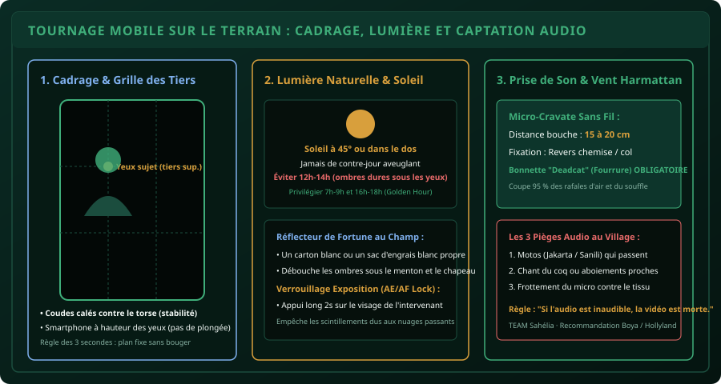

# CHAPITRE 4 : TOURNAGE SMARTPHONE SUR LE TERRAIN : CADRAGE & PRISE DE SON
## Transformer son téléphone portable en outil de reportage agronomique professionnel

> **Manuel :** 09 — Création Graphique & Vidéo Mobile pour les Réseaux Sociaux  
> **Auteur :** Sègla Bio KPEROU, Olivier AREMOU & TEAM Sahélia  
> **Temps d’apprentissage :** 45 minutes de lecture + 40 minutes de tournage d'essai  
> **Illustration associée :** `schemas/schema_04_tournage_terrain_cadrage_et_audio.svg`  
> **Devise :** TEAM Sahélia · Apprendre. Créer. Innover.

---

## 1. La Réalité du Terrain Ouest-Africain

Sur les réseaux sociaux (TikTok, Instagram Reels, LinkedIn, statuts WhatsApp), les internautes pardonnent une image imparfaite, mais ils **ne pardonnent jamais un son inaudible**. Si le vent d'Harmattan sature le micro ou si une moto Sanili assourdissante couvre la voix de l'agronome, la vidéo est balayée en 1 seconde.

Dans ce chapitre, nous allons voir comment obtenir un rendu quasi-télévisuel en plein champ, avec un simple smartphone milieu de gamme (Infinix, Tecno, Samsung Galaxy A, Xiaomi Redmi ou iPhone) sans matériel coûteux.

---

## 2. Préparation du Smartphone : Les 4 Réglages Préliminaires

Avant de poser le pied sur une parcelle agricole, effectuez systématiquement cette checklist :

1. **Nettoyer l'objectif de la caméra (Le réflexe vital) :**  
   Dans la poche ou sous la poussière de latérite, la lentille se couvre d'un film gras invisible. Essuyez-la vigoureusement avec un t-shirt en coton ou une lingette en microfibre. Ce simple geste élimine le voile laiteux et redonne du piqué à l'image.
2. **Activer la Grille 3x3 dans les réglages de l'appareil :**  
   Elle affiche 4 lignes repères sur l'écran pour composer vos plans sans pencher l'horizon.
3. **Paramétrer la résolution :**  
   - Format recommandé : **1080p (Full HD) à 30 images par seconde (fps)**.
   - Si vous prévoyez de faire des ralentis soyeux (ex: chute de grains de maïs, goutte de bouillie pulvérisée), activez le **60 fps**.
   - *Évitez la 4K si vous n'avez pas au moins 128 Go d'espace libre ou un processeur récent, car elle sature la mémoire et fait chauffer le téléphone sous le soleil.*
4. **Verrouiller la mise au point et l'exposition (AE/AF Lock) :**  
   Maintenez votre doigt appuyé 2 secondes sur le visage de l'intervenant jusqu'à voir apparaître le cadenas jaune. Si vous ne le faites pas, l'appareil recalculera la lumière chaque fois qu'un nuage passe ou qu'une feuille bouge, provoquant d'insupportables sauts de luminosité.

---

## 3. Cadrage et Stabilité : Filmer sans Trembler

### A. La Posture du Trépied Humain
Si vous n'avez pas de trépied ni de stabilisateur gyroscopique (gimbal) :
- Tenez le smartphone à **deux mains**.
- Plaquez fermement vos deux **coudes contre votre cage thoracique**.
- Pour faire un mouvement panoramique, ne tournez pas vos poignets : **pivotez tout votre buste à partir du bassin**.
- Respirez calmement et fléchissez légèrement les genoux en avançant.

### B. La Règle des Tiers en Vidéo Verticale (9:16)
- Ne centrez pas obligatoirement le visage au milieu géométrique de l'écran.
- Placez les **yeux de l'orateur sur la ligne horizontale supérieure** de la grille.
- Laissez un espace de tête raisonnable (*headroom*) : ni trop près du bord supérieur (tête coupée), ni trop loin (le corps semble perdu au fond du cadre).

---

## 4. Dompter la Lumière Tropicale

Le soleil du Sahel et des régions soudano-guinéennes est impitoyable entre 11h et 15h : il crée des ombres noires sous les yeux et le nez, et brûle les reflets sur la peau et la végétation.

1. **Les Heures Dorées (Golden Hours) :**  
   Tournez les interviews principales entre **7h00 et 9h30** le matin, ou entre **16h30 et 18h00** en fin d'après-midi. La lumière rasante réchauffe les teintes et flatte les visages.
2. **L'Orientation :**  
   Placez le soleil de biais (à environ 45°) par rapport à l'intervenant, ou placez-le dans votre dos d'opérateur. **Ne filmez jamais face au soleil** (contre-jour), sauf pour un effet artistique de silhouette.
3. **Le Réflecteur de Fortune au Champ :**  
   Si l'orateur porte une casquette ou un chapeau de paille qui assombrit son visage, demandez à un assistant de tenir un sac d'engrais blanc propre ou un carton blanc incliné vers le visage : il renverra la lumière du soleil pour déboucher naturellement les ombres sans aucune batterie !

---

## 5. Captation Audio : Vaincre le Vent et le Bruit Ambiant

### A. L'Équipement Recommandé
- **Option 1 (Budget accessible, ~15 000 à 25 000 FCFA) :** Micro-cravate sans fil double émetteur type K9 ou Boya BY-V20 enfichable directement sur le port USB-C ou Lightning.
- **Option 2 (Qualité broadcast professionnelle, ~60 000 à 100 000 FCFA) :** Kit Boyalink ou Hollyland Lark M1/M2 avec boîtier de recharge.

### B. La Bonnette "Deadcat" (Obligatoire en Extérieur)
La petite mousse noire livrée d'origine ne protège que des postillons en intérieur. En extérieur, installez toujours la bonnette en poils synthétiques (appelée familièrement *deadcat* ou coupe-vent). Ses fibres brisent la turbulence de l'air avant qu'elle n'atteigne la membrane électrostatique du micro.

### C. Emplacement du Micro
- Clipsez le micro sur le col ou la patte de boutonnage de la chemise, à **15-20 centimètres sous le menton**.
- Orientez la capsule vers la bouche.
- Vérifiez que le cordon ou la pince ne frotte pas contre un tissu rugueux lors des mouvements de l'agronome.

---

## 6. La Liste des Plans d'un Reportage Agronomique (Plan de Coupe / B-Roll)

Pour monter une vidéo dynamique de 60 secondes sans ennuyer l'audience, vous ne devez pas laisser l'orateur parler en continu sans illustration. Récoltez systématiquement ces 4 types de plans sur le terrain :

1. **Plan Principal (Face Caméra) :** L'agronome ou l'expert explique le problème (10 à 15 secondes max par prise).
2. **Plans Rapprochés / Macro (B-Roll) :**
   - Gros plan sur la feuille attaquée montrant les chenilles ou les taches foliaires.
   - Les mains du paysan qui effritent la terre ou versent la semence.
   - La buse de pulvérisation qui atomise le liquide.
3. **Plan Moyen :** L'agronome marchant dans la parcelle avec le producteur en train d'échanger.
4. **Plan d'Ensemble :** Vue large de la parcelle montrant l'horizon et l'état général des cultures (ou vue de drone en survol).

---

## 7. Synthèse du Chapitre
Un bon tournage au smartphone repose sur 3 piliers : un objectif impeccable, un cadrage tiers stabilisé, et un micro-cravate équipé de sa bonnette coupe-vent. Avec ces trois éléments, vous produisez des reportages agricoles d'une qualité digne des grandes chaînes de télévision.
