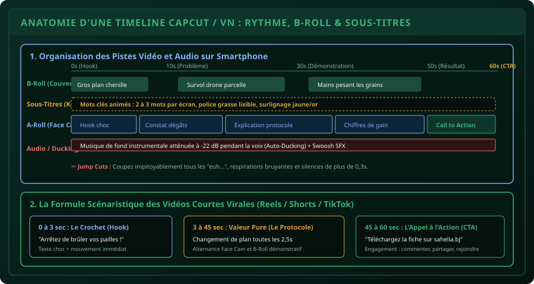

# CHAPITRE 5 : MONTAGE VIDÉO MOBILE : RYTHME, CAPCUT & VN EDITOR
## Dynamiser vos vidéos courtes, automatiser les sous-titres et captiver l'attention en moins de 60 secondes

> **Manuel :** 09 — Création Graphique & Vidéo Mobile pour les Réseaux Sociaux  
> **Auteur :** Sègla Bio KPEROU, Olivier AREMOU & TEAM Sahélia  
> **Temps d’apprentissage :** 45 minutes de lecture + 45 minutes de montage sur smartphone  
> **Illustration associée :** `schemas/schema_05_timeline_montage_capcut_rythme.svg`  
> **Devise :** TEAM Sahélia · Apprendre. Créer. Innover.

---

## 1. La Guerre de l'Attention sur Mobile

L'algorithme de TikTok, des Reels Instagram, des YouTube Shorts et des statuts WhatsApp n'a qu'un seul critère suprême : le **temps de rétention moyen** (*watch time*). Si 50 % des utilisateurs quittent votre vidéo avant la 3ème seconde, elle ne sera plus jamais recommandée.

À l'inverse, si votre vidéo maintient l'attention jusqu'au bout, votre message d'agronome, de chercheur ou d'entrepreneur agricole touchera des dizaines de milliers de personnes à travers toute l'Afrique de l'Ouest.

Le secret d'une vidéo captivante ne réside pas dans des effets spéciaux compliqués, mais dans le **rythme**, la **suppression des temps morts** et la **synchronisation du texte et de l'image**.

---

## 2. Le Choix de l'Outil Mobile : CapCut vs VN Editor

Deux applications gratuites dominent la création de contenu mobile :

| Fonctionnalité | CapCut (Bytedance) | VN Video Editor |
| :--- | :--- | :--- |
| **Sous-titres automatiques** | Exceptionnels en français (reconnaissance IA) | Manuels ou import SRT |
| **Gestion du filigrane de fin** | Bouton de fin supprimable en 1 clic | Aucun filigrane forcé |
| **Pistes multiples (Overlay)** | Jusqu'à 6 couches superposées | Piste B-roll très fluide |
| **Audio Ducking** | Automatique et réglable en pourcentage | Réglage par images clés (*keyframes*) |
| **Disponibilité** | Android & iOS | Android & iOS |

> [!TIP]
> Pour un agronome ou un jeune professionnel débutant, **CapCut** est recommandé pour sa rapidité de génération des sous-titres karaoké. Pensez simplement à supprimer l'écran noir de logo à la fin du projet avant d'exporter.

---

## 3. Étape 1 : Le Découpage Chirurgical (Jump Cuts)

Un bon orateur de terrain hésite, prend son souffle ou cherche ses mots. Dans un cours magistral ou un séminaire en salle, cela passe inaperçu ; en vidéo courte mobile, cela fait fuir l'audience.

1. **La technique du Jump Cut :**
   - Zoomez sur la piste audio principale (A-Roll) pour bien visualiser les formes d'onde sonores.
   - Placez la tête de lecture juste avant le mot et appuyez sur **Diviser** (*Split*).
   - Coupez tout silence de plus de **0,3 seconde**, chaque « euh... », et chaque reprise de souffle.
   - Rapprochez les segments. Le rythme devient incisif et vivant.
2. **La variation d'échelle (Punch-in) :**
   - Sur un même plan fixe, zoomez légèrement (environ 115 %) sur un mot ou une phrase clé.
   - Cela simule une deuxième caméra et réveille le cerveau de l'utilisateur.

---

## 4. Étape 2 : L'Incrustation de B-Roll (Piste de Couverture)

Ne laissez jamais le spectateur regarder le visage de l'intervenant pendant plus de 4 secondes d'affilée sans illustration :
1. Cliquez sur **Superposition / Incrustation** (*Overlay*).
2. Ajoutez votre plan rapproché (B-Roll) : le drone qui décolle, les racines du maïs, le test pH au sol, la pesée des récoltes.
3. Ajustez la durée du clip de couverture entre **1,5 et 3 secondes**.
4. La voix de l'agronome continue de guider l'explication pendant que l'image montre la preuve par les faits.

---

## 5. Étape 3 : Les Sous-Titres Dynamiques (Auto-Captions)

**Plus de 70 % des vidéos sur les réseaux sociaux sont regardées sans le son**, notamment au bureau, dans les transports ou en famille. Sans sous-titres, votre vidéo est invisible pour la majorité.

### Génération et Style Karaoké :
1. Cliquez sur **Texte $\rightarrow$ Sous-titres automatiques**.
2. Choisissez la langue française.
3. Choisissez une animation de type **Karaoké** (le mot prononcé s'allume en jaune ambré `#d89f3c` ou en vert émeraude `#3fae7a` au fur et à mesure).
4. **Correction impérative des termes techniques :** L'intelligence artificielle phonétique fait souvent des erreurs sur le lexique agricole et local :
   - Elle écrira *« haine péka »* $\rightarrow$ Corrigez en **NPK**.
   - Elle écrira *« hymne rab »* $\rightarrow$ Corrigez en **INRAB**.
   - Elle écrira *« bio charre »* $\rightarrow$ Corrigez en **Biochar**.
5. Placez toujours les sous-titres au centre de l'écran ou légèrement au-dessus du tiers inférieur pour qu'ils ne soient pas masqués par le nom du profil TikTok/Reels ou la description.

---

## 6. Étape 4 : Le Mixage Sonore et le Ducking Automatique

Une erreur courante consiste à mettre une musique de fond si forte qu'on ne distingue plus les paroles de l'agronome.

1. **Sélection de la musique :** Choisissez un morceau instrumental rythmé mais discret (Afro-chill, Lo-Fi ou acoustique sans paroles).
2. **Volume de la voix principale :** Réglez la piste voix entre **+5 dB et +10 dB** (ou 100 %).
3. **Auto-Ducking :** Dans CapCut, sélectionnez la piste musicale et cochez **Atténuation audio** (*Ducking*). L'application baisse automatiquement la musique à un niveau très bas dès que l'orateur parle, et remonte subtilement le son pendant les micro-pauses.

---

## 7. Étape 5 : Paramètres d'Exportation Optimale

Pour éviter que WhatsApp ou Instagram ne compressent sauvagement votre vidéo en détruisant sa netteté :
- **Résolution :** 1080p (1920 x 1080 vertical).
- **Fréquence d'images :** 30 fps (standard universel fluide).
- **Débit binaire (Bitrate) :** Recommandé ou standard (ne cochez pas "élevé" inutilement, cela ferait un fichier trop lourd pour les forfaits mobiles africains).
- Taille cible finale pour une vidéo de 60 secondes : **entre 15 Mo et 30 Mo**.

---

## 8. Exercice Pratique : Monter un Reel Agronomique de 45 Secondes
Prenez 3 rushs tournés sur le terrain :
1. 0 à 3s : Accroche face caméra : *« Ne commettez plus cette erreur avec votre compost ! »* (Jump cut franc + texte jaune géant).
2. 3 à 20s : Voix off avec B-roll des tas de compost en décomposition (auto-ducking musical).
3. 20 à 35s : Face caméra avec punch-in zoom expliquant l'arrosage et le retournement.
4. 35 à 45s : Fin avec logo TEAM Sahélia et appel : *« Enregistre ce post pour ton prochain champ ! »*.
