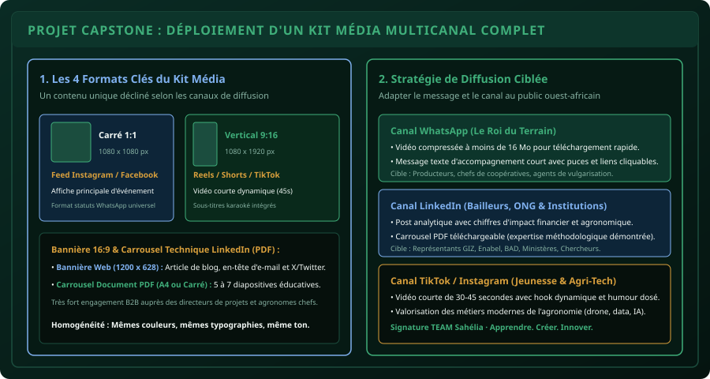

# CHAPITRE 6 : PROJET CAPSTONE : CONCEPTION ET DÉPLOIEMENT D'UN KIT MÉDIA COMPLET
## Concevoir une campagne multicanal professionnelle pour vulgariser une innovation agronomique au Bénin

> **Manuel :** 09 — Création Graphique & Vidéo Mobile pour les Réseaux Sociaux  
> **Auteur :** Sègla Bio KPEROU, Olivier AREMOU & TEAM Sahélia  
> **Temps d’apprentissage :** 1h30 de conception et de production multimédia  
> **Illustration associée :** `schemas/schema_06_kit_media_multicanal_diffusion.svg`  
> **Devise :** TEAM Sahélia · Apprendre. Créer. Innover.

---

## 1. Contexte du Projet Capstone

Félicitations ! Vous avez assimilé les règles fondamentales du graphisme moderne, les safe-zones des réseaux sociaux, la théorie des couleurs 60-30-10, la captation audio de terrain au smartphone et le montage rythmé sur CapCut/VN.

Pour valider ce manuel et obtenir votre certification TEAM Sahélia, vous allez maintenant réaliser un **Kit Média Multicanal complet** pour un projet réel d'innovation agricole.

---

## 2. Le Thème de la Campagne

**Sujet imposé :**  
*« L'Introduction de la Cartographie Multispectrale par Drone et de la Fertilisation de Précision auprès des Coopératives Cotonnières et Vivrières du Nord-Bénin (Borgou-Alibori) »*.

**Objectifs de communication :**
1. Démontrer aux producteurs que la technologie n'est pas un gadget de luxe mais un moyen direct d'économiser **35 000 FCFA par hectare** sur les engrais.
2. Convaincre les chefs de projets d'ONG et partenaires techniques (GIZ, Enabel, BAD) de financer des séances de diagnostic parcellaire.
3. Inciter 50 jeunes agronomes à participer à l'atelier pratique organisé par TEAM Sahélia à Parakou.

---

## 3. Les 4 Livrables Requis

### Livrable 1 : L'Affiche Carrée Principale (1080 x 1080 px)
- Conçue sur Canva Mobile ou Photopea.
- **Palette stricte :** 60 % vert forêt profond (`#06100c`), 30 % vert émeraude (`#1b4d3e`), 10 % or ambré (`#d89f3c`) pour le bouton d'inscription.
- **Typographie :** Titre sans-serif massif en 3 mots max (*« DRONE & FERTILISATION »*), sous-titre explicatif, détails (date, lieu, tarif en FCFA) et logo officiel TEAM Sahélia.
- **Safe zone :** Aucune information vitale à moins de 40 px des bords.

### Livrable 2 : Le Reel / TikTok Vertical (9:16 - 1080 x 1920 px)
- Durée : **45 secondes pile**.
- **0 à 3s (Hook) :** Plan face caméra d'un agronome tenant une poignée d'engrais avec sous-titre jaune géant : *« Vous perdez 1 sac d'engrais sur 3 ! Voici pourquoi. »*.
- **3 à 30s (Démonstration) :** Alternance de plans A-roll et B-roll (survol drone, carte NDVI colorée, buse d'épandage). Voix claire sans hésitations (jump cuts appliqués).
- **30 à 45s (CTA) :** Musique afro-chill qui remonte en fondu avec incrustation du lien WhatsApp pour réserver son diagnostic.

### Livrable 3 : Le Carrousel Technique LinkedIn (Document PDF 5 Slides)
- Format carré ou 4:5 vertical (exporté au format PDF multi-pages).
- **Slide 1 :** Titre magnétique (*« Pourquoi la dose unique d'engrais appauvrit nos sols : Le diagnostic de TEAM Sahélia »*).
- **Slide 2 :** Constat de terrain chiffré (la variabilité spatiale des sols béninois).
- **Slide 3 :** Schéma d'une carte de vigueur NDVI (zones rouges carencées vs zones vertes vigoureuses).
- **Slide 4 :** Bilan économique en FCFA (économie d'intrants vs gain de rendement).
- **Slide 5 :** Profil des experts (Sègla Bio KPEROU, Olivier AREMOU) et invitation à la discussion.

### Livrable 4 : Le Message de Diffusion WhatsApp Structuré
- Rédigé pour être partagé dans les groupes de producteurs et d'étudiants.
- Titre encadré d'émojis sobres (🌱 📍 💡).
- 3 puces claires résumant le bénéfice.
- Lien court d'inscription et contact direct.

---

## 4. Grille d'Évaluation de la Certification (100 Points)

| Critère d'Excellence | Points | Éléments vérifiés |
| :--- | :---: | :--- |
| **Cohérence Graphique & Charte** | 25 pts | Règle 60-30-10 respectée, logo TEAM Sahélia net, aucune police fantaisiste illisible. |
| **Qualité Technique Vidéo & Audio** | 25 pts | Voix parfaitement audible (bonnette deadcat), musique duckée, sous-titres sans fautes. |
| **Pertinence Agronomique & Données** | 25 pts | Chiffres en FCFA réalistes, terminologie scientifique exacte sans jargon hermétique. |
| **Efficacité Multicanal** | 25 pts | Chaque format est optimisé pour sa plateforme cible (WhatsApp, LinkedIn, TikTok). |

---

## 5. Conclusion du Manuel 09
En maîtrisant la chaîne complète de création de contenu — de la règle des tiers au tournage smartphone jusqu'à la diffusion multicanal —, vous n'êtes plus un simple exécutant : vous devenez un **communicateur d'impact**, capable de valoriser le savoir agricole et scientifique partout en Afrique.
