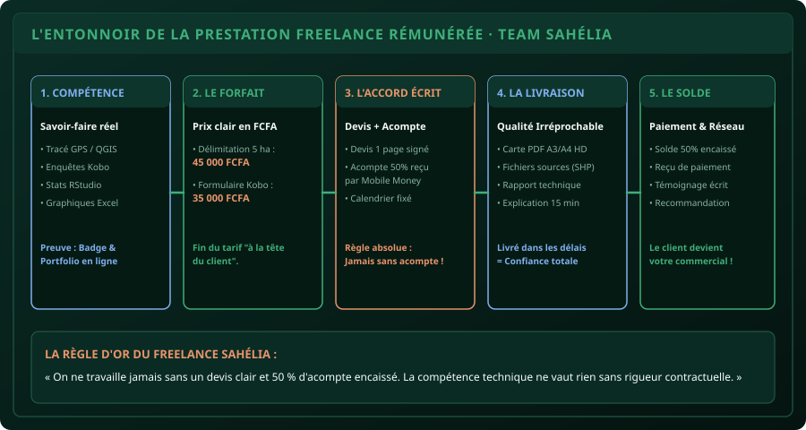

# CHAPITRE 1 : CARTOGRAPHIER SES COMPÉTENCES & FIXER SES TARIFS EN FCFA
## Transformer son savoir académique en prestations rémunérées auprès des ONG et projets

> **Manuel :** 10 — L'Agronome & le Numéricien Freelance  
> **Auteur :** Sègla Bio KPEROU, Olivier AREMOU & TEAM Sahélia  
> **Temps d’apprentissage :** 30 minutes de lecture + 20 minutes d'exercice de pricing  
> **Illustration associée :** `schemas/schema_01_entonnoir_prestation.svg`

---

## 1. Objectifs d'Impact Réel
À la fin de ce chapitre, vous saurez :
1. **Identifier vos 3 compétences techniques les plus recherchées** par les ONG, coopératives et exploitants au Bénin.
2. **Sortir du piège mortel du travail gratuit** ou du sous-tarif qui décrédibilise votre savoir-faire.
3. **Calculer votre Tarif Journalier Moyen (TJM)** réaliste en FCFA.
4. **Construire des offres packagées forfaitaires** (au lieu de vendre des heures floues).
5. **Rédiger un devis professionnel en 1 page** avec la clause de verrouillage d'acompte à 50 %.

---

## 2. Le Paradoxe de l'Étudiant Diplômé au Bénin

Chaque année, des centaines d'étudiants sortent d'université avec des compétences en cartographie QGIS, en traitement statistique ou en collecte de données, mais restent sans revenus pendant des mois en attendant un recrutement officiel.

Pendant ce temps, des dizaines d'ONG locales, de projets de développement rural, de fermes privées et de coopératives agricoles cherchent désespérément des jeunes capables de :
- Délimiter 10 parcelles au GPS et livrer une carte propre.
- Configurer un formulaire d'enquête KoboToolbox pour 5 enquêteurs.
- Nettoyer et formater un rapport d'activité annuel sous Word.

**La différence entre celui qui attend et le freelance qui facture :**
Le freelance ne vend pas un diplôme, il vend **la solution clé en main à un problème précis**, avec un prix clair et un délai ferme.



---

## 3. Grille Tarifaire Réaliste au Bénin (Zone UEMOA)

Ne demandez jamais à un client : *« Vous me donnez combien ? »*. C’est à vous de fixer vos prix :

| Prestation Technique | Livrable Précis | Tarif Forfaitaire Conseillé (Bénin) |
| :--- | :--- | :--- |
| **Pack Cartographie d'Exploitation (≤ 5 ha)** | Relevé terrain + Carte PDF A3 HD + Fichiers shapefiles | **35 000 à 50 000 FCFA** |
| **Configuration d'Enquête KoboToolbox** | Formulaire XLSForm + Déploiement + Briefing enquêteurs (1h) | **30 000 à 45 000 FCFA** |
| **Nettoyage & Analyse Statistique de Données** | Fichier Excel nettoyé + Tableaux croisés + Graphiques de synthèse | **25 000 à 40 000 FCFA** |
| **Mise en Page de Rapport d'Expertise (30-50 pages)** | Gabarit Word aux normes + Sommaire automatique + Export PDF pro | **30 000 à 60 000 FCFA** |
| **Journée de Supervision Terrain (Enquêteur Chef)** | Coordination de l'équipe, audit qualité des fiches | **15 000 à 25 000 FCFA / jour** (+ frais) |

---

## 4. Les Deux Règles Contractuelles Non-Négociables

1. **Règle n°1 : Le Devis Écrit en 1 Page :**
   - Un devis doit préciser exactement ce qui est inclus et **ce qui n'est pas inclus** (ex: *« Le prix inclut 1 aller-retour de corrections mineures. Tout déplacement au-delà de 20 km de Parakou est pris en charge par le client. »*).
2. **Règle n°2 : L'Acompte de 50 % Obligatoire :**
   - Ne commencez JAMAIS un travail, ne prenez pas votre moto pour aller au champ, tant que l'acompte de 50 % n'est pas crédité sur votre compte Mobile Money.
   - Celui qui refuse de verser 50 % d'acompte ne vous paiera pas à la fin.

> [!CAUTION]
> ### Erreur classique : Livrer les fichiers sources avant le solde
> Lorsque vous terminez une carte ou un rapport, envoyez un aperçu en basse définition ou avec un filigrane discret. Ne livrez les shapefiles sources ou le document final imprimable qu'une fois le solde de 50 % encaissé.

---

## 5. Atelier Pratique : Rédiger sa Première Fiche d'Offre

Sur une feuille ou dans Word, rédigez votre première proposition forfaitaire :
- **Intitulé de l'offre :** *Pack Délimitation GPS & Cartographie d'Exploitation*.
- **Pour qui :** Propriétaires terriens, coopératives de soja/maïs, projets agricoles.
- **Ce que le client reçoit :**
  1. Le relevé au smartphone des sommets de la parcelle.
  2. La superficie officielle certifiée en hectares.
  3. Une carte grand format (PDF A3 haute résolution) avec image satellite Google, échelle, Nord et légende.
- **Délai de réalisation :** 48 heures après visite du terrain.
- **Tarif forfaitaire :** 40 000 FCFA (Acompte : 20 000 FCFA à la commande, solde à la livraison).

---

## 6. Le Défi Communautaire TEAM Sahélia

> ### 🏆 Défi Hebdo n°10 : Votre Première Proposition Commerciale
> 
> 1. Définissez votre propre offre de service technique (Cartographie, Kobo, Statistiques ou Rapport Word).
> 2. Rédigez un devis propre en 1 page avec vos coordonnées, le descriptif précis et le tarif en FCFA.
> 3. Postez la capture de votre devis sur le canal de la communauté avec la mention :  
>    *« Défi Manuel 10 - Chapitre 1 Freelance Validé ! »*.

---

## 7. Fiche Mémo Récapitulative Détachable

```text
================================================================================
             FICHE MÉMO · FREELANCE & PRESTATIONS TECHNIQUES
================================================================================
1. VENDRE UN RÉSULTAT, PAS DU TEMPS :
   - Proposez des forfaits clairs (ex: Pack Carte 40 000 FCFA) plutôt qu'un taux horaire flou.

2. LA RÈGLE D'OR FINANCIÈRE :
   - 50% d'acompte avant de commencer (Mobile Money).
   - 50% de solde à la livraison des fichiers finaux.

3. LES 3 COMPÉTENCES EN OR AU BÉNIN :
   - Cartographie de parcelles QGIS (très demandée pour les litiges et projets).
   - Enquêtes KoboToolbox sur smartphone (ONG et thèses).
   - Traitement de données et graphiques Excel/RStudio.
================================================================================
TEAM Sahélia · Apprendre. Créer. Innover.
================================================================================
```
