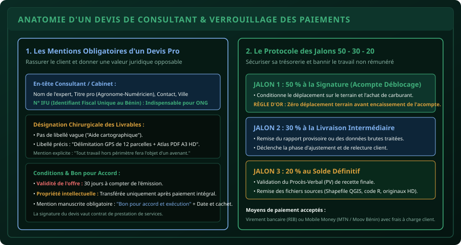

# CHAPITRE 2 : RÉDACTION D'UN DEVIS PROFESSIONNEL & CONDITIONS DE PAIEMENT
## Protéger son travail, éliminer les impayés et sécuriser sa trésorerie grâce aux jalons 50 - 30 - 20

> **Manuel :** 10 — L'Agronome & le Numéricien Freelance  
> **Auteur :** Sègla Bio KPEROU, Olivier AREMOU & TEAM Sahélia  
> **Temps d’apprentissage :** 40 minutes de lecture + 30 minutes de modélisation de devis  
> **Illustration associée :** `schemas/schema_02_anatomie_devis_pro_et_jalons.svg`  
> **Devise :** TEAM Sahélia · Apprendre. Créer. Innover.

---

## 1. Le Piège des Accords Verbaux en Afrique de l'Ouest

Dans l'écosystème professionnel ouest-africain, un piège classique détruit les débuts de carrière de jeunes diplômés talentueux :
> *« Grand frère, commence d'abord le travail de terrain ou fais la carte d'abord, dès que le boss valide le projet la semaine prochaine, on te positionne tes sous ! »*

Neuf fois sur dix, ce scénario se termine par :
- Des nuits blanches passées à nettoyer des bases de données ou à arpenter des parcelles sous le soleil.
- Un livrable transmis par WhatsApp.
- Des relances téléphoniques ignorées, le commanditaire affirmant que le bailleur a reporté le financement ou que le travail n'était qu'un « test bénévole ».

Un agronome-numéricien formé par TEAM Sahélia n'est pas un bénévole silencieux : c'est un **professionnel indépendant**. Toute mission, même pour un proche ou une connaissance, commence par un **devis écrit, chiffré et signé**.

---

## 2. Anatomie d'un Devis Inattaquable

Un devis professionnel n'est pas un simple message WhatsApp avec un chiffre au bout. C'est un document juridique formel en 1 ou 2 pages PDF qui comporte 6 blocs obligatoires :

### Bloc 1 : L'En-tête du Prestataire
- Votre Nom complet et prénom.
- Votre titre professionnel valorisant : *« Agronome Consultant · Spécialiste SIG & Collecte Numérique »*.
- Vos coordonnées : Téléphone (WhatsApp pro), e-mail professionnel, ville de résidence (ex: Parakou / Cotonou, Bénin).
- **Le Numéro IFU (Identifiant Fiscal Unique) :** Au Bénin, toute ONG internationale (GIZ, Enabel, Helvetas), projet d'État ou entreprise formelle exige un IFU pour justifier ses dépenses auprès de la Direction Générale des Impôts (DGI). Obtenir son IFU en tant que travailleur indépendant est gratuit et se fait en ligne en quelques clics.

### Bloc 2 : Les Coordonnées du Client
- Nom de la structure (ONG, Coopérative, Ferme, Entreprise).
- Nom et fonction du responsable signataire.
- N° IFU du client et adresse physique.

### Bloc 3 : L'Identifiant du Document
- Mention : **DEVIS N° DEV-2026-XXXX** (ex: `DEV-2026-001`).
- Date d'émission.
- Durée de validité de l'offre : **30 jours**. *(Passé ce délai, les tarifs et disponibilités doivent être réévalués).*

### Bloc 4 : Le Périmètre Détaillé des Livrables
Bannissez les désignations floues comme *« Travail de SIG »*. Détaillez précisément :
- *Livrable 1 :* Relevé GPS différentiel de 15 parcelles maraîchères dans la commune de N'Dali.
- *Livrable 2 :* Fichier Shapefile (.shp) nettoyé et géoréférencé en WGS 84 / UTM zone 31N.
- *Livrable 3 :* Atlas cartographique au format PDF A3 Haute Définition avec carroyage, légende et logos officiels.
- *Livrable 4 :* Tableau de synthèse Excel des superficies calculées en hectares.

### Bloc 5 : La Séparation des Honoraires et des Frais Logistiques
Ne noyez jamais les frais de transport et d'hébergement dans votre tarif technique :
- **Ligne A (Honoraires d'expertise) :** 150 000 FCFA.
- **Ligne B (Frais de mission terrain remboursables) :** Carburant moto, hébergement 2 nuitées, per diem d'enquête = 65 000 FCFA.
*Si le client souhaite négocier, il réduira la logistique (par exemple en fournissant son propre véhicule), mais ne bradera pas la valeur de votre cerveau.*

### Bloc 6 : Le Cadre de Signature
- Mention manuscrite obligatoire : *« Bon pour accord et commande ferme »*.
- Date, nom du signataire, signature et cachet officiel de l'organisation.

---

## 3. Le Protocole des Jalons 50 - 30 - 20

Ne démarrez jamais une mission avec 0 % d'acompte. La règle d'or de TEAM Sahélia est la suivante :

1. **Jalon 1 (50 % à la commande) :**
   - Conditionne le début effectif de la mission.
   - Permet de financer le déplacement sur le terrain, l'achat de forfaits data et le matériel sans puiser dans vos économies personnelles.
   - **Règle absolue :** Pas d'acompte encaissé = Pas de déplacement terrain.
2. **Jalon 2 (30 % à la remise du livrable provisoire) :**
   - Versé dès la présentation des premières cartes ou du rapport provisoire.
   - Ouvre la fenêtre de relecture et d'ajustements du client (7 jours maximum).
3. **Jalon 3 (20 % au solde final) :**
   - Versé à la livraison des fichiers finaux et signature du Procès-Verbal de recette.

*(Pour les petites missions inférieures à 100 000 FCFA, appliquez un schéma simplifié : **50 % au démarrage et 50 % à la livraison**).*

---

## 4. Les 3 Clauses Protectrices Essentielles

Insérez toujours ces 3 phrases en petits caractères au bas de votre devis :

1. **Clause de Réserve de Propriété :**
   > *« Les fichiers sources (projets QGIS, scripts R, bases KoboToolbox, photographies brutes) demeurent la propriété exclusive du consultant jusqu'au paiement intégral du solde de la facture. »*
2. **Clause de Délimitation des Révisions :**
   > *« Le présent devis inclut un maximum de 2 cycles d'ajustements mineurs conformes aux livrables convenus. Toute modification substantielle des objectifs fera l'objet d'un avenant tarifé. »*
3. **Clause de Frais de Transfert :**
   > *« En cas de règlement par Mobile Money (MTN MoMo, Moov Money), les frais de retrait sont intégralement à la charge du client. »*

---

## 5. Exercice Pratique : Rédiger son Premier Devis Réel
Prenez la fiche de calcul du Chapitre 1 et modélisez sous Word ou Canva un modèle de devis PDF élégant pour une prestation de cartographie de 3 fermes avicoles à Parakou (Montant : 120 000 FCFA TTC, avec acompte de 60 000 FCFA par virement ou MoMo).
