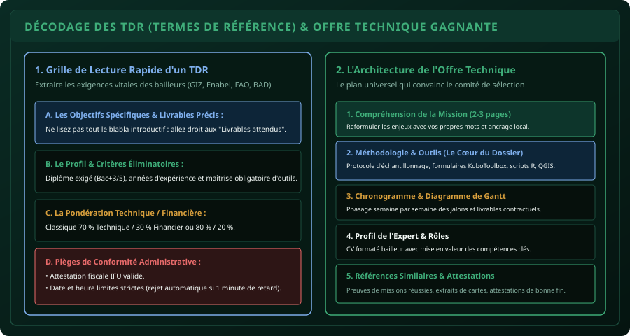

# CHAPITRE 3 : RÉPONDRE AUX TDR & CANDIDATER AUX APPELS D'OFFRES D'ONG
## Décoder les exigences des bailleurs de fonds (GIZ, Enabel, FAO, BAD) et structurer une offre technique percutante

> **Manuel :** 10 — L'Agronome & le Numéricien Freelance  
> **Auteur :** Sègla Bio KPEROU, Olivier AREMOU & TEAM Sahélia  
> **Temps d’apprentissage :** 50 minutes de lecture + 40 minutes d'analyse de cas  
> **Illustration associée :** `schemas/schema_03_decodage_tdr_et_offre_technique.svg`  
> **Devise :** TEAM Sahélia · Apprendre. Créer. Innover.

---

## 1. L'Écosystème des TDR en Afrique de l'Ouest

Les Termes de Référence (TDR) constituent la boussole de tout recrutement de consultant par les institutions internationales, les ministères et les ONG de développement rural :
- Enabel (Coopération belge)
- GIZ (Coopération allemande)
- FAO, PAM, PNUD (Nations Unies)
- BAD (Banque Africaine de Développement), Banque Mondiale
- ONG internationales et nationales (Helvetas, SNV, Care, CeBEDES, etc.)

Ces organisations ne recrutent pas sur la base d'une lettre de motivation vague. Elles publient un TDR officiel décrivant une mission précise (ex: *« Recrutement d'un consultant individuel pour la cartographie des bas-fonds aménagés et la collecte de données socio-économiques dans les départements de l'Atacora et de la Donga »*).

Pour décrocher ces contrats de plusieurs centaines de milliers ou millions de FCFA, vous devez maîtriser les codes rigoureux de l'**Offre Technique** et de l'**Offre Financière**.

---

## 2. La Méthode de Lecture Rapide d'un TDR (En 15 Minutes)

Un TDR fait souvent entre 8 et 25 pages. Ne perdez pas de temps à lire en détail les paragraphes de contexte institutionnel. Allez directement chercher les 4 éléments éliminatoires :

1. **La Section "Profil du Consultant" (Critères de Recevabilité) :**  
   - Quel diplôme est requis (Bac+3, Bac+5 Ingénieur Agronome / Géographe) ?
   - Combien d'années d'expérience sont exigées ?
   - *Si vous êtes jeune diplômé et qu'on demande 5 ans d'expérience, associez-vous avec un consultant senior du réseau TEAM Sahélia en binôme !*
2. **La Section "Livrables Attendus" :**  
   C'est la seule chose sur laquelle vous serez jugé et payé (ex: *Livrable 1 : Note de cadrage méthodologique ; Livrable 2 : Base de données KoboToolbox apurée ; Livrable 3 : Rapport final de diagnostic et cartes QGIS*).
3. **Le Délai et Calendrier :**  
   Combien de jours de travail (Homme/Jour) sont prévus (ex: 20 H/J sur 45 jours calendaires) ? Êtes-vous disponible sans conflit d'agenda ?
4. **Les Pièces Administratives Obligatoires :**  
   N° IFU, attestation de non-faillite, RIB bancaire, copies légalisées des diplômes, attestations de bonne fin d'exécution de missions antérieures.

---

## 3. L'Architecture Universelle d'une Offre Technique Gagnante

Une offre technique professionnelle comprend 5 parties indispensables :

### Partie 1 : Compréhension de la Mission & Analyse des Enjeux (2 à 3 pages)
- Ne faites **JAMAIS** un simple copier-coller des TDR (le comité de sélection le repère immédiatement et vous élimine).
- Reformulez le problème avec vos propres mots : montrez que vous connaissez les réalités du terrain (ex: la saison des pluies dans l'Atacora, l'accès difficile aux pistes rurales, les dynamiques d'organisations paysannes locales).

### Partie 2 : Démarche Méthodologique & Outils Déployés (Le Cœur du Dossier)
C'est ici que l'agronome formé par TEAM Sahélia écrase la concurrence :
- **Phase préparatoire :** Revue documentaire, note de cadrage, paramétrage des formulaires mobiles KoboToolbox avec contraintes de saut et géolocalisation GPS.
- **Phase terrain :** Protocole d'échantillonnage représentatif, formation des enquêteurs locaux, contrôle qualité en temps réel sur serveur cloud.
- **Phase de traitement :** Nettoyage et modélisation statistique sous R/RStudio (ou Python), croisement des données spatiales sous QGIS, production de cartes thématiques conformes aux normes cartographiques internationales.
- **Phase de restitution :** Animation d'un atelier participatif avec diaporama clair et fiches de vulgarisation.

### Partie 3 : Chronogramme Détaillé (Diagramme de Gantt)
Présentez un tableau clair découpé semaine par semaine ou jour par jour montrant l'enchaînement logique des activités et la date précise de remise de chaque livrable.

### Partie 4 : Qualifications & Rôle de l'Expert
- Résumé percutant du parcours académique et technique.
- Justification de la parfaite adéquation entre le profil de l'expert et les exigences du TDR.

### Partie 5 : Références Similaires Attestées
- Tableau récapitulant 3 à 5 missions comparables déjà réalisées.
- Pour chaque mission : Nom du client, montant, période, livrables réalisés, et contact d'un référent joignable.

---

## 4. Structurer l'Offre Financière Ventilée

La plupart des bailleurs exigent que l'offre financière soit soumise dans un fichier ou une enveloppe séparée pour ne pas biaiser la notation technique initiale.

Elle s'articule en 2 sous-budgets :
1. **Les Honoraires de l'Expert (Rémunération du Travail Intellectuel) :**  
   - Calculé en Homme/Jour (H/J).  
   - *Exemple : 20 H/J à 40 000 FCFA/jour = 800 000 FCFA*.
2. **Les Frais Logistiques et Opérationnels (Remboursables ou Forfaitaires) :**  
   - Per diem de séjour sur le terrain (nourriture, hébergement).
   - Déplacements (location de moto ou véhicule, carburant, péages).
   - Honoraires des enquêteurs de terrain (ex: 5 enquêteurs pendant 4 jours à 10 000 FCFA/jour).
   - Frais de communication (forfaits data internet, crédits d'appels).
   - Organisation de l'atelier de restitution (location de salle, pause-café).

---

## 5. Les 4 Erreurs Fatales qui Entraînent le Rejet Immédiat

1. **Le retard de soumission :** Envoyer son offre à 17h01 alors que la date limite était 17h00. Les plateformes automatiques ferment les portes sans aucune pitié.
2. **Le mélange Technique / Financier :** Mentionner un prix dans l'offre technique alors que le règlement imposait deux fichiers séparés (rejet direct pour rupture d'anonymat financier).
3. **Le manque de pièces administratives :** Oublier son attestation IFU ou son RIB bancaire.
4. **La négligence orthographique et visuelle :** Un document mal aligné, avec des polices de caractères hétéroclites et des fautes d'accord donne une impression immédiate de travail bâclé.
