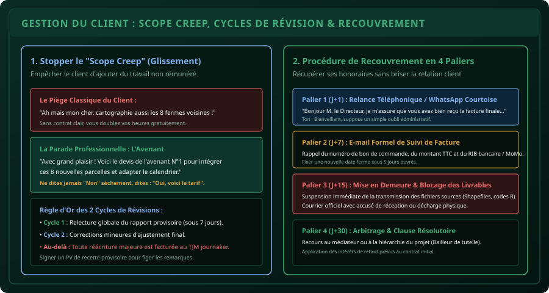

# CHAPITRE 4 : RELATION CLIENT, GESTION DES LITIGES & RECOUVREMENT
## Stopper le glissement de périmètre, cadrer les révisions et récupérer ses impayés avec fermeté et diplomatie

> **Manuel :** 10 — L'Agronome & le Numéricien Freelance  
> **Auteur :** Sègla Bio KPEROU, Olivier AREMOU & TEAM Sahélia  
> **Temps d’apprentissage :** 40 minutes de lecture + 25 minutes de cas pratiques  
> **Illustration associée :** `schemas/schema_04_gestion_revisions_et_recouvrement.svg`  
> **Devise :** TEAM Sahélia · Apprendre. Créer. Innover.

---

## 1. La Psychologie du Client et les Limites Professionnelles

Dans les prestations de conseil agricole et de numérique en Afrique de l'Ouest, les relations professionnelles sont souvent teintées de familiarité :
- Appels téléphoniques le dimanche soir à 22h.
- Messages WhatsApp vocaux décousus remplaçant les e-mails formels.
- Exigences impromptues formulées au milieu d'une conversation amicale.

Si vous laissez le client s'installer dans cette informalité, vous perdez votre autorité technique. Un consultant respecté instaure dès le départ un **cadre de travail rigoureux** :
- Horaires d'échange professionnels (du lundi au vendredi, de 8h à 18h).
- Validation écrite systématique de chaque décision importante.
- Séparation stricte entre courtoisie relationnelle et rigueur contractuelle.

---

## 2. Maîtriser le "Scope Creep" (Glissement de Périmètre)

Le *Scope Creep* est le poison silencieux du freelance. Il se manifeste toujours de manière anodine :
> *« Cher consultant, puisque tu es déjà sur le terrain à Parakou pour cartographier les 10 parcelles de maïs, fais un saut rapide dans le village d'à côté pour relever aussi les 5 bas-fonds rizicoles, ça ne te prendra que quelques minutes ! »*

Si vous acceptez par timidité ou gentillesse :
1. Vous passez 2 jours supplémentaires sous le soleil.
2. Vous usez votre carburant moto.
3. Le client considère que ce travail n'a aucune valeur marchande puisqu'il ne l'a pas payé.

### La Réponse Type du Consultant TEAM Sahélia :
Ne répondez jamais avec agressivité ni avec soumission. Utilisez la technique du **« Oui conditionné »** :
> *« Bonjour M. le Coordonnateur. C'est une excellente initiative d'intégrer ces 5 bas-fonds rizicoles pour enrichir la base de données du projet. Ce travail sort du périmètre initial de notre contrat DEV-2026-004. Je vous prépare immédiatement le devis de l'Avenant N°1 (comprenant 2 jours de terrain supplémentaires et la mise à jour de l'Atlas) afin que vous puissiez le valider pour déblocage des per diem. Dès réception de votre bon pour accord, j'ajuste le planning d'intervention. »*

Cette formulation magique :
- Valorise l'idée du client.
- Rappelle poliment le contrat initial.
- Positionne immédiatement le prix du travail supplémentaire.

---

## 3. Cadrer les Révisions : La Règle des Deux Cycles

Sans règle écrite, certains clients vous feront modifier une carte 15 fois : un jour ils veulent la légende en bleu, le lendemain en vert, puis ils veulent ajouter une route, puis l'enlever.

### Protocole des 2 Cycles d'Ajustement :
1. **Remise du Livrable Provisoire :**  
   Transmettez votre rapport d'analyse ou vos cartes au format PDF avec la mention en filigrane : **« VERSION PROVISOIRE DE VALIDATION »**.
2. **Cycle 1 (Sous 7 jours ouvrés) :**  
   Le client rassemble **TOUTES** ses remarques dans une fiche de relecture unique (pas un message par jour). Vous appliquez les corrections demandées.
3. **Cycle 2 (Ajustement final) :**  
   Le client vérifie que ses remarques ont été prises en compte. Vous effectuez les dernières retouches de détails.
4. **Signature du Procès-Verbal (PV) de Recette Définitive :**  
   Une fois le PV signé, la mission est close. Toute demande ultérieure relève d'une nouvelle commande facturée au Tarif Journalier Moyen (TJM).

---

## 4. Protéger ses Livrables Techniques avant le Paiement

Pour ne jamais être pris en otage par un mauvais payeur :

- **Ne donnez jamais les fichiers sources modifiables avant le solde :**
  - Livrez des cartes en **PDF compressé ou PNG**, jamais le projet QGIS (`.qgz`) ni les couches vecteurs Shapefile (`.shp`).
  - Livrez les rapports d'analyse en **PDF verrouillé**, jamais le fichier Word modifiable (`.docx`).
  - Livrez les visualisations de données sous forme de graphiques finaux, jamais le code source R (`.R`) ou Python.
- **La remise des clés :**  
  Dès que les 20 % du solde final sont positionnés sur votre compte bancaire ou Mobile Money, vous envoyez par lien sécurisé (Google Drive ou WeTransfer) l'archive complète contenant tous les fichiers sources éditables et les données brutes.

---

## 5. Le Protocole de Recouvrement des Impayés en 4 Paliers

Si une facture arrive à échéance sans paiement :

### Palier 1 : J+1 après l'échéance (Le rappel courtois)
- Appel téléphonique ou message WhatsApp poli.
- Posture : On suppose un simple oubli administratif de la comptabilité.
- *« Bonjour Madame la Responsable, je me permets de vous rappeler que la facture N° FAC-2026-012 arrivait à échéance hier. Vous trouverez ci-joint notre RIB / compte MoMo pour le règlement. Belle journée à vous ! »*

### Palier 2 : J+7 (L'e-mail formel de rappel)
- E-mail officiel avec en objet : **« RAPPEL : Facture N° FAC-2026-012 en attente de règlement »**.
- Pièces jointes : Le devis signé, le PV de recette provisoire et la facture.
- Fixation d'une date limite ferme sous 5 jours.

### Palier 3 : J+15 (La mise en demeure et le blocage opérationnel)
- Courrier formel signé de mise en demeure.
- **Action de blocage :** Suspension de toute assistance technique, fermeture des accès au tableau de bord en ligne ou arrêt des formations prévues.

### Palier 4 : J+30 (L'arbitrage institutionnel)
- Si le client est un projet d'ONG ou d'État, contact direct avec le coordonnateur national ou le bailleur de tutelle (les bailleurs détestent que leurs fonds soient associés à des scandales d'impayés de prestataires locaux).
