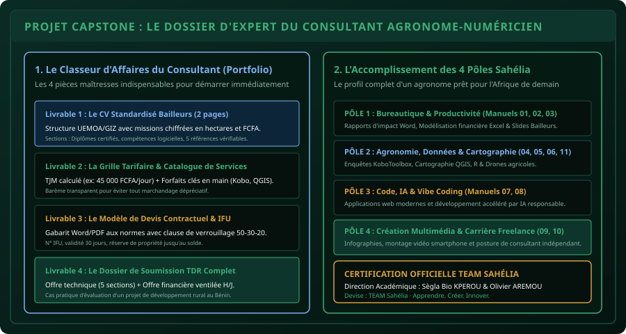

# CHAPITRE 6 : PROJET CAPSTONE : LE DOSSIER COMPLET DU CONSULTANT INDÉPENDANT
## Assembler son portfolio d'affaires, valider la certification et devenir un acteur majeur du développement agricole africain

> **Manuel :** 10 — L'Agronome & le Numéricien Freelance  
> **Auteur :** Sègla Bio KPEROU, Olivier AREMOU & TEAM Sahélia  
> **Temps d’apprentissage :** 2 heures de synthèse et d'assemblage de documents  
> **Illustration associée :** `schemas/schema_06_portfolio_complet_consultant_sahelia.svg`  
> **Devise :** TEAM Sahélia · Apprendre. Créer. Innover.

---

## 1. L'Aboutissement d'un Parcours d'Excellence

Vous êtes arrivé au terme du Manuel 10 et au point culminant de l'ensemble du curriculum d'excellence fondé par **Sègla Bio KPEROU**, **Olivier AREMOU** et le collectif **TEAM Sahélia**.

Tout au long des 4 grands pôles de formation :
1. Vous avez dompté les standards internationaux de la bureautique et de la productivité d'affaires (Word, Excel, PowerPoint).
2. Vous êtes descendu sur le terrain agronomique armé de KoboToolbox, avez cartographié les terroirs sous QGIS, analysé les essais agronomiques sous RStudio, et piloté des drones agricoles de cartographie et de pulvérisation.
3. Vous avez exploré le code moderne (HTML5, CSS3, JavaScript) et la révolution du *Vibe Coding* guidé par l'intelligence artificielle responsable.
4. Vous avez appris à transformer cette science en communication visuelle captivante et en prestations de conseil hautement rémunérées.

Le projet Capstone de ce manuel consiste à assembler votre **Dossier d'Expert Indépendant (Portfolio d'Affaires)**, prêt à être déposé auprès des bailleurs de fonds et des partenaires techniques dès demain matin.

---

## 2. Les 4 Livrables du Dossier d'Expert

Pour valider votre statut de consultant indépendant certifié par TEAM Sahélia, vous devez constituer un classeur professionnel contenant 4 documents réels :

### Livrable 1 : Le CV Standardisé d'Expert Bailleurs (Format 2 pages)
- En-tête professionnel avec N° IFU, contact WhatsApp, profil LinkedIn optimisé et ville de résidence.
- **Synthèse de profil (4 lignes) :** Positionnement d'agronome-numéricien spécialiste de la donnée territoriale et de l'innovation agricole.
- **Compétences techniques clés :** SIG (QGIS), Enquêtes mobiles (KoboToolbox), Traitement statistique (R/RStudio), Drones (DJI Agras & Mavic Enterprise), Création multimédia (Canva, CapCut).
- **Expériences et Missions :** Chaque expérience doit être quantifiée (*« Cartographie de 180 hectares »*, *« Formation de 25 enquêteurs »*, *« Analyse statistique de 12 essais variétaux »*).
- **Références vérifiables :** Noms, fonctions et contacts de 3 encadreurs ou chefs de projets joignables.

### Livrable 2 : La Grille Tarifaire Officielle & Catalogue de Services
Un document élégant d'une page au format PDF présentant :
- Votre Tarif Journalier Moyen (TJM) en FCFA.
- Vos 4 packages de services phares :
  1. *Pack Délimitation & Atlas Cartographique QGIS* (parcelle ≤ 10 ha).
  2. *Pack Configuration & Déploiement d'Enquête KoboToolbox*.
  3. *Pack Traitement Statistique & Analyse Graphique de Données R*.
  4. *Pack Mission Photogrammétrique / Diagnostic Vigueur par Drone*.
- Les conditions générales de vente (délais d'exécution, conditions de paiement, politique de per diem).

### Livrable 3 : Le Devis Type Contractuel Sécurisé
- Numéroté au format standard `DEV-2026-XXXX`.
- Mentionnant explicitement le protocole des **jalons 50 - 30 - 20**.
- Intégrant les clauses de réserve de propriété intellectuelle, de limitation à 2 cycles de révisions et de prise en charge des frais de transfert Mobile Money.

### Livrable 4 : Le Dossier Complet de Réponse à un Appel d'Offres Simulé
Rédigé sur la base des Termes de Référence d'un projet de développement rural (ex: projet de valorisation des bas-fonds maraîchers dans l'Alibori) :
- **L'Offre Technique (10 pages) :**
  1. Compréhension de la mission et analyse des enjeux locaux.
  2. Approche méthodologique détaillée pas à pas.
  3. Chronogramme d'exécution (Diagramme de Gantt).
  4. Profil de l'expert.
  5. Références similaires.
- **L'Offre Financière sous pli distinct :**
  - Ventilation précise entre honoraires (H/J) et frais logistiques remboursables.

---

## 3. Grille de Notation et Validation de la Certification (100 Points)

| Épreuve de Certification | Points | Critères d'Évaluation |
| :--- | :---: | :--- |
| **CV d'Expert & Positionnement** | 20 pts | Lisibilité, chiffres d'impact terrain, absence totale de formules passives. |
| **Cohérence Tarifaire & Devis Pro** | 25 pts | Prix réalistes en FCFA pour la zone UEMOA, présence de l'IFU, clauses juridiques. |
| **Rigueur de l'Offre Technique** | 35 pts | Méthodologie scientifique solide, mobilisation des outils modernes (QGIS, R, Kobo, Drones). |
| **Présentation & Identité Visuelle** | 20 pts | Respect de la charte graphique sobre, clarté rédactionnelle, orthographe irréprochable. |

---

## 4. Message de Clôture de la Direction Académique de TEAM Sahélia

> *« Chers étudiants, chers confrères agronomes et professionnels du numérique,*  
>  
> *Le savoir n'a de valeur que lorsqu'il transforme la réalité. À travers ce programme d'excellence, nous n'avons pas simplement voulu vous enseigner des logiciels ou des lignes de code : nous avons voulu forger une génération de praticiens rigoureux, autonomes et audacieux.*  
>  
> *L'Afrique de l'Ouest n'a plus besoin d'observateurs passifs des crises agricoles et climatiques. Elle a besoin d'ingénieurs de terrain capables de cartographier un bas-fond avec précision le matin, d'analyser les données statistiques l'après-midi, de vulgariser les résultats en vidéo le soir, et de négocier des contrats d'expertise de haut niveau avec les plus grandes institutions internationales.*  
>  
> *Portez haut les valeurs de TEAM Sahélia : la rigueur scientifique, l'intégrité professionnelle et la solidarité panafricaine. Ne bradez jamais votre travail. Continuez d'apprendre chaque jour, d'expérimenter sans crainte et d'innover pour nos terroirs. »*  
>  
> **Sègla Bio KPEROU & Olivier AREMOU**  
> *Fondateurs & Directeurs de Formation · TEAM Sahélia*  
> **« TEAM Sahélia · Apprendre. Créer. Innover. »**
